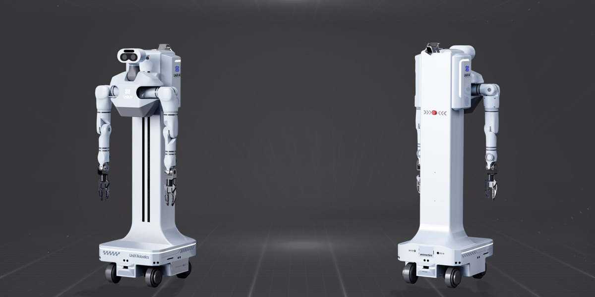
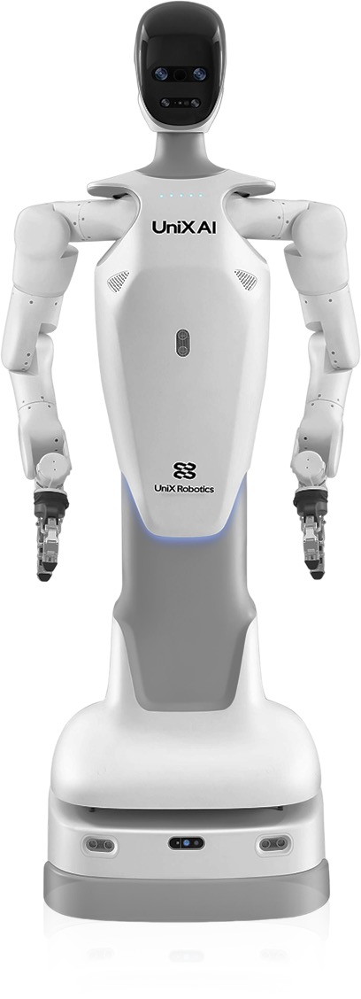
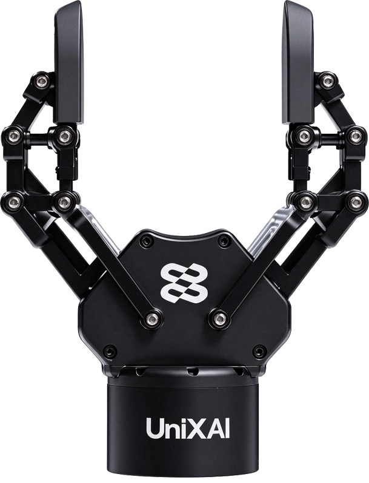
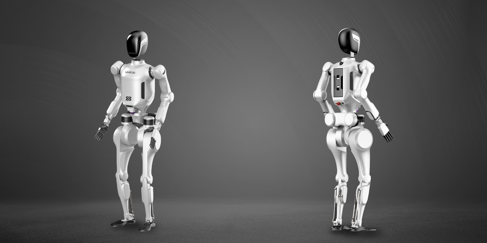

# UniX AI × T04 — Products and Solutions

⬆ [UniX AI profile](../UniX-AI.md) · [Brief](UniX-AI-T04-1-Brief.md) · [Playbook](UniX-AI-T04-3-Playbook.md)

> **Read this first:** UniX AI markets "Elderly Care & Companionship" as a solution, but the website entry has **no page behind it** and no care deployment is named anywhere. Everything below is about how its household / hotel service robots can be *repurposed* for care. Which robot is actually on site is not confirmed.
> Research note: track-specific web search was unavailable when this file was written; findings rest on the official site and the company's 2026 press releases. Anything newer than Aug 2026 may be missing.

## Relevant products (ranked for this track)

### Panther

**Role in T04:** best assistive-manipulation body — reaches from the floor to high shelves, moves sideways in tight rooms, built for household use.

| Track-relevant spec | Value (official page) |
|---|---|
| Height / torso lift | 1.62–1.72 m · **800 mm** lift, works down to floor level |
| Arms | 2 × 8-DoF, **12 kg** dual-arm payload, 982 mm reach, ±0.5 mm repeatability |
| Base | 4-wheel-steer + 4-wheel-drive omnidirectional · **2 m/s** max · min. passage **65 cm** |
| Battery | **4–8 h** (48 V platform) |
| Sensors | Front + rear 360° LiDAR, dual RGB head cameras; 3D LiDAR and RGBD optional |
| Voice hardware | 6-mic circular array, dual speakers |
| End effector | UniPicker Pro gripper; "compatible with dexterous hands" |
| Compute | Optional up to 2070 TOPS on board |
| Arm force / torque sensing, collision detection, e-stop, IP rating, weight | not public |

- **Status:** ✅ launched 8 Apr 2026, deliveries started (company timeline also lists a Sep 2025 release). **Price:** not public.
- **Developer interface:** product page mentions only pre-loaded "L4-level" applications and fast learning. No API, ROS 2 or language details published. ⚠️ unverified what teams may control.

### Wanda 2.0

**Role in T04:** the most likely robot on site; long-shift fetch / serve / tidy assistant and voice companion on wheels.

| Track-relevant spec | Value (official page) |
|---|---|
| Height / torso lift | 1.40–1.68 m · 280 mm lift · touch height up to **1.8 m** |
| Arms | 2 × 8-DoF, **12 kg** dual-arm (6 kg single-arm) payload, 982 mm reach, ±0.5 mm |
| Base | Differential drive · **1.5 m/s** max · min. passage **75 cm** · obstacle avoidance |
| Battery | **8–16 h** |
| Sensors | 360° LiDAR, head RGB + RGBD, base RGBD, ultrasonic |
| Voice hardware | 6-mic circular array (speaker output assumed — ⚠️ unverified) |
| End effector | Two-finger biomimetic gripper or underactuated adaptive gripper |
| Compute | Up to 275 TOPS on board |
| Floor-level reach | ⚠️ unverified — the 280 mm lift is much shorter than Panther's; test before planning floor pick-up |
| Arm force sensing, collision detection, e-stop, IP rating, weight | not public |

- **Status:** ✅ mass production since 2025. **Price:** not public.
- **Developer interface:** "supports customization for research, education and industry" (application page); no SDK details published.

### UniPicker Pro

**Role in T04:** gentle grasping of everyday objects (cups, bottles, pill boxes, remote controls, clothing).

| Spec | Value |
|---|---|
| Max grip force | **100 N** |
| Max payload | up to 10 kg |
| Open / close time | 0.2 s |
| Weight | 400 g / 600 g (variants not specified) |
| Control | Hybrid force–velocity–position |
| Tactile sensor, stroke width, comms interface | not public |

- **Status:** ✅ ships on the robots. **Price:** not public. Whether grip force can be set from user code: not public.

### UniFlex / UniTouch / UniCortex

**Role in T04:** the source of the pre-loaded skills you would compose. UniFlex = imitation learning from demonstrations; UniTouch = vision-tactile model; UniCortex = long-horizon task planner.

- **Status:** ✅ on-robot only; no weights, code, benchmarks or docs released.
- **What it could give you:** teach one new care skill from demonstrations (e.g. "hand over the pill box") — only if the vendor team runs the data-collection and training loop with you. Turnaround time: not public.

### Martian

**Role in T04:** marginal. Bipedal (148 cm, 40 kg, 5 kg payload, 11-DoF hand) — less stable and less payload than the wheeled robots, so a poor choice near frail people. Only reason to consider it: it is the **one product whose page promises high- and low-level APIs** for secondary development. Battery runtime not public.

### Wanda 3.0

🧪 CES 2026 preview only (household demos: tea, dishes, clothes). No specs; probably the generation sold as Panther (⚠️ unverified). Not a planning option.

## What UniX AI already does in this domain

**Nothing confirmed in elder care or rehabilitation.** No named care home, clinic, pilot or partner was found. Adjacent evidence:

| Date | What | Relevance to T04 | Source |
|---|---|---|---|
| Aug 2025 | 2 golds + 1 silver in hotel room service and reception at the World Humanoid Robot Games | Room tidying and guiding skills transfer to care rooms | [Household & Hotel page](https://www.unix-group.ai/Household-Hotel) |
| Jan 2026 | CES household zone: tea-making, dishwashing, clothes organising; hotel zone: wiping, bed-making, restocking, waste sorting | Daily-living chores | [CES release](https://www.webull.com/news/14134140025406464) |
| 31 Mar 2026 | Fully autonomous tea-making demo, Shenzhen | Long-horizon serve-a-drink task | [Panther release](https://technode.global/prnasia/unix-ai-introduces-panther-the-worlds-first-service-humanoid-robot-to-enter-real-household-deployment-powered-by-its-differentiated-wheeled-dual-arm-architecture/) |
| 8 Apr 2026 | Panther launch with a video in a real household; "elder care and companionship" listed among target home scenarios | Company claim; no detail on care tasks | same release |
| Undated | Website lists "Elderly Care & Companionship" as a solution tile and a contact-form industry (plus "Medical") | Label only — no page, no content | [Applications](https://www.unix-group.ai/Applications) |

## What they are building next in this domain

- **Household is the stated next market** (Apr 2026 release): the company wants its robots in real homes and scaled to 1,000 units/month. 🔭
- **Elder care** is named as a home scenario but with **no product, feature or pilot announced**. 🔭
- *Inference:* a company selling a home robot in China will be pushed toward ageing-at-home use cases; a hackathon care demo is plausibly interesting to them, which may make the on-site engineers cooperative. Not a stated plan.
- No health-sensing, safety-certification or medical-device plans are public.

## Software, models and data that help for this track

| Asset | Available? | Use for T04 |
|---|---|---|
| Pre-loaded skills (tea-making, tidying, wiping, delivery, guiding) | ✅ on robot; exact list on site not public | Building blocks for a care routine |
| Teleoperation (local and remote, "millisecond-level" public-network latency) | Claimed on the official application page; tooling not public ⚠️ unverified | Tele-care / family avatar; fallback when autonomy fails |
| "Fully open software and hardware interfaces for customization" | Claimed on the same page; no docs ⚠️ unverified | Ask what this means in practice |
| Demonstration learning (UniFlex) | On-robot; process not public | One custom skill, vendor-assisted |
| SDK, ROS 2 packages, URDF / simulation, datasets, model weights, GitHub | **not public** | — |

Bring your own for the layer above the robot (none of this is vendor-provided): speech-to-text and text-to-speech, an LLM for dialogue and task selection, camera-based pose estimation for fall detection or exercise counting. Run it on a laptop and call the robot through whatever trigger the UniX team exposes.

## Gaps and limits for this track

- **No care track record** — no deployment, study or care-specific feature.
- **Safety around frail people is undocumented:** no published arm force / torque sensing, collision detection, e-stop behaviour, speed limits or certification; robot weight not public. Treat as *no physical contact*; hand over via a table or tray.
- **Developer access is the make-or-break unknown** — no public SDK or docs.
- **No rehab-specific capability:** no force-controlled contact, no body-weight support, no patient sensing.
- **Indoor flat floors only;** thresholds, ramps and lift use are not documented. Wanda 2.0 needs 75 cm passages, Panther 65 cm.
- **Voice / language:** dialogue software and supported languages (German, French, English?) are not public — plan your own.
- **Privacy:** on-board cameras in a care setting; data handling and cloud dependence not public.

## Sources
- [Panther product page](https://www.unix-group.ai/Panther)
- [Wanda 2.0 product page](https://www.unix-group.ai/Wanda)
- [UniPicker Pro product page](https://www.unix-group.ai/UniPicker)
- [Martian product page](https://www.unix-group.ai/Martian)
- [Household & Hotel application page](https://www.unix-group.ai/Household-Hotel)
- [Applications overview](https://www.unix-group.ai/Applications)
- [About UniX AI (timeline)](https://www.unix-group.ai/About-Unix-AI)
- [UniX AI home page (navigation: elder-care entry has no page)](https://www.unix-group.ai)
- [Press release, 2 Jan 2026: CES 2026 demos (via Webull / PR Newswire)](https://www.webull.com/news/14134140025406464)
- [Press release, 8 Apr 2026: Panther launch (via TechNode Global / PR Newswire Asia)](https://technode.global/prnasia/unix-ai-introduces-panther-the-worlds-first-service-humanoid-robot-to-enter-real-household-deployment-powered-by-its-differentiated-wheeled-dual-arm-architecture/)
- [UniX AI company profile (this repository)](../UniX-AI.md)
