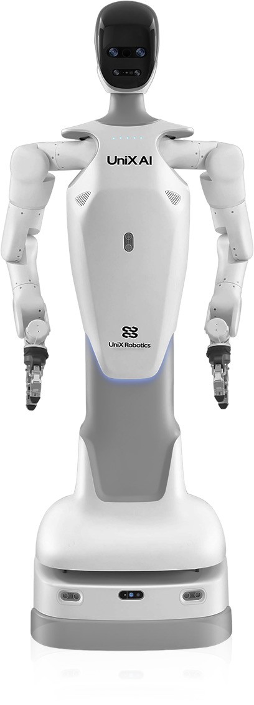
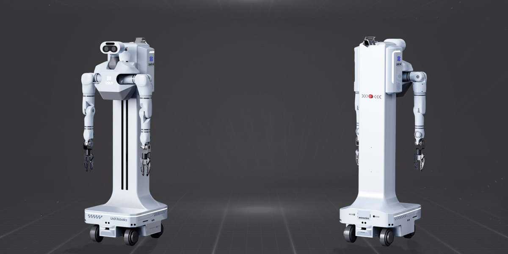
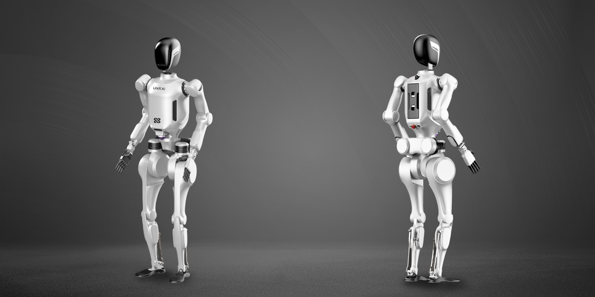
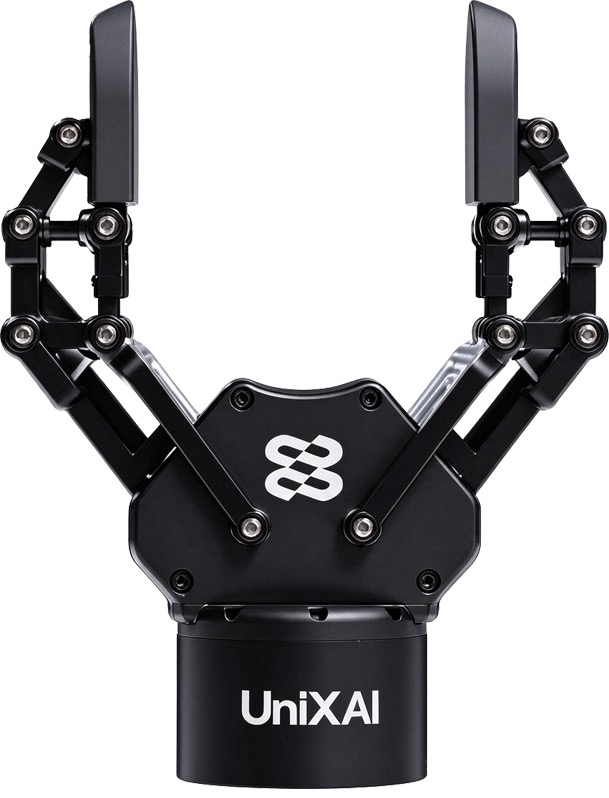

# UniX AI — Product Portfolio

⬆ [UniX AI profile](UniX-AI.md) · [Developer guide](UniX-AI-Developer-Guide.md) · [Roadmap and strategy](UniX-AI-Roadmap-and-Strategy.md)

> **Read this first:** UniX AI sells four catalogue products (two wheeled dual-arm humanoids, one biped, one gripper). All prices are "contact us". **No public SDK, docs or GitHub** — only the Martian page promises development APIs. Specs below are taken from the official product pages as fetched on 2026-11-14; anything else is flagged.

## Lineup map

Track relevance: ● strong · ◐ partial · ○ none

| Product | Category | Status | Launched | Price (if public) | Positioning (one line) | T01 | T02 | T03 | T04 |
|---|---|---|---|---|---|---|---|---|---|
| **Wanda 2.0** | Wheeled dual-arm humanoid | ✅ | Released Dec 2024, mass production May 2025 (company timeline) | not public | Volume model: long-runtime indoor service robot for hotel, retail, reception, patrol | ● | ◐ | ◐ | ● |
| **Panther** | Full-size wheeled dual-arm humanoid (4WS + 4WD) | ✅ | Press launch **8 Apr 2026**; company timeline lists "Panther Release" at 2025.09 (⚠️ unverified which is the first public showing) | not public | Flagship: floor-to-head reach, omnidirectional base, heavier compute option, household focus | ● | ◐ | ◐ | ● |
| **Martian** | Bipedal humanoid | ✅ listed ("contact us") | Debut Aug 2024 (WRC); "Martian 2.0" upgrade Mar 2026 (company timeline, ⚠️ date pairing inferred from list order) | not public | Small biped with dexterous hands and the only stated dev APIs | ◐ | ◐ | ○ | ◐ |
| **UniPicker Pro** | Underactuated adaptive gripper | ✅ | not public (product image uploaded to site Nov 2026) | not public | Fast, strong two-finger end effector used on Panther | ◐ | ◐ | ◐ | ◐ |
| **Wanda 3.0** | Wheeled dual-arm humanoid | 🧪 | Shown at CES, Jan 2026 | not public | Preview name only; no spec sheet; likely what shipped as Panther (⚠️ unverified) | ○ | ○ | ○ | ○ |
| **UniFlex / UniTouch / UniCortex** | Algorithm stack (software) | ✅ on-robot only | not public | not sold separately | Imitation learning + vision-tactile model + long-horizon planner behind the pre-loaded skills | ◐ | ◐ | ◐ | ◐ |

## Products

### Wanda 2.0

Wheeled dual-arm service humanoid on a differential-drive base with a lifting torso. The volume product and the most likely unit on site. The company lists it for research and education as well as commercial service.

| Spec | Value |
|---|---|
| Height | **1,400–1,680 mm** (torso lift **280 mm**) |
| Degrees of freedom | 23 total (⚠️ unverified in this pass; from company profile research) · arms **8 DoF each** ("4+1+3" shoulder-elbow-wrist) · head 2 DoF (yaw ±90°, pitch ±30°) |
| Payload | **12 kg** dual-arm · **6 kg** single-arm |
| Reach | **982 mm** single-arm |
| Repeatability | **±0.5 mm** at end effector |
| Max speed | **1.5 m/s** |
| Battery life | **8–16 h** (capacity not public) |
| Base | Differential drive, hub motors ("silent chassis") · min. passage width **75 cm** |
| Sensors | 360° LiDAR · ultrasonic · base RGBD camera · head dual RGB + RGBD · 6-mic circular array |
| Compute | up to **275 TOPS** (chip vendor not public) |
| End effector | Biomimetic two-finger adaptive gripper (underactuated) |
| Weight, connectivity, IP rating | not public |

- **Variants:** none published. No EDU / developer edition is listed; API access level is not public.
- **Software:** "pre-loaded L4-level applications", "fast learning and rapid deployment" (vendor wording; no API detail).
- **Typical applications:** hotel room service and housekeeping, reception and guiding, retail and autonomous stores, catering, patrol and security, elderly companionship.
- **Limits for Leukerbad:** indoor flat floors only; 75 cm clearance needed; no stairs, slopes or snow.
- **Official page:** [unix-group.ai/Wanda](https://www.unix-group.ai/Wanda)

### Panther

Third-generation full-size wheeled dual-arm humanoid. Compared with Wanda 2.0: omnidirectional base, **800 mm** torso stroke that reaches the floor, 48 V power platform, narrower passage width, optional high-end compute — but **half the battery life**.

| Spec | Value |
|---|---|
| Height | **1,620–1,720 mm** · torso lift stroke **800 mm** (ground-level operation) |
| Degrees of freedom | **34** total · arms **8 DoF each** · head 2 DoF (yaw ±90°, pitch +20° / −86°) |
| Payload | **12 kg** dual-arm |
| Reach | **982 mm** single-arm |
| Repeatability | **±0.5 mm** |
| Max speed | **2 m/s** |
| Battery life | **4–8 h** · **48 V** platform |
| Base | Four-wheel steering + four-wheel drive omnidirectional chassis · min. passage width **65 cm** |
| Sensors | Front and rear 360° LiDAR · head dual RGB · top 3D LiDAR (optional) · RGBD camera (optional) |
| Voice | Dual speakers · 6-mic circular array |
| Compute | optional edge compute up to **2,070 TOPS** (chip vendor not public) |
| End effector | UniPicker Pro gripper · stated as compatible with dexterous hands (model not named) |
| Weight, connectivity, IP rating | not public |

- **Variants:** the official page text reads "Panther Pro Max Mini" in one sentence, which may indicate Pro / Max / Mini editions — no per-edition specs are published and the launch press release names none (⚠️ unverified).
- **Demonstrated skills:** autonomous tea-making (Morgan Stanley China Summit, 31 Mar 2026); household deployment video (press release).
- **Typical applications:** household chores, hotels, reception, retail, guided tours, elderly care and companionship, security patrol, research and education.
- **Why pick it over Wanda 2.0:** picking things up from the floor (T04 fall-risk and tidy-up scenarios), sideways moves in tight rooms, more on-board compute. **Why not:** shorter runtime, newer, probably fewer units.
- **Official page:** [unix-group.ai/Panther](https://www.unix-group.ai/Panther)

### Martian

Compact bipedal humanoid with dexterous hands. The only UniX product whose page states **high- and low-level API interfaces for secondary development**. Rarely seen in recent demos, so less likely to be on site.

| Spec | Value |
|---|---|
| Height / weight | **148 cm** / **40 kg** |
| Degrees of freedom | arms 7 each (14) · legs 6 each (12) · waist 3 · head 2 · hand **11 DoF** (industrial-grade dexterous hand) |
| Link lengths | thigh 320 mm · shank 320 mm · upper arm 240 mm · forearm 240 mm |
| Max speed | **4 m/s** |
| Total payload | **5 kg** |
| Peak joint torque | **150 N·m** |
| Battery | **48 V / 9 Ah** (runtime not public) |
| Sensors | Depth camera · 2 × RGB · IMU |
| Compute | "40T" computing platform · 32 GB RAM (chip vendor not public) |
| Bus | CAN FD |
| Software | High- / low-level APIs · OTA updates (languages, ROS 2 support not public) |
| IP rating | not public |

- **Variants:** "Martian 2.0" upgrade appears on the company milestone list (2026); the product page does not separate 1.0 and 2.0 specs.
- **Typical applications:** research and education, entertainment, reception; can squat and pick objects from the floor (vendor claim).
- **Official page:** [unix-group.ai/Martian](https://www.unix-group.ai/Martian)

### UniPicker Pro

Underactuated adaptive two-finger gripper with hybrid force-velocity-position control. Fitted to Panther; used by the team that won at the 2025 World Humanoid Robot Games (vendor statement).

| Spec | Value |
|---|---|
| Max grip force | **100 N** |
| Max payload | up to **10 kg** |
| Open / close time | **0.2 s** per stroke |
| Weight | **400 g / 600 g** (two versions implied; differences not public) |
| Control | Hybrid force / velocity / position |
| Interface, stroke width, mounting flange, IP rating | not public |

- **Hackathon note:** no public mechanical or electrical interface, so do not plan to mount it on another vendor's arm unless the UniX team provides an adapter and driver.
- **Official page:** [unix-group.ai/UniPicker](https://www.unix-group.ai/UniPicker)

### Wanda 3.0

🧪 Name used for the third-generation wheeled robot shown at CES in January 2026 (per the company's CES press release cited in the [profile](UniX-AI.md)). No spec sheet and no product page exist under this name. The About page speaks of "second- and third-generation models of the Wanda series", and Panther is described as the third generation, so Wanda 3.0 is most likely the same platform as Panther (⚠️ unverified). **Treat Panther's specs as the reference; do not plan around "Wanda 3.0" separately.**

### UniFlex / UniTouch / UniCortex

Software stack that runs on the robots; not downloadable, no public weights, code or benchmarks.

| Component | What it is (vendor description) | Practical meaning for a team |
|---|---|---|
| **UniFlex** | Imitation-learning framework (multimodal semantic keypoints + trajectory imitation) for cross-scenario skills | New skills are probably taught by demonstration; tooling not public — ask on site |
| **UniTouch** | Vision-tactile multimodal foundation model for manipulation | Explains the delicate-grasp demos; not callable as an API as far as is public |
| **UniCortex** | Long-sequence task-planning model | Chains pre-loaded skills into multi-step jobs (e.g. tea-making) |

- **Access:** not public. Assume skills are triggered through vendor tools unless the on-site engineers expose an interface.

## Accessories and ecosystem

| Item | Status | Notes |
|---|---|---|
| UniPicker Pro gripper | ✅ | See above; standard end effector on Panther |
| Biomimetic two-finger gripper | ✅ | Standard on Wanda 2.0 |
| 11-DoF dexterous hand | ✅ on Martian | Not listed as a separate product |
| Dexterous-hand compatibility (Panther) | ✅ stated | Hand model and interface not public |
| 8-DoF bionic arm ("Robotic Arm") | ⚠️ unverified as a standalone product | Appears as a selectable product in the website enquiry form; no product page or specs |
| Planetary joint module | ⚠️ unverified as a standalone product | Appears in the enquiry form only; no specs |
| Panther options | ✅ | Top 3D LiDAR, RGBD camera, compute up to 2,070 TOPS |
| Charging dock, teleoperation kit, simulation assets (URDF / MJCF), SDK | not public | Nothing published |

## Legacy and discontinued

- **Wanda 1.0** — first wheeled model, debuted with Martian at WRC in Aug 2024 (company timeline). No longer listed; superseded by Wanda 2.0.
- **Martian (first version)** — superseded by the Martian 2.0 upgrade per the company timeline; the site keeps a single Martian page.

## Image credits

All images © UniX AI, taken from the official website for reference in this hackathon guide.

| File | Shows | Source URL |
|---|---|---|
| assets/unix-ai-wanda-2.jpg | Wanda 2.0, front view | https://www.unix-group.ai/public/uploads/images/20250428/120f27d4e16f0da237540cb2d3c36cac.png |
| assets/unix-ai-panther.jpg | Panther, front and rear views | https://www.unix-group.ai/public/static/index/en/images/panther.jpg |
| assets/unix-ai-martian.jpg | Martian, front and rear views | https://www.unix-group.ai/public/static/index/en/images/martian.jpg |
| assets/unix-ai-unipicker-pro.jpg | UniPicker Pro gripper | https://www.unix-group.ai/public/uploads/images/20261111/3b2e90803c5e30071ed989f8734b7ca7.png |

No official image was found for Wanda 3.0 or the algorithm stack.

## Sources

- [UniX AI official site](https://www.unix-group.ai)
- [Wanda 2.0 product page](https://www.unix-group.ai/Wanda)
- [Panther product page](https://www.unix-group.ai/Panther)
- [Martian product page](https://www.unix-group.ai/Martian)
- [UniPicker Pro product page](https://www.unix-group.ai/UniPicker)
- [About UniX AI (algorithm stack, milestones)](https://www.unix-group.ai/About-Unix-AI)
- [Press release, 8 Apr 2026: Panther launch (via TechNode Global / PR Newswire Asia)](https://technode.global/prnasia/unix-ai-introduces-panther-the-worlds-first-service-humanoid-robot-to-enter-real-household-deployment-powered-by-its-differentiated-wheeled-dual-arm-architecture/)
- [UniX AI company profile in this pack (CES 2026 and deployment references)](UniX-AI.md)
