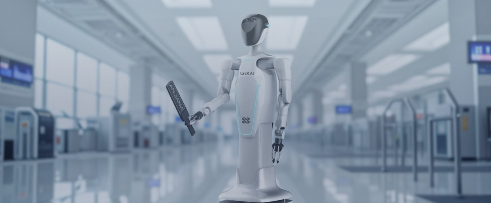
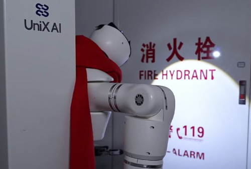
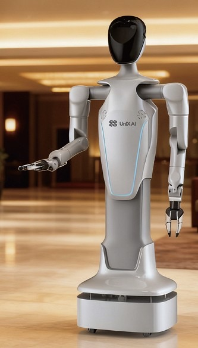
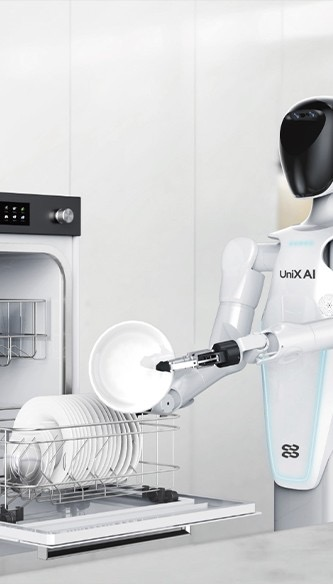
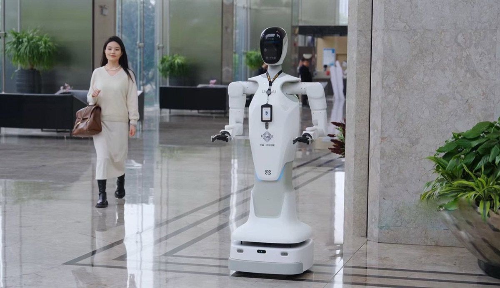
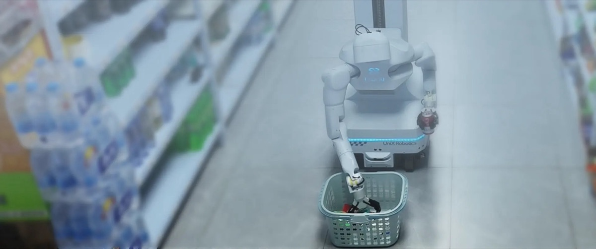
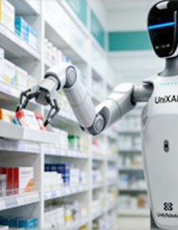
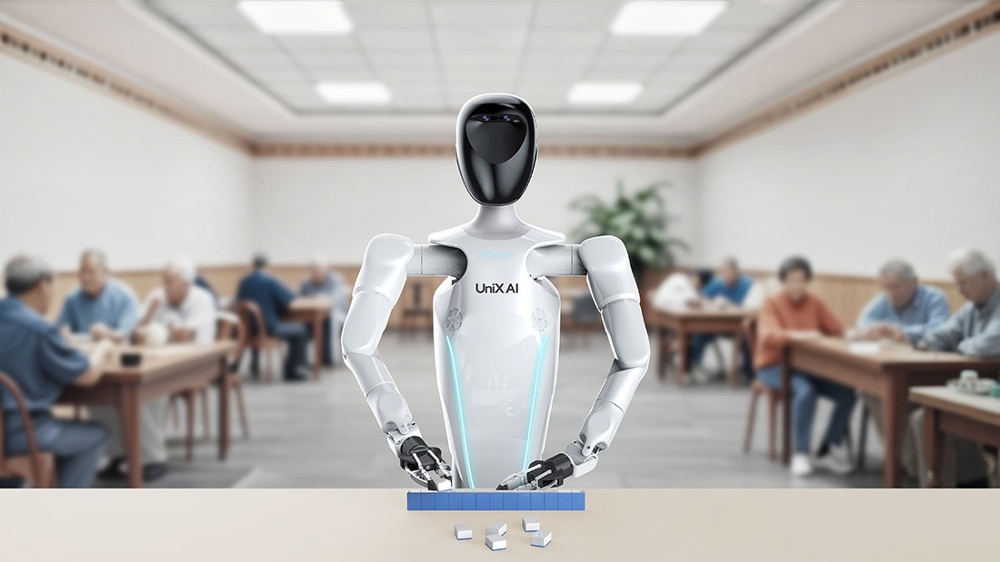
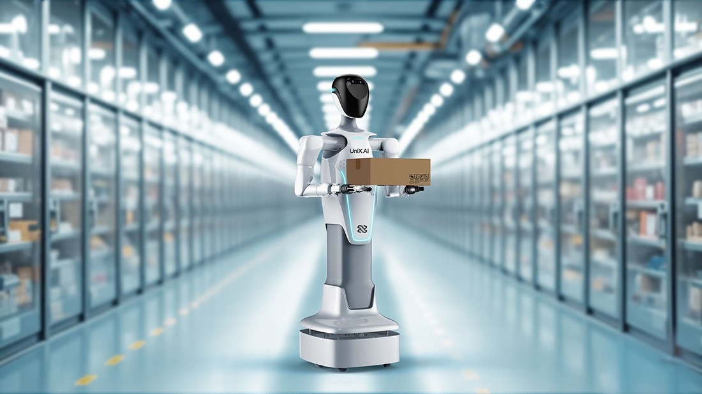

# UniX AI — Solutions and Projects Register

⬆ [UniX AI profile](UniX-AI.md) · [Product portfolio](UniX-AI-Products.md) · [Papers and research](UniX-AI-Papers-and-Research.md) · [Roadmap and strategy](UniX-AI-Roadmap-and-Strategy.md)

> **Coverage note:** Walked on 2026-11-14: the English site (sitemap.xml, 35 URLs; navigation; all Application pages — Security, Retail, Household & Hotel, Reception & Guiding, Entertainment) and the Chinese site (`/cn`, news list pages 1–9, article IDs 7–176, **Aug 2024 → 9 Nov 2026**; about 45 articles read in full). The Chinese name **优理奇机器人** is confirmed. Web search was available (2 extended queries) and surfaced the Nov 2026 funding round, the Inspur order and independent analysis (Huxiu). **Not accessible / not walked:** LinkedIn, WeChat, video content, customer contracts. "High-Risk Operation", "Elderly Care & Companionship" and "Research & Education" are menu items **without a page** (thumbnail only). The English news list stops at Dec 2025 — the Chinese list is the complete one. Almost all customer and volume figures are **company statements**; independent confirmation is flagged where it exists.

Status icons: ✅ shipping / available / done · 🧪 announced / pilot / preview · 🔭 roadmap / planned.

## Solutions catalogue — everything they offer

| # | Solution / application | What it does | Products used | Maturity | Tracks | Source link |
|---|---|---|---|---|---|---|
| 1 | **Autonomous security patrol** (Security Service) | Plans patrol routes, multi-floor rounds of corridors, pantries, restrooms; dynamic re-routing; multi-robot cloud scheduling; results synced to the property-management platform | Wanda 2.0, Panther | ✅ (company: batch deliveries to real-estate groups, Certis, Inspur) | T02, T01, T03 | [Security page](https://www.unix-group.ai/Security) |
| 2 | **Fire-safety equipment and fire-door inspection** | Checks fire-equipment cabinets (present, intact, ready); **physically operates fire doors** to verify self-closing | Wanda 2.0, Panther | ✅ (part of Security Service) | T02 | [Security page](https://www.unix-group.ai/Security) |
| 3 | **Corridor risk detection and lobby patrol** | Detects abnormal persons / unattended objects; lobby patrol with vision + infrared sensing; real-time alerts to building security system | Wanda 2.0, Panther | ✅ (marketed) | T02 | [Security page](https://www.unix-group.ai/Security) · [Reception & Guiding page](https://www.unix-group.ai/Reception-Guiding) |
| 4 | **Integrated building operations** (one robot, many roles) | Same robot does greeting, enquiry, item delivery, room assistance, basic cleaning and patrol inside one building | Wanda 2.0, Panther | 🧪 (concept framed with Certis alliance, Jun 2026) | T01, T02 | [News 160](https://www.unix-group.ai/cn/article/196/detail/160) |
| 5 | **Smart-park inspection, government and enterprise service** | Park inspection, government / enterprise service desks, commercial reception, industrial O&M, "city services" | Wanda / Panther (not specified) | 🧪 (CNY 20M order from Inspur, Jun 2026; delivery status not confirmed) | T01, T02 | [News 159](https://www.unix-group.ai/cn/article/196/detail/159) |
| 6 | **Hotel room service and housekeeping** | Room tidying, bed-making, wiping surfaces, rubbish collection, amenity restocking, using standard cleaning tools; 24/7 | Wanda 2.0, Panther | ✅ (company: in routine operation at Hilton, Ji Hotel, Home Inn properties) | T01, T04 | [Household & Hotel page](https://www.unix-group.ai/Household-Hotel) |
| 7 | **Household service** | Learns household habits; kitchen prep, tidying, hanging laundry, handing over parcels, dishwasher loading; soft-touch handling | Panther, Wanda 2.0 | 🧪 (first real-household validation claimed Apr 2026, Suzhou) | T04 | [Household & Hotel page](https://www.unix-group.ai/Household-Hotel) |
| 8 | **Reception and consultation** | Recognises visitors, handles registration, guides to waiting areas, answers voice enquiries, fetches items; linked to back-end systems | Wanda 2.0, Panther | ✅ (marketed; delivered to hotels per Dec 2025 note) | T01 | [Reception & Guiding page](https://www.unix-group.ai/Reception-Guiding) |
| 9 | **Smart exhibition guide** | Plans tour routes, explains exhibits at multiple stops, real-time Q&A | Wanda 2.0, Panther | ✅ (marketed) | T01 | [Reception & Guiding page](https://www.unix-group.ai/Reception-Guiding) |
| 10 | **In-building delivery** | Navigates complex buildings, **rides elevators**, delivers items to a designated location | Wanda 2.0, Panther | ✅ (marketed) | T01, T04 | [Reception & Guiding page](https://www.unix-group.ai/Reception-Guiding) |
| 11 | **Retail — MFC / front-warehouse automation** | Takes orders from WMS, picks across zones, handles mixed and soft SKUs, opens cold cabinets, bags, labels and hands over to the delivery rider | Panther (omnidirectional base) | 🧪 (demonstrated in a customer's real front warehouse, Apr 2026; customer unnamed) | T01 | [Retail page](https://www.unix-group.ai/lspicture/1852/detail/51) |
| 12 | **Pharmacy retail (24/7)** | Day: store assistant (guidance, **assisted pickup for seniors, sick or disabled customers**, inventory checks). Night: unmanned attendant (delivery-order picking and packing, store safety inspection) | Wanda / Panther with suction cup + adaptive gripper | 🧪 (marketed; no named deployment) | T01, T04 | [Retail page](https://www.unix-group.ai/lspicture/1852/detail/51) |
| 13 | **Retail shelf replenishment and tidying** | Shelf restocking / facing in stores | Wanda 2.0, Panther | 🧪 (homepage video; IFA 2026 demo; units delivered abroad for shelf work per company) | T01 | [Home page](https://www.unix-group.ai) · [News 171](https://www.unix-group.ai/cn/article/196/detail/171) |
| 14 | **F&B last-step fulfilment — "robot store manager"** | Takes finished drinks, moves sideways in a ~65 cm aisle, pushes the cup into the right pickup locker (~100 lockers), returns the order signal, greets customers | Panther | ✅ (JD 7Fresh Coffee 24 h unmanned store, Beijing, Aug 2026) | T01 | [News 166](https://www.unix-group.ai/cn/article/196/detail/166) |
| 15 | **Food and drink preparation** | Tea service, coffee, zero-alcohol cocktails, pizza (sauce, topping, bake, cut, serve), household breakfast | Wanda 2.0, Panther | 🧪 (trade-show demos; no named commercial site) | T01, T04 | [News 167](https://www.unix-group.ai/cn/article/196/detail/167) |
| 16 | **Public restroom cleaning** | Identifies area and dirt, cleans with arm + tools in a high-traffic public facility | Wanda / Panther (not specified) | 🧪 / ✅ (in service at Wuxi East railway station from Apr 2026; scale not public) | T01 | [News 145](https://www.unix-group.ai/cn/article/196/detail/145) |
| 17 | **Elderly care and companionship** | Listed scenario; no public solution description. Delivered units work in wellness / senior-care hotels (greeting, floor-round assistance, guidance) | Panther, Wanda 2.0 | 🧪 (menu placeholder; Greenland co-development announced Nov 2026) | T04 | [Applications page](https://www.unix-group.ai/Applications) |
| 18 | **High-risk operation** | Hazardous-material handling, rescue, industrial inspection via teleoperation; firefighting tasks shown in competition | Wanda / Panther + teleoperation | 🧪 (menu placeholder; competition results only) | T02 | [Applications page](https://www.unix-group.ai/Applications) |
| 19 | **Remote teleoperation system** | Proprietary local + remote real-time control; company claims millisecond-level latency over the public network | All robots | ✅ (in-house tool; also the demonstration-teaching channel) | T02, T04 | [Applications page](https://www.unix-group.ai/Applications) |
| 20 | **Entertainment — culture and tourism** | Instrument playing, robot band, ink painting, audience interaction at museums, attractions, events | Wanda 2.0, Panther | ✅ (delivered for events since Dec 2025) | T01 | [Entertainment page](https://www.unix-group.ai/Entertainment) |
| 21 | **Research and education platform** | Robot body for labs: teleoperated demonstration, data collection, imitation learning, algorithm validation, secondary development; site states "fully open software and hardware interfaces" for Wanda | Wanda 2.0, Martian | ✅ (units delivered to research customers abroad per company; interfaces not documented publicly) | — | [News 155](https://www.unix-group.ai/cn/article/196/detail/155) |
| 22 | **Waste sorting and tidying skills** | Sorting waste, organising clothes and objects as demo skills | Wanda 2.0 / 3.0 | 🧪 (CES 2026 demo only) | T03 | [Interesting Engineering, 2 Jan 2026](https://interestingengineering.com/ai-robotics/unix-ai-wanda-humanoid-robots-real-world-deployment) |
| 23 | **Core components for sale** | uni-module joint module (~**500 g**, **60 N·m** peak), 8-axis bionic arm, UniPicker Pro gripper | — | ✅ (on sale since Jul 2025) | — | [News 106](https://www.unix-group.ai/cn/article/196/detail/106) |

### Autonomous security patrol

- Route planning with real-time re-routing around obstacles and priority on high-risk areas; multi-floor coverage; several robots coordinated by cloud scheduling to avoid duplicate rounds.
- Runs parallel checks while patrolling: environmental monitoring, face recognition, abnormal-behaviour analysis (vendor wording).
- Vendor ROI claims: **24/7** coverage, **50 %** lower operating cost, human-to-robot ratio **1:3**, up to **45 %** less energy than traditional security equipment, **60 %** lower maintenance cost through modular parts, **>90 %** reuse of inspection data in the property platform. None independently verified.
- Buyers named by the company (Nov 2026): several large real-estate groups, **Certis**, **Inspur**. Official page: [Security Service](https://www.unix-group.ai/Security).

### Fire-safety equipment and fire-door inspection

- The robot opens fire-equipment cabinets and verifies that hydrant hoses, extinguishers and tools are present and intact.
- It **pushes and releases fire doors** to check automatic closing — an inspection that needs arms, not just cameras.
- Sold as part of the Security Service package for office buildings and property managers. Official page: [Security Service](https://www.unix-group.ai/Security).

### Corridor risk detection and lobby patrol

- Detects loitering or abnormal persons and unattended objects in corridors; the Certis write-up adds blocked passages, access-control anomalies, crowding and abnormal equipment status.
- Lobby patrol uses vision plus infrared sensing and pushes alerts to the building security system.
- Official pages: [Security Service](https://www.unix-group.ai/Security) · [Reception & Guiding](https://www.unix-group.ai/Reception-Guiding).

### Integrated building operations

- Positioning from the Certis alliance: the robot is not a "mobile camera" but a multi-role worker — greeting, guidance, item delivery, room assistance, basic cleaning, patrol — inside one building.
- Target users: integrated security / facility-management operators, hotel groups, transport hubs.
- Official link: [Certis alliance news](https://www.unix-group.ai/cn/article/196/detail/160).

### Smart-park inspection, government and enterprise service

- Combines Inspur's "digital base" (cloud, data, government IT) with UniX robots as the on-site terminal.
- Scenarios named: park inspection, government / enterprise service, commercial reception, smart O&M, city services. Order value **CNY 20M**; unit count not public.
- Official link: [Inspur order news](https://www.unix-group.ai/cn/article/196/detail/159).

### Hotel room service and housekeeping

- Long-horizon chores chained by UniCortex, skills taught by demonstration (UniFlex): bed-making, wiping, rubbish collection, restocking; the robot uses ordinary cleaning tools (mobile bin, wiping brush).
- Proof points: champion in the hotel scenario at the World Humanoid Robot Games **two years running** (2025, 2026); a five-star hotel in Suzhou has run the robot since **Dec 2025** (CCTV report, Mar 2026).
- Company states routine operation at **Hilton, Ji Hotel (全季) and Home Inn (如家)** properties (Nov 2026) — sites and unit counts not public.
- Official page: [Household & Hotel](https://www.unix-group.ai/Household-Hotel).

### Household service

- Marketed as learning a home's habits and preferences; soft, damage-free handling; fast teaching of new chores.
- Company videos (2026) show kitchen prep, handing a bag at the door, living-room tidying, hanging laundry on a balcony; Panther's 80 cm lift lets it pick items off the floor.
- Status: the Apr 2026 release claims validation in a real, unmodified home in Suzhou; no consumer sales channel or price is public. Independent press reads household use as a later market after elder care and commercial service.
- Official page: [Household & Hotel](https://www.unix-group.ai/Household-Hotel).

### Reception and consultation

- For office lobbies, hotels and exhibition halls: recognises visitors, manages registration, guides them to waiting areas, answers questions by voice, fetches items.
- Integrates with back-end systems for a closed-loop workflow (vendor wording; interfaces not public).
- Gold medal in the Reception Service challenge, World Humanoid Robot Games 2025.
- Official page: [Reception & Guiding](https://www.unix-group.ai/Reception-Guiding).

### Smart exhibition guide

- Plans a tour route, gives explanations at several stops and answers questions live.
- Suited to museums, showrooms and visitor centres. Official page: [Reception & Guiding](https://www.unix-group.ai/Reception-Guiding).

### In-building delivery

- Autonomous navigation through complex buildings including **elevator rides**, with hand-over at a designated spot.
- Useful pattern for room service in hotels and item delivery in clinics or care homes. Official page: [Reception & Guiding](https://www.unix-group.ai/Reception-Guiding).

### Retail — MFC / front-warehouse automation

- Design rules: one SKU per coded slot ("localisation replaces recognition"), zone picking in parallel, picking decoupled from packing, full-process data.
- Six stated capabilities: order-system-driven long-horizon work, adaptive grasping of mixed SKUs, gentle handling of soft goods, omnidirectional movement in narrow aisles, cold-chain door-open / identify / grasp, container assembly and sealing.
- Apr 2026: video filmed in a customer's working front warehouse — pick, sort, bag, label and hand-over to a delivery rider. Customer not named.
- Official page: [Retail](https://www.unix-group.ai/lspicture/1852/detail/51).

### Pharmacy retail (24/7)

- One robot, two shifts: daytime assistant to the pharmacist; night-time unmanned attendant fulfilling delivery orders and inspecting the store.
- **Assisted pickup** flow is explicitly designed for seniors, sick and disabled customers: request → navigation → precise grasp → safe hand-over.
- Integrates with ERP / WMS and delivery platforms; suction cups plus torque-controlled grippers for fragile medicine packs.
- Vendor value claims: **100 %** cut in night labour cost, up to **80 %** higher off-peak efficiency. No named pharmacy customer.
- Official page: [Retail](https://www.unix-group.ai/lspicture/1852/detail/51).

### Retail shelf replenishment and tidying

- Shown as "Retail Replenishment" on the home page and as the retail demo at IFA Berlin 2026.
- Company says robots for research, **shelf tidying** and security have been delivered to customers in Russia, the USA, India and Singapore (Sep 2026).
- Official link: [IFA 2026 news](https://www.unix-group.ai/cn/article/196/detail/171).

### F&B last-step fulfilment — "robot store manager"

- JD 7Fresh Coffee's first 24-hour unmanned store (Galaxy SOHO, Beijing): an automated line makes the drinks; **Panther** handles the hand-over into pickup lockers and greets customers.
- **2,136 drinks in 24 hours** on a livestream, ~100 lockers, zero wrong lockers, spills or retries (company figures). The store set a Guinness record of **202 drinks in one hour** — a store-level record, not Panther's alone.
- Independent caveat (Huxiu): Panther does not grind or brew; takeover rate and long-term uptime are not disclosed.
- Official link: [7Fresh Coffee news](https://www.unix-group.ai/cn/article/196/detail/166).

### Food and drink preparation

- Recurring demo set: gongfu tea (scoop, pour, steep, serve), coffee and mixed drinks, pizza, household breakfast; two Panthers can split a cooking task.
- Aimed at chain restaurants, hotels, resorts and tourist venues; shown at CES, WRC, WAIC, IFA and the China–ASEAN Expo in 2026. No named commercial kitchen deployment.
- Official link: [WRC 2026 news](https://www.unix-group.ai/cn/article/196/detail/167).

### Public restroom cleaning

- At Wuxi East railway station the robot identifies the area, judges dirt and cleans autonomously with its arms — a public-facility maintenance job, not a demo booth.
- The home page lists "Toilet Cleaning" among "Robots in Action". Fleet size, duty cycle and operator are not public.
- Official link: [Wuxi East station news](https://www.unix-group.ai/cn/article/196/detail/145).

### Elderly care and companionship

- **No solution page exists** — only a menu entry and this thumbnail (a rendered image). Treat it as a target market, not a finished offering.
- What is real: Dec 2025 deliveries into wellness / senior-care hotels (lobby greeting, floor-round assistance, route and room guidance); silver and bronze in the **home elderly-care** task at the Mianyang "Panbao" challenge (May 2026); pharmacy flow for seniors (see above).
- Next step: **Greenland Group** joined as strategic investor (Nov 2026) to co-develop security, hotel and elder-care (康养) solutions. Sites and dates not announced.
- Official page: [Applications](https://www.unix-group.ai/Applications).

### High-risk operation

- Marketed through teleoperation: hazardous-material handling, rescue and industrial inspection in places people cannot enter. No dedicated page, no hazard ratings (IP, explosion protection) published.
- Evidence so far is competition-level: top-three finish in the **firefighting scenario** at the World Humanoid Robot Games 2026 (first entry), silver and bronze in **high-voltage switch operation** at the Panbao challenge.
- Official page: [Applications](https://www.unix-group.ai/Applications).

### Remote teleoperation system

- Proprietary system for local and remote real-time control over a high-bandwidth link; the image shows VR-headset operation.
- Doubles as the data-collection tool for imitation learning; shown to university labs at ICRA 2026 as part of the research platform.
- Official page: [Applications](https://www.unix-group.ai/Applications).

### Entertainment — culture and tourism

- Robot band (parts assigned per robot, beat-synchronised), ink painting from few demonstrations, instrument playing; deployed for a performance inside a Suzhou ferris-wheel cabin at 128 m (Mar 2026).
- Relevant only as a public-space attraction. Official page: [Entertainment](https://www.unix-group.ai/Entertainment).

### Waste sorting and tidying skills

- Waste sorting was one of the simulated household / hotel tasks at CES 2026; object sorting and storage were also shown in Mianyang (Sep 2025).
- A demo skill, not a product: no throughput, accuracy or material list is published.
- Link: [Interesting Engineering report](https://interestingengineering.com/ai-robotics/unix-ai-wanda-humanoid-robots-real-world-deployment).

## Projects register — past and current

| Date | Project / deployment / pilot / partnership | Partner or customer | Location | What happened (one line) | Tracks | Source link |
|---|---|---|---|---|---|---|
| 14–16 Nov 2026 | Leukerbad Robotics Hackathon | Organisers | Leukerbad, CH | Listed among the hardware companies on site (event context; models not confirmed) | all | [Profile](UniX-AI.md) |
| 9 Nov 2026 | **Pre-A round, CNY 500M** | Greenland Group (strategic), Keli Sensing, Huagong Venture Capital, Xinjing Fuying, Red Bird Qihang Fund (HKUST-backed), Yulin Industrial Investment; follow-on Xienuo, Yonghua | Suzhou, CN | Greenland becomes investor and scenario partner for security, hotels, elder care | T01, T02, T04 | [News 176](https://www.unix-group.ai/cn/article/196/detail/176) |
| Nov 2026 (stated) | Hotel chain deployments | Hilton, Ji Hotel (全季), Home Inn (如家) | CN (sites not public) | Company says robots are in routine operation at these brands | T01 | [News 176](https://www.unix-group.ai/cn/article/196/detail/176) |
| Nov 2026 (stated) | Security batch deliveries | Several large real-estate groups, Certis, Inspur | CN / SG | Company says batch orders delivered; several customers ordered **100+ units** each | T02 | [News 176](https://www.unix-group.ai/cn/article/196/detail/176) |
| Nov 2026 (stated) | Shipment level | — | — | **100+ units/month** since late 2025, peak **300+ units/month** | — | [News 176](https://www.unix-group.ai/cn/article/196/detail/176) |
| Late Sep 2026 | 23rd China–ASEAN Expo | — | Nanning, CN | Pizza-making catering demo; exploring catering, hotel, tourism cooperation in ASEAN | T01 | [News 175](https://www.unix-group.ai/cn/article/196/detail/175) |
| 4–8 Sep 2026 | **IFA Berlin 2026** (IFA Next) | European retailers, hotel groups, property operators, distributors | Berlin, DE | European commercial debut: shelf tidying, room tidying, breakfast; company reports purchase intent above CNY 10M and distribution frameworks; FCC and CE-EMC certification stated | T01, T04 | [News 171](https://www.unix-group.ai/cn/article/196/detail/171) |
| Sep 2026 (stated) | Overseas deliveries | Unnamed customers | Russia, USA, India, Singapore | Robots for research, shelf tidying and security delivered | T01, T02 | [News 171](https://www.unix-group.ai/cn/article/196/detail/171) |
| Sep 2026 (stated) | Overseas channel partners | Agent in San Francisco Bay Area; agent in Singapore | USA, SG | Early pilots with North American universities, research institutes, retail (names not public) | — | [News 171](https://www.unix-group.ai/cn/article/196/detail/171) |
| 28 Aug 2026 (reported) | Strategic investment | Keli Sensing | CN | Tens of millions of CNY; later confirmed as investor in the Nov round | — | [Parkworld report](https://www.parkworld.net/Post/8df04e4ab8f62e9) |
| Aug 2026 | **World Humanoid Robot Games 2026** | — | Beijing, CN | **1 gold, 1 silver, 1 bronze**; Panther defends the hotel-scenario title; top three in firefighting on first entry | T01, T02 | [News 168](https://www.unix-group.ai/cn/article/196/detail/168) |
| Aug 2026 | UniTac research | Zhejiang Univ., MIT, Oxford, Yale, SJTU | — | Unified multimodal tactile model accepted at ECCV 2026 (see papers doc) | — | [News 168](https://www.unix-group.ai/cn/article/196/detail/168) |
| 19–23 Aug 2026 | WRC 2026, booth B105 | — | Beijing, CN | Six scenarios: hotel service, home breakfast, pizza, gongfu tea, ink painting, robot band | T01, T04 | [News 167](https://www.unix-group.ai/cn/article/196/detail/167) |
| Aug 2026 | **JD 7Fresh Coffee 24 h unmanned store** | JD.com (7Fresh) | Galaxy SOHO, Beijing, CN | Panther as "robot store manager": **2,136 drinks** handed over in 24 h; store Guinness record 202 drinks/hour (the Nov funding release prints 2,156 — ⚠️ unverified discrepancy) | T01 | [News 166](https://www.unix-group.ai/cn/article/196/detail/166) |
| 17–20 Jul 2026 | WAIC 2026, booth H3-C610 | — | Shanghai, CN | Robot band, pizza, sugar painting, home breakfast, room cleaning; Jiangsu governor visited | T01, T04 | [News 161](https://www.unix-group.ai/cn/article/196/detail/161) |
| 10 Jul 2026 | Suzhou Top-10 Industrial Sci-Tech Achievements 2026 | Suzhou city | Suzhou, CN | "Embodied-intelligence wheeled manipulation robot" selected | — | [News 162](https://www.unix-group.ai/cn/article/196/detail/162) |
| 17 Jun 2026 | **Strategic alliance** | Certis (Singapore) | Suzhou / SG | Agreement covering hotel service, security patrol, building operations in international sites | T02, T01 | [News 160](https://www.unix-group.ai/cn/article/196/detail/160) |
| 5 Jun 2026 | **Strategic cooperation + CNY 20M order** | Inspur | CN | Government / enterprise service, smart parks, commercial service, industrial O&M | T01, T02 | [News 159](https://www.unix-group.ai/cn/article/196/detail/159) |
| 1–4 Jun 2026 | ICRA 2026, booth B-133 | Universities, labs | Vienna, AT | Research-platform pitch: towel / clothes folding, chess set-up, toy sorting, teleoperation teaching, data collection; chief scientist Wang Hesheng gave a keynote | — | [News 155](https://www.unix-group.ai/cn/article/196/detail/155) |
| May 2026 | Awards | GGII; Rongzhong | CN | GGII "2026 Embodied AI Industrial Deployment Benchmark" award; Rongzhong China POWER50 list (per news-list title) | — | [News 154](https://www.unix-group.ai/cn/article/196/detail/154) |
| May 2026 | "Panbao" embodied-robot scenario challenge | Chengdu–Chongqing innovation centre | Mianyang, CN | **1 gold, 3 silver, 3 bronze**: bolt assembly and sorting; high-voltage switch operation; **home elderly care** (silver + bronze) | T04, T02 | [News 153](https://www.unix-group.ai/cn/article/196/detail/153) |
| 29 Apr 2026 | Front-warehouse (MFC) demonstration | Unnamed instant-retail customer | CN | Order-to-rider workflow filmed in the customer's working warehouse | T01 | [News 150](https://www.unix-group.ai/cn/article/196/detail/150) |
| Apr 2026 | Co-marketing at Quantum Bookstore | Sci-fi themed bookstore | Suzhou, CN | Tea-making and interaction in a public venue | T01 | [News 149](https://www.unix-group.ai/cn/article/196/detail/149) |
| Apr 2026 | InnoEX 2026 | — | Hong Kong | Clothes folding, towel sorting, tea-making demos | T04 | [News 147](https://www.unix-group.ai/cn/article/196/detail/147) |
| 10 Apr 2026 | Singapore government and business delegation visit | Business China, SIP investment bureau | Suzhou, CN | Senior ministers of state and firms (CapitaLand Investment, Keppel, GIC, Singtel and others) saw demos; ageing and labour shortage discussed | T04 | [News 143](https://www.unix-group.ai/cn/article/196/detail/143) |
| 9 Apr 2026 | **Public restroom cleaning deployment** | Wuxi East railway station | Wuxi, CN | Robot starts public-area cleaning duty in station restrooms | T01 | [News 145](https://www.unix-group.ai/cn/article/196/detail/145) |
| 8 Apr 2026 | Panther international launch | — | Suzhou, CN | Global deliveries start; household-deployment claim; orders "hundreds of millions of yuan" | T04 | [Press release](https://technode.global/prnasia/unix-ai-introduces-panther-the-worlds-first-service-humanoid-robot-to-enter-real-household-deployment-powered-by-its-differentiated-wheeled-dual-arm-architecture/) |
| 31 Mar 2026 | Morgan Stanley China Summit demo | — | Shenzhen, CN | Panther makes tea autonomously on site | — | [Press release](https://technode.global/prnasia/unix-ai-introduces-panther-the-worlds-first-service-humanoid-robot-to-enter-real-household-deployment-powered-by-its-differentiated-wheeled-dual-arm-architecture/) |
| 29 Mar 2026 | Suzhou Eye "space capsule" performance | Suzhou Eye ferris wheel | Suzhou, CN | Robot plays music inside a rotating cabin at 128 m | T01 | [News 144](https://www.unix-group.ai/cn/article/196/detail/144) |
| 16 Mar 2026 | **Five-star hotel housekeeping** (CCTV report) | Unnamed five-star hotel | Suzhou, CN | Robot on site since Dec 2025: wiping surfaces, tables and chairs, collecting rubbish with standard tools | T01, T04 | [News 142](https://www.unix-group.ai/cn/article/196/detail/142) |
| 2 Mar 2026 | Equity round, ~CNY 300M | CICC Huirong, Hongshan Capital, Guangzhou Industrial Investment, Xienuo; follow-on Wuzhong Financial Holdings, Yonghua | CN | Funds for full-stack R&D, product iteration, global channels | — | [News 137](https://www.unix-group.ai/cn/article/196/detail/137) |
| 14 Feb 2026 | Panther series release (China) | — | CN | Video: two-robot cooking, wine pouring, card dealing, embroidery, coat hand-over | T04 | [News 136](https://www.unix-group.ai/cn/article/196/detail/136) |
| 6–9 Jan 2026 | CES 2026 | — | Las Vegas, US | Wanda 2.0 / 3.0: tea reception, bar, housework, bed-making, restocking, waste sorting | T01, T03, T04 | [Interesting Engineering](https://interestingengineering.com/ai-robotics/unix-ai-wanda-humanoid-robots-real-world-deployment) |
| Dec 2025 | **100+ units shipped in one month** | Wellness / senior-care hotels, building security, event operators | CN | Units placed for lobby greeting and guidance, fixed-route security rounds, exhibition entertainment | T01, T02, T04 | [News 125](https://www.unix-group.ai/cn/article/196/detail/125) |
| 5 Dec 2025 | Two rounds totalling CNY 300M | Sichuan Entrepreneur Fund, Wuzhong Financial Holdings, Yihua Capital, Qingyu Fund, Taihao Ventures; follow-on Saina Capital | CN | Fifth closing within six months | — | [News 119](https://www.unix-group.ai/cn/article/196/detail/119) |
| 27–29 Nov 2025 | World Intelligent Manufacturing Conference | Jiangsu province | CN (city not checked) | Wanda 2.0 tea service and room tidying; named among Jiangsu's 13 humanoid companies | — | [News 118](https://www.unix-group.ai/cn/article/196/detail/118) |
| Oct 2025 | IROS 2025 | — | Hangzhou, CN | New product shown; chief scientist Wang Hesheng was general chair | — | [News 115](https://www.unix-group.ai/cn/article/196/detail/115) |
| 13 Oct 2025 | GITEX Global 2025, stand CC2-19 | — | Dubai, UAE | "Oasis Café": Wanda makes coffee, mixes drinks, greets visitors | T01 | [News 113](https://www.unix-group.ai/cn/article/196/detail/113) |
| Sep 2025 | Mianyang Sci-Tech City Expo and Tianfu AI conference | Sichuan government | Mianyang / Chengdu, CN | Home storage and sorting demo; stage performance | T04 | [News 112](https://www.unix-group.ai/cn/article/196/detail/112) |
| 28 Sep 2025 | Two rounds, nearly CNY 100M | not listed here | CN | Funding for global roll-out | — | [News 110](https://www.unix-group.ai/cn/article/196/detail/110) |
| 16 Aug 2025 | **World Humanoid Robot Games 2025** | — | Beijing, CN | Champion and runner-up in hotel cleaning with full marks; total 2 golds + 1 silver incl. reception | T01 | [News 109](https://www.unix-group.ai/cn/article/196/detail/109) |
| 23 Jul 2025 | Component launch | — | CN | uni-module joint module and 8-axis bionic arm go on sale | — | [News 106](https://www.unix-group.ai/cn/article/196/detail/106) |
| 20 Jul 2025 | **"Embodied-intelligence training ground"** agreement | Sichuan Sci-Tech City government; led by Sichuan Changhong | Mianyang, CN | "1 + 2 + N": one innovation centre, two training bases, N real sites; stated tasks include home cleaning, **emergency response**, guiding and accompaniment | T02, T04 | [News 105](https://www.unix-group.ai/cn/article/196/detail/105) |
| 19 May 2025 | Wanda 2.0 batch deliveries begin | — | CN | Mass production opened; base price reported as CNY 88,000 (Huxiu) | — | [News 48](https://www.unix-group.ai/cn/article/196/detail/48) |
| Dec 2024 | Wanda 2.0 pre-sale | — | Beijing, CN | Released with 8-DoF arm; shown at Beijing E-Town Robot World | — | [CN news list](https://www.unix-group.ai/cn/News) |
| Aug 2024 | WRC 2024 debut | — | Beijing, CN | Martian and Wanda 1.0 first shown | — | [About page](https://www.unix-group.ai/About-Unix-AI) |

## Future projects and announced plans

| Announced | Planned for | What | Confidence | Tracks | Source link |
|---|---|---|---|---|---|
| 9 Nov 2026 | not dated | 🔭 Co-development with **Greenland Group** of security, hotel and **elder-care (康养)** solutions — model, robot, data and solution in one loop | official | T01, T02, T04 | [News 176](https://www.unix-group.ai/cn/article/196/detail/176) |
| 9 Nov 2026 | not dated | 🔭 Greenland first sites named as a Shanghai Hongqiao elder-care community, a Wuhan hotel cluster and a Chengdu security hub; a 427-unit real-estate order | reported — ⚠️ unverified (single self-media article, partly AI-generated) | T02, T04 | [Sohu article](https://www.sohu.com/a/1099170891_122066679) |
| 9 Nov 2026 | 2026–2027 | 🔭 Use of Pre-A funds: algorithm research, product iteration, delivery system; scale-up in property management, hotels, retail | official | T01, T02 | [News 176](https://www.unix-group.ai/cn/article/196/detail/176) |
| 8 Sep 2026 | end of 2026 | 🔭 **GITEX 2026, Dubai** — hotel, building and government-service buyers in the Gulf (exact dates not given) | official | T01 | [News 171](https://www.unix-group.ai/cn/article/196/detail/171) |
| 8 Sep 2026 | not dated | 🔭 Europe: turn IFA leads into orders; distribution and local-service partners in DACH, Southern, Nordic and Central-Eastern Europe; targets named are retail chains, hotel groups, **elder-care** and building operators | official | T01, T04 | [News 171](https://www.unix-group.ai/cn/article/196/detail/171) |
| listing | 3–7 Sep 2027 | 🔭 IFA Berlin 2027 exhibitor (IFA Next, Hall 25, stand H25-345) | official (IFA listing) | — | [IFA profile](https://www.ifa-berlin.com/exhibitors/unix-ai) |
| 17 Jun 2026 | not dated | 🧪 Certis alliance: scaled deployment in security patrol, building operations and hotel service; Singapore as Asia-Pacific base | official | T02, T01 | [News 160](https://www.unix-group.ai/cn/article/196/detail/160) |
| 5 Jun 2026 | not dated | 🧪 Inspur: deliver the CNY 20M order; extend to park inspection, government service, city services | official (delivery and acceptance not confirmed per Huxiu) | T01, T02 | [News 159](https://www.unix-group.ai/cn/article/196/detail/159) |
| 29 Apr 2026 | not dated | 🔭 Instant-retail fulfilment network: community front warehouses, cold-chain stores, convenience-store back rooms, pharmacy delivery, rider hand-over points | official (positioning) | T01 | [News 150](https://www.unix-group.ai/cn/article/196/detail/150) |
| 28 Sep 2026 | not dated | 🔭 ASEAN: catering, hotel and tourism cooperation starting from food preparation | official (exploratory) | T01 | [News 175](https://www.unix-group.ai/cn/article/196/detail/175) |
| Aug 2026 | not dated | 🔭 Replicate the 7Fresh unmanned-store model at further stores | inferred (open question raised by Huxiu) | T01 | [Huxiu analysis](https://www.huxiu.com/article/4904469.html) |
| 2 Mar 2026 | not dated | 🔭 Production target **1,000 units/month** | official | — | [News 137](https://www.unix-group.ai/cn/article/196/detail/137) |
| 2026 | later | 🔭 Sequence for Panther: elder care and commercial service first, home use later | reported | T04 | [Huxiu analysis](https://www.huxiu.com/article/4904469.html) |
| 20 Jul 2025 | ongoing | 🧪 Mianyang training ground: applications in manufacturing, tourism, city governance, livelihood services | official | T02, T04 | [News 105](https://www.unix-group.ai/cn/article/196/detail/105) |
| — | — | Developer SDK, open models or datasets: **nothing announced** | — | — | [Profile](UniX-AI.md) |

## Solutions by track — quick index

### T01 Autonomous Urban Services

- **Hotel room service and housekeeping** — T01.2, T01.3 · two-time competition champion; Hilton / Ji Hotel / Home Inn (company claim); Suzhou five-star hotel since Dec 2025.
- **Public restroom cleaning** (Wuxi East station) — T01.2 · the only public-infrastructure cleaning deployment found.
- **Reception and consultation** — T01.5, T01.7 · visitor recognition, registration, voice Q&A.
- **Smart exhibition guide** — T01.5 · route planning and live explanations.
- **In-building delivery** (elevator riding) — T01.1, T01.6.
- **F&B last-step fulfilment** (JD 7Fresh Coffee) — T01.1, T01.3 · 2,136 hand-overs in 24 h.
- **Retail — MFC / front-warehouse automation** — T01.1 · order-to-rider workflow.
- **Pharmacy retail (24/7)** — T01.3, T01.5.
- **Retail shelf replenishment** — T01.2.
- **Integrated building operations** (Certis) and **smart-park / government service** (Inspur) — T01.3, T01.4.
- **Food and drink preparation** — T01.3.
- **Entertainment — culture and tourism** — T01.3, T01.7.
- **Security patrol with dynamic path planning** — T01.4, T01.6 (indoor only).

### T02 Resilient & Safe City

- **Fire-safety equipment and fire-door inspection** — T02.3 · arms test the door, not just a camera check.
- **Autonomous security patrol** — T02.5 · multi-floor, multi-robot, 24/7; Certis and Inspur as buyers (company claim).
- **Corridor risk detection and lobby patrol** — T02.5 · abnormal persons, unattended objects, infrared sensing, alerts to security system.
- **Remote teleoperation system** — T02.7 · human operator in the loop over the public network.
- **High-risk operation** — T02.2, T02.1 · marketed for hazmat handling, rescue, industrial inspection; evidence = firefighting medal (2026) and high-voltage switch medals only.
- **Certis alliance** — T02.5, T02.7 · patrol, anomaly detection, emergency response in international sites (stated goal).
- **Mianyang training ground** — T02.4 · "emergency response" listed among training tasks (2025 agreement).
- **Smart-park inspection** (Inspur) — T02.3.

### T03 Sustainable City

- **Waste sorting skill** (CES 2026 demo) — T03.1 · demo only, no metrics.
- **Security solution energy claims** — T03.3 · dynamic power modes, "up to 45 %" lower energy than traditional security equipment; multi-robot scheduling to avoid redundant rounds (vendor claims).
- **Inspection data reuse** — T03.7 · patrol data synced to property platform, ">90 %" reuse (vendor claim); "environmental monitoring" named as a parallel patrol task without detail — T03.2.
- Otherwise: nothing specific found.

### T04 Elderly Care & Rehabilitation

- **Elderly care and companionship** — T04.1, T04.2, T04.5 · target market with Greenland co-development announced; no solution page yet.
- **Household service** — T04.1 · kitchen prep, tidying, laundry, floor-level pick-up with Panther.
- **Pharmacy assisted pickup** — T04.1, T04.6 · flow designed for seniors, sick and disabled customers.
- **Home elderly-care competition task** (Panbao challenge, May 2026: silver + bronze) — T04.1.
- **Wellness / senior-care hotel deliveries** (Dec 2025) — T04.6 · greeting, floor-round assistance, guidance.
- **Hotel housekeeping and in-building delivery** — T04.6 · transferable to care-home rooms and item delivery.
- **Food and drink preparation** (tea, breakfast) — T04.1.
- **Remote teleoperation system** — T04.6 · remote caregiver or family operation is possible in principle (inference, not a marketed use).
- **Voice interaction and greeting behaviours** — T04.5 · shown at the 7Fresh store; no dedicated companionship software found.
- Nothing found for T04.3 (rehabilitation training), T04.4 (mobility support) or T04.7 (health monitoring).

## What they do NOT offer

- **No outdoor or rough-terrain capability**: wheeled bases for flat indoor floors; no stairs, slopes, snow. Elevator riding is the only vertical mobility.
- **No rehabilitation or mobility-assistance product**: no exoskeleton, gait trainer, walker or patient-transfer function; 12 kg dual-arm payload rules out lifting people.
- **No health-monitoring function**: no vital-sign sensing, fall-detection product or medical certification found.
- **No elder-care solution page or named care-home deployment** — only a menu entry, hotel-type deployments and a newly announced partnership.
- **No dedicated sustainability product**: no waste-collection robot, recycling line, environmental sensor payload or water / energy management offering.
- **No verified hazardous-environment hardware**: no IP rating, explosion protection or heat resistance published; "high-risk operation" rests on teleoperation and competition runs.
- **No drones, quadrupeds or outdoor delivery vehicles**.
- **No public SDK, API documentation or simulation assets**, despite the "fully open interfaces" wording on the Applications page.
- **No named European customer or deployment** yet; Europe so far means IFA 2026, certifications and distributor talks.

## Image credits

All images © UniX AI, taken from the official website for reference in this hackathon guide. Several are rendered concept images rather than site photographs.

| File | Shows | Source URL |
|---|---|---|
| assets/unix-ai-sol-security.jpg | Security Service banner: robot with baton in a public hall (render) | https://www.unix-group.ai/public/uploads/images/20251229/a4c0eda91dd4f3a1a30bf541e8aab3e2.jpg |
| assets/unix-ai-sol-fire-inspection.jpg | Robot inspecting a fire-hydrant cabinet (video still) | https://www.unix-group.ai/public/uploads/images/20251227/f8c36c1a494397ae7137c5fbb21b86ab.png |
| assets/unix-ai-sol-hotel.jpg | Wanda 2.0 in a hotel lobby (hotel room scenario image) | https://www.unix-group.ai/public/uploads/images/20251229/d11dc8e43843373a5c4a7ffef2f3f2f3.jpg |
| assets/unix-ai-sol-household.jpg | Robot loading a dishwasher (household scenario image) | https://www.unix-group.ai/public/uploads/images/20251230/3676fafbd07e937f55285f57aad18211.jpg |
| assets/unix-ai-sol-reception.jpg | Robot greeting a visitor in an office lobby | https://www.unix-group.ai/public/uploads/images/20260209/976a791f59ca737c0ab3356ee5b8f28d.jpg |
| assets/unix-ai-sol-retail-mfc.jpg | Robot picking into a basket in a store aisle (Retail banner) | https://www.unix-group.ai/public/static/index/en/images/application/retail/retail-banner.jpg |
| assets/unix-ai-sol-pharmacy.jpg | Robot picking medicine from a pharmacy shelf (render) | https://www.unix-group.ai/public/static/index/en/images/application/retail/retailOne-img1.jpg |
| assets/unix-ai-sol-elderly-care.jpg | Elderly Care & Companionship thumbnail: robot in a seniors' activity room (render) | https://www.unix-group.ai/public/uploads/images/20251219/0ae1e3d895f961c51211b28deffcbd3e.jpg |
| assets/unix-ai-sol-high-risk.jpg | High-Risk Operation thumbnail: robot carrying a box in a storage corridor (render) | https://www.unix-group.ai/public/uploads/images/20251219/626db6ad3edc80152f6db6f6e4bf0786.jpg |
| assets/unix-ai-sol-teleop.jpg | Operator with VR headset teleoperating the robot (render) | https://www.unix-group.ai/public/static/index/en/images/caseThree-img1.jpg |

## Sources

- [UniX AI official site (English)](https://www.unix-group.ai) · [sitemap](https://www.unix-group.ai/sitemap.xml)
- [Applications overview](https://www.unix-group.ai/Applications)
- [Security Service page](https://www.unix-group.ai/Security)
- [Retail page (MFC automation, pharmacy retail)](https://www.unix-group.ai/lspicture/1852/detail/51)
- [Household & Hotel page](https://www.unix-group.ai/Household-Hotel)
- [Reception & Guiding page](https://www.unix-group.ai/Reception-Guiding)
- [Entertainment page](https://www.unix-group.ai/Entertainment)
- [About UniX AI (milestones)](https://www.unix-group.ai/About-Unix-AI)
- [UniX AI Chinese site — news list](https://www.unix-group.ai/cn/News)
- [News 176, 9 Nov 2026: CNY 500M Pre-A round, Greenland Group](https://www.unix-group.ai/cn/article/196/detail/176)
- [News 175, 28 Sep 2026: China–ASEAN Expo](https://www.unix-group.ai/cn/article/196/detail/175)
- [News 171, 8 Sep 2026: IFA Berlin 2026 and overseas layout](https://www.unix-group.ai/cn/article/196/detail/171)
- [News 168, 24 Aug 2026: World Humanoid Robot Games 2026](https://www.unix-group.ai/cn/article/196/detail/168)
- [News 167, 21 Aug 2026: six scenarios at WRC 2026](https://www.unix-group.ai/cn/article/196/detail/167)
- [News 166, 18 Aug 2026: JD 7Fresh Coffee unmanned store](https://www.unix-group.ai/cn/article/196/detail/166)
- [News 162, 10 Jul 2026: Suzhou Top-10 achievements](https://www.unix-group.ai/cn/article/196/detail/162)
- [News 161, 20 Jul 2026: WAIC 2026 visit](https://www.unix-group.ai/cn/article/196/detail/161)
- [News 160, 17 Jun 2026: Certis strategic alliance](https://www.unix-group.ai/cn/article/196/detail/160)
- [News 159, 5 Jun 2026: Inspur CNY 20M order](https://www.unix-group.ai/cn/article/196/detail/159)
- [News 155, 25 May 2026: ICRA 2026 research platform](https://www.unix-group.ai/cn/article/196/detail/155)
- [News 154, 22 May 2026: GGII deployment award](https://www.unix-group.ai/cn/article/196/detail/154)
- [News 153, 18 May 2026: Panbao challenge, Mianyang](https://www.unix-group.ai/cn/article/196/detail/153)
- [News 152, 15 May 2026: Science and Technology Daily coverage (home and front warehouse)](https://www.unix-group.ai/cn/article/196/detail/152)
- [News 150, 29 Apr 2026: front-warehouse robot](https://www.unix-group.ai/cn/article/196/detail/150)
- [News 149, 27 Apr 2026: Quantum Bookstore](https://www.unix-group.ai/cn/article/196/detail/149)
- [News 147, 22 Apr 2026: InnoEX Hong Kong](https://www.unix-group.ai/cn/article/196/detail/147)
- [News 145, 9 Apr 2026: Wuxi East station restroom cleaning](https://www.unix-group.ai/cn/article/196/detail/145)
- [News 144, 29 Mar 2026: Suzhou Eye performance](https://www.unix-group.ai/cn/article/196/detail/144)
- [News 143, 10 Apr 2026: Singapore delegation](https://www.unix-group.ai/cn/article/196/detail/143)
- [News 142, 16 Mar 2026: CCTV hotel cleaning report](https://www.unix-group.ai/cn/article/196/detail/142)
- [News 137, 2 Mar 2026: ~CNY 300M equity round](https://www.unix-group.ai/cn/article/196/detail/137)
- [News 136, 14 Feb 2026: Panther series release](https://www.unix-group.ai/cn/article/196/detail/136)
- [News 125, 31 Dec 2025: 100+ units in one month](https://www.unix-group.ai/cn/article/196/detail/125)
- [News 119, 5 Dec 2025: CNY 300M angel extensions](https://www.unix-group.ai/cn/article/196/detail/119)
- [News 118, 4 Dec 2025: World Intelligent Manufacturing Conference](https://www.unix-group.ai/cn/article/196/detail/118)
- [News 115, 29 Oct 2025: IROS 2025](https://www.unix-group.ai/cn/article/196/detail/115)
- [News 113, 14 Oct 2025: GITEX Global 2025](https://www.unix-group.ai/cn/article/196/detail/113)
- [News 112, 30 Sep 2025: Sichuan events](https://www.unix-group.ai/cn/article/196/detail/112)
- [News 110, 28 Sep 2025: angel++ / +++ rounds](https://www.unix-group.ai/cn/article/196/detail/110)
- [News 109, 17 Aug 2025: hotel cleaning champion](https://www.unix-group.ai/cn/article/196/detail/109)
- [News 106, 23 Jul 2025: joint module and 8-axis arm on sale](https://www.unix-group.ai/cn/article/196/detail/106)
- [News 105, 20 Jul 2025: Mianyang training ground](https://www.unix-group.ai/cn/article/196/detail/105)
- [News 48, 19 May 2025: batch deliveries begin](https://www.unix-group.ai/cn/article/196/detail/48)
- [Press release, 8 Apr 2026: Panther launch (TechNode Global / PR Newswire Asia)](https://technode.global/prnasia/unix-ai-introduces-panther-the-worlds-first-service-humanoid-robot-to-enter-real-household-deployment-powered-by-its-differentiated-wheeled-dual-arm-architecture/)
- [China Daily (promotional content), 9 Nov 2026: Pre-A round](https://cn.chinadaily.com.cn/a/202611/09/WS6af1810de4b0e14252fca040.html)
- [Huxiu analysis, Nov 2026: Pre-A round, 7Fresh deployment, open questions](https://www.huxiu.com/article/4904469.html)
- [Sina Finance, 9 Jun 2026: Inspur order](https://finance.sina.com.cn/roll/2026-06-09/doc-iniavfst1805235.shtml)
- [Parkworld, 28 Aug 2026: Keli Sensing strategic investment](https://www.parkworld.net/Post/8df04e4ab8f62e9)
- [Sohu self-media article, 9 Nov 2026 (unverified Greenland site claims)](https://www.sohu.com/a/1099170891_122066679)
- [Interesting Engineering, 2 Jan 2026: Wanda robots at CES 2026](https://interestingengineering.com/ai-robotics/unix-ai-wanda-humanoid-robots-real-world-deployment)
- [IFA Berlin exhibitor profile (2027 listing)](https://www.ifa-berlin.com/exhibitors/unix-ai)
