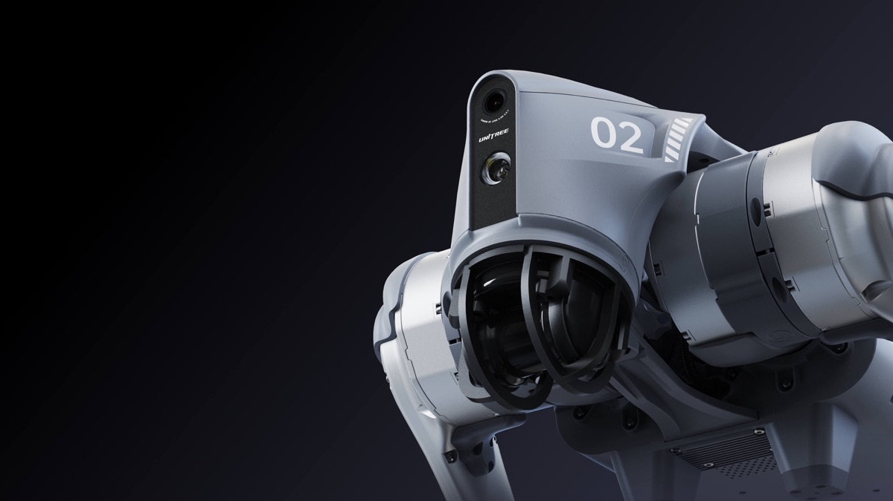
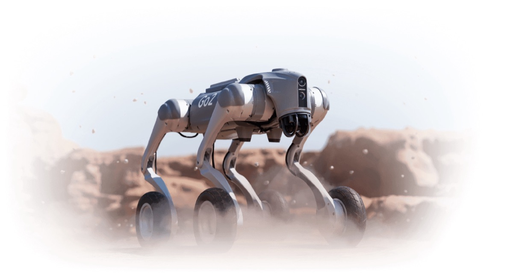
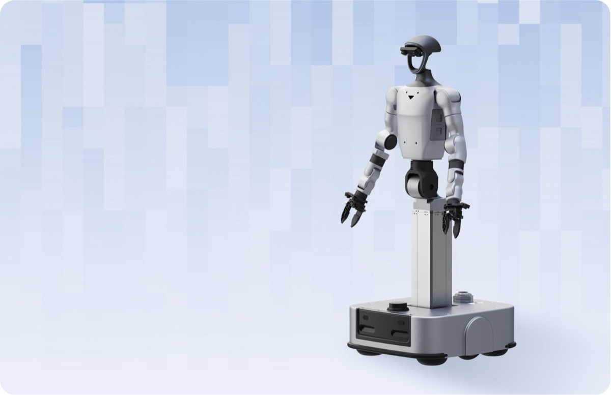
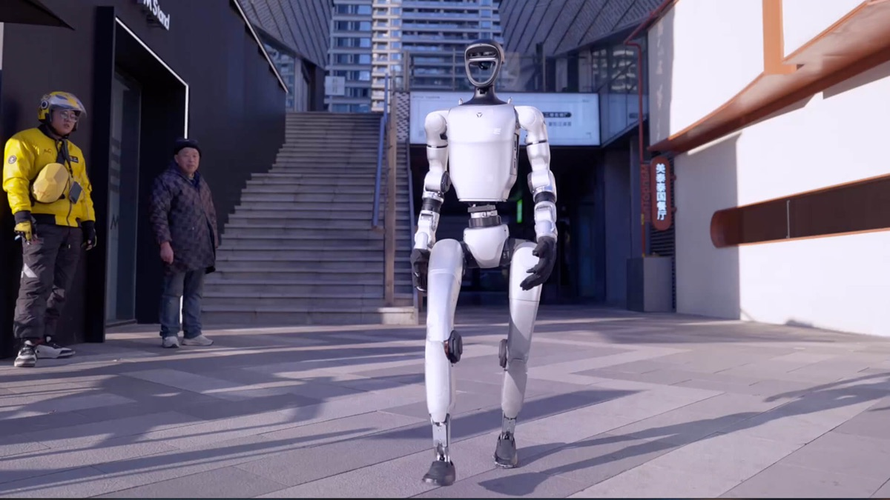
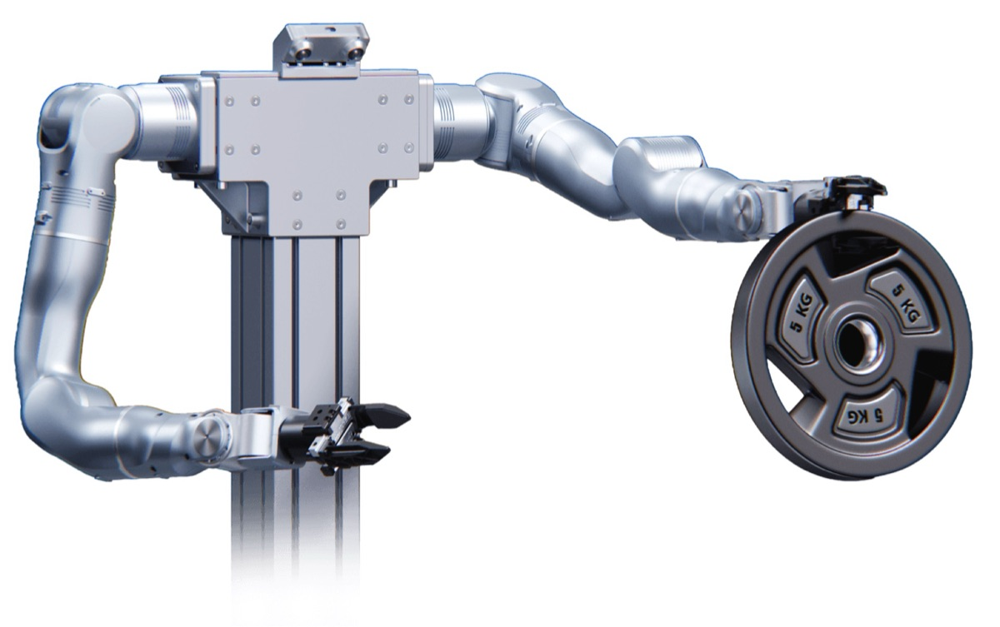

# Unitree Robotics × T01 — Products and Solutions

⬆ [Unitree Robotics profile](../Unitree.md) · [Brief](Unitree-T01-1-Brief.md) · [Playbook](Unitree-T01-3-Playbook.md)

**Read this first:** Unitree sells mobility platforms, not urban-service products. For T01 you get an excellent body (legs or wheel-legs, LiDAR, SDK) and must add the service brain (mapping, navigation, task logic, handover). What is physically on site is **not confirmed** — check variants at the booth before committing.

## Relevant products (ranked for this track)

| Rank | Product | T01 role | Likely on site? |
|---|---|---|---|
| 1 | Go2 EDU | Small courier / patrol / guide base | Very likely |
| 2 | Go2-W | Faster courier on pavement, still climbs | Possible |
| 3 | As2 / As2-W | Weather-rated carrier with follow mode | Possible (showpiece) |
| 4 | G1-D Flagship | Indoor service robot with two arms | Unknown |
| 5 | G1 / G1+ EDU | Concierge / guide with a human face | Very likely (G1) |
| 6 | A2-W / B2-W | Heavy-load mountain porter | Unlikely for team use |
| 7 | 4D LiDAR L2, D2 arm | Add-ons | Unknown |

### Go2 (Air / Pro / X / EDU)

**Role:** default T01 platform — light enough to run among pedestrians, climbs stairs, carries a small parcel box.

| Spec | Value |
|---|---|
| Weight | **~15 kg** |
| Payload | **~7–8 kg** (max 10–12 kg) |
| Speed | up to 3.7 m/s (EDU ~5 m/s peak) — cap it near people |
| Runtime | **1–2 h**; EDU 15,000 mAh battery 2–4 h |
| Perception | 4D LiDAR L2 (360° × 96°), front HD camera |
| Compute | 8-core CPU; EDU optional Orin module (40–100 TOPS) |
| Stairs / slope | ~16 cm steps, ~40° ⚠️ unverified (not re-checked) |
| IP rating | not public |

- **Status / price:** ✅ shipping. Air **$1,600** · Pro **$2,800** · X **$4,500** · EDU contact sales.
- **Developer access:** EDU = full unitree_sdk2 (high-level velocity / posture, obstacle-avoidance switch, front camera, volume and light, low-level joints). X = partial. **Air / Pro = no official SDK**; the unofficial go2_ros2_sdk reaches them over WebRTC / Wi-Fi.

### Go2-W

**Role:** wheel-legged Go2 — rolls efficiently on streets and corridors, steps over kerbs and stairs.

| Spec | Value |
|---|---|
| Weight | **~18 kg** with battery |
| Payload | **~8 kg** (max ~12 kg) |
| Speed | 0–2.5 m/s |
| Runtime | **1.5–3 h** (15,000 mAh) |
| Obstacles / slope | climb / drop height < **70 cm**; max **35°** |
| Wheels | 7-inch pneumatic tyres, in-wheel motors |
| Perception / compute | wide-angle 3D LiDAR, HD camera; 8-core CPU, optional Orin NX |
| IP rating / price | not public |

- **Status:** ✅ shipping; price not public.
- **Developer access:** secondary development listed as supported (see the official manual); assume the same DDS SDK family as Go2 EDU — confirm on site.

### As2-W

**Role:** the best-matched Unitree machine for an alpine town if one is available — weather-rated, cold-rated, long range, built-in follow mode.

| Spec | As2-W (X / EDU) | As2 (legged) for comparison |
|---|---|---|
| Weight | **~25 kg** | ~20 kg |
| Walking payload | **~16 kg** (static ~150 kg) | ~15 kg (Air ~10 kg) |
| Speed | 0–3.7 m/s, peak ~6 m/s | up to ~5 m/s |
| Runtime / range | **~3 h, ~30 km** unloaded; > 2 h, ~25 km at 16 kg | > 4 h, > 13 km unloaded |
| Stairs / slope | 30 cm stairs; climb 0.4–0.8 m; **~45°** | — |
| Protection | **IP54**; **−20 to 55 °C** | IP54 (Pro / X / EDU) |
| Perception | 64–128-line ultra-wide LiDAR, HD camera, mic, speaker, front light | — |
| Extras | **ISS 3.0 side-follow**; GPS and 4G (off by default, user must authorise); Wi-Fi 6 | — |
| Compute | 8-core CPU; EDU: expansion dock (e.g. Orin NX); EDU: charging dock | EDU: optional Orin NX dock |

- **Status / price:** ✅ shipping (As2 unveiled Feb 2026); contact sales.
- **Developer access:** SDK and APIs on **X and EDU**, plus the UniStore app platform. Whether side-follow and GPS are exposed through the SDK: not public — ask.

### G1-D (Standard / Flagship)

**Role:** indoor service robot (reception, retail shelf, hand-over counter). Unitree's own page lists **Service, Life, Retail, Industry** as target scenarios.

| Spec | Standard | Flagship |
|---|---|---|
| Mobile base | none listed | differential drive, **1.5 m/s**, turns in place |
| Height (lift column) | 1.26–1.68 m | 1.26–1.68 m |
| Arm payload | **~3 kg** per arm | **~3 kg** per arm |
| Runtime | ~2 h | **~6 h** |
| Sensors | head stereo camera + 2 wrist cameras | + base LiDAR, 2 depth cameras, bumpers, low-obstacle sensors |
| Compute | 8-core CPU; optional Orin NX 16 GB (100 TOPS) | same |
| Weight | ~90 kg | ~90 kg |

- **Status / price:** ✅ listed; price not public.
- **Developer access:** data-collection → training → deployment toolchain; page states integration with open models such as Pi and GR00T, plus UnifoLM-WMA-0. Base navigation API: not public.
- **Limit:** wheels only — no stairs, no snow.

### G1 / G1 EDU

**Role:** concierge, greeter or guide where a humanoid form helps engagement; light hand-overs with Dex3-1 hands. The G1+ (2-DoF neck, stereo + wide camera, 6-mic array) is the better conversational unit if present.

| Spec | Value |
|---|---|
| Size | **1.32 m**, **~35 kg** |
| DoF | 23 (EDU 23–43) |
| Runtime | **~2 h** |
| Sensors | depth camera + 3D LiDAR |
| Price | G1 **$13.5K** · G1+ **$15K** · EDU contact sales |

- **Developer access:** EDU only — locomotion and arm control via unitree_sdk2, teleoperation via xr_teleoperate.
- **Limit:** a biped walking through public space among tourists is a fall risk; keep it to a staffed station or short guided walks.

### A2-W

**Role:** heavy porter (luggage, supplies, waste bags) on steep paths. Showpiece-class; unlikely to be handed to teams.

| Spec | A2-W | B2-W (larger) |
|---|---|---|
| Weight | **~52 kg** with battery | **~85 kg** |
| Walking payload | **~25 kg** (static ~100 kg) | **> 40 kg** (static 120 kg) |
| Speed | 0–3 m/s, peak ~6 m/s | up to 15 km/h (special configuration) |
| Range | > 3.5 h / ~35 km unloaded; > 1.5 h / ~15 km at 25 kg | ~30 km unloaded; 25 km at 40 kg |
| Stairs / slope | 30 cm step; ~45° | 20–25 cm continuous stairs, 40 cm single; > 45° |
| Protection | **IP56** (PRO: core parts IP67); −20 to 55 °C | **IP67**; −20 to 55 °C |
| Compute | 8-core CPU + Intel i7 for user code | i5 + i7; optional up to 3 extra (i7 / Orin NX) |

- **Status / price:** ✅ shipping; contact sales. Hot-swappable dual batteries on A2-W.
- **Developer access:** secondary development supported on both.

### B2-W

See the comparison column above. Only relevant if the organisers allow a supervised outdoor heavy-load demo.

### 4D LiDAR L1 / L2

**Role:** the sensor behind Go2 mapping (L2: 360° × 96°). Official open code: unilidar_sdk2 and point_lio_unilidar (LiDAR-inertial odometry / mapping). Price not public.

### D2

**Role:** arm on a quadruped for button pressing, parcel drop-off, litter picking. 7 DoF + gripper, **3 kg rated**, 760 mm working radius, **5.9 kg**, SDK + drag teaching. At 5.9 kg it uses most of a Go2's payload — realistic only on As2 / A2 / B2. Mount compatibility and availability on site: not public.

## What Unitree Robotics already does in this domain

**Short answer: no confirmed delivery, cleaning, concierge or municipal-service deployment by Unitree was found.** What exists is adjacent:

| When | What | Relevance to T01 |
|---|---|---|
| Ongoing | Official **intelligent inspection solution** (B2-class robots following planned routes with sensor payloads) | Same autonomy pattern as facility-upkeep rounds; aimed at industry, not public space |
| 2026 | **G1-D** product page names Service, Life, Retail and Industry as scenarios | Statement of intent, no named customers |
| Feb 2026 | **As2 / As2-W** ship with side-follow, GPS / 4G options and the UniStore app platform | Hardware features that suit follow-me carrying and outdoor routes |
| First 3 quarters of 2025 | About **73.6%** of humanoid revenue came from research and education, **9.0%** from industrial use (per Unitree's listing documents, as cited on Wikipedia) | Service-sector deployments are not yet a real business line |
| 2024–2026 | G1 units operated by third parties as crowd-interaction "street performer" robots (Wired, Aug 2026, as cited on Wikipedia) | Shows public engagement value; these are teleoperated, not autonomous |
| Oct 2024 | B2 trialled for carrying cargo and waste on Mount Tai (tourist mountain, China) | Closest analogue to alpine-resort logistics — ⚠️ unverified: from prior knowledge, no source re-checked in this run |

## What they are building next in this domain

- **Wheel-legged versions of every size** (Go2-W, As2-W, A2-W, B2-W) with 25–35 km ranges. *Inference:* Unitree is positioning quadrupeds for long mixed routes (road + stairs), which is exactly the last-mile carrying profile.
- **G1-D + data / training platform + UniStore.** *Inference:* a path to service skills delivered as apps and learned policies rather than hand-coded behaviours.
- **Foundation models:** UnifoLM (WMA-0, VLA-0, and a newer "unifolm-wla" repo updated Sep 2026); NVIDIA Isaac GR00T reference workflow for G1 and the H2 Plus (announced June 2026, 🧪).
- **Household and elder-care humanoid by about 2030** (IPO filing, per press) — the stated long-term service direction.
- No announced delivery, cleaning or city-service product or pilot programme: not public.

## Software, models and data that help for this track

| Resource | What it gives you | Notes |
|---|---|---|
| [unitree_sdk2](https://github.com/unitreerobotics/unitree_sdk2) | C++ DDS SDK, high- and low-level control | 1.4k stars; updated 9 Nov 2026 |
| [unitree_sdk2_python](https://github.com/unitreerobotics/unitree_sdk2_python) | Python: velocity / posture control, state, front camera (OpenCV), obstacle-avoidance switch, volume / light | Python ≥ 3.8, cyclonedds 0.10.2; pass the network interface name as argument |
| [unitree_ros2](https://github.com/unitreerobotics/unitree_ros2) | Native ROS 2 topics for Go2, B2, H1 (G1 / H1-2 examples) | Humble on Ubuntu 22.04 recommended; sport requests on `/api/sport/request`, LiDAR cloud on `utlidar/cloud` |
| [go2_ros2_sdk](https://github.com/abizovnuralem/go2_ros2_sdk) (community, unofficial) | **slam_toolbox + Nav2 + COCO object detection** for Go2 Air / Pro / EDU, WebRTC (Wi-Fi) or CycloneDDS (Ethernet) | 1.1k stars, BSD-2-Clause; maintenance activity uncertain — test before relying on it |
| [point_lio_unilidar](https://github.com/unitreerobotics/point_lio_unilidar) | LiDAR-inertial odometry and mapping for Unitree LiDARs | GPL-2.0; last updated June 2025 |
| [unitree_mujoco](https://github.com/unitreerobotics/unitree_mujoco) | Simulator with the same SDK interface | Develop while the robot is busy or charging |
| [xr_teleoperate](https://github.com/unitreerobotics/xr_teleoperate) + teleimager | XR teleoperation and camera streaming for humanoids | Remote-operator fallback for a G1 concierge |
| [unitree_lerobot](https://github.com/unitreerobotics/unitree_lerobot) / unifolm repos | Imitation-learning and VLA pipelines | Manipulation only; too slow to train from scratch in 48 h |

No official open-source navigation stack and no urban-service dataset exist in the Unitree GitHub organisation (first page of 59 repos checked).

## Gaps and limits for this track

- **Autonomy is do-it-yourself.** Unitree gives locomotion and obstacle avoidance; global mapping, localisation, routing, elevators and doors are your work.
- **Variant lottery.** Go2 Air / Pro have no official SDK. Confirm EDU (and Orin) before designing anything.
- **Runtime.** Go2: 1–2 h per battery; G1: ~2 h. Plan battery swaps into the demo day.
- **Weather.** Go2 and Go2-W publish no IP rating; snow, slush and ice on feet are untested risks. Only As2 / A2 / B2 lines carry IP54–IP67.
- **Payload interface.** No standard cargo box or handover mechanism; build a light lidded box and secure it properly.
- **No arm by default.** Opening doors and pressing lift buttons needs D2 / another vendor's arm, or infrastructure help (a person, an automatic door).
- **Public-space operation.** Running a robot on Leukerbad streets needs organiser clearance and a spotter with the remote; not verified here.
- **Research limit:** web search was unavailable in this run, so the deployment list rests on official pages, GitHub and one Wikipedia check; trade-press coverage of 2026 pilots could not be searched.

## Sources

Fetched in this run:
- [Unitree Go2-W](https://www.unitree.com/go2-w)
- [Unitree As2-W](https://www.unitree.com/As2-W)
- [Unitree A2-W](https://www.unitree.com/A2-W)
- [Unitree B2-W](https://www.unitree.com/b2-w)
- [Unitree G1-D](https://www.unitree.com/G1-D)
- [Unitree GitHub organisation — repositories](https://github.com/orgs/unitreerobotics/repositories?type=all&sort=stargazers)
- [unitree_ros2](https://github.com/unitreerobotics/unitree_ros2)
- [unitree_sdk2_python](https://github.com/unitreerobotics/unitree_sdk2_python)
- [go2_ros2_sdk (community)](https://github.com/abizovnuralem/go2_ros2_sdk)
- [Wikipedia — Unitree Robotics](https://en.wikipedia.org/wiki/Unitree_Robotics)

Via the company profile (official pages, not re-fetched here):
- [Unitree Go2](https://www.unitree.com/go2) · [Unitree As2](https://www.unitree.com/As2) · [Unitree G1](https://www.unitree.com/g1) · [Unitree G1+](https://www.unitree.com/G1pl) · [Unitree D2](https://www.unitree.com/D2)
- [Unitree intelligent inspection solution](https://www.unitree.com/mobile/industry/electricity)
- [PR Newswire — H2 Plus / Isaac GR00T (1 Jun 2026)](https://tools.prnewswire.com/en-us/live/20823/release/20260601EN72140)
- [Notebookcheck — household / elder-care humanoid plans](https://www.notebookcheck.net/Beyond-kung-fu-Unitree-plans-humanoid-robot-for-household-chores-and-elder-care-by-2030.1255707.0.html)
