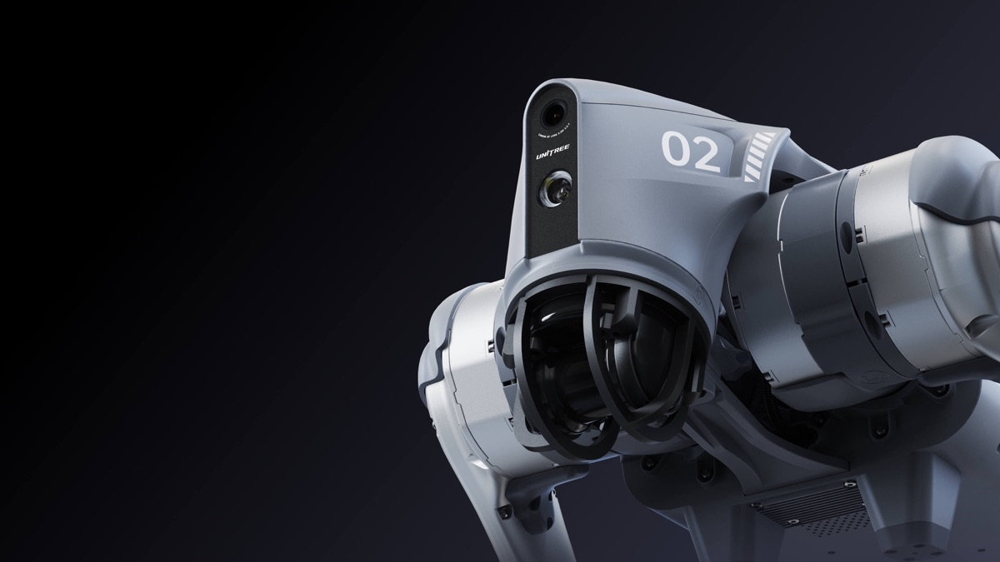
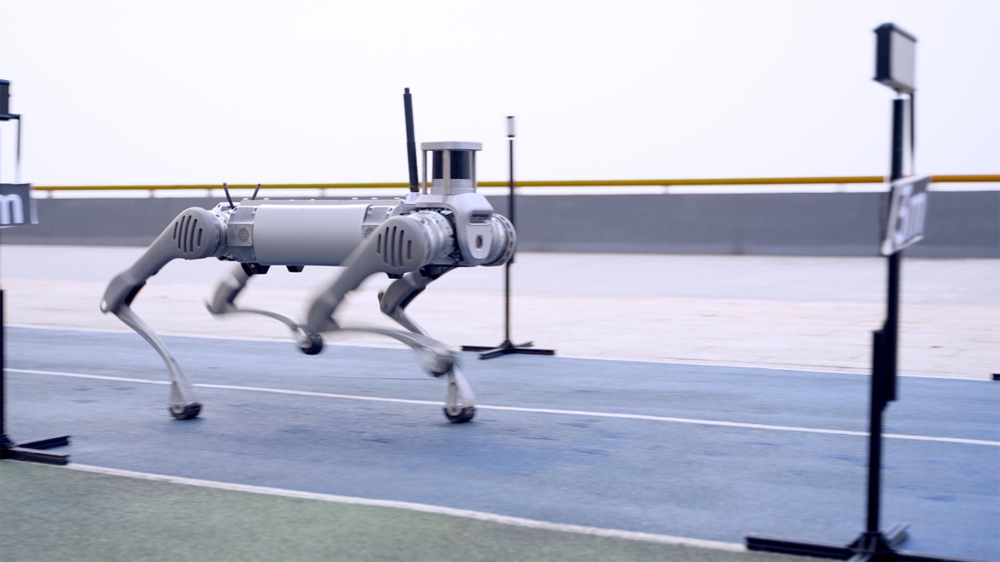
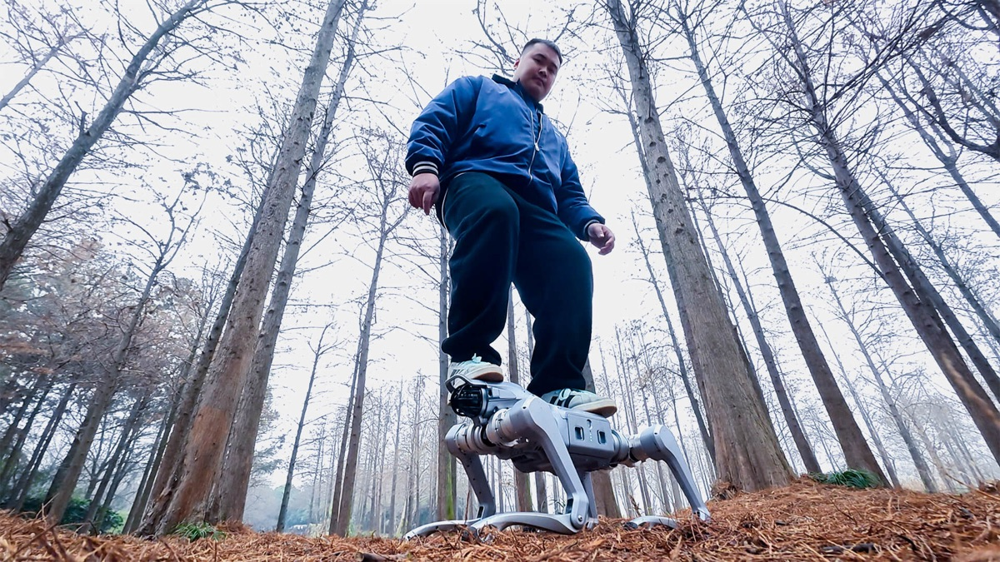
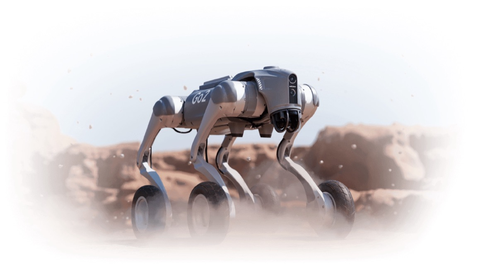
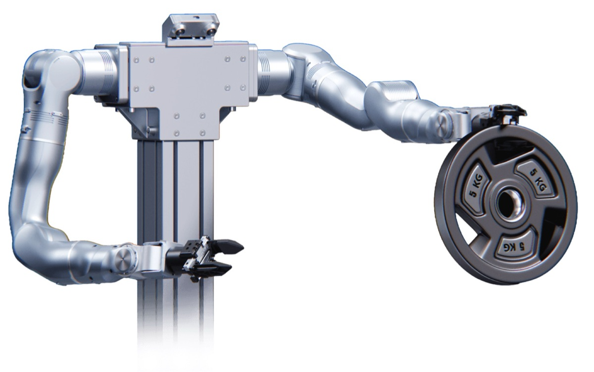
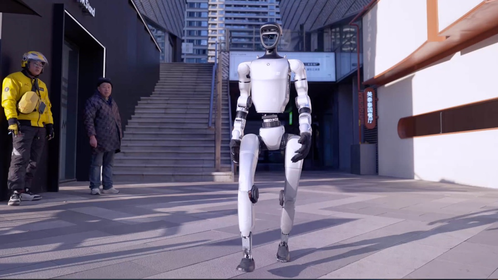

# Unitree Robotics × T02 — Products and Solutions

⬆ [Unitree Robotics profile](../Unitree.md) · [Brief](Unitree-T02-1-Brief.md) · [Playbook](Unitree-T02-3-Playbook.md)

**Read this first:** Unitree's T02 strength is its quadrupeds. The industrial models (B2, A2, As2) are what the company actually deploys for inspection and fire rescue; the **Go2 EDU** is what a hackathon team will most likely get. Which units are on site is **not confirmed** — check at the booth. Specs below are from official product pages (vendor figures, lab conditions).

## Relevant products (ranked for this track)

### Go2 (Air / Pro / X / EDU)

**Role:** the realistic 48-hour build platform — patrol, scout, search and mapping robot that is light enough (15 kg) to run safely around people.

| Spec | Value |
|---|---|
| Weight | **~15 kg** with battery |
| Payload | ~8 kg (max ~12 kg on X / EDU) |
| Speed | 0–3.7 m/s (X / EDU) |
| Runtime | 1–2 h; **EDU 2–4 h** (15,000 mAh) |
| Terrain | **40°** max climb angle (Air 30°), ~16 cm steps |
| IP rating / temperature | not listed on the product page — treat as **not weatherproof** |
| Sensors | 4D LiDAR L2 (360° × 96°), HD wide-angle camera, front lamp; **EDU adds depth camera and foot-end force sensors** |
| Comms | Wi-Fi; 4G module with GPS on Pro / X / EDU |
| Compute | 8-core CPU; EDU optional Orin-class module (40–100 TOPS) |

- **Status / price:** ✅ shipping. Air **$1,600** · Pro **$2,800** · X **$4,500** · EDU contact sales.
- **Developer access:** official SDK is **EDU only** (X partial, Air / Pro none). With EDU you get high-level sport commands (velocity, posture, trajectory follow, obstacle-avoidance switch), front camera frames, LiDAR point cloud (`utlidar/cloud` in ROS 2), robot state, and low-level joint control.
- **Fallback for Air / Pro:** the community **go2_ros2_sdk** drives Air / Pro / EDU over WebRTC (Wi-Fi) with SLAM and Nav2 — unofficial, firmware-sensitive.

### B2 (Large industrial quadruped)

**Role:** the robot Unitree deploys in tunnels, substations and fire drills. Best choice for outdoor, wet, snowy or heavy-payload demos — if the organisers let teams drive a 60 kg machine.

| Spec | Value |
|---|---|
| Weight | **~60 kg** with battery |
| Payload | **>40 kg** walking, ≥120 kg standing |
| Runtime / range | **4–6 h**; unloaded >5 h, >20 km; with 20 kg >4 h, >15 km (2,250 Wh, quick-swap) |
| Terrain | slopes **>45°**, continuous stairs 20–25 cm, single step / obstacle **40 cm**, ditches 0.5–1.2 m |
| Protection | **IP67**, −20 to 55 °C |
| Sensors | 1 × 3D LiDAR, 2 × depth cameras, 2 × optical cameras (configuration-dependent) |
| Compute | Intel i5 (platform) + **Intel i7 for user code**; optional extra i7 / Orin NX |
| Ports | 4 × Gigabit Ethernet, 4 × USB 3.0, 12 V / 24 V / 5 V / BAT power outputs |

- **Status / price:** ✅ shipping; price not public (contact sales).
- **Developer access:** unitree_sdk2 and unitree_ros2 list B2 as supported (high-level and low-level). The commercial inspection software (route planning, meter reading) is a separate product — access for teams is **not public**.

### A2 / A2-PRO (Mid-size industrial quadruped)

**Role:** lighter industrial option with long range and hot-swap batteries; used by Unitree in substation and furnace-area inspection.

| Spec | Value |
|---|---|
| Weight | **~42 kg** with battery |
| Payload | ~25 kg walking, ~100 kg standing |
| Runtime / range | **>5 h, ~20 km** unloaded; >3 h, ~12.5 km with 25 kg; dual hot-swap battery slots |
| Terrain | ~45° slope, 30 cm max step |
| Protection | **IP56** (PRO: core parts IP67), −20 to 55 °C |
| Sensors | A2: 1 LiDAR + HD camera · PRO: front and rear LiDAR, front light |
| Compute / ports | 8-core CPU + Intel i7 for user code; RS485, CAN, Gigabit Ethernet, USB-C, 12 / 24 V |

- **Status / price:** ✅ shipping; contact sales.
- **Developer access:** secondary development supported (per product page); SDK details for A2 not checked ⚠️ unverified.

### As2 (Air / Pro / X / EDU)

**Role:** the "weatherproof Go2" — 20 kg, IP54, about 4 h. If one is on site it is the best compromise between safety around people and outdoor robustness.

| Spec | Value |
|---|---|
| Weight | **~20 kg** |
| Payload | ~15 kg walking (X / EDU), ~65 kg standing |
| Runtime / range | **~4 h, ~20 km** unloaded (Pro / X / EDU); >2.5 h, ~13 km loaded |
| Terrain | ~40° slope, 25 cm stairs |
| Protection | **IP54** (Pro / X / EDU), −20 to 55 °C (X / EDU) |
| Sensors | HD camera + industrial 64–128-line LiDAR (Pro and up); GPS and 4G optional |
| Compute | 8-core CPU; **EDU: Orin NX expansion dock and charging dock** |

- **Status / price:** ✅ shipping (unveiled 24 Feb 2026); contact sales.
- **Developer access:** **X and EDU only**.

### B2-Ex (Explosion-proof B2)

**Role:** hazardous-area patrol (gas stations, chemical tank farms). Very unlikely to be on site; relevant as proof that Unitree builds certified safety-domain hardware.

| Spec | Chassis | Inspection solution |
|---|---|---|
| Ex class | Ex db mb IIB T4 Gb | Ex db eb ib mb IIB T4 Gb |
| Weight | ~130 kg | ~170 kg |
| Endurance | ≥7 h | ≥4 h with 40 kg payload |
| Payload | 40 kg walking, 70 kg max | fixed superstructure: front / rear Ex LiDAR, bi-spectrum PTZ, gas sensor |
| Terrain / speed | 45° slope, 20–25 cm stairs, 0–1 m/s | 30° slope |
| Protection | **IP66**, −20 to 55 °C | same |

- **Status / price:** ✅ listed on the official site; price not public.

### Wheel-legged variants: Go2-W, As2-W, A2-W, B2-W

**Role:** faster and more energy-efficient on roads and corridors while still able to step over obstacles — useful for long patrol routes. Unitree's inspection page offers the industrial models in legged and wheeled form. Detailed specs not checked ⚠️ unverified; prices not public.

### D2 (7-DoF robot arm with gripper)

**Role:** arm on a quadruped for "respond" tasks — press a button, open a door handle, place a sensor, pick up a sample.

| Spec | Value |
|---|---|
| DoF | 7 + 1-DoF gripper |
| Payload | **3 kg rated**, 5 kg max |
| Reach | 760 mm working radius |
| Weight | 5.9 kg (suits As2 / A2 / B2, heavy for Go2) |
| Control | 500 Hz, SDK + drag teaching |

- **Status / price:** ✅; price not public. On-site availability not confirmed.

### 4D LiDAR L1 / L2

**Role:** the mapping sensor on Go2 (L2, **360° × 96°**), also usable stand-alone on a custom rig. Supported by Unitree's open Point-LIO odometry and mapping package (outputs a PCD point-cloud map). Price not public.

### G1 / G1 EDU (supporting role)

**Role:** teleoperated "hands in a hazardous room" via **xr_teleoperate** — a humanoid that turns a valve or flips a breaker under remote control. **1.32 m, ~35 kg, ~2 h**; EDU needed for SDK and Dex3-1 hands. Higher fall risk and far less proven in this domain than the quadrupeds.

## What Unitree Robotics already does in this domain

**Intelligent inspection (official solution line, B2 / B2-Ex / A2 / As2, legged and wheeled)**
- Payloads: thermal + visible gimbal (640 × 512 thermal, 32× optical zoom, −20 to 550 °C, ±2 °C / ±2 %), acoustic imaging camera, gas sensor, arm.
- Software: 3D route generation (waypoints → simulation → field run), scheduled autonomous inspection, AI meter reading, vision-language-model recognition, auto return to a charging dock, 3D visualisation.
- Sites listed by Unitree (all in China, **no dates and no named customers** on the page): power cable tunnel (**six B2**), smart water plant, hydropower station, 110 kV substation (A2), mining grinding workshop (B2), calcium-carbide furnace area (A2), airport perimeter security. — [Unitree inspection solution](https://www.unitree.com/mobile/industry/electricity)

**Fire rescue (official solution line, B2)**
- Modules: water cannon (**40 L/s, 60 m range**, 5–85° pitch, water or foam), air blower for forest-fire lines, reconnaissance unit (360° camera, dual-light gimbal, gas sensor); a drencher system cools the robot body.
- Deployments per Unitree: **2 B2** added by the Qingdao fire and rescue support team; **2 B2** in a forest-fire drill; **1 B2** with gas sensor in a commercial-complex live-fire drill (rode an elevator to scout an underground street). No dates on the page. — [Unitree fire rescue solution](https://www.unitree.com/mobile/industry/fireRescue)
- Trade press: the Qingdao hand-over and the three variants were reported on **6 May 2025**. — [WinFuture](https://winfuture.de/news,150757.html)
- Sales restriction: Unitree states these inspection / water-cannon / blower units are sold only to countries and regions that accept certain conditions.

**Explosion-proof line:** B2-Ex with Ex certification class stated on the official page (see above). — [Unitree B2-Ex](https://www.unitree.com/B2-Ex)

**Not found:** search-and-rescue deployments with named agencies outside China, avalanche / alpine rescue work, any Swiss or European public-safety customer. Web search capacity was exhausted during this research run, so 2026 news in this domain was **not** systematically checked — ask the Unitree team.

## What they are building next in this domain

- **Widening the industrial quadruped ladder:** As2 (Feb 2026), A2-PRO, wheel-legged versions of every size and the B2-Ex show investment in inspection-grade hardware at every weight class. ✅
- **VLM-based inspection:** the inspection page already advertises vision-language recognition and calibration-free meter reading. 🧪 (maturity not public)
- **Inference:** with IPO proceeds (Aug 2026) aimed at embodied foundation models, expect UnifoLM-type models to move into inspection and manipulation-on-quadruped (arm payloads). No public roadmap confirms this. 🔭
- **Humanoids for hazardous work:** nothing announced; the company's stated humanoid targets are factories and, by about 2030, households.

## Software, models and data that help for this track

| Asset | What it gives you | Notes |
|---|---|---|
| [unitree_sdk2_python](https://github.com/unitreerobotics/unitree_sdk2_python) | Python over DDS: stand / velocity / trajectory, obstacle-avoidance switch, front camera (OpenCV), lights and volume, low-level | Python ≥ 3.8, cyclonedds 0.10.2; fastest start |
| [unitree_ros2](https://github.com/unitreerobotics/unitree_ros2) | ROS 2 Humble (recommended) / Foxy; topics for sport state, low state, `utlidar/cloud`, `/api/sport/request` | Go2, B2, H1; fixed robot-side network (192.168.123.x) |
| [point_lio_unilidar](https://github.com/unitreerobotics/point_lio_unilidar) | LiDAR-inertial odometry + point-cloud map (PCD) for L1 / L2 | **ROS 1 Noetic**, GPL-2.0 — run in a container or port |
| unilidar_sdk / unilidar_sdk2 | Raw drivers for L1 / L2 LiDAR | For stand-alone sensor rigs |
| [go2_ros2_sdk (community)](https://github.com/abizovnuralem/go2_ros2_sdk) | Unofficial ROS 2 stack for Go2 Air / Pro / EDU: slam_toolbox, Nav2, PointCloud2, camera, COCO detection, Foxglove | WebRTC or CycloneDDS; firmware ≥ 1.1.15 needs a per-device key for WebRTC; BSD-2 |
| unitree_mujoco | Simulate Go2 / B2 with the same SDK interface | Lets half the team work without the robot |
| unitree_rl_gym / unitree_rl_lab | RL locomotion training and deployment | Not needed for T02 unless you want a custom gait (snow, rubble) — risky in 48 h |
| xr_teleoperate + teleimager | XR-headset teleoperation of humanoids, multi-camera streaming (ZeroMQ / WebRTC) | For a "remote hands" concept with G1 |

No public Unitree dataset for hazards, thermal or inspection was found.

## Gaps and limits for this track

- **Variant lock:** no official SDK on Go2 Air / Pro or As2 Air / Pro.
- **No open navigation stack from Unitree:** autonomous patrol means integrating SLAM + Nav2 yourself (community code exists for Go2).
- **Go2 is not weather-rated:** no IP rating published; snow and wet demos belong on As2 / A2 / B2.
- **Domain payloads may be absent:** thermal gimbal, gas sensor, acoustic camera and water cannon are commercial options; assume you bring your own USB thermal camera or gas sensor.
- **Manipulation is weak:** light arms only; no door-opening or valve skill out of the box.
- **Comms:** robots rely on Wi-Fi / 4G; no mesh radio in the standard kit — tunnels and concrete buildings will cut the link.
- **Proof points are vendor-reported:** deployment sites are undated and unnamed on Unitree's pages; independent confirmation is limited to trade press on Qingdao.
- **Export / sales conditions** apply to the firefighting variants.
- **Runtime:** standard Go2 battery gives 1–2 h; plan charging and spare batteries.

## Sources

- [Unitree — intelligent inspection solution](https://www.unitree.com/mobile/industry/electricity)
- [Unitree — fire rescue solution](https://www.unitree.com/mobile/industry/fireRescue)
- [Unitree B2](https://www.unitree.com/b2)
- [Unitree B2-Ex](https://www.unitree.com/B2-Ex)
- [Unitree A2](https://www.unitree.com/A2)
- [Unitree As2](https://www.unitree.com/As2)
- [Unitree Go2](https://www.unitree.com/go2)
- [Unitree D2 arm](https://www.unitree.com/D2)
- [Unitree GitHub organisation](https://github.com/unitreerobotics)
- [unitree_ros2](https://github.com/unitreerobotics/unitree_ros2)
- [unitree_sdk2_python](https://github.com/unitreerobotics/unitree_sdk2_python)
- [point_lio_unilidar](https://github.com/unitreerobotics/point_lio_unilidar)
- [go2_ros2_sdk (community, unofficial)](https://github.com/abizovnuralem/go2_ros2_sdk)
- [WinFuture — Unitree firefighting robot dogs (6 May 2025)](https://winfuture.de/news,150757.html)
- [Unitree Robotics profile (this repository)](../Unitree.md)
