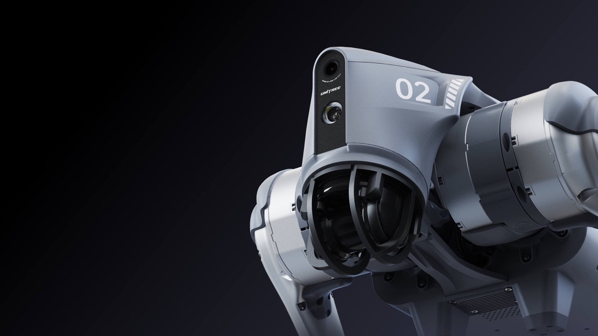
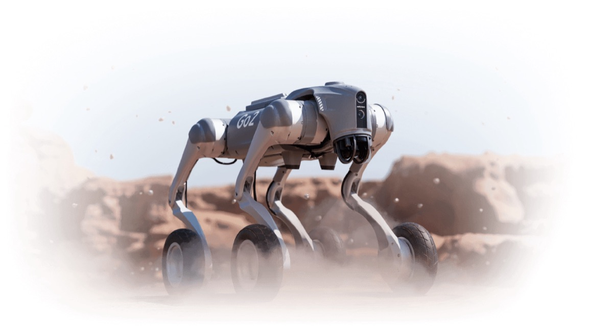
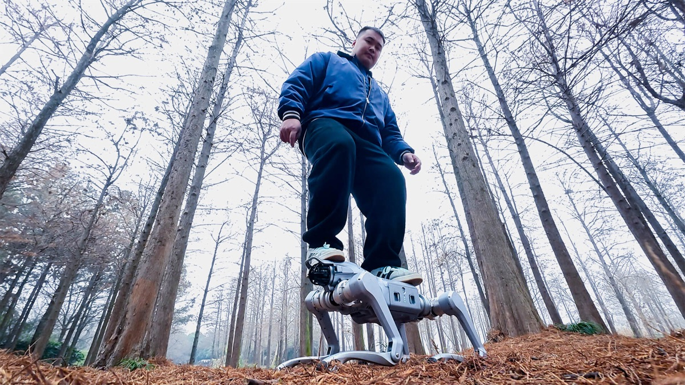
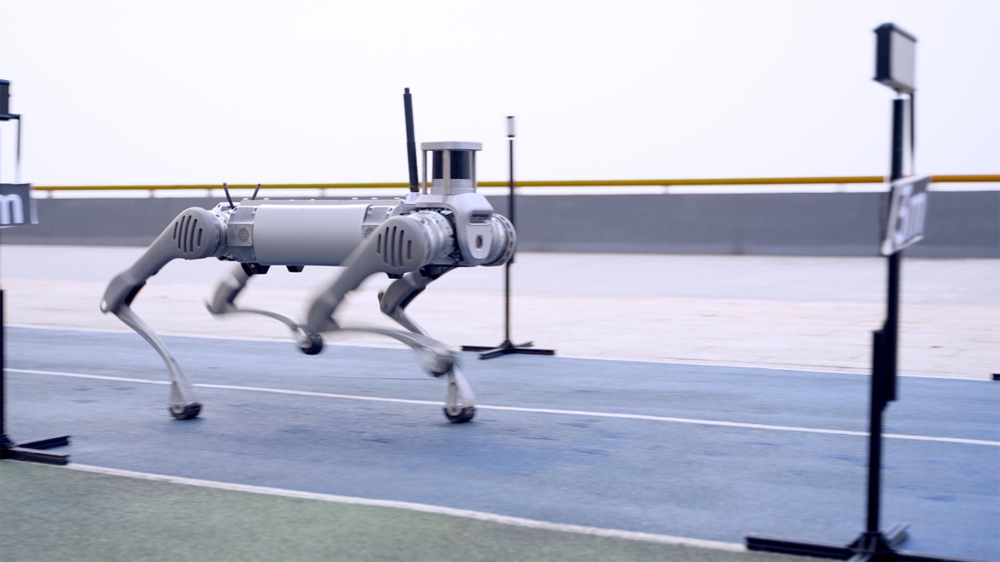
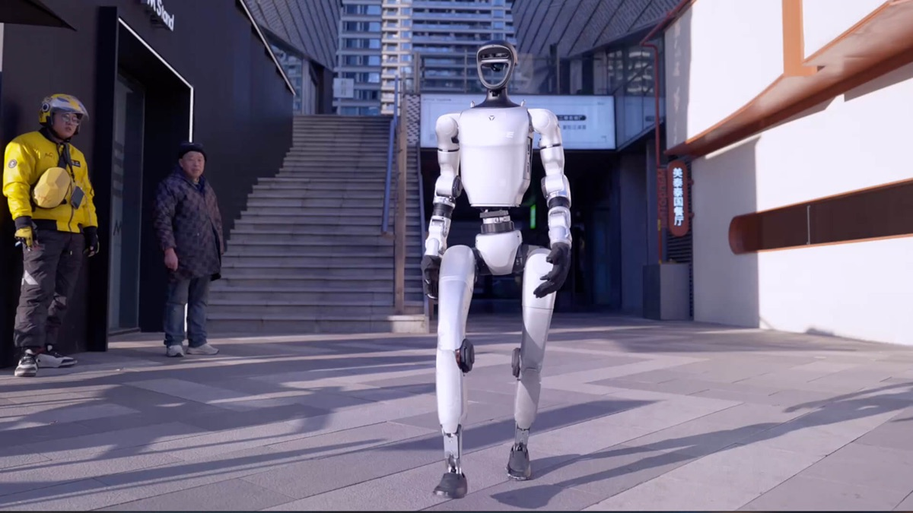
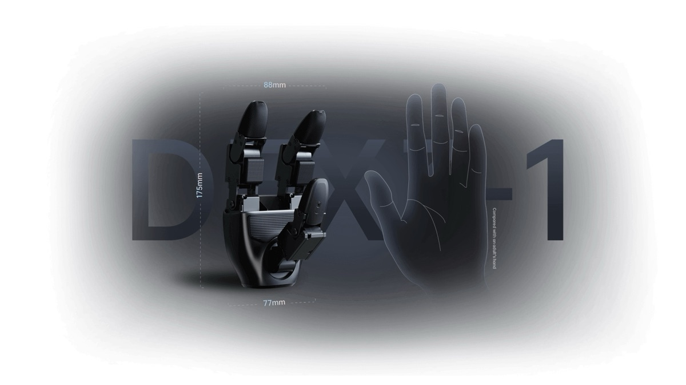
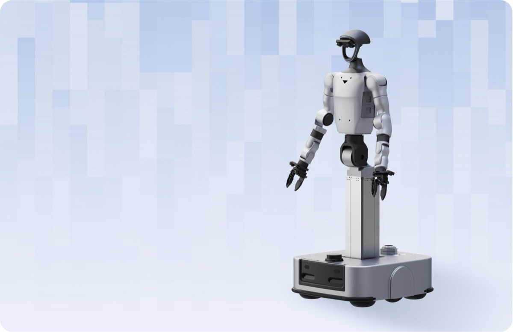
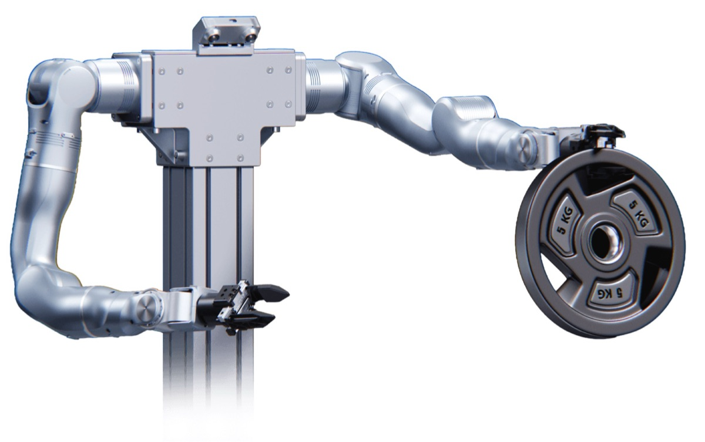

# Unitree Robotics × T03 — Products and Solutions

⬆ [Unitree Robotics profile](../Unitree.md) · [Brief](Unitree-T03-1-Brief.md) · [Playbook](Unitree-T03-3-Playbook.md)

**Read this first:** Unitree sells robots, not sustainability applications. For T03 its value is (a) a legged sensor carrier that reaches places wheels cannot, and (b) a humanoid data-collection and imitation-learning pipeline for a small sorting task. Which units are on site is **not confirmed** — check the variant (EDU or not) before you commit.

Research note: web search was unavailable for this run; findings rest on official Unitree pages, the official GitHub organisation and the company profile. "Not found" below means not found in those sources.

## Relevant products (ranked for this track)

### Go2 (Air / Pro / X / EDU)

**Role in T03:** default mobile sensing platform — carries a thermal camera, gas / air-quality sensor or RGB camera through buildings, plant rooms, stairs and paths; litter / bin scouting; energy-leak patrol.

| Spec | Value |
|---|---|
| Weight | **~15 kg** |
| Payload | ~7–8 kg (max 10–12 kg) — enough for sensors plus a small compute box |
| Speed | up to 3.7 m/s (EDU ~5 m/s peak) |
| Runtime | **1–2 h** standard; EDU 15,000 mAh battery: **2–4 h** |
| Sensors | 4D LiDAR L2 (360° × 96°), front HD camera |
| Compute | 8-core CPU; EDU: optional Orin module (40–100 TOPS) |
| Weather rating | none stated — treat as fair-weather / indoor |

- **Status / price:** ✅ shipping. Air **$1,600** · Pro **$2,800** · X **$4,500** · EDU contact sales.
- **Developer interface:** **EDU only for full access** (Air / Pro none, X partial). unitree_sdk2 / unitree_sdk2_python over DDS: high-level sport client (velocity move, stand / sit, attitude, trajectory follow), obstacle-avoidance switch, front-camera frames (OpenCV example), light / volume, low-level joint control (not needed here). ROS 2 through unitree_ros2.

### Go2-W

**Role in T03:** same sensing role with wheels — more energy-efficient on flat floors and roads, still climbs stairs. A good story for "resource-efficient rounds".

| Spec | Value |
|---|---|
| Weight | **~18 kg** with battery |
| Payload | ~8 kg (max ~12 kg) |
| Speed | up to 2.5 m/s |
| Runtime | **1.5–3 h** (33.6 V, 15,000 mAh) |
| Terrain | climb / drop height up to ~70 cm, slope up to 35° |
| Sensors / compute | wide-angle 3D LiDAR, HD wide camera; 8-core CPU, Orin NX expansion available |

- **Status / price:** ✅ shipping; price not public.
- **Developer interface:** secondary development supported per the product page; exact API parity with Go2 EDU ⚠️ unverified — ask on site.

### As2 (Air / Pro / X / EDU)

**Role in T03:** the outdoor / all-day version of the same idea — weather-rated, long runtime, and the smallest dog officially stated to carry a **D2 arm** (single arm). Best choice for snow, rain and long monitoring loops.

| Spec | Value |
|---|---|
| Weight | **~20 kg** |
| Walking load | ~15 kg (Air ~10 kg) |
| Runtime / range | **>4 h / >13 km** unloaded (648 Wh) |
| Protection | **IP54** (Pro / X / EDU) |
| Compute | EDU: optional Orin NX dock |

- **Status / price:** ✅ shipping (unveiled 24 Feb 2026); contact sales.
- **Developer interface:** SDK on **X and EDU** variants. Listed in Unitree's official inspection solution (industrial variant).

### A2 / A2-PRO and B2

**Role in T03:** the robots Unitree's own inspection solution actually uses for energy and water infrastructure. Relevant if one is on site as a showpiece; heavy for a 48-hour team.

| Spec | A2 / A2-PRO | B2 |
|---|---|---|
| Weight | ~42 kg | ~60 kg |
| Walking load | ~25 kg | >40 kg |
| Runtime / range | >5 h / ~20 km unloaded | 4–6 h, >20 km unloaded (2,250 Wh) |
| Protection | **IP56** (PRO: core parts IP67) | **IP67** |
| Compute for user code | Intel i7 | i5 + i7, optional Orin NX |

- **Status / price:** ✅ shipping; contact sales.
- **Developer interface:** unitree_sdk2 high- and low-level; unitree_ros2 lists Go2 and B2. The packaged inspection software (routes, meter reading, reports) is a commercial solution — open API access to it is **not public**.

### G1 / G1 EDU with Dex3-1

**Role in T03:** manipulation demo — sort a few waste classes into bins, or a simple repair / reuse step — learned from teleoperated demonstrations. Slow and low-throughput; it demonstrates the method, not a recycling line.

| Spec | Value |
|---|---|
| Size | **1.32 m**, **~35 kg** |
| DoF | 23 (EDU 23–43) |
| Runtime | **~2 h** |
| Sensors | depth camera + 3D LiDAR |
| Hands | Dex3-1: 3 fingers, **7 DoF** per hand, optional tactile arrays |

- **Status / price:** ✅ shipping. G1 **$13.5K**; EDU contact sales; Dex3-1 price not public.
- **Developer interface:** EDU only. Arm / hand joint control over DDS; teleoperation and episode recording through xr_teleoperate; policy training through unitree_lerobot.

### G1-D (Standard / Flagship)

**Role in T03:** the better sorting robot if it is on site — wheeled base (no balance risk), lift column, two wrist cameras, and a ready data-collection → training → deployment toolchain.

| Spec | Value |
|---|---|
| Arms | 7-DoF, **~3 kg per arm** |
| Height range | 1.26–1.68 m (lift column) |
| Weight | ~90 kg |
| Runtime | ~2 h / ~6 h (Standard / Flagship) |
| Cameras | head stereo + 2 wrist |

- **Status / price:** ✅ shipping; price not public. On-site availability not confirmed.
- **Developer interface:** unitree_robotskills exposes arm poses, gripper, base motion and navigation as bounded tools (MCP / agent-driven) on top of SDK2.

### D2 (and the older Z1) — arms for a quadruped

**Role in T03:** turns a monitoring dog into a litter picker or valve / switch operator.

| Spec | D2 | Z1 (Air / Pro) |
|---|---|---|
| DoF | 7 + 1 gripper | 6 |
| Payload | **3 kg** rated (5 kg max) | 2 kg / ≥3 kg |
| Reach | 612 mm arm, 760 mm working radius | 740 mm |
| Weight | 5.9 kg | 4.3 / 4.5 kg |
| Power | 36–58 V | 24 V, >20 A, max 500 W |
| Control | SDK, drag teaching, 500 Hz | position + force control, collision detection; Ethernet |
| Mounting stated by Unitree | **A2 / As2** (As2: single arm only) | AlienGo / B1 "and other mobile robots" |

- **Status / price:** ✅ listed; prices not public.
- **Caveat:** neither page states Go2 mounting. D1-T is the Go2-class servo arm (specs ⚠️ unverified). Do not plan a Go2 + arm build unless the booth has the mount and power cable ready.

### 4D LiDAR L1 / L2

**Role in T03:** already on Go2 (L2, 360° × 96°); usable for mapping, bin fill-level or snow-pile volume estimation. Standalone price not public. point_lio_unilidar provides LiDAR-inertial SLAM for the L1.

## What Unitree Robotics already does in this domain

| What | Detail | Date | Source |
|---|---|---|---|
| Quadruped inspection solution (official) | B2 / A2 / As2 with thermal dual-sensor gimbal (640×512 thermal, −20 to 550 °C), acoustic imaging camera, gas sensor, optional arm. Functions: scheduled autonomous patrol, meter reading, thermal-anomaly / leak / corrosion detection, auto return-to-charge, automatic reports with historical comparison | current page; no dates given | [Unitree inspection solution](https://www.unitree.com/mobile/industry/electricity) |
| T03-relevant cases on that page | **Smart water plant** inspection (B2) · **hydropower station** equipment inspection (B2) · **renewable-energy site, 110 kV substation** (A2) · "smart city" scenarios: urban parks, underground utility tunnels, industrial parks, dams | customers and dates **not public** | same page |
| Waste sorting, recycling, litter picking | **Nothing found** from Unitree itself | — | — |
| EV charging, urban farming, building automation | **Nothing found** | — | — |
| Europe / Switzerland sustainability pilots | **Nothing found** | — | — |

Bottom line: Unitree's real T03 footprint is *infrastructure condition monitoring that avoids energy and water losses*. Everything else would be built by you.

## What they are building next in this domain

- **No sustainability-specific roadmap is public.**
- **Inference:** the inspection line is widening downward (As2, Feb 2026, IP54, >4 h) — cheaper patrol robots make routine energy / water monitoring rounds more plausible for small municipalities.
- **Inference:** wheel-legged "-W" variants (Go2-W, As2-W, A2-W, B2-W) reduce energy per kilometre on paved routes — relevant if your pitch counts the robot's own footprint.
- **Announced:** agent-style skill framework (unitree_robotskills, G1-D / R1-D) and NVIDIA Isaac GR00T workflow for G1 (announced 1 Jun 2026) — general manipulation, which sorting tasks could later ride on.
- **Stated in IPO filing (per profile):** household / elder-care humanoids by about 2030 — not a T03 item.

## Software, models and data that help for this track

| Asset | Use in a T03 build | Status |
|---|---|---|
| [unitree_sdk2](https://github.com/unitreerobotics/unitree_sdk2) / [unitree_sdk2_python](https://github.com/unitreerobotics/unitree_sdk2_python) | Drive the dog from Python: velocity moves, trajectory follow, obstacle-avoidance switch, front-camera frames. Needs Python ≥ 3.8, cyclonedds 0.10.2 | ✅ |
| unitree_ros2 | Native ROS 2 topics for Go2 / B2 → plug into Nav2, SLAM, your sensor nodes | ✅ (not re-fetched this run) |
| unitree_mujoco | Test patrol logic without the robot; same SDK interface | ✅ |
| point_lio_unilidar | LiDAR-inertial SLAM for Unitree LiDAR (written for L1; L2 use ⚠️ unverified) | ✅ |
| [xr_teleoperate](https://github.com/unitreerobotics/xr_teleoperate) | Teleoperate G1 / H1 / H2 / R1 with Dex3-1, Dex1-1, Inspire or BrainCo hands from Apple Vision Pro, PICO 4 Ultra Enterprise or Meta Quest 3; `--record` saves episodes; `--sim` for Isaac Lab | ✅ |
| [unitree_lerobot](https://github.com/unitreerobotics/unitree_lerobot) | Convert recorded episodes to LeRobot format; train ACT, Diffusion, Pi0, Pi05 or GR00T; evaluate on the real G1. Example dataset: `unitreerobotics/G1_Dex3_ToastedBread_Dataset` on Hugging Face | ✅ |
| unitree_sim_isaaclab | Simulated G1 / H1-2 manipulation scenes for data and policy tests | ✅ |
| [unitree_robotskills](https://github.com/unitreerobotics/unitree_robotskills) | Pattern for LLM-agent control (observe → reason → act → verify, MCP navigation tools) on G1-D / R1-D; Apache-2.0 | ✅ new (Oct 2026), small |
| UnifoLM-WMA-0 / VLA-0 | Pretrained manipulation models; fine-tuning in 48 h is unrealistic for most teams | ✅ open (WMA-0 non-commercial) |

No Unitree dataset or model for waste, litter, thermal or environmental data was found — use public detectors (for example a generic litter-detection dataset) and your own captures.

## Gaps and limits for this track

- **No sustainability payloads in the box.** Thermal, gas and acoustic sensors belong to the commercial inspection kits for B2 / A2 / As2; a hackathon Go2 has LiDAR and an RGB camera only. Bring or borrow sensors (USB thermal camera, CO₂ / PM sensor).
- **Variant trap.** Go2 Air / Pro cannot be programmed through the SDK; G1 and R1 base models likewise need EDU.
- **Go2 is not weather-rated.** Outdoor snow demos belong on As2 / A2 / B2.
- **No open map-based navigation product for Go2 confirmed** — plan on your own SLAM / Nav2 or simple waypoint following ⚠️ verify with the engineers.
- **Manipulation is light and slow:** ~3 kg per arm class; learned policies need hours of demos and a GPU; expect a narrow task with a modest success rate.
- **Robot energy use:** legged locomotion is not efficient; a sustainability pitch must show the saved resource outweighs the robot's own footprint.
- **No published impact numbers** (energy saved, leaks found) for any Unitree deployment.

## Sources

- [Unitree Robotics company profile (internal; product specs verified there from official pages)](../Unitree.md)
- [Unitree — Advanced quadruped inspection solution](https://www.unitree.com/mobile/industry/electricity)
- [Unitree Go2-W product page](https://www.unitree.com/go2-w)
- [Unitree Z1 product page](https://www.unitree.com/z1)
- [Unitree D2 product page](https://www.unitree.com/D2)
- [Unitree GitHub organisation](https://github.com/unitreerobotics)
- [unitree_sdk2_python](https://github.com/unitreerobotics/unitree_sdk2_python)
- [xr_teleoperate](https://github.com/unitreerobotics/xr_teleoperate)
- [unitree_lerobot](https://github.com/unitreerobotics/unitree_lerobot)
- [unitree_robotskills](https://github.com/unitreerobotics/unitree_robotskills)
