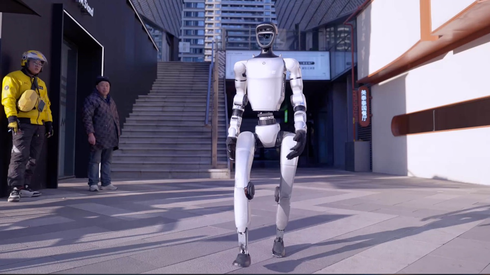
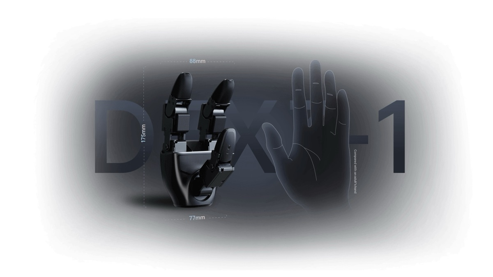
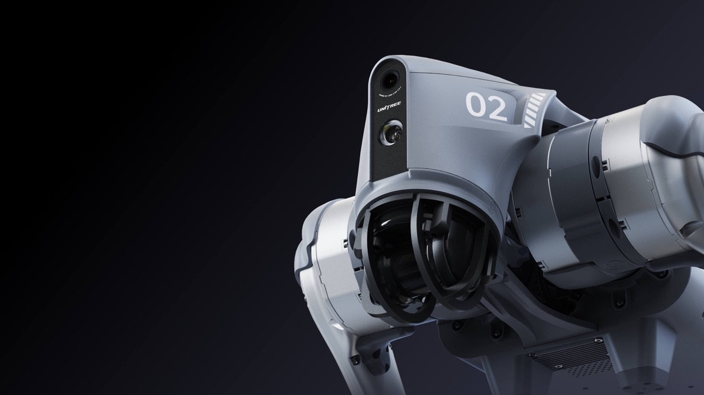
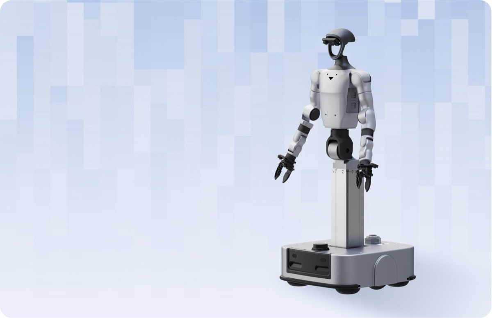
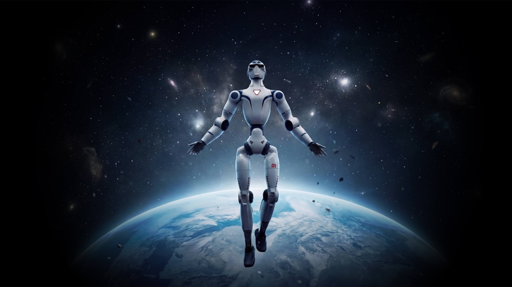
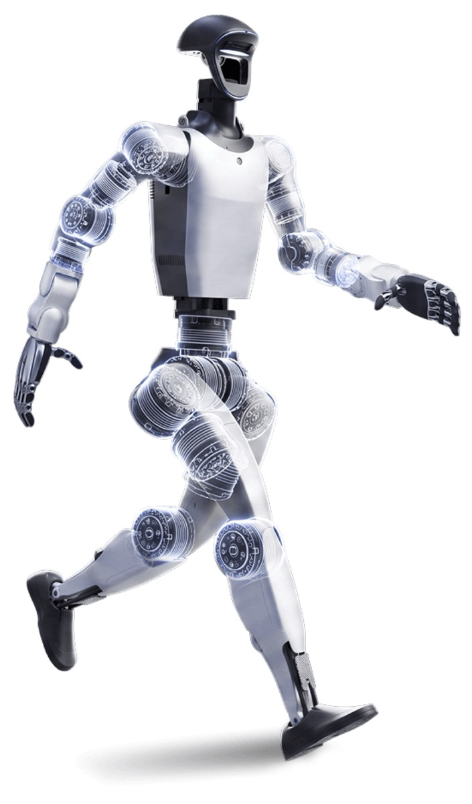

# Unitree Robotics × T04 — Products and Solutions

⬆ [Unitree Robotics profile](../Unitree.md) · [Brief](Unitree-T04-1-Brief.md) · [Playbook](Unitree-T04-3-Playbook.md)

**Bottom line:** Unitree has **no care or rehabilitation product and no confirmed care deployment**. What it offers for T04 is affordable general-purpose robots (G1, Go2, R1) plus the strongest open teleoperation / imitation-learning toolchain on site. Treat every robot as "keep a safe distance from people" — that is what Unitree's own product pages say.

Research note: web search was unavailable in this run; findings rest on official Unitree pages and repositories fetched today plus the company profile. Third-party care pilots may exist that were not found.

## Relevant products (ranked for this track)

### G1 / G1 EDU

**Role in T04:** the main candidate. Human-shaped exercise demonstrator, voice companion, light fetch-and-handover, teleoperated tele-care avatar. All Unitree teleoperation and imitation-learning repos target it.

| Spec | G1 | G1 EDU |
|---|---|---|
| Size / weight | 1.32 m, **~35 kg** | same (35 kg+) |
| DoF | 23 | **23–43** (with hands) |
| Arm max load | ~2 kg | **~3 kg** (depends on posture) |
| Battery | **~2 h**, 9,000 mAh quick-release | same |
| Sensors | depth camera + 3D LiDAR | same |
| Audio | **4-mic array, 5 W speaker** | same |
| Compute | 8-core CPU | + optional Orin-class module |
| SDK (secondary development) | **No** | **Yes** |

- **Status / price:** ✅ shipping · G1 **$13.5K** list · EDU: contact sales.
- **Developer interface (EDU):** high-level locomotion (velocity, postures), upper-body arm control while the factory balance controller keeps running, full low-level joint control, camera / LiDAR streams, on-board audio. Exact audio / TTS service names: ⚠️ unverified in this run — check support.unitree.com or ask on site.
- **T04 caveat:** Unitree's page asks users to keep a sufficient safe distance between the humanoid and people.

### Dex3-1

**Role in T04:** the G1's hand for picking up a pill box, cup or towel and handing it over.

| Spec | Value |
|---|---|
| DoF | **7** (thumb 3, index 2, middle 2) |
| Weight | 710 g |
| Grasp load | **max 500 g** (5 cm round hard object) |
| Tactile (optional) | 33 pressure sensors in 9 arrays, 10 g–2,500 g range |
| Control | hybrid force / position, USB 2.0 at 1,000 Hz |

- **Status / price:** ✅ shipping · price not public.
- **Developer interface:** per-joint commands and tactile readings through the SDK; supported as `dex3` in xr_teleoperate and unitree_lerobot.
- **T04 caveat:** 500 g rules out a full 0.5 l bottle held from above with margin; choose light objects.

### Go2 (Air / Pro / X / EDU)

**Role in T04:** night-round and fall-response scout, small-item courier (medication pouch, water, phone), companion "dog". Lowest risk of all Unitree robots around people because it is small and low to the ground.

| Spec (from company profile, official page) | Value |
|---|---|
| Weight | **~15 kg** |
| Payload | ~7–8 kg (max 10–12 kg) |
| Runtime | 1–2 h (EDU large battery: 2–4 h) |
| Perception | 4D LiDAR L2 (360° × 96°), front camera |
| Compute (EDU) | optional Orin module (40–100 TOPS) |
| SDK | **EDU full · X partial · Air / Pro none** |

- **Status / price:** ✅ shipping · Air **$1,600** · Pro **$2,800** · X **$4,500** · EDU contact sales.
- **Developer interface (EDU):** Python / C++ sport client (stand, sit, velocity, attitude, trajectories), obstacle-avoidance switch, front-camera frames via OpenCV, volume and light control, wireless-controller state, low-level joint control (requires disabling sport mode).
- **T04 caveat:** a quadruped is a trip hazard for people with walkers; keep it out of the walking path and slow.

### G1-D (Standard / Flagship)

**Role in T04:** the form factor care actually needs — wheeled base that cannot fall over, lift column to reach floor and shelf heights. **Presence on site not confirmed.**

| Spec | Standard | Flagship |
|---|---|---|
| Height (lift column) | 1.26–1.68 m | same |
| Weight | ~90 kg | ~90 kg |
| DoF (without hands) | 17 | 19 |
| Arm payload | **~3 kg per arm** | same |
| Base | speed not listed; whether the base is driven is ⚠️ unverified | differential drive, **1.5 m/s**, turns in place |
| Runtime | ~2 h | **~6 h** |
| Sensors | head stereo + 2 wrist cameras | + LiDAR, 2 depth cameras, collision and low-obstacle sensors |
| Compute | 8-core CPU, optional Orin NX 16 GB | same |

- **Status / price:** ✅ listed · price not public.
- **Developer interface:** data-collection, training and deployment toolchain (task templates, annotation, export to common training formats, simulation test); page names Pi and GR00T models as integrated. Listed scenarios are service, life, retail and industry — healthcare is **not** mentioned.

### R1 (Air / R1 / EDU)

**Role in T04:** lighter, cheaper companion / exercise-demonstrator alternative to G1.

| Spec | Value |
|---|---|
| Size / weight | 1.23 m, **27–29 kg** |
| DoF | 20 (Air) · 26 (R1) · 26–40 (EDU) |
| Battery | **~1 h** |
| Audio / vision | 4-mic array + speaker; mono (Air) or stereo camera |
| Built-in AI | voice and image interaction via an integrated multimodal model |
| SDK | **EDU only** |

- **Status / price:** ✅ shipping · Air **$4,900** · R1 **$5,900** · EDU contact sales.
- **T04 caveat:** 1 h battery; dexterous hands only as EDU option; supported in xr_teleoperate since v1.6.

### G1+ / G1+ EDU

**Role in T04:** same as G1, with better interaction hardware: 2-DoF neck, stereo + wide camera, **6-mic array**, stronger shoulder / waist motors, external power option (useful for an all-day stationary coach). ✅ · **$15K** list, EDU contact sales. Whether the open repos already support it: ⚠️ unverified.

### UnifoLM (WMA-0, VLA-0) and UniPlatform / UniStore

**Role in T04:** pretrained manipulation models and datasets for household-style tasks on G1. See the software section below.

## What Unitree Robotics already does in this domain

**Nothing care-specific was found.** No care-home pilot, rehabilitation product, medical certification or healthcare partner appears on Unitree's site or in the sources checked.

| Date | What | Relevance to T04 |
|---|---|---|
| 29 Jan 2026 | UnifoLM-VLA-0 code and weights released; one policy performs **12 manipulation task categories** on G1, with open datasets including **Pour Medicine, Fold Towel, Wipe Table, Clean Table, Prepare Fruit** ([repo](https://github.com/unitreerobotics/unifolm-vla)) | Household-chore manipulation, lab setting only |
| 2026 (ongoing) | **246 public datasets** on Hugging Face, e.g. fold socks, hang socks to dry, tidy slippers, pick up cushions ([Hugging Face](https://huggingface.co/unitreerobotics)) | Daily-living task data |
| 2025–26 | R1 marketed with built-in voice + image interaction ([R1 page](https://www.unitree.com/R1)) | Companion-style interaction, consumer-grade |
| Research community | Universities have used Unitree quadrupeds as robotic guide dogs and G1 for assistive studies | ⚠️ unverified in this run — third-party work, not Unitree's own |

## What they are building next in this domain

- **Stated goal:** the March 2026 IPO filing describes a general-purpose humanoid foundation model by about 2030 and expansion into **household services, elder care and daily living** once generalisation, reliability and safety mature ([Notebookcheck](https://www.notebookcheck.net/Beyond-kung-fu-Unitree-plans-humanoid-robot-for-household-chores-and-elder-care-by-2030.1255707.0.html)). No dates, products or pilots for elder care are given.
- **Model line is moving fast:** Hugging Face now lists UnifoLM-WMA-0, UnifoLM-ER-1 / ER-Flow and UnifoLM-WLA-1.0-Base (most recent entries dated September). Details not checked in this run.
- **Inference (ours):** G1-D (wheeled, lift column, data toolchain) and H2 Plus (NVIDIA GR00T reference, announced 1 Jun 2026) show Unitree is building the data and manipulation layer first; care applications will likely come from partners and researchers before Unitree itself.

## Software, models and data that help for this track

| Asset | What it gives a T04 team | Notes |
|---|---|---|
| [unitree_sdk2_python](https://github.com/unitreerobotics/unitree_sdk2_python) | Python control in minutes: sport client, camera, obstacle avoidance, volume / lights | Python ≥ 3.8, CycloneDDS 0.10.2; laptop on the robot's Ethernet |
| [xr_teleoperate](https://github.com/unitreerobotics/xr_teleoperate) | Teleoperate G1 (23 / 29 DoF), H1, H1-2, H2, R1 from **Apple Vision Pro, PICO 4 Ultra Enterprise or Meta Quest 3**; hands: Dex1-1, Dex3-1, Inspire, BrainCo; `--record` saves episodes; `--sim` runs in Isaac Lab | Needs a host PC (Ubuntu 20.04 / 22.04) and the robot's development computer; soft e-stop on controllers |
| [unitree_lerobot](https://github.com/unitreerobotics/unitree_lerobot) | Convert teleop data → train **ACT, Diffusion, Pi0, Pi05, GR00T** → deploy on G1 (`eval_g1.py`) or in sim | GPU needed for training; example dataset `G1_Dex3_ToastedBread_Dataset` |
| [unifolm-vla](https://github.com/unitreerobotics/unifolm-vla) | Pretrained VLA for G1 manipulation; fine-tune on own data (RLDS format) | VRAM needs and licence not stated on the page — do not plan on it without a strong GPU |
| [Hugging Face datasets](https://huggingface.co/unitreerobotics) | 246 G1 datasets for pretraining or as task templates | Mostly Dex1 gripper and Inspire / BrainCo hands — check that the hand matches yours |
| unitree_mujoco / unitree_sim_isaaclab | Test behaviours in simulation with the same DDS interface before touching the robot | Useful while waiting for robot time |
| On-board audio | 4-mic array + speaker on G1 / R1 for voice dialogue | Simplest robust path: run speech recognition, LLM and TTS on a laptop and send audio or text to the robot |

## Gaps and limits for this track

- **No human-contact safety case.** No certified collaborative operation, no medical-device status. Official pages demand a safe distance from humanoids.
- **Bipeds can fall.** G1 (~35 kg) or R1 (~29 kg) next to a frail person is a real hazard; use a gantry, keep it stationary, or keep 1.5 m+ distance.
- **Weak payload.** ~2–3 kg per arm, 500 g per Dex3-1 grasp: no lifting, transfer or weight-bearing walking support.
- **No arm force / torque sensing at the wrist** advertised for physical therapy or massage; for contact tasks use a force-controlled arm from another vendor (Flexiv, ROKAE).
- **SDK only on EDU variants.** A non-EDU G1, R1 or Go2 Air / Pro is a remote-controlled demo unit, not a development platform.
- **Short runtime.** G1 ~2 h, R1 ~1 h, Go2 1–2 h — plan batteries for demo day.
- **No built-in indoor navigation product for humanoids** was confirmed; mapping and navigation on Go2 via the SDK is ⚠️ unverified in this run.
- **Learned manipulation is brittle in 48 h.** Expect one narrow task with fixed object positions, not general household help.

## Sources
- [Unitree G1 product page](https://www.unitree.com/g1)
- [Unitree G1-D product page](https://www.unitree.com/G1-D)
- [Unitree Dex3-1 product page](https://www.unitree.com/Dex3-1)
- [Unitree R1 product page](https://www.unitree.com/R1)
- [Unitree Go2 product page (specs taken from the company profile)](https://www.unitree.com/go2)
- [Unitree G1+ product page (specs taken from the company profile)](https://www.unitree.com/G1pl)
- [Unitree GitHub organisation](https://github.com/unitreerobotics)
- [xr_teleoperate repository](https://github.com/unitreerobotics/xr_teleoperate)
- [unitree_lerobot repository](https://github.com/unitreerobotics/unitree_lerobot)
- [unifolm-vla repository](https://github.com/unitreerobotics/unifolm-vla)
- [unitree_sdk2_python repository](https://github.com/unitreerobotics/unitree_sdk2_python)
- [Unitree on Hugging Face](https://huggingface.co/unitreerobotics)
- [Notebookcheck — Unitree household / elder-care plans (20 Mar 2026)](https://www.notebookcheck.net/Beyond-kung-fu-Unitree-plans-humanoid-robot-for-household-chores-and-elder-care-by-2030.1255707.0.html)
- [PR Newswire — Unitree H2 Plus announcement (1 Jun 2026, via company profile)](https://tools.prnewswire.com/en-us/live/20823/release/20260601EN72140)
