# Unitree Robotics — Product Portfolio

⬆ [Unitree Robotics profile](Unitree.md) · [Developer guide](Unitree-Developer-Guide.md) · [Roadmap and strategy](Unitree-Roadmap-and-Strategy.md)

> **Read this first:** on almost every Unitree robot, **only the EDU variant has full SDK ("secondary development") access**. Go2 Air / Pro, G1 (base), R1 Air / R1 (base) are app-and-remote products. Check the label on the unit before you plan anything.
> Specs below are from the official product pages as fetched on 2026-11-14 (lab values per Unitree). Prices are official list prices in USD, excluding tax and shipping. Launch dates marked ⚠️ are from memory, not re-verified.

## Lineup map

Track relevance: ● strong · ◐ partial · ○ none. Status: ✅ shipping · 🧪 announced / preview · 🔭 roadmap.

| Product | Category | Status | Launched | Price (if public) | Positioning (one line) | T01 | T02 | T03 | T04 |
|---|---|---|---|---|---|---|---|---|---|
| Go2 (Air / Pro / X / EDU) | Small quadruped | ✅ | 2023 ⚠️ | Air **$1,600** · Pro **$2,800** · X **$4,500** · EDU contact sales | 15 kg dog with 4D LiDAR; the default developer quadruped (EDU) | ● | ● | ◐ | ◐ |
| Go2-W | Wheel-legged small quadruped | ✅ | 2024 ⚠️ | not public | Go2 with 7-inch wheels; faster on flat ground, still climbs | ● | ◐ | ◐ | ○ |
| As2 (Air / Pro / X / EDU) | Compact industrial quadruped | ✅ | 24 Feb 2026 | contact sales | 20 kg, IP54, >4 h; Go2 size with industrial endurance | ● | ● | ◐ | ◐ |
| As2-W | Wheel-legged compact quadruped | ✅ | 2026 ⚠️ | contact sales | 25 kg, >6 m/s peak, ~30 km range unloaded | ● | ● | ◐ | ○ |
| A2 / A2-PRO | Mid-size industrial quadruped | ✅ | 2025 ⚠️ | contact sales | 42 kg, 25 kg walking load, IP56, >5 h | ◐ | ● | ◐ | ○ |
| A2-W | Wheel-legged mid-size quadruped | ✅ | not confirmed | contact sales | 52 kg, hot-swap dual batteries, ~35 km unloaded | ● | ● | ◐ | ○ |
| B2 | Large industrial quadruped | ✅ | 2023 ⚠️ | not public | 60 kg, >40 kg walking load, IP67, 4–6 h | ◐ | ● | ◐ | ○ |
| B2-W | Wheel-legged large quadruped | ✅ | 2024 ⚠️ | not public | 85 kg, 15 km/h, 25 km with 40 kg load | ◐ | ● | ◐ | ○ |
| B2-Ex | Explosion-proof B2 | ✅ | not confirmed | not public | Ex-certified chassis for oil / gas / chemical inspection | ○ | ● | ◐ | ○ |
| R1 (Air / R1 / EDU) | Lightweight humanoid | ✅ | 2025 ⚠️ | Air **$4,900** · R1 **$5,900** · EDU contact sales | 1.23 m, 27–29 kg, cheapest humanoid; ~1 h battery | ◐ | ○ | ○ | ◐ |
| G1 / G1 EDU | Compact humanoid | ✅ | 2024 ⚠️ | G1 **$13.5K** · EDU contact sales | 1.32 m, 35 kg; the reference research humanoid | ◐ | ◐ | ○ | ● |
| G1+ / G1+ EDU | Compact humanoid (upgraded) | ✅ | 2026 ⚠️ | G1+ **$15K** · EDU contact sales | G1 with neck, better cameras / mics, stronger upper body | ◐ | ◐ | ○ | ● |
| G1-D (Standard / Flagship) | Wheeled dual-arm mobile manipulator | ✅ | 2025 ⚠️ | not public | G1 torso on wheeled lift base; manipulation + data collection | ● | ○ | ◐ | ● |
| H1 / H1-2 | Full-size humanoid (previous gen) | ✅ | 2023 ⚠️ | not public | 1.8 m research platform; H1-2 has 7-DoF arms | ○ | ◐ | ○ | ○ |
| H2 / H2 EDU | Full-size humanoid | ✅ | 2025 ⚠️ | H2 **$29,900** · EDU contact sales | 1.82 m, 70 kg, 31 DoF, 7 kg arm payload | ○ | ◐ | ○ | ◐ |
| H2-X / H2-X EDU | Next-gen full-size humanoid | ✅ | 2026 ⚠️ | H2-X **$25,400** · EDU contact sales | ~1.70 m, hot-swap dual batteries, Jetson Thor option | ○ | ◐ | ○ | ◐ |
| H2 Plus | GR00T reference humanoid | 🧪 | announced 1 Jun 2026 | not public | H2 + Sharpa Wave hands + Jetson AGX Thor | ○ | ○ | ○ | ◐ |
| GD01 | Pilotable transforming mecha | 🧪 / ✅ | May 2026 | from **RMB 3.9M** | Showpiece; not hackathon-relevant | ○ | ○ | ○ | ○ |
| Z1 (Air / Pro) | Light 6-axis arm | ✅ | 2022 ⚠️ | not public | 4.3–4.5 kg arm, 2–3 kg payload, 740 mm reach | ◐ | ◐ | ◐ | ◐ |
| D1-T | Small servo arm | ✅ | not confirmed | not public | 2.37 kg, 500 g payload; light add-on / data-collection arm | ◐ | ○ | ◐ | ◐ |
| D2 | 7-DoF arm with gripper | ✅ | not confirmed | not public | 5.9 kg, 3 kg rated payload; mounts on quadrupeds | ● | ◐ | ● | ◐ |
| R1-7a | 7-axis desktop arm | ✅ | 2026 ⚠️ | not public | 5.5 kg, 3–5 kg payload, 650 mm reach | ○ | ○ | ◐ | ◐ |
| Dex3-1 | 3-finger dexterous hand | ✅ | 2024 ⚠️ | not public | 7-DoF force-controlled hand for G1, 33 tactile sensors | ◐ | ○ | ◐ | ● |
| Dex5-1 | 5-finger dexterous hand | ✅ | 2025 ⚠️ | not public | 20 DoF (16 active), 94 tactile sensors | ○ | ○ | ○ | ● |
| Dex1-1 / Dex2/5 / Dex5-S | Gripper and hand variants | ✅ | not confirmed | not public | Dex1-1: 550 g parallel gripper, 5–120 N | ◐ | ○ | ◐ | ◐ |
| 4D LiDAR L1 / L2 | 3D LiDAR sensor | ✅ | L2: 2024 ⚠️ | L2 **$419** · L1 PM **$249** · L1 RM **$309** | 230 g, 360°×96°, 30 m; cheap SLAM sensor for any robot | ● | ● | ● | ◐ |
| Joint motors and components | Actuators, servos, dock | ✅ | — | not public | IM6014, GO-M8010-6, B1-16, A1 motor, SV1-25 servo, BA2 dock | ○ | ○ | ○ | ○ |
| UnifoLM (WMA-0, VLA-0), UniPlatform / UniStore | Models and platforms | ✅ / 🧪 | WMA-0: Sept 2025 | free (WMA-0 non-commercial licence) | World-model-action and VLA models; data / app platforms | ◐ | ○ | ○ | ◐ |

## Products

### Go2 (Air / Pro / X / EDU)

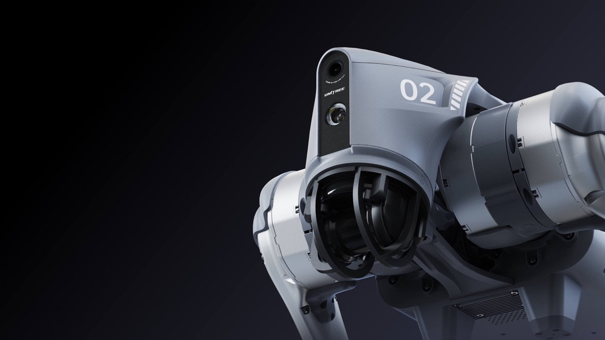

Small 12-motor quadruped with a 360°×96° 4D LiDAR L2 as standard. The most likely Unitree robot on a hackathon floor; safe weight class around people.

| Spec | Air | Pro | X | EDU |
|---|---|---|---|---|
| Price | **$1,600** | **$2,800** | **$4,500** | contact sales |
| Size standing | 70 × 31 × 40 cm | same | same | same |
| Weight (with battery) | **~15 kg** | ~15 kg | ~15 kg | ~15 kg |
| Payload | ~7 kg (max ~10) | ~8 kg (max ~10) | ~8 kg (max ~12) | **~8 kg (max ~12)** |
| Speed | 0–2.5 m/s | 0–3.5 m/s | 0–3.7 m/s (max ~5) | 0–3.7 m/s (max ~5) |
| Max step / slope | ~15 cm / 30° | ~16 cm / 40° | ~16 cm / 40° | ~16 cm / 40° |
| Peak joint torque | not stated | ~45 N·m | ~45 N·m | ~45 N·m |
| Battery / runtime | 8,000 mAh / 1–2 h | 8,000 mAh / 1–2 h | 8,000 mAh / 1–2 h | **15,000 mAh / 2–4 h** |
| Sensors | 4D LiDAR L2, HD wide camera | + tracking module | same as Pro | + **depth camera, foot force sensors** |
| Compute | not stated | 8-core CPU | 8-core CPU | 8-core CPU + optional Orin module (**40–100 TOPS**) |
| Connectivity | Wi-Fi 6, Bluetooth | + 4G / GPS | + 4G / GPS | + 4G / GPS |
| Voice, side-follow (ISS 2.0) | no | yes | yes | yes |
| Charging-dock compatible | no | no | yes | yes |
| **Secondary development (SDK)** | **no** | **no** | **partial** | **full** |
| Warranty | 6 months | 12 months | 12 months | 12 months |

- **IP rating:** not stated on the product page — treat as not weatherproof; snow and wet ground are at your own risk.
- **Typical use:** patrol, follow-me carrier, mapping (LiDAR point-cloud map + path replay in the app), inspection with a custom payload, guide-dog style demos.
- **Hackathon note:** ask whether the Orin module is fitted — without it you run your code on a laptop over Ethernet / Wi-Fi.
- Official page: [unitree.com/go2](https://www.unitree.com/go2)

### Go2-W

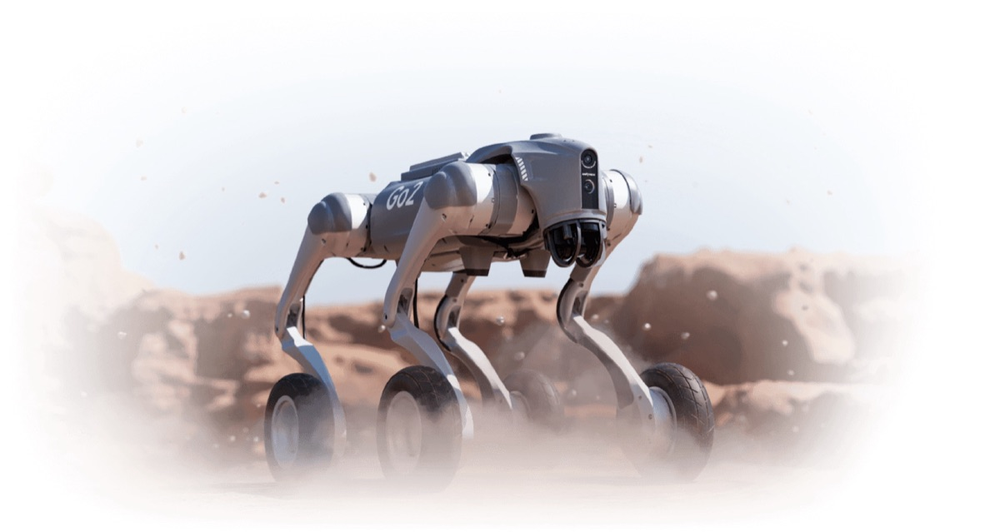

Go2 with driven wheels on each leg (16 motors): rolls on flat ground, steps over obstacles. Listed with secondary development and an Orin NX expansion option.

| Spec | Value |
|---|---|
| Size standing | 70 × 43 × 50 cm |
| Weight (with battery) | **~18 kg** |
| Payload | ~8 kg (max ~12 kg) |
| Speed | 0–2.5 m/s |
| Max climb / drop height | < 70 cm |
| Max slope | 35° |
| Joint motors / peak torque | 16 / ~45 N·m |
| Tyres | 7-inch pneumatic |
| Sensors | 3D LiDAR, HD wide camera |
| Compute | 8-core CPU; expansion module (e.g. Orin NX) |
| Connectivity | Wi-Fi 6, 4G, Bluetooth |
| Battery / runtime | 15,000 mAh / **1.5–3 h** |
| Price | not public |

- **Typical use:** fast delivery / patrol on paved paths with kerbs and stairs.
- Official page: [unitree.com/go2-w](https://www.unitree.com/go2-w)

### As2 (Air / Pro / X / EDU)

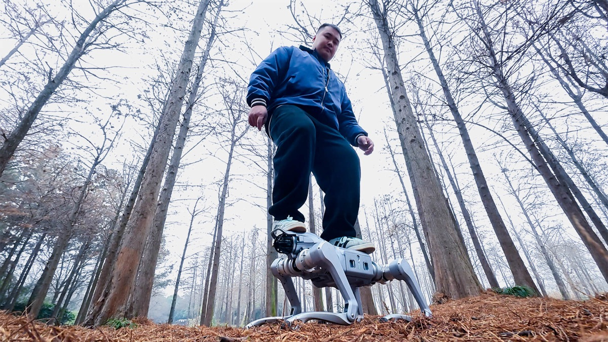

Compact industrial-grade quadruped unveiled 24 Feb 2026: Go2-class size with much longer endurance and weather sealing.

| Spec | Value |
|---|---|
| Weight | **~20 kg** |
| Walking load | ~15 kg (Air ~10 kg); standing up to ~65 kg |
| Speed | up to ~5 m/s |
| Battery / runtime | 648 Wh; **>4 h / >13 km** unloaded |
| IP rating | **IP54** (Pro / X / EDU) |
| SDK | X and EDU |
| Compute | EDU: optional Orin NX dock |
| Price | contact sales |

- **Typical use:** outdoor patrol and inspection, load carrying, side-follow.
- Official page: [unitree.com/As2](https://www.unitree.com/As2)

### As2-W

Wheel-legged As2 (16 motors), sold as **As2-W X** and **As2-W EDU**.

| Spec | Value |
|---|---|
| Size standing | 721 × 493 × 521 mm |
| Weight (with battery) | **~25 kg** |
| Speed | 0–3.7 m/s (max ~6 m/s) |
| Walking load | ~16 kg; standing ~150 kg |
| Slope / stairs | ~45° / 30 cm steps; max climb 0.4–0.8 m |
| Peak joint torque | ~95 N·m |
| Battery / runtime | 648 Wh (15,000 mAh); **~3 h, ~30 km** unloaded; >2 h with 16 kg |
| Sensors | 64–128-line LiDAR, HD camera |
| Compute | 8-core CPU; supports a 150 TOPS expansion module |
| Interfaces | Gigabit Ethernet × 1, SBUS × 1, battery power out |
| Connectivity | Wi-Fi 6, Bluetooth 5.2; GPS and 4G (off by default) |
| IP rating / temperature | **IP54** / −20 to 55 °C |
| Price | contact sales |

- Official page: [unitree.com/As2-W](https://www.unitree.com/As2-W)

### A2 / A2-PRO

Mid-size industrial quadruped between As2 and B2.

| Spec | Value |
|---|---|
| Weight (with battery) | **~42 kg** |
| Walking load | ~25 kg; standing ~100 kg |
| Speed | up to ~5 m/s |
| Runtime | **>5 h / ~20 km** unloaded |
| IP rating | **IP56** (PRO: core parts IP67, dual LiDAR) |
| Compute | 8-core CPU (platform) + Intel Core i7 (user development) |
| Price | contact sales |

- **Typical use:** industrial inspection, emergency response, payload carrier.
- Official page: [unitree.com/A2](https://www.unitree.com/A2)

### A2-W

Wheel-legged A2 (16 motors), sold as **A2-W** and **A2-W PRO**.

| Spec | Value |
|---|---|
| Size standing | 900 × 440 × 625 mm |
| Weight | ~45 kg without / **~52 kg** with battery |
| Speed | 0–3 m/s (up to ~6 m/s) |
| Walking load | ~25 kg; standing ~100 kg |
| Slope / stairs | ~45° / 30 cm steps; max climb 0.5–1 m |
| Peak joint torque | ~180 N·m |
| Battery | Dual hot-swap, 2 × 9,000 mAh (907 Wh total) |
| Runtime | **>3.5 h, ~35 km** unloaded; >1.5 h with 25 kg |
| Sensors | LiDAR × 1 + HD camera (PRO: LiDAR × 2) |
| Compute | 8-core CPU + Intel Core i7 (user); optional expansion dock |
| Interfaces | RS485 × 2, CAN × 2, Gigabit Ethernet × 2, USB 3.0 Type-C × 4, 12 V / 24 V / BAT out |
| IP rating / temperature | **IP56** (PRO: core parts IP67) / −20 to 55 °C |
| Price | contact sales |

- Official page: [unitree.com/A2-W](https://www.unitree.com/A2-W)

### B2

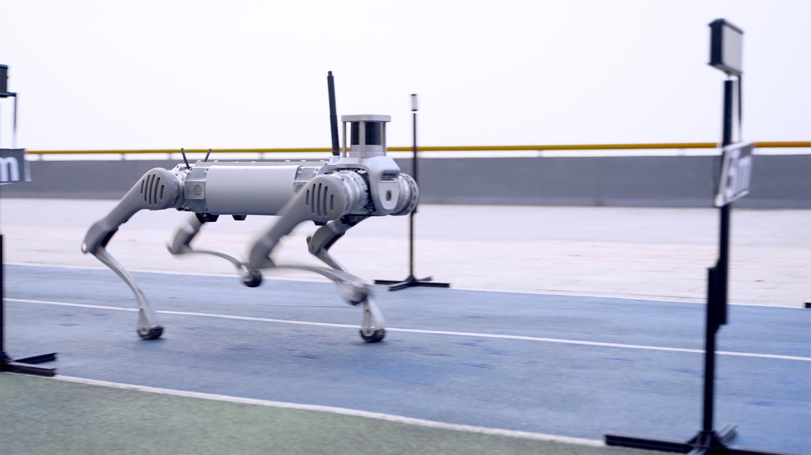

Large industrial quadruped; the base for Unitree's inspection and fire-rescue solutions.

| Spec | Value |
|---|---|
| Weight | **~60 kg** |
| Walking load | >40 kg; standing ≥120 kg |
| Slope / steps | >45° / 40 cm |
| Battery / runtime | 2,250 Wh; **4–6 h**, >20 km unloaded |
| IP rating | **IP67** |
| Compute | Intel Core i5 (platform) + i7 (user); optional Orin NX |
| Price | not public (contact sales) |

- **Typical use:** substation / tunnel inspection, firefighting payloads, heavy carry in rough terrain.
- **Hackathon note:** 60 kg robot — expect vendor-supervised use only.
- Official page: [unitree.com/b2](https://www.unitree.com/b2)

### B2-W

Wheel-legged B2.

| Spec | Value |
|---|---|
| Size standing | ~1098 × 550 × 758 mm |
| Weight (with battery) | **~85 kg** |
| Max speed | 15 km/h (special configuration; speed-limited in practice) |
| Range | ~30 km unloaded; up to 25 km with 40 kg |
| Load | >40 kg walking; 120 kg standing |
| Stairs / slope | 20–25 cm continuous stairs, 40 cm single step / >45° |
| Wheels | 225 mm; 40 N·m, 50 rad/s max |
| Battery | >2 kWh, 58 V |
| IP rating / temperature | **IP67** / −20 to 55 °C |
| Compute | Intel Core i5 + i7; optional i7 or Orin NX (up to 3 devices) |
| Price | not public |

- Official page: [unitree.com/b2-w](https://www.unitree.com/b2-w)

### B2-Ex

Explosion-proof B2 for oil and gas, chemical and mining sites. Not hackathon-relevant, but shows the T02 product depth.

| Spec | B2-Ex (chassis) | B2-Ex Inspection Solution |
|---|---|---|
| Explosion protection class | Ex db mb IIB T4 Gb | Ex db eb ib mb IIB T4 Gb |
| Weight (with battery) | ~130 kg | ~170 kg |
| Battery | 60 Ah (3,072 Wh) | same |
| Runtime | ≥7 h | ≥4 h (40 kg payload) |
| Payload | 40 kg walking, 70 kg max | standard superstructure |
| Slope / stairs | 45° / 20–25 cm | 30° / 20–25 cm |
| Speed | 0–1 m/s | 0–1 m/s |
| Payloads | — | Front and rear Ex LiDAR, bi-spectrum PTZ, gas sensor, autonomous navigation |

- Official page: [unitree.com/B2-Ex](https://www.unitree.com/B2-Ex)

### R1 (Air / R1 / EDU)

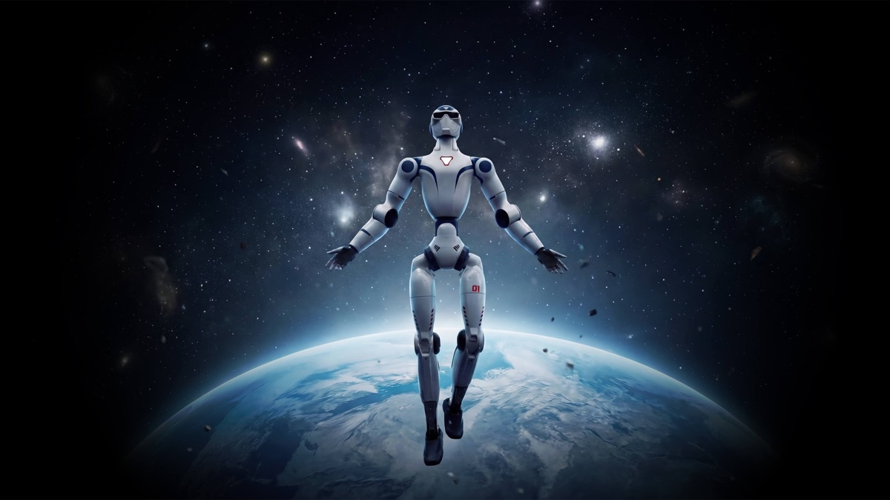

Lightweight, low-cost humanoid. Agile motion first; manipulation needs the EDU version with optional hands.

| Spec | R1 Air | R1 | R1 EDU |
|---|---|---|---|
| Price | **$4,900** | **$5,900** | contact sales |
| Height | 1.23 m | 1.23 m | 1.23 m |
| Weight (with battery) | ~27 kg | ~29 kg | ~29 kg |
| Total DoF | 20 | 26 | **26–40** |
| Arm / leg DoF | 4 / 6 | 5 / 6 | 5 / 6 |
| Waist / head DoF | — | 2 / 2 | 2 / 2 |
| Arm max load | ~3–5 kg (posture-dependent, as listed) | same | same |
| Dexterous hand | no | no | optional |
| Camera | monocular | binocular | binocular |
| Audio | 4-mic array, speaker | same | same |
| Compute | 8-core processor | 8-core processor | + optional Orin module (40–100 TOPS) |
| Connectivity | Wi-Fi 6, Bluetooth 5.2 | same | same |
| Battery life | **~1 h** | ~1 h | ~1 h |
| **Secondary development (SDK)** | no | no | **yes** |
| Warranty | 6 months | 8 months | 12 months |

- **Typical use:** motion / RL research, education, entertainment; companion-style demos.
- Official page: [unitree.com/R1](https://www.unitree.com/R1)

### G1 / G1 EDU

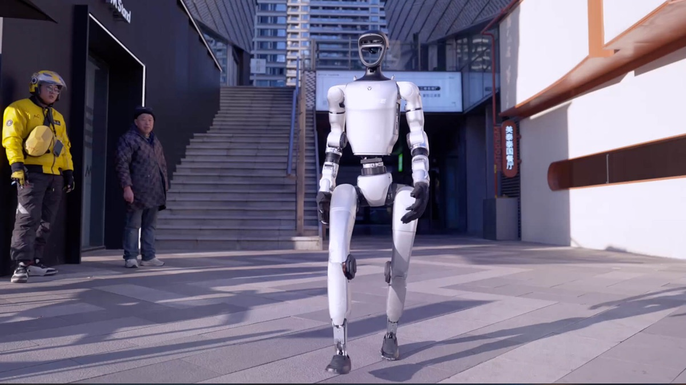

Compact humanoid and the de-facto research platform: most Unitree teleoperation, RL and VLA repos target it.

| Spec | G1 | G1 EDU |
|---|---|---|
| Price | **$13.5K** | contact sales |
| Size standing / folded | 1320 × 450 × 200 mm / 690 × 450 × 300 mm | same |
| Weight (with battery) | ~35 kg | ~35 kg+ |
| Total DoF | 23 | **23–43** |
| Leg / arm DoF | 6 / 5 | 6 / 5 (+2 optional wrist DoF) |
| Waist DoF | 1 | 1 (+2 optional) |
| Hand | none | optional **Dex3-1** (7 DoF, optional tactile arrays) |
| Max knee torque | 90 N·m | 120 N·m |
| Arm max load | ~2 kg | **~3 kg** |
| Sensors | Depth camera + 3D LiDAR, 4-mic array, 5 W speaker | same |
| Compute | 8-core CPU | + high-compute module (e.g. Orin) |
| Connectivity | Wi-Fi 6, Bluetooth 5.2 | same |
| Battery / runtime | 9,000 mAh quick-release / **~2 h** | same |
| **Secondary development (SDK)** | **no** | **yes** |
| Warranty | 8 months | 18 months |

- **Typical use:** teleoperation and imitation learning, fetch-and-hand-over, reception / guide, whole-body RL.
- **Limits:** ~3 kg per arm; a fall near a frail person is a real hazard — keep a gantry or spotter for care demos.
- Official page: [unitree.com/g1](https://www.unitree.com/g1)

### G1+ / G1+ EDU

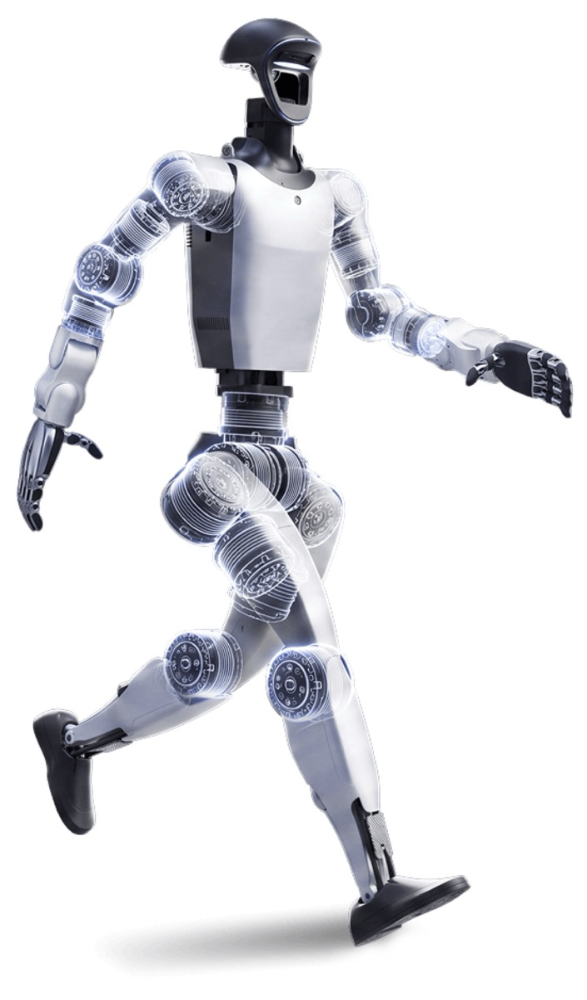

Upgraded G1.

| Spec | Value |
|---|---|
| Height / weight | **1.34 m** / ~35 kg |
| DoF | 25 (EDU 25–45), incl. 2-DoF neck |
| Sensors | Stereo + wide camera, 6-mic array |
| Other | Stronger shoulder / waist motors; external power supported |
| Price | G1+ **$15K** · EDU contact sales |

- Official page: [unitree.com/G1pl](https://www.unitree.com/G1pl)

### G1-D (Standard / Flagship)

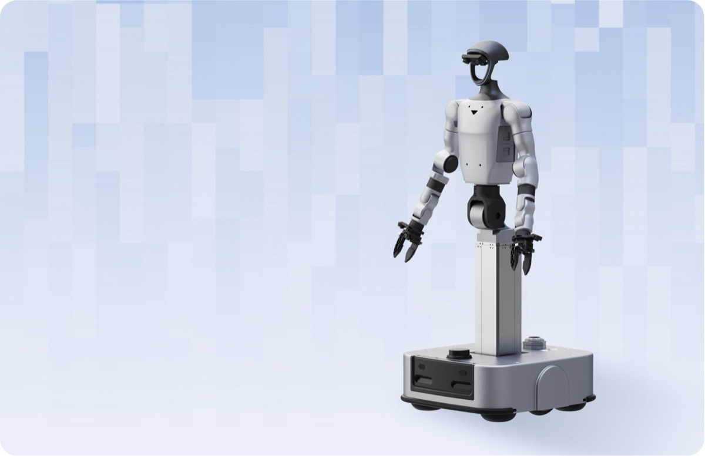

G1 upper body on a differential-drive base with a lift column, sold with a data-collection, training and deployment toolchain. The stable (non-falling) option for manipulation tasks.

| Spec | Value |
|---|---|
| Height (lift range) | 1.26–1.68 m |
| DoF | 17 / 19; 7-DoF arms |
| Arm payload | **~3 kg per arm** |
| Weight | ~90 kg |
| Runtime | **~2 h / ~6 h** (Standard / Flagship) |
| Sensors | Head stereo camera + 2 wrist cameras |
| Price | not public |

- **Typical use:** household / care manipulation, shelf picking, data collection for VLA training.
- Official page: [unitree.com/G1-D](https://www.unitree.com/G1-D)

### H1 / H1-2

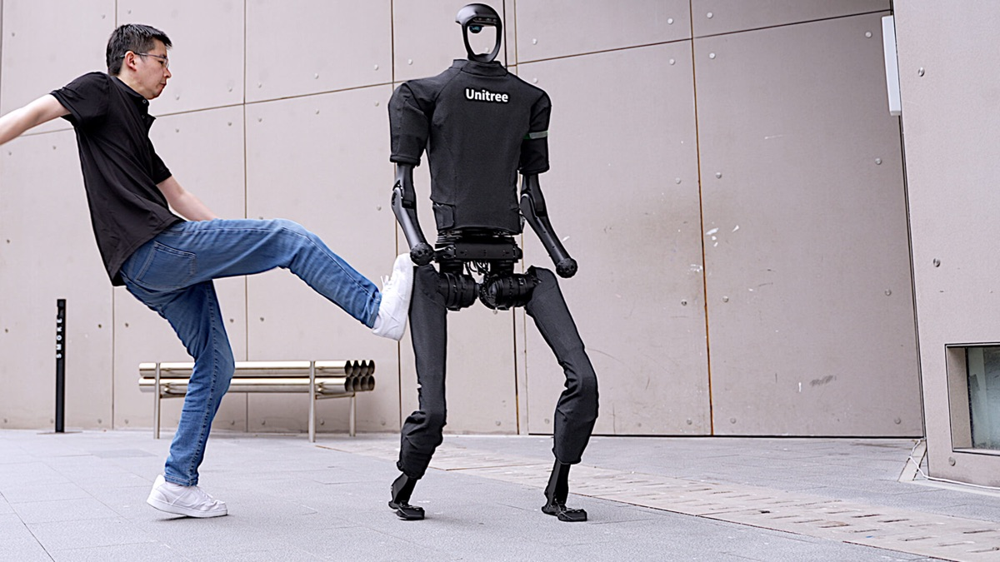

Previous-generation full-size research humanoids.

| Spec | H1 | H1-2 |
|---|---|---|
| Height / weight | ~1.80 m / **~47 kg** | ~1.78 m / **~70 kg** |
| Total DoF | 5 per leg, 4 per arm (expandable) | **27** (6 per leg, 7 per arm) |
| Peak joint torque | Knee ~360 N·m, hip ~220 N·m, arm ~75 N·m | Knee ~360 N·m, hip / waist ~220 N·m, arm ~120 N·m |
| Speed | 3.3 m/s | < 2 m/s |
| Arm load | — | ~7 kg rated, ~21 kg peak |
| Battery | 15 Ah (0.864 kWh), quick-swap | same |
| Sensors | 3D LiDAR + depth camera | same |
| Compute | Intel Core i5 (platform) + i7 (user); optional i7 / Orin NX | same (up to 3 devices) |
| Hands | optional | optional Dex5-1 or other hands |
| Price | not public | not public |

- Official page: [unitree.com/h1](https://www.unitree.com/h1)

### H2 / H2 EDU

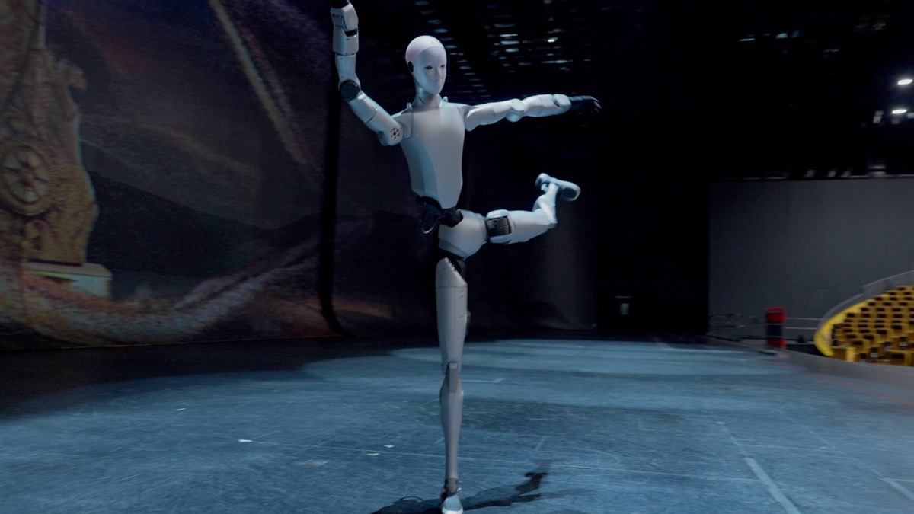

Current full-size humanoid.

| Spec | Value |
|---|---|
| Height / weight | **1.82 m** / ~70 kg |
| DoF | 31 |
| Joint torque | Legs up to 360 N·m; arms 120 N·m |
| Arm payload | **7 kg rated / 15 kg peak** |
| Battery / runtime | 0.97 kWh / **~3 h** |
| Compute | Intel Core i5 / i7 on board |
| Price | H2 **$29,900** · EDU contact sales |

- Official page: [unitree.com/H2](https://www.unitree.com/H2)

### H2-X / H2-X EDU

| Spec | Value |
|---|---|
| Height / weight | ~1.70 m / 65+ kg |
| DoF | 31 |
| Battery / runtime | Dual hot-swap, 1.15 kWh each; **~4 h walking** |
| Compute | Optional Jetson Thor T5000 / AGX Orin |
| Price | H2-X **$25,400** · EDU contact sales |

- Official page: [unitree.com/H2-X](https://www.unitree.com/H2-X)

### H2 Plus

🧪 Announced 1 Jun 2026 as an NVIDIA Isaac GR00T reference humanoid; availability stated as late 2026.

| Spec | Value |
|---|---|
| Base | H2 body (31 DoF) |
| Hands | Sharpa Wave, 22 DoF each → **75 DoF** total |
| Compute | Jetson AGX Thor T5000, 128 GB |
| Price | not public |

- Source: [PR Newswire release](https://tools.prnewswire.com/en-us/live/20823/release/20260601EN72140)

### GD01

Pilotable transforming mecha (biped / quadruped form), unveiled May 2026, from **RMB 3.9M** (~USD 574K). Not relevant for the hackathon. No official product page found.

### Z1 (Air / Pro)

Light 6-axis arm from the older accessory line, designed to ride on mobile robots (Unitree names AlienGo / B1). No picture saved (no clean official arm image found on the page).

| Spec | Z1 Air | Z1 Pro |
|---|---|---|
| DoF | 6 | 6 |
| Weight | 4.3 kg | 4.5 kg |
| Payload | **2 kg** | **≥3 kg** |
| Reach | 740 mm | 740 mm |
| Repeatability | ~0.1 mm | ~0.1 mm |
| Power | 24 V, >20 A; max 500 W | same |
| Interface / OS | Ethernet / Ubuntu | same |
| Control | Position + force control; force feedback, collision detection | same |
| Joint speed | 180°/s | 180°/s |

- **Caveat (per Unitree):** low gear ratios mean low position stiffness; expect shake without tuned control.
- Official page: [unitree.com/z1](https://www.unitree.com/z1)

### D1-T

Small bus-servo arm for light tasks and data collection.

| Spec | Value |
|---|---|
| DoF | 6 axes + 1 gripper |
| Weight | ~2.37 kg |
| Payload | **500 g** |
| Reach | 550 mm (670 mm with gripper) |
| Power | 24 V, 2.5 A (max 5 A); 60 W |
| Interfaces | DC 5.5-2.1 power, RJ45 communication, Type-C serial debug |

- Official page: [unitree.com/D1-T](https://www.unitree.com/D1-T)

### D2

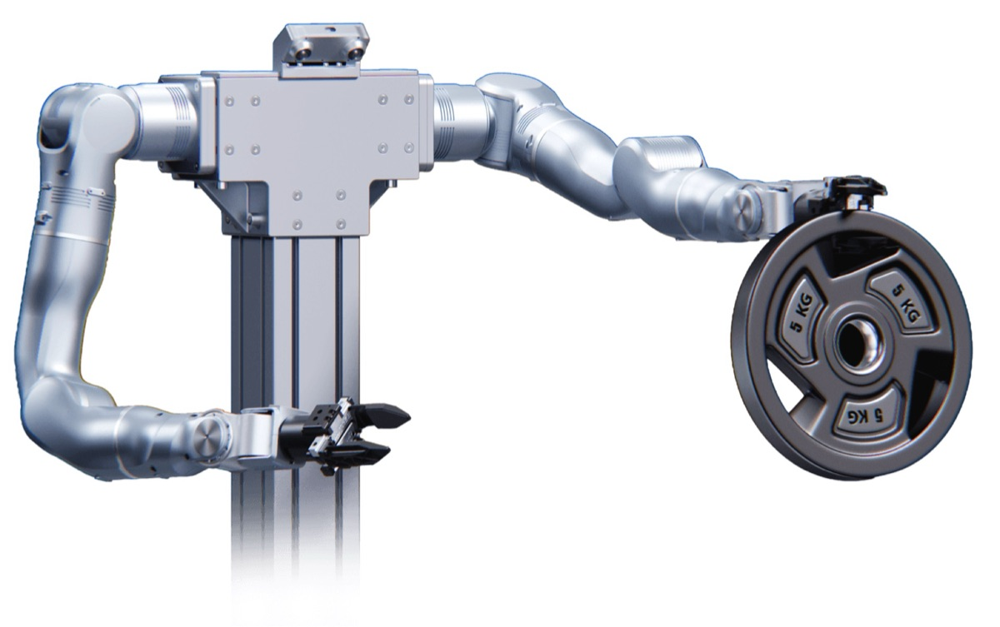

7-DoF force-controlled arm with 1-DoF gripper; mountable on quadrupeds or used as a dual-arm set.

| Spec | Value |
|---|---|
| DoF | 7 + 1 (gripper) |
| Payload | **3 kg rated** (5 kg max) |
| Arm length / working radius | 612 mm / 760 mm |
| Weight | 5.9 kg |
| Control rate | 500 Hz |
| Development | SDK + drag teaching |
| Price | not public |

- **Typical use:** mobile manipulation on As2 / A2 / B2 (open doors, press buttons, pick samples or litter).
- Official page: [unitree.com/D2](https://www.unitree.com/D2)

### R1-7a

Desktop 7-axis arm built from R1-class joints, aimed at labs and education.

| Spec | Value |
|---|---|
| DoF | 7 |
| Payload | 3–5 kg |
| Max reach | 650 mm (with dexterous hand) |
| Weight | 5.5 kg |
| Power | 24–60 V |
| Interfaces | XT30 + CAN / 485 |
| OS / control | Ubuntu; position / force control, force feedback, collision detection |
| Joint speed | >180°/s |

- Control programs and interfaces are stated to be open-sourced iteratively.
- Official page: [unitree.com/R1-7a](https://www.unitree.com/R1-7a)

### Dex3-1

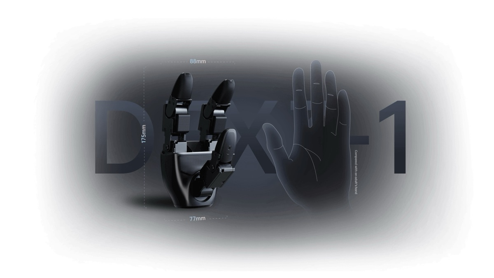

Three-finger force-controlled hand, the standard G1 EDU hand option.

| Spec | Value |
|---|---|
| DoF | **7** (thumb 3, index 2, middle 2) |
| Weight / size | 710 g / 175 × 88 × 77 mm |
| Drive | 6 direct-drive + 1 geared micro brushless joints |
| Tactile | 9 sensor pads, **33 pressure sensors** total; range 10–2,500 g |
| Grasp load | max 500 g (5 cm round hard object, as tested) |
| Fingertip repeatability | ±2 mm |
| Voltage | 12–58 V |
| Interface / rate | USB 2.0 / 1,000 Hz |
| Feedback | Joint position, velocity, torque, temperature, pressure values, IMU |

- **Limit to plan around:** 500 g grasp load — cups, pill boxes and remote controls, not full bottles or heavy tools.
- Official page: [unitree.com/Dex3-1](https://www.unitree.com/Dex3-1)

### Dex5-1

Five-finger hand for humanoids (listed as an H1-2 option).

| Spec | Value |
|---|---|
| DoF | **20** (16 active + 4 passive) |
| Weight | 1.1 kg |
| Tactile | **94 tactile sensors** |
| Fingertip force | 10 N |
| Grasp load | 3.5–4.5 kg |
| Price | not public |

- Official page: [unitree.com/Dex5-1](https://www.unitree.com/Dex5-1)

### Dex1-1 / Dex2/5 / Dex5-S

**Dex1-1** — parallel gripper usable standalone or on G1, H2 and R1; an advanced version adds a 1080p camera (30 / 60 fps, 118° horizontal field of view).

| Spec | Dex1-1 |
|---|---|
| Weight / size | 550 g / 143 × 78 × 67 mm |
| Stroke | 90 mm |
| Gripping force | **5–120 N** (adjustable) |
| Speed | 50–375 mm/s; shortest full close 0.24 s |
| Grasp load | 20 kg form-fit / 5 kg friction |
| Fingertip resolution | 0.1 mm |
| Communication | High-speed RS-485, 6 Mbps, 1,000 Hz |
| Voltage | 24–64 V |

- **Dex2/5** and **Dex5-S** are listed in the site navigation as further hand variants; specs not checked ⚠️ unverified.
- Official page: [unitree.com/Dex1-1](https://www.unitree.com/Dex1-1)

### 4D LiDAR L1 / L2

Low-cost hemispherical 3D LiDAR; L2 is the unit fitted to Go2. Useful as a stand-alone SLAM sensor on any vendor's robot.

| Spec | L2 | L1 PM | L1 RM |
|---|---|---|---|
| Price | **$419** | $249 | $309 |
| Range | 30 m @ 90% / 15 m @ 10% reflectivity | 20 m / 10 m | 30 m / 15 m |
| Field of view | **360° × 96°** | 360° × 90° | 360° × 90° |
| Effective points | 64,000 pts/s | 21,600 pts/s | 21,600 pts/s |
| Accuracy | ≤ 2 cm | ± 2 cm | ± 2 cm |
| Near blind zone | 0.05 m | not stated | not stated |
| Interface | Ethernet UDP / TTL UART | TTL UART | TTL UART |
| IMU | 3-axis accel + 3-axis gyro | not stated | not stated |
| Weight / size / power | 230 g / 75 × 75 × 65 mm / ~10 W | not stated | not stated |
| Eye safety | Class 1 (IEC 60825-1:2014) | — | — |

- Official page: [unitree.com/L2](https://www.unitree.com/L2)

### Joint motors and components

Catalogue actuators for people building their own robots: **IM6014**, **GO-M8010-6**, **B1-16** waterproof joint, **A1 motor**, **SV1-25** brushless digital servo, plus the **BA2** autonomous charging dock.

| Spec | IM6014 (N6014B-12.6) |
|---|---|
| Weight / size | 535 g / φ65 × 60 mm |
| Peak torque | **31.7 N·m** (34.4 N·m braking direction) |
| No-load speed | 54.2 rad/s @ 60 V |
| Voltage / max line current | 24–75 V / 40 A |
| Gear ratio | 3:38 (~12.66:1) |
| Encoders | Dual absolute (rotor + output), 15-bit rotor |
| Bus | High-speed RS-485 multidrop, up to 6 Mbps, IDs 0–14 |
| Control | Torque, angle, velocity, feed-forward torque, position / velocity stiffness |
| Warranty | 3 months |

- Official page: [unitree.com/IM6014](https://www.unitree.com/IM6014)

### UnifoLM (WMA-0, VLA-0) and UniPlatform / UniStore

- **UnifoLM-WMA-0** ✅ — open-source world-model-action model (Sept 2025, CC BY-NC-SA 4.0, non-commercial).
- **UnifoLM-VLA-0** ✅ — vision-language-action model for humanoid manipulation.
- **UniPlatform / UniStore / UniUni** 🧪 — data, app and community platforms linked from the site; feature details not checked ⚠️ unverified.
- Details and repos: see the [Developer guide](Unitree-Developer-Guide.md). Official index: [unitree.com/opensource](https://www.unitree.com/opensource)

## Accessories and ecosystem

| Item | What it adds | Fits |
|---|---|---|
| Dex3-1 hand | 7-DoF force-controlled grasping, 33 tactile sensors, 500 g grasp load | G1 EDU |
| Dex5-1 hand | 20-DoF five-finger hand, 94 tactile sensors | H1-2 and other humanoids |
| Dex1-1 gripper | 5–120 N parallel gripper, optional 1080p camera | G1, H2, R1, standalone |
| D2 / Z1 / D1-T arms | Manipulation on a mobile base (3 kg / 2–3 kg / 0.5 kg payload) | Quadrupeds, benches |
| 4D LiDAR L2 | 360°×96° point cloud + IMU, $419 | Any robot (Ethernet UDP / UART) |
| High-compute module | Orin-class add-on, 40–100 TOPS (Go2 EDU, R1 EDU); Orin NX dock (As2 EDU); up to 150 TOPS (As2-W); Jetson Thor option (H2-X) | EDU variants |
| On-board Intel Core i7 | Dedicated user-development PC | A2 / A2-W, B2 / B2-W, H1 / H1-2, H2 |
| Long-endurance battery + fast charger | 15,000 mAh, 33.6 V 9 A charger | Go2 EDU, Go2-W |
| Hot-swap dual batteries | Swap without shutdown | A2-W, H2-X |
| Charging docks | BA2 dock; A2 autonomous charging dock; Go2 X / EDU are dock-compatible | Quadrupeds |
| Side-follow (ISS 2.0 / 3.0) | Wireless follow-me with tracking module | Go2 Pro / X / EDU, As2-W |
| Industry payloads | PTZ, thermal, gas, acoustic imaging (inspection and fire-rescue solution lines) | B2, B2-Ex, A2 |
| Application plans | R1-D, H2-A / H2-D, G1-D, G1-Comp (RoboCup), boxing package | Humanoids |
| Software | unitree_sdk2 (C++ / Python), unitree_ros2, unitree_mujoco, RL and teleoperation repos | See [Developer guide](Unitree-Developer-Guide.md) |

## Legacy and discontinued

Still listed in the site navigation but superseded: **Go1** and **A1** (small quadrupeds, replaced by Go2), **B1** and **AlienGo** (industrial quadrupeds, replaced by B2 / A2). H1 remains listed alongside H2. Availability of legacy units: not public.

## Image credits

All images © Unitree Robotics, taken from the official product pages / CDN and converted to JPEG (max 1920 px).

| File | Shows | Source URL |
|---|---|---|
| unitree-go2.jpg | Go2 close-up | https://www.unitree.com/images/c2555e3813074ba6a1f2e124ee7e90cf_3840x2160.jpg |
| unitree-go2-w.jpg | Go2-W on rough ground | https://www.unitree.com/images/038fa156aa884270afeb255789da44b2_1478x788.png |
| unitree-as2.jpg | As2 carrying a standing person | https://www.unitree.com/images/a3a04d8f8fd248cc82f9f11075feb265_1920x1080.jpg |
| unitree-b2.jpg | B2 running | https://oss-global-cdn.unitree.com/static/55974d98b9564521ac82128f5378b52f_1920x1080.jpg |
| unitree-r1.jpg | R1 humanoid (render) | https://www.unitree.com/images/eec8d82f279b440ea170982ffa80b3fa_3840x2160.jpg |
| unitree-g1.jpg | G1 walking outdoors | https://www.unitree.com/images/39d02ea5ef314413855ae4790812e9ff_1920x1080.jpg |
| unitree-g1-plus.jpg | G1+ studio cut-out | https://www.unitree.com/images/b12680ae6e7d42598859c8f83063dc63_551x938.png |
| unitree-g1-d.jpg | G1-D on wheeled lift base | https://www.unitree.com/images/8c85d6a1b92c464fa245f9826495c605_1960x1270.png |
| unitree-h1.jpg | H1 push-recovery demo | https://oss-global-cdn.unitree.com/static/01f822261bb84dea8e54b32d0e2cbb0b_1920x1080.jpg |
| unitree-h2.jpg | H2 balancing on one leg | https://www.unitree.com/images/cab91f8a6c024197a4641d342ec44895_3840x2160.jpg |
| unitree-d2.jpg | Two D2 arms on a lift column, one holding a 5 kg plate | https://www.unitree.com/images/a85803a187b74c3bbf7da77f866f35bd_1570x986.png |
| unitree-dex3-1.jpg | Dex3-1 hand with dimensions | https://www.unitree.com/images/4eff56e5733d4fdbb8276bf6c65daa74_1920x1080.png |

## Sources

- [Unitree Go2](https://www.unitree.com/go2)
- [Unitree Go2-W](https://www.unitree.com/go2-w)
- [Unitree As2](https://www.unitree.com/As2)
- [Unitree As2-W](https://www.unitree.com/As2-W)
- [Unitree A2](https://www.unitree.com/A2)
- [Unitree A2-W](https://www.unitree.com/A2-W)
- [Unitree B2](https://www.unitree.com/b2)
- [Unitree B2-W](https://www.unitree.com/b2-w)
- [Unitree B2-Ex](https://www.unitree.com/B2-Ex)
- [Unitree R1](https://www.unitree.com/R1)
- [Unitree G1](https://www.unitree.com/g1)
- [Unitree G1+](https://www.unitree.com/G1pl)
- [Unitree G1-D](https://www.unitree.com/G1-D)
- [Unitree H1 / H1-2](https://www.unitree.com/h1)
- [Unitree H2](https://www.unitree.com/H2)
- [Unitree H2-X](https://www.unitree.com/H2-X)
- [Unitree Z1](https://www.unitree.com/z1)
- [Unitree D1-T](https://www.unitree.com/D1-T)
- [Unitree D2](https://www.unitree.com/D2)
- [Unitree R1-7a](https://www.unitree.com/R1-7a)
- [Unitree Dex3-1](https://www.unitree.com/Dex3-1)
- [Unitree Dex5-1](https://www.unitree.com/Dex5-1)
- [Unitree Dex1-1](https://www.unitree.com/Dex1-1)
- [Unitree 4D LiDAR L2](https://www.unitree.com/L2)
- [Unitree IM6014 joint motor](https://www.unitree.com/IM6014)
- [Unitree open-source index](https://www.unitree.com/opensource)
- [PR Newswire — Unitree H2 Plus, NVIDIA Isaac GR00T reference humanoid (1 Jun 2026)](https://tools.prnewswire.com/en-us/live/20823/release/20260601EN72140)
- [DigiTimes — Unitree As2 unveiled (25 Feb 2026)](https://www.digitimes.com/news/a20260225VL208.html)
- [CnTechPost — Unitree GD01 mecha (12 May 2026)](https://cntechpost.com/2026/05/12/unitree-unveils-worlds-first-mass-produced-manned-mecha-gd01/)
- [Unitree Robotics profile (this vault; specs carried over for As2, A2, B2, G1+, G1-D, H2, H2-X, D2, Dex5-1)](Unitree.md)
