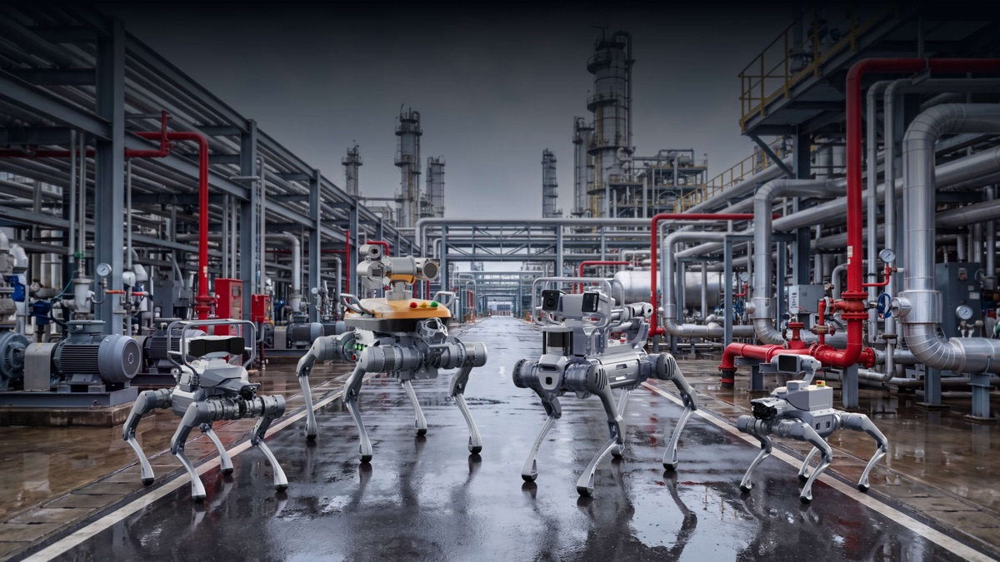
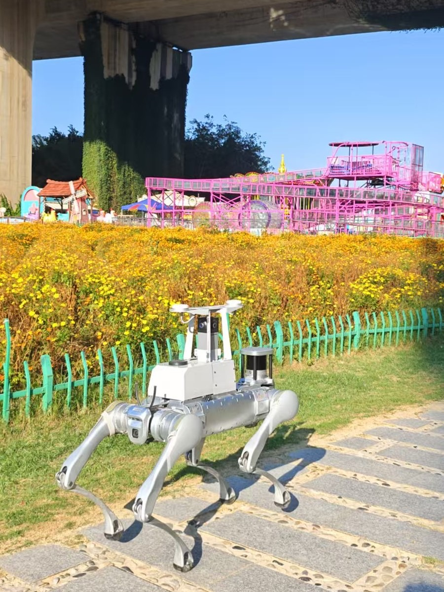
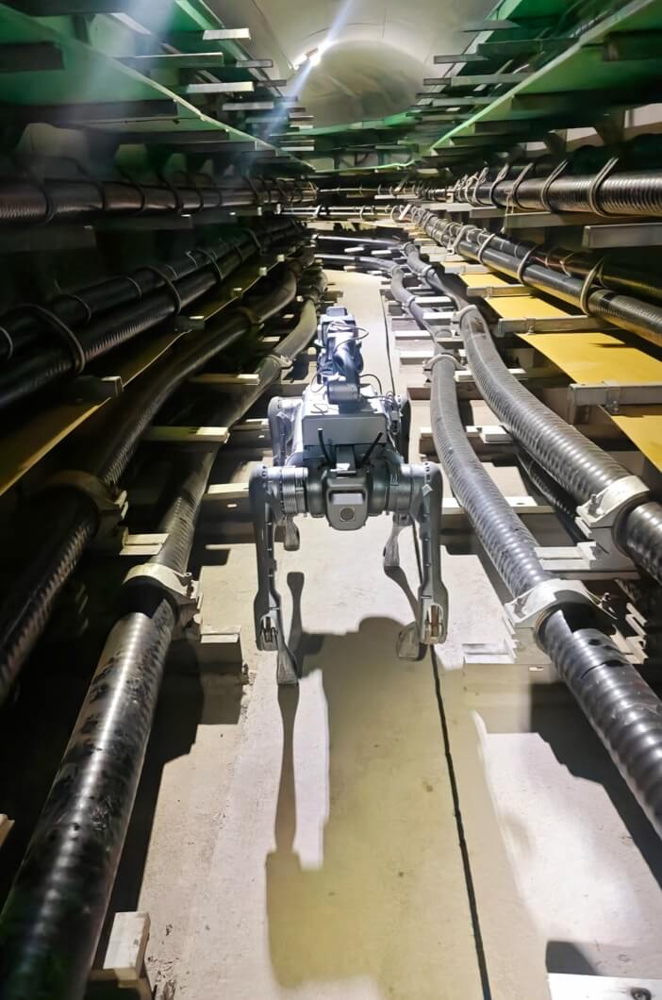
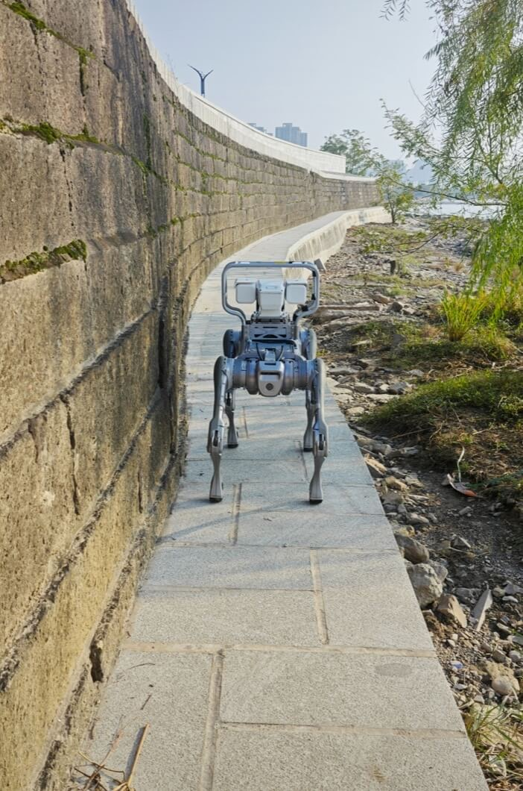
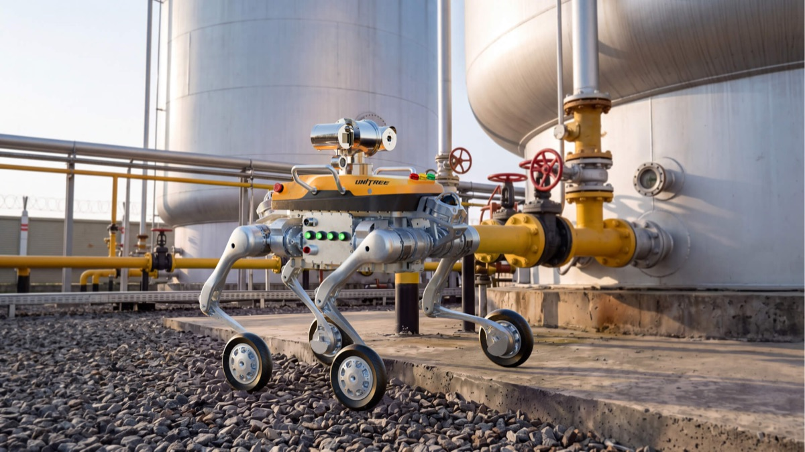
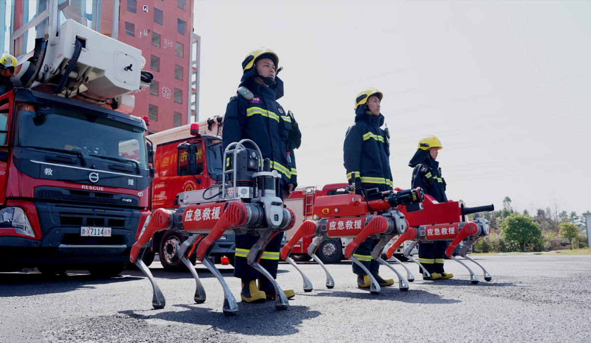
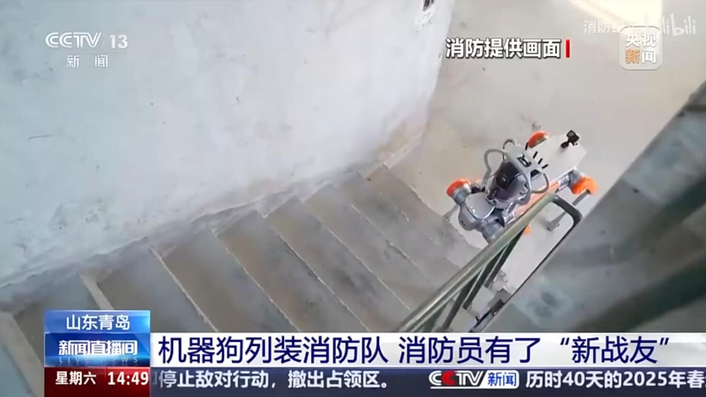
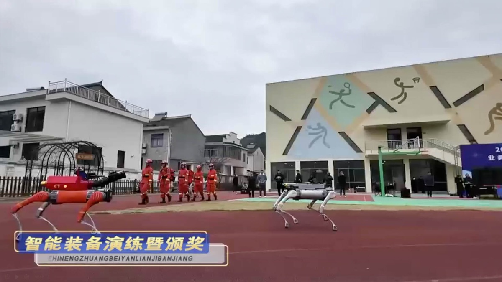
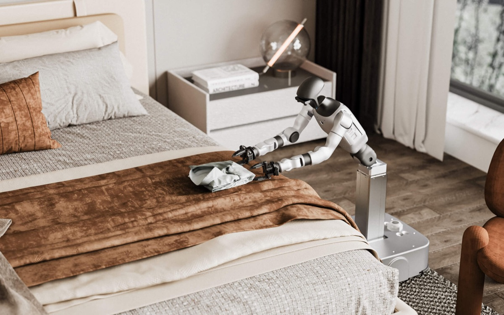
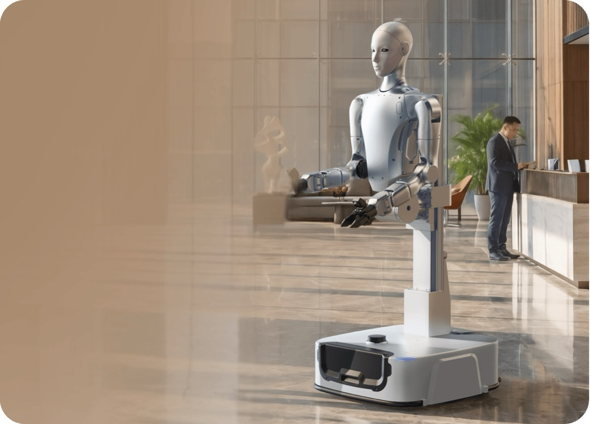

# Unitree Robotics — Solutions and Projects Register

⬆ [Unitree Robotics profile](Unitree.md) · [Product portfolio](Unitree-Products.md) · [Papers and research](Unitree-Papers-and-Research.md) · [Roadmap and strategy](Unitree-Roadmap-and-Strategy.md)

> **Coverage note:** Unitree Robotics = 宇树科技 (Yushu Technology Co., Ltd., Hangzhou; confirmed in the site footer and investor page). Walked on 2026-11-14: official site navigation (EN and CN), `sitemap.xml` (59 URLs, CN only, stale since 2024), all three "Industrial Applications" pages (Intelligent Inspection EN + CN, Fire Rescue, Education), all "Application Plan" pages (G1-D, H2-A / H2-D, R1-D, G1-Comp, Iron Fist King), B2-Ex, charging dock, quadruped / arm product pages for stated use cases, About, Investor Relations, DATA, both competition sites, the EN and CN news lists (**Mar 2023 → Sep 2026**), the official GitHub organisation (**59 repositories**, both pages), plus English and Chinese Wikipedia and six press pages.
> **Could not be accessed:** live web search was unavailable in this run (search budget exhausted), so trade-press and Chinese-language press coverage (养老 / 康复 / 环卫 / 配送 / 巡检 deployments) could **not** be swept — only pages fetched directly by URL were used. News article bodies on unitree.com are rendered client-side (only titles and dates were readable). UniStore, UniPlatform (eai.unitree.com), UniUni and unifolm.com are login / JavaScript apps (only their titles were readable). Partner and customer logos on the solution pages are images without names. Investor-relations PDFs were not opened. The Caixin article is paywalled. Treat "nothing found" below as "not found in the sources walked", not as proof of absence.

Status icons: ✅ shipping / available / done · 🧪 announced / pilot / preview · 🔭 roadmap / planned · ⚠️ unverified.

## Solutions catalogue — everything they offer

| # | Solution / application | What it does | Products used | Maturity | Tracks | Source link |
|---|---|---|---|---|---|---|
| 1 | **Intelligent Inspection Solution** (umbrella) | Unattended, scheduled inspection rounds by quadrupeds in hazardous or hard-to-reach sites; data goes to a central platform | B2, B2-Ex, A2, As2 (legged and wheel-legged), payload kit, charging dock, inspection software | ✅ | T02, T03 | [Inspection solution](https://www.unitree.com/industry/electricity) |
| 2 | Industrial-energy inspection: **substation / power grid, oil and chemical pipelines, mining** | Meter reading, thermal checks, gas and leak detection across generation, transmission, refineries, mine tunnels | B2, B2-Ex, A2 | ✅ | T02, T03 | [Inspection solution](https://www.unitree.com/industry/electricity) |
| 3 | Smart-city inspection: **urban parks and industrial parks** | Safety and security patrol on park paths and campus roads; intrusion and anomaly alerts | B2, A2, As2 | ✅ | T01, T02 | [Inspection solution](https://www.unitree.com/industry/electricity) |
| 4 | Smart-city inspection: **underground utility tunnels** | Gas detection, cable temperature and environment monitoring in tunnels | B2 + arm + gas sensors | ✅ | T02 | [Inspection solution](https://www.unitree.com/industry/electricity) |
| 5 | Transport and water inspection: **train undercarriage, airport, dam / water infrastructure** | Low-clearance access to inspection pits and dam galleries; crack, leak and temperature detection; airport perimeter patrol with bird deterrence | B2, A2 | ✅ | T02, T03 | [Inspection solution](https://www.unitree.com/industry/electricity) |
| 6 | **Intelligent Inspection System** (software platform) | Task scheduling, VLM-based equipment / meter / defect recognition, trend analytics, 3D visualisation, auto reports, 3D route generation | Server software + robots | ✅ | T02, T03 | [Inspection solution](https://www.unitree.com/industry/electricity) |
| 7 | **Inspection payload kit** | Thermal dual-sensor gimbal, acoustic imaging camera, 3-axis thermal gimbal, gas sensor, robotic arm; also drones and firefighting gear per the page | Mounted on B2 / A2 / As2 | ✅ | T02, T03 | [Inspection solution](https://www.unitree.com/industry/electricity) |
| 8 | **B2-Ex explosion-proof inspection solution** | Certified quadruped for explosive atmospheres (gas stations, tank farms, hazmat storage) with explosion-proof LiDAR, bi-spectrum PTZ and gas sensor | B2-Ex chassis / B2-Ex Inspection Solution | ✅ | T02 | [B2-Ex](https://www.unitree.com/B2-Ex) |
| 9 | **Intelligent autonomous charging dock** (unattended operation) | Robot returns on low battery, docks with 40 mm tolerance and recharges; enables 24/7 rounds | A2 charging dock (listed in the menu as "BA2 Intelligent Autonomous Charging Dock") | ✅ | T01, T02, T03 | [A2 charging dock](https://www.unitree.com/A2/ChargingDock) |
| 10 | **Fire Rescue Solutions** (umbrella) | Modular quadrupeds for fire reconnaissance and extinguishing | B2-based variants | ✅ (sold only to regions accepting certain conditions) | T02 | [Fire rescue](https://www.unitree.com/industry/fireRescue) |
| 11 | **Fire reconnaissance ("inspection") robot dog** | Enters smoke-filled buildings, climbs fire stairs, streams video and gas readings to command | B2 + 360° camera, dual-light gimbal, gas sensor, mesh / point-to-point radio | ✅ | T02 | [Fire rescue](https://www.unitree.com/industry/fireRescue) |
| 12 | **Water-cannon robot dog** | Carries a hose-fed monitor for water or foam | B2 + water cannon, drencher, quick hose release | ✅ | T02 | [Fire rescue](https://www.unitree.com/industry/fireRescue) |
| 13 | **Air-blower robot dog** | Blows out forest and grass fires with high-speed airflow | B2 + blower | ✅ | T02, T03 | [Fire rescue](https://www.unitree.com/industry/fireRescue) |
| 14 | **Fire-rescue visualisation platform** | Long-range video link and scene reconstruction for incident command | Software + radio link | ✅ | T02 | [Fire rescue](https://www.unitree.com/industry/fireRescue) |
| 15 | **Embodied Intelligence Education Solutions** | Robots + lab platforms + 16-course curriculum + competition and faculty support for universities and vocational schools | Full EDU range, quadruped and humanoid experiment platforms | ✅ | — | [Education solution](https://www.unitree.com/industry/education) |
| 16 | **G1-D** — end-to-end humanoid data and training platform | Wheeled dual-arm robot plus data collection, labelling, training and one-click deployment tools; stated scenarios: service, life (home), retail, industry | G1-D Standard / Flagship, UnifoLM | ✅ | T01, T04 | [G1-D](https://www.unitree.com/G1-D) |
| 17 | **H2-A / H2-D** — dual-arm humanoid for industrial mobile manipulation | Fixed-base or mobile dual-arm upper body; stated uses: sorting, warehousing, reception, guided tours, retail, data collection | H2-A Standard, H2-D Standard, H2-D Flagship | ✅ | T01 | [H2-D](https://www.unitree.com/H2-D) |
| 18 | **R1-A / R1-A-D ("R1-D")** — low-cost dual-arm robot | Entry dual-arm platform, fixed or on a mobile lifting base, "multi-scenario" (scenarios not named on the page) | R1-A5, R1-A7, R1-A5-D, R1-A7-D | ✅ | T01, T04 (generic platform) | [R1-D](https://www.unitree.com/R1-D) |
| 19 | **G1-Comp** — robot-soccer competition package | G1 with RoboCup SDK (YOLO11 vision, localisation, motion API), Orin NX | G1-Comp | ✅ | — | [G1-Comp](https://www.unitree.com/robocup) |
| 20 | **G1 "Iron Fist King"** — robot combat sport | Motion-capture-trained boxing G1 controlled by motion sensing, controller or voice; livestream / on-site events | G1 | ✅ | — | [Iron Fist King](https://www.unitree.com/boxing) |
| 21 | **H2 Plus** — NVIDIA Isaac GR00T reference humanoid for academic research | H2 + Sharpa Wave hands + Jetson AGX Thor + GR00T stack as one research kit | H2 Plus | 🧪 (availability "late 2026") | T04 (research), T01 | [PR Newswire](https://tools.prnewswire.com/en-us/live/20823/release/20260601EN72140) |
| 22 | **UnifoLM model family** | Open embodied-AI models: UnifoLM-WMA-0 (world-model-action), UnifoLM-VLA-0 (vision-language-action), `unifolm-wla` repo (⚠️ expansion of "WLA" not shown) | G1, G1-D and other embodiments | ✅ open source (WMA-0 under a non-commercial licence) | T01, T03, T04 | [GitHub](https://github.com/unitreerobotics) |
| 23 | **UniPlatform / "宇树具身智能平台"** (embodied-AI platform) | Web platform for data and model workflows (content behind login) | eai.unitree.com | 🧪 ⚠️ scope unverified | — | [eai.unitree.com](https://eai.unitree.com) |
| 24 | **UniStore** (Unitree App Store) | App distribution for robots; official app templates published on GitHub | Robots with app support | 🧪 ⚠️ catalogue not readable | T01, T04 | [UniStore](https://unistore.unitree.com) |
| 25 | **UniUni** | Distribution portal for scene maps and version packages (search, versioned download, central management) | — | 🧪 | T01, T02 | [UniUni](https://uniuni.unitree.com) |
| 26 | **DATA resources portal** | Open datasets: embodied manipulation, human motion, classic motion capture, egocentric video (Unitree and third-party) | — | ✅ | — | [DATA](https://www.unitree.com/data) |
| 27 | **Open developer stack** | SDK2 (C++ / Python / Rust), ROS / ROS 2, MuJoCo and Isaac Lab simulation, RL training (rl_gym, rl_lab, rl_mjlab), robot skills framework | All EDU robots | ✅ | T01, T02, T03, T04 | [GitHub](https://github.com/unitreerobotics) |
| 28 | **Teleoperation and data-collection toolchain** | XR-headset teleoperation of humanoids, camera streaming, arm teleoperation, LeRobot training pipeline | G1, H1, R1-7a arm, Dex / third-party hands | ✅ | T02, T04 | [xr_teleoperate](https://github.com/unitreerobotics/xr_teleoperate) |
| 29 | **SLAM / navigation / LiDAR stack** | 4D LiDAR L1 / L2, Point-LIO for Unitree LiDAR, SLAM interface and Python demos for "SLAM industry application scenarios" | L1, L2, Go2, B2, A2, As2 | ✅ | T01, T02 | [point_lio_unilidar](https://github.com/unitreerobotics/point_lio_unilidar) |
| 30 | **Intelligent side-follow and load carrying** | Robot follows a person at their side and carries bags or supplies (ISS 2.0 on Go2, ISS 3.0 on As2 / As2-W, wireless vector follow module on A2) | Go2, As2, As2-W, A2, A2-W | ✅ | T01, T04 | [As2-W](https://www.unitree.com/As2-W) |
| 31 | **Logistics / park logistics carrying** | Heavy-payload legged or wheel-legged transport in parks and plants | A2, A2-W, B2, B2-W | ✅ (platform only, no fleet software) | T01 | [A2-W](https://www.unitree.com/A2-W) |
| 32 | **Security patrol** | Wheel-legged / legged patrol; stated as "security, inspection" use | As2-W, As2, A2, B2 | ✅ (platform) | T01, T02 | [As2-W](https://www.unitree.com/As2-W) |
| 33 | **Quadruped + arm mobile manipulation** | Arm (single or dual) mounted on a quadruped for inspection and rescue in forests and mountains; Z1 marketed for mobile-robot manipulation, e-commerce logistics, daily life | D2, Z1, D1-T on B2 / A2 / Go2 | ✅ | T02, T03, T01 | [D2](https://www.unitree.com/D2) |
| 34 | **Emergency-rescue mobility** | All-terrain access over long stairs, rock piles, steep slopes for rescue work | B2, A2, A2-W | ✅ (platform) | T02 | [B2](https://www.unitree.com/b2) |
| 35 | **Consumer companion robots** | Small quadruped and low-cost humanoid with voice / vision interaction, follow mode and app control | Go2, R1 | ✅ (⚠️ feature details not re-read in this run) | T04, T01 | [Go2](https://www.unitree.com/go2) |
| 36 | **Stage and event performance** | Synchronised robot shows and sports-event support | G1, H1, H2, B2-W, Go-series | ✅ | — | [About Unitree](https://www.unitree.com/about) |
| 37 | **Competitions as a programme** | UniBot World Challenge (real-hardware manipulation benchmark) and World Physical AI Competition (8+ categories incl. healthcare and farming) | G1-class evaluation fleet | 🧪 | T04, T03 | [UniBot](https://unibot.unitree.com) |
| 38 | **Components for third-party robots** | Joint motors, servos, waterproof joints, 4D LiDAR, dexterous hands (Dex1-1, Dex2/5, Dex3-1, Dex5-1, Dex5-S) | — | ✅ | — | [unitree.com](https://www.unitree.com) |
| 39 | **GD01 pilotable mecha** | Rideable transforming robot (not hackathon-relevant) | GD01 | 🧪 / ✅ | — | [Chinese Wikipedia](https://zh.wikipedia.org/wiki/%E5%AE%87%E6%A0%91%E7%A7%91%E6%8A%80) |
| 40 | **Agriculture, survey and exploration, public rescue** (claimed uses, no dedicated solution page) | The About page states robots are "widely used" in these fields | Quadrupeds | ✅ claim only ⚠️ no cases shown | T03, T02 | [About Unitree](https://www.unitree.com/about) |

### Intelligent Inspection Solution

- **How it works:** site survey → route selection → install charging docks and network → build map and calibrate inspection points → robot runs scheduled rounds → data uploaded and reports generated automatically.
- **Platforms:** B2, B2-Ex, A2, As2, in legged and wheel-legged form. B2 inspection figures: **≥40 kg** continuous payload, **45°** gradeability, **25 cm** steps, **0–2 m/s** cruise, **4–6 h** endurance; operating range **−20 °C to 55 °C**.
- **Who uses it:** per Unitree, deployed across substations, chemical plants, mines, utility tunnels and industrial parks in China (seven named case types, see projects register). Customer names are shown only as logos.
- Official page: [Intelligent Inspection Solution](https://www.unitree.com/industry/electricity) · Chinese page: [四足智能巡检方案](https://www.unitree.com/cn/industry/electricity)

### Industrial-energy inspection (substation, pipeline, mining)

- Covers the power grid from generation to distribution, refinery pipelines and mine tunnels; the robot streams images and readings in real time.
- Follows China's State Grid "Document No. 57" interface specification, so it plugs into existing patrol systems there; expect integration work elsewhere.
- **T03 angle:** condition-based and predictive maintenance for energy assets (thermal anomalies, leaks) rather than emission reduction as such.
- Official page: [Intelligent Inspection Solution](https://www.unitree.com/industry/electricity)

### Smart-city inspection — urban parks and industrial parks

- Self-planned patrol routes on stairs, ramps, park trails and campus roads, with auto-recharge at low battery.
- LiDAR + thermal + HD vision fused; edge AI raises alerts within seconds and uploads the image and location, which can trigger security or drainage systems.
- Closest official Unitree offering to a "city service robot" in public space (T01 / T02 overlap).
- Official page: [Intelligent Inspection Solution](https://www.unitree.com/industry/electricity)

### Smart-city inspection — underground utility tunnels

- Gas detection and cable temperature monitoring in narrow tunnels where wheeled robots get stuck.
- Reference case: **six B2** robots with 3D LiDAR, thermal and visible cameras, CH₄ / H₂S / CO / O₂ gas sensors and robotic arms, centrally scheduled, in a power cable tunnel.
- Official page: [Intelligent Inspection Solution](https://www.unitree.com/industry/electricity)

### Transport and water inspection (train undercarriage, airport, dam and water plant)

- Reaches train inspection pits, dam galleries and airport utility tunnels; HD vision, ultrasonic and infrared sensing flag millimetre-level cracks, loosening, leakage and abnormal temperatures.
- Airport case: round-the-clock perimeter, slope and buffer-zone patrol with audiovisual alerts and a bird-deterrence module; detects intrusions, fence damage and bird activity.
- Water cases: wastewater, dosing and ozone-treatment areas of a water plant; energised cabinets at a hydropower station (T03-relevant: water and energy infrastructure).
- Official page: [Intelligent Inspection Solution](https://www.unitree.com/industry/electricity)

### Intelligent Inspection System (software platform)

- Inspection modes: comprehensive, routine and special-purpose, scheduled or remote-manual.
- Recognition: vision models plus **VLMs** identify equipment, meters and defects and write alerts, explanations and reports; "no-model" meter reading locates the meter, segments the scale and reads the value **without calibration**.
- Deployment aids: AI-assisted inspection-point configuration, 3D route generation with a "mark points → simulate → run" loop, 3D visualisation of the site.
- Official page: [Intelligent Inspection Solution](https://www.unitree.com/industry/electricity)

### Inspection payload kit

- **Thermal dual-sensor T-type gimbal:** 640×512 thermal + 4 MP visible, **32× optical zoom**, measures **−20 °C to 550 °C** at ±2 °C or ±2%.
- Also listed: acoustic imaging camera (leak / partial-discharge style sound imaging), 3-axis stabilised thermal gimbal, gas sensor, dexterous robotic arm; the page also names drones and firefighting equipment as integrable.
- Useful for T02 (hazard monitoring) and T03 (leak and energy-loss detection). Whether any payload is on site in Leukerbad is unknown — ask at the booth.
- Official page: [Intelligent Inspection Solution](https://www.unitree.com/industry/electricity)

### B2-Ex explosion-proof inspection solution

- Explosion-protection marking **Ex db mb IIB T4 Gb** (chassis) / **Ex db eb ib mb IIB T4 Gb** (inspection solution); **IP66**; **60 Ah (3,072 Wh)** battery; continuous walking payload **40 kg** (max 70 kg).
- Inspection solution: about **170 kg**, **≥4 h** with 40 kg payload, front and rear explosion-proof LiDAR, bi-spectrum PTZ and gas sensor as standard, autonomous navigation, manual or wireless charging, 0–1 m/s.
- Target sites: natural-gas gathering stations, oil and gas production, chemical tank farms, hazardous-materials storage. Unitree states it is still advancing mining and coal-mine certification.
- Official page: [B2-Ex](https://www.unitree.com/B2-Ex)

### Intelligent autonomous charging dock

- Automatic return on low battery, posture adjustment, docking and charging; **40 mm** X / Y alignment tolerance; LiDAR (reflective posts) or QR-code positioning.
- **IP56**, 9.6 kg, output 58.8 V / 7.4 A (**≤437 W**); concealed contacts exposed only while charging.
- **Watch for Leukerbad:** dock operating temperature is **0–40 °C**, narrower than the robots' −20 to 55 °C.
- This is robot self-charging, not EV charging (T03 teams: no EV-charging product exists).
- Official page: [A2 charging dock](https://www.unitree.com/A2/ChargingDock)

### Fire Rescue Solutions

- Modular B2-based family: reconnaissance dog, water-cannon dog, air-blower dog, plus a command visualisation platform and quick battery swap that keeps the body watertight.
- Stair climbing up to **40 cm** steps; joint performance stated as **+170%** versus the earlier inspection dog; metal-composite body, dust- and waterproof.
- **Sales restriction:** the page states these variants are sold only to countries and regions that accept certain conditions — check availability for Switzerland.
- Official page: [Fire Rescue Solutions](https://www.unitree.com/industry/fireRescue)

### Fire reconnaissance robot dog

- Payload set used in the published cases: 360° camera, dual-light (visible + thermal) gimbal, gas sensor, self-forming network or point-to-point radio, industrial remote controller.
- Used to scout multi-level buildings (it rode a mall elevator in one drill) and to monitor for re-ignition after a fire.
- Customer: **Qingdao Firefighting and Rescue Support Team — 2 × B2** (see projects register).
- Official page: [Fire Rescue Solutions](https://www.unitree.com/industry/fireRescue)

### Water-cannon robot dog

- Monitor pitch **5–85°** (with body-angle compensation), flow **40 L/s**, range **60 m**, water or foam.
- Hose release ("self-dewatering belt") in about **1 s**; a drencher system cools the robot in high heat.
- Shown in a forest-fire drill for fire inspection and fire-source location.
- Official page: [Fire Rescue Solutions](https://www.unitree.com/industry/fireRescue)

### Air-blower robot dog

- High-speed airflow blows out flames and carries heat away, separating fire from fuel; aimed at forest and grass fires.
- Keeps firefighters at a distance; no performance figures are published on the page.
- Official page: [Fire Rescue Solutions](https://www.unitree.com/industry/fireRescue)

### Fire-rescue visualisation platform

- Long-distance video transmission and reconstruction of the scene for the command post, to support rescue decisions.
- No API or integration details are published.
- Official page: [Fire Rescue Solutions](https://www.unitree.com/industry/fireRescue)

### G1-D — humanoid data and training platform

- **Robot:** G1 upper body on a lifting column (**1.26–1.68 m**), 17 / 19 DoF, 7-DoF arms, about **3 kg per arm**, about 90 kg; Flagship adds a driven base (**1.5 m/s**). End effectors: 2-finger gripper, 3-finger hand (with or without tactile), 5-finger hand.
- **Tools:** task templates, collection, labelling, review, storage and export; architecture for **hundreds of robots** collecting in parallel; distributed training; simulation-based evaluation; integrates open models such as **Pi** and **GR00T**; ships with UnifoLM-WMA-0.
- **Stated scenarios:** Service, Life (home tasks such as handling laundry), Retail, Industry — these are illustrations, not named deployments.
- **T04 relevance:** the most practical Unitree base for assistive-manipulation demos (wheeled, stable, no fall risk), but arm payload is small.
- Official page: [G1-D](https://www.unitree.com/G1-D)

### H2-A / H2-D — dual-arm humanoid for mobile manipulation

- Three versions: **H2-A Standard** (fixed base, 33.5 kg, 19 DoF), **H2-D Standard** (manual-move chassis, about 148 kg), **H2-D Flagship** (mobile chassis, about 120 kg, 20 DoF).
- Per arm **7 kg rated / 15 kg peak**; reach from floor to **2 m** using waist pitch (0–115°) and a 0.36 / 0.46 m lift column; vision, LiDAR, ultrasonic, force feedback and voice.
- **Stated applications:** industrial automation, high-speed sorting, autonomous warehousing; reception, guided tours and retail; research and education; large-scale data collection.
- Official page: [H2-A / H2-D](https://www.unitree.com/H2-D)

### R1-A / R1-A-D — low-cost dual-arm robot

- Price **from $4,290** (launched 30 Apr 2026 at RMB 26,900 in China).
- **R1-A5 / R1-A7:** fixed base, 5- or 7-DoF arms, about 11 / 13 kg. **R1-A5-D / R1-A7-D:** mobile base with lift (0.68 m → 1.6 m tall), chassis LiDAR, about 30 / 32 kg.
- Arm payload about **2–4 kg** (max 3–5 kg); binocular head camera with a 10 TOPS module; 4-mic array and speakers; optional Orin module (40–100 TOPS); gripper, 3-finger or 5-finger hand.
- Full low-level SDK access is advertised; no named application scenario — treat as a generic manipulation development kit for T01 / T04 prototypes.
- Official page: [R1-D](https://www.unitree.com/R1-D)

### H2 Plus — NVIDIA Isaac GR00T reference humanoid

- H2 body (31 DoF) + two **Sharpa Wave** tactile hands (22 DoF each, **75 DoF** total) + **Jetson AGX Thor T5000** (128 GB) + Isaac GR00T software (Isaac Teleop, GR00T models, Isaac Sim / Lab, Isaac ROS).
- Announced **1 Jun 2026**; availability "late 2026"; a GR00T reference workflow for **G1** is to be published on GitHub and Hugging Face.
- No named universities or customers in the release.
- Source: [PR Newswire](https://tools.prnewswire.com/en-us/live/20823/release/20260601EN72140)

### UnifoLM model family

- **UnifoLM-WMA-0:** world-model-action architecture across several embodiments; works as a predictor that helps the policy pick actions, and as an interactive simulator that generates synthetic data. Repo: [unifolm-world-model-action](https://github.com/unitreerobotics/unifolm-world-model-action) (about 1.2k stars).
- **UnifoLM-VLA-0:** vision-language-action model; per Notebookcheck it lets a G1 handle **12 categories of manipulation with one policy**. Repo: [unifolm-vla](https://github.com/unitreerobotics/unifolm-vla).
- **unifolm-wla:** newer repo (updated Sept 2026); no description shown ⚠️.
- Papers and model details: see [Papers and research](Unitree-Papers-and-Research.md).

### UniStore (Unitree App Store)

- App store for Unitree robots; the official repo [unitree-app-templates](https://github.com/unitreerobotics/unitree-app-templates) provides app templates for it.
- Catalogue could not be read (JavaScript app) ⚠️ — check at the booth which apps run on the robots on site.
- Official link: [UniStore](https://unistore.unitree.com)

### UniUni

- Portal to search, download by version and centrally manage scene maps and version packages — relevant when several robots share one mapped site.
- Official link: [UniUni](https://uniuni.unitree.com)

### Open developer stack

- Most-used repos (stars): [unitree_rl_gym](https://github.com/unitreerobotics/unitree_rl_gym) (**3.7k**), [unitree_ros](https://github.com/unitreerobotics/unitree_ros) (1.6k), [unitree_sdk2](https://github.com/unitreerobotics/unitree_sdk2) (1.4k), [unitree_rl_lab](https://github.com/unitreerobotics/unitree_rl_lab) (1.4k), [unitree_mujoco](https://github.com/unitreerobotics/unitree_mujoco) (1.3k), [unitree_ros2](https://github.com/unitreerobotics/unitree_ros2), [unitree_sdk2_python](https://github.com/unitreerobotics/unitree_sdk2_python), [unitree_sim_isaaclab](https://github.com/unitreerobotics/unitree_sim_isaaclab).
- New in 2026: `unitree_rl_mjlab` (RL on MuJoCo), `unitree_robotskills` (skill framework to connect AI models to robots), `unitree_sdk2_rs` (Rust), `unitree_slam` interface.
- Details: [Developer guide](Unitree-Developer-Guide.md).

### Teleoperation and data-collection toolchain

- [xr_teleoperate](https://github.com/unitreerobotics/xr_teleoperate) (1.7k stars): XR-headset teleoperation of Unitree humanoids; `televuer` (XR vision and hand / controller interface); `teleimager` (multi-camera streaming over ZeroMQ / WebRTC); `kinect_teleoperate` (Azure Kinect).
- Arms: `UniArmL1` (lightweight arm teleoperation with three control modes), `R1-7A` (single- and dual-arm teleoperation with multi-camera record and replay).
- Training: [unitree_lerobot](https://github.com/unitreerobotics/unitree_lerobot) (LeRobot adapted to Unitree data).
- Hand services: Dex1-1, Inspire RH56DFX, **BrainCo Revo2**, Linker hand (serial-to-DDS bridges).
- T02 use: teleoperation in hazardous sites. T04 use: telepresence and caregiver-operated manipulation.

### SLAM / navigation / LiDAR stack

- **4D LiDAR L2** (360° × 96°) and L1, with SDKs (`unilidar_sdk`, `unilidar_sdk2`) and [point_lio_unilidar](https://github.com/unitreerobotics/point_lio_unilidar) for odometry and mapping.
- `unitree_slam` (SLAM interface) and `Python_unitree_demos` (Python routines for SLAM industry application scenarios), both published July 2026.
- Fits T02 3D mapping / digital-twin tasks and T01 navigation.

### Intelligent side-follow and load carrying

- **ISS 3.0** on As2 / As2-W: centimetre-level positioning and stable following at the user's side; As2-W is pitched as carrying backpacks and supplies outdoors (IP54).
- **ISS 2.0** on Go2; **wireless vector follow module** on A2 / A2-W.
- T01: porter / luggage-carrying or guide demos. T04: walking companion that carries shopping — not a certified mobility aid.
- Official pages: [As2-W](https://www.unitree.com/As2-W) · [As2](https://www.unitree.com/As2) · [Go2](https://www.unitree.com/go2)

### Logistics / park logistics carrying

- A2 is positioned for "logistics, industrial inspection, emergency rescue"; A2-W for "industrial inspection, park logistics, emergency rescue".
- Platform only: no delivery compartment, order system or fleet manager is offered.
- Official pages: [A2](https://www.unitree.com/A2) · [A2-W](https://www.unitree.com/A2-W)

### Security patrol

- As2-W is described as suited to "security, inspection and advanced applications"; the inspection software provides intrusion alerts in park and airport scenarios.
- Official page: [As2-W](https://www.unitree.com/As2-W)

### Quadruped + arm mobile manipulation

- **D2** (7 DoF + gripper, 3 kg rated): single or dual mounting on a quadruped, pitched for inspection and rescue in forests and mountains. Delivery materials: [D2-Arm](https://github.com/unitreerobotics/D2-Arm).
- **Z1:** marketed as an on-board manipulator for mobile robots, e-commerce logistics and daily-life tasks.
- T03 use (not an official solution): litter picking or sample collection with a quadruped + arm.
- Official pages: [D2](https://www.unitree.com/D2) · [Z1](https://www.unitree.com/z1)

### Emergency-rescue mobility

- B2 page positions the robot for emergency rescue on long stairs, rock piles and steep slopes, with infrared scanning and 3D mapping for inspection.
- No search-and-rescue-specific victim-detection software is offered; thermal payloads come from the inspection and fire lines.
- Official page: [B2](https://www.unitree.com/b2)

### Consumer companion robots

- Go2 (from $1,600) and R1 (from $4,900) are sold to consumers; R1 handles simple household tasks by voice and vision per Notebookcheck.
- Unitree's own product pages warn that humanoids are at an early stage and buyers should understand the limits.
- Official pages: [Go2](https://www.unitree.com/go2) · [R1](https://www.unitree.com/R1)

### Competitions as a programme

- **UniBot World Challenge (2026):** real-hardware benchmark for single-model, multi-task tabletop manipulation (grasping, placement, bimanual coordination); UniBot-V1 leaderboard marked "coming soon"; submission resources in [unibot_submission](https://github.com/unitreerobotics/unibot_submission).
- **World Physical AI Competition:** open worldwide, **US$10M annual funding** (stated as not fixed), 8+ categories: locomotion, athletics, combat, dexterity (household tasks), production (**farming**, construction), sports, multimodal HRI, **healthcare (rehabilitation care, activities-of-daily-living support)**. Rules "to be announced".
- Official pages: [UniBot](https://unibot.unitree.com) · [World Physical AI Competition](https://www.unitree.com/challenge/World_Physical_AI_Competition)

### Agriculture, survey and exploration, public rescue (claimed uses)

- The About page says Unitree robots have been "widely used in agriculture and industry" and in power inspection, survey and exploration and public rescue since 2017.
- No agriculture or green-space case study, payload or software is published — treat as a claim.
- Official page: [About Unitree](https://www.unitree.com/about)

## Projects register — past and current

| Date | Project / deployment / pilot / partnership | Partner or customer | Location | What happened (one line) | Tracks | Source link |
|---|---|---|---|---|---|---|
| 2026-11-14 → 16 | Leukerbad Robotics Hackathon | Organisers | Leukerbad, CH | Unitree robots listed among the on-site hardware (exact models unconfirmed) | T01–T04 | [Company profile](Unitree.md) |
| 2026-10-29 | Capital increase into an associate company (related-party transaction) | Not read (PDF) | Hangzhou | Official notice title only; target and amount ⚠️ unverified | — | [Investor relations](https://www.unitree.com/investor) |
| 2026-10-28 | `unitree_robotskills` repo | Open source | — | Skill framework for connecting frontier AI models to Unitree robots | T01–T04 | [GitHub](https://github.com/unitreerobotics) |
| 2026-09-01 (posted) | "Unitree sponsors 'genius youth' free of charge" | Not readable | China | Official news title; article body not readable ⚠️ | — | [News (CN)](https://www.unitree.com/cn/news) |
| 2026-08-19 | STAR Market listing | Shanghai Stock Exchange | Shanghai | Shares listed; strong first-day surge; DeepSeek named a strategic investor (cap RMB 155M) | — | [Chinese Wikipedia](https://zh.wikipedia.org/wiki/%E5%AE%87%E6%A0%91%E7%A7%91%E6%8A%80) |
| 2026-08-17 | "Superman" humanoid demonstration | — | China | Prototype shown sprinting at **12.66 m/s** and jumping about 2 m from standing | — | [Wikipedia](https://en.wikipedia.org/wiki/Unitree_Robotics) |
| 2026-08-05 (posted) | State visit to Unitree | Myanmar head of state (per Unitree's news title) | Hangzhou | Delegation visit published in the official news centre | — | [News](https://www.unitree.com/news) |
| 2026-08 | UniBot World Challenge (UniBot-V1) | Global teams | Online + Unitree evaluation fleet | Real-robot manipulation benchmark opened; leaderboard pending | T04, T01 | [UniBot](https://unibot.unitree.com) |
| 2026-07-28 | US FCC Covered List change | US FCC | USA | Newly announced foreign-made advanced robots added; Unitree says future models are affected, existing US sales are not | — | [Chinese Wikipedia](https://zh.wikipedia.org/wiki/%E5%AE%87%E6%A0%91%E7%A7%91%E6%8A%80) |
| 2026-07-26 | As2-W wheel-legged quadruped reported | — | — | Hybrid wheel-leg version of As2; reported 150 kg carrying capacity | T01, T02 | [Wikipedia](https://en.wikipedia.org/wiki/Unitree_Robotics) |
| 2026-07 | SLAM interface and industry demos published | Open source | — | `unitree_slam` and `Python_unitree_demos` released | T01, T02 | [GitHub](https://github.com/unitreerobotics) |
| 2026-06 | US DoD list | US Department of Defense | USA | Unitree added to a list of Chinese military-linked companies | — | [Wikipedia](https://en.wikipedia.org/wiki/Unitree_Robotics) |
| 2026-06-01 | H2 Plus / Isaac GR00T reference humanoid | NVIDIA, Sharpa | Taipei (announcement) | Research humanoid kit announced; G1 GR00T workflow promised | T04, T01 | [PR Newswire](https://tools.prnewswire.com/en-us/live/20823/release/20260601EN72140) |
| 2026-05-31 | "Embodied Intelligence Experience Hall" | Jiuguang Department Store | Nanjing West Road, Shanghai | First such experience store opened in a department store (retail showroom) | T01 | [Chinese Wikipedia](https://zh.wikipedia.org/wiki/%E5%AE%87%E6%A0%91%E7%A7%91%E6%8A%80) |
| 2026-05 | GD01 manned mecha launch | — | China | About 3 m tall transforming mecha, RMB 3.9M | — | [Chinese Wikipedia](https://zh.wikipedia.org/wiki/%E5%AE%87%E6%A0%91%E7%A7%91%E6%8A%80) |
| 2026-04-30 | R1-A5 / R1-A7 dual-arm series launch | — | China, then global | RMB 26,900 / from $4,290; 15–31 DoF | T01, T04 | [R1-D](https://www.unitree.com/R1-D) |
| 2026-04 | R1 sold internationally via AliExpress | AliExpress | Global | Entry humanoid offered at about USD 4K (reported; not re-fetched) | — | [eWeek](https://www.eweek.com/news/china-unitree-4k-humanoid-robot-apac/) |
| 2026-03-20 | STAR Market IPO application accepted | Shanghai Stock Exchange | Shanghai | Target RMB 4.2 bn; humanoids 51.5% and quadrupeds 42.3% of revenue in Jan–Sep 2025 | — | [Caixin](https://www.caixinglobal.com/2026-03-21/unitree-robotics-files-for-608-million-star-market-ipo-102425491.html) |
| 2026-02-24 | As2 compact industrial quadruped launch | — | — | IP54, >4 h endurance | T01, T02 | [Chinese Wikipedia](https://zh.wikipedia.org/wiki/%E5%AE%87%E6%A0%91%E7%A7%91%E6%8A%80) |
| 2026-02 | CCTV Spring Festival Gala ("Cyber Real Kung Fu") | China Media Group | Beijing | G1 robots performed kung fu "fully autonomously" per Unitree; H2 and B2-W also shown | — | [eWeek](https://www.eweek.com/news/unitree-20000-humanoid-robots-2026-china/) |
| 2026-01 | UnifoLM-VLA-0 released | Open source | — | VLA model; one policy for 12 manipulation categories on G1 (reported) | T04, T01 | [unifolm-vla](https://github.com/unitreerobotics/unifolm-vla) |
| 2025-11-12 | Joint venture "Superstar Entertainment Technology" (50 / 50) | Superstar Culture | China | Consumer IP robots and performance humanoids; first product "Superstar Dog" | — | [Chinese Wikipedia](https://zh.wikipedia.org/wiki/%E5%AE%87%E6%A0%91%E7%A7%91%E6%8A%80) |
| 2025-11 | New HQ floors and exhibition hall | — | Digital Valley Building, Hangzhou | Exhibition hall opened; sales teams moved in early 2026 | — | [Chinese Wikipedia](https://zh.wikipedia.org/wiki/%E5%AE%87%E6%A0%91%E7%A7%91%E6%8A%80) |
| 2025-10-20 | H2 full-size humanoid launch ("Destiny Awakening") | — | — | 180 cm, 70 kg | — | [Chinese Wikipedia](https://zh.wikipedia.org/wiki/%E5%AE%87%E6%A0%91%E7%A7%91%E6%8A%80) |
| 2025 (autumn) | Japan Mobility Show exhibit | — | Tokyo | Unitree exhibited | — | [Wikipedia](https://en.wikipedia.org/wiki/Unitree_Robotics) |
| 2025-09 | Security disclosures | Independent researchers | — | Wormable BLE exploit affecting Go2, B2, G1, H1; G1 telemetry concerns (see also Apr 2025 backdoor allegation, fixed per Unitree) | T02, T04 (risk) | [Wikipedia](https://en.wikipedia.org/wiki/Unitree_Robotics) |
| 2025-09 | UnifoLM-WMA-0 open-sourced | Open source | — | World-model-action model released (not re-fetched) | T01, T04 | [Yicai Global](https://www.yicaiglobal.com/news/chinas-unitree-open-sources-world-model-to-advance-robotics-ecosystem) |
| 2025-08 | Robot-dog patrols | Taipei City Government (system integration by Taiwanese firms) | Taipei | City deployed patrol robot dogs on a Unitree base; security debate; city said networking and positioning on the base were disabled | T01, T02 | [Chinese Wikipedia](https://zh.wikipedia.org/wiki/%E5%AE%87%E6%A0%91%E7%A7%91%E6%8A%80) |
| 2025-08-15 | World Humanoid Robot Games | Organisers | Beijing | Unitree **H1 won the 1,500 m race** (per SCMP headline) | — | [Wikipedia](https://en.wikipedia.org/wiki/2025_World_Humanoid_Robot_Games) |
| 2025-08-05 | A2 quadruped launch ("Stellar Explorer") | — | — | Mid-size industrial quadruped | T02 | [Chinese Wikipedia](https://zh.wikipedia.org/wiki/%E5%AE%87%E6%A0%91%E7%A7%91%E6%8A%80) |
| 2025-07-25 | R1 humanoid launch | — | China | RMB 39,900 | — | [Chinese Wikipedia](https://zh.wikipedia.org/wiki/%E5%AE%87%E6%A0%91%E7%A7%91%E6%8A%80) |
| 2025-07 | WIPO Global Award (ICT, SME category) | WIPO | Geneva | Award won | — | [Wikipedia](https://en.wikipedia.org/wiki/Unitree_Robotics) |
| Q1–Q3 2025 | Customer mix disclosure | Shanghai Stock Exchange inquiry | — | **73.6%** of humanoid revenue from research and education, **9.0%** from industrial applications | — | [Wikipedia](https://en.wikipedia.org/wiki/Unitree_Robotics) |
| 2025-05 ⚠️ | Robot combat tournament with G1 | China Media Group (from memory) | Hangzhou | Televised G1 boxing event; ⚠️ unverified — not re-checked in this run | — | [Iron Fist King](https://www.unitree.com/boxing) |
| 2025 (reported 6 May; CCTV-13 frame from early 2025) | **Fire service adoption** | Qingdao Firefighting and Rescue Support Team | Qingdao, Shandong | **2 × B2** with 360° camera, dual-light gimbal, self-forming network, gas sensor commissioned | T02 | [Fire rescue](https://www.unitree.com/industry/fireRescue) · [WinFuture](https://winfuture.de/news,150757.html) |
| Undated (on site in 2025–26) | Forest-fire intelligent-equipment drill | Fire and emergency services | China | Recon B2 + water-cannon B2 used for fire inspection, source location and post-fire monitoring | T02 | [Fire rescue](https://www.unitree.com/industry/fireRescue) |
| Undated | Live-fire drill in a large commercial complex | Fire service | China | Recon B2 rode the mall elevator and scouted several levels for the command post | T02 | [Fire rescue](https://www.unitree.com/industry/fireRescue) |
| Undated | Power cable tunnel inspection | Not named | China | **6 × B2** with LiDAR, thermal, gas sensors and arms, centrally scheduled | T02 | [Inspection solution](https://www.unitree.com/industry/electricity) |
| Undated | Smart water plant inspection | Not named | China | B2 covers wastewater, dosing and ozone areas; reads meters; detects leaks, corrosion, gas | T02, T03 | [Inspection solution](https://www.unitree.com/industry/electricity) |
| Undated | Hydropower station equipment inspection | Not named | China | B2 inspects energised cabinets on generator and turbine levels | T02, T03 | [Inspection solution](https://www.unitree.com/industry/electricity) |
| Undated | Renewable-energy site inspection | Not named | China | A2 at a **110 kV substation**: transformers, 10 kV switchgear, GIS, secondary rooms | T02, T03 | [Inspection solution](https://www.unitree.com/industry/electricity) |
| Undated | Mining production workshop inspection | Not named | China | B2 with 5G, dual-spectrum and acoustic imaging, voice interaction in a grinding workshop | T02 | [Inspection solution](https://www.unitree.com/industry/electricity) |
| Undated | Chemical / metallurgical hazard inspection | Not named | China | A2 monitors calcium-carbide furnace temperatures around the clock | T02 | [Inspection solution](https://www.unitree.com/industry/electricity) |
| Undated | Airport intelligent security inspection | Not named | China | Perimeter patrol with intrusion, fence-damage and bird detection plus bird deterrence | T02 | [Inspection solution](https://www.unitree.com/industry/electricity) |
| 2025-01 | CES 2025 and CCTV Spring Festival Gala 2025 | CTA / China Media Group | Las Vegas / Beijing | Go2, Go2-W, B2-W, H1, G1 shown at CES; H1 performed at the Gala | — | [Wikipedia](https://en.wikipedia.org/wiki/Unitree_Robotics) |
| 2024-12-20 | Strategic cooperation agreement | Shenzhen Lanfang ("Blue Square") Technology, subsidiary of a listed company (301325) ⚠️ English names transliterated | Hangzhou | Agreement signed; scope not stated in the source | — | [Chinese Wikipedia](https://zh.wikipedia.org/wiki/%E5%AE%87%E6%A0%91%E7%A7%91%E6%8A%80) |
| 2024-10 ⚠️ | Waste and cargo hauling trial on Mount Tai | Scenic-area operator (from memory) | Shandong | Quadrupeds reportedly trialled to carry rubbish down the mountain; ⚠️ unverified — not re-checked in this run | T03, T01 | — |
| 2024 | G1 as teleoperated public characters | Third parties ("Edward Warchocki", "Rizzbot") | Poland, USA | G1 units puppeted by remote operators as street / online personalities | T01 | [Wikipedia](https://en.wikipedia.org/wiki/Unitree_Robotics) |
| 2022–2024 | Military and police adaptations by third parties (not a Unitree offering) | Various | Various | 2023 US Marines test with a Go1; 2024 China–Cambodia drill footage; 2024 modified Go2 units in Ukraine. Unitree states it does not sell to militaries | — | [Wikipedia](https://en.wikipedia.org/wiki/Unitree_Robotics) |
| 2024-04-16 (posted) | NVIDIA GTC appearance | NVIDIA | San Jose | H1 presented with NVIDIA's humanoid ecosystem | — | [News (CN)](https://www.unitree.com/cn/news) |
| 2024-02-29 (posted) | Funding round of nearly RMB 1 bn | Investors | — | Official news item | — | [News (CN)](https://www.unitree.com/cn/news) |
| 2024-01-11 (posted) | IEEE Humanoids 2023 win and CES 2024 | IEEE / CTA | — | Official news title: Unitree took a championship at IEEE Humanoids 2023; exhibited at CES 2024 | — | [News (CN)](https://www.unitree.com/cn/news) |
| 2023-09 → 10 | 19th Asian Games (and Asian Para Games) | Organising committee | Hangzhou | Robot dogs **carried discus and javelin** back across the athletics field | T01 | [Go2](https://www.unitree.com/go2) |
| 2023-06 | ICRA 2023 | IEEE | London | Wheel-legged "B-W" shown | — | [News](https://www.unitree.com/news) |
| 2023-03-22 (posted) | B1 for fire reconnaissance and emergency rescue; quadrupeds for smart power inspection | — | China | First official solution announcements for fire and power inspection | T02 | [News (CN)](https://www.unitree.com/cn/news) |
| 2023-02 | Super Bowl pre-game show | NFL | Glendale, USA | Robot dogs performed | — | [About Unitree](https://www.unitree.com/about) |
| 2022-12 | Construction Innovation Expo | — | Hong Kong | B1 and Go1 displayed | T02 | [Wikipedia](https://en.wikipedia.org/wiki/Unitree_Robotics) |
| 2022-02 | Winter Olympics opening ceremony | Beijing 2022 | Beijing | Robots appeared in the ceremony programme | — | [About Unitree](https://www.unitree.com/about) |
| 2021-02 | CCTV Spring Festival Gala | China Media Group | Beijing | Quadruped group performance | — | [About Unitree](https://www.unitree.com/about) |
| Ongoing | Education partnerships and supported competitions | Universities; RoboCom, China Software Cup, Tencent Kaiwu, ROBOTAC, RoboCup, WBCD, IROS teleoperation and assembly challenges, ATEC | China and international | Unitree platforms used as competition and teaching hardware (institution names shown only as logos) | — | [Education solution](https://www.unitree.com/industry/education) |

## Future projects and announced plans

| Announced | Planned for | What | Confidence (official / reported / inferred) | Tracks | Source link |
|---|---|---|---|---|---|
| 2026-06-01 | Late 2026 | **H2 Plus** research humanoid available | official | T04, T01 | [PR Newswire](https://tools.prnewswire.com/en-us/live/20823/release/20260601EN72140) |
| 2026-06-01 | "Soon" (no date) | **Isaac GR00T reference workflow for G1** on GitHub and Hugging Face | official | T01, T04 | [PR Newswire](https://tools.prnewswire.com/en-us/live/20823/release/20260601EN72140) |
| 2026-02 | 2026 | **10,000–20,000 humanoid shipments** in 2026 (vs about 5,500 in 2025) | reported (CEO statement) | — | [eWeek](https://www.eweek.com/news/unitree-20000-humanoid-robots-2026-china/) |
| 2026-02 | Not dated | Embodied-AI "brain" developed with partners so robots work outside controlled environments | reported (CEO statement) | T01–T04 | [eWeek](https://www.eweek.com/news/unitree-20000-humanoid-robots-2026-china/) |
| 2026-03 | By 2030 | **General-purpose humanoid embodied foundation model** (scene, instruction, action and task generalisation; cloud training + edge inference + real-world data) | reported (from IPO filing) | T04, T01 | [Notebookcheck](https://www.notebookcheck.net/Beyond-kung-fu-Unitree-plans-humanoid-robot-for-household-chores-and-elder-care-by-2030.1255707.0.html) |
| 2026-03 | Towards 2030 | Expansion from industrial settings into **household services, elder care and daily living** (laundry given as an example), conditional on reliability and safety | reported (from IPO filing) | T04 | [Notebookcheck](https://www.notebookcheck.net/Beyond-kung-fu-Unitree-plans-humanoid-robot-for-household-chores-and-elder-care-by-2030.1255707.0.html) |
| 2026-03 | Within about three years | Start selling a general-purpose humanoid | reported | T04, T01 | [Notebookcheck](https://www.notebookcheck.net/Beyond-kung-fu-Unitree-plans-humanoid-robot-for-household-chores-and-elder-care-by-2030.1255707.0.html) |
| 2026-03 | Post-IPO | Use of proceeds: about half for robotics and embodied-intelligence R&D, the rest for product development and manufacturing facilities (per-project amounts not confirmed here) | reported | — | [KrASIA](https://kr-asia.com/unitree-targets-ipo-after-revenue-quadruples-on-robotics-demand) |
| 2026 | Rules "to be announced" | **World Physical AI Competition** — US$10M annual funding, 8+ categories incl. healthcare (rehabilitation care, ADL support), farming, household tasks | official | T04, T03 | [World Physical AI Competition](https://www.unitree.com/challenge/World_Physical_AI_Competition) |
| 2026 | "Coming soon" | **UniBot-V1 leaderboard** and scaled real-robot evaluation fleet | official | T04, T01 | [UniBot](https://unibot.unitree.com) |
| 2026 | Not dated | **Mining and coal-mine safety certification** work for the explosion-proof quadruped line ("continuously advancing") | official (wording), timing inferred | T02 | [B2-Ex](https://www.unitree.com/B2-Ex) |
| 2026 | Not dated | More robot-combat events ("stay tuned for upcoming events") | official | — | [Iron Fist King](https://www.unitree.com/boxing) |
| 2026 | Ongoing | More partner institutions for the education solution; joint curricula, labs and certification | official | — | [Education solution](https://www.unitree.com/industry/education) |
| 2025-11 | Not dated | "Superstar Dog" and further consumer IP / performance robots via the Superstar joint venture | reported | — | [Chinese Wikipedia](https://zh.wikipedia.org/wiki/%E5%AE%87%E6%A0%91%E7%A7%91%E6%8A%80) |
| 2026-08 | Not announced | Productisation of the "Superman" high-speed humanoid | inferred (demo only) | — | [Wikipedia](https://en.wikipedia.org/wiki/Unitree_Robotics) |
| 2026-09 | Not announced | Next UnifoLM generation (`unifolm-wla` repo active since Sept 2026) | inferred | T01, T04 | [GitHub](https://github.com/unitreerobotics) |
| 2026-07 | From now | US market access for **new** models restricted by the FCC Covered List change | reported | — | [Chinese Wikipedia](https://zh.wikipedia.org/wiki/%E5%AE%87%E6%A0%91%E7%A7%91%E6%8A%80) |

## Solutions by track — quick index

### T01 Autonomous Urban Services
- **Intelligent side-follow and load carrying** (As2 / As2-W ISS 3.0, Go2 ISS 2.0) — porter, guide and carry demos.
- **Smart-city inspection of urban parks and industrial parks** — patrol routes, alerts, auto-recharge.
- **H2-A / H2-D** — reception, guided tours, retail operations (stated applications).
- **G1-D** — service and retail scenarios; data-collection toolchain for teaching new service tasks.
- **R1-A / R1-A-D** — cheapest dual-arm base for concierge / kiosk prototypes.
- **Logistics / park logistics carrying** (A2, A2-W) and **security patrol** (As2-W).
- **Autonomous charging dock** — unattended service loops (mind the 0–40 °C dock limit).
- **SLAM / navigation stack**, **UniUni** map distribution, **open developer stack**.
- Projects: Asian Games 2023 discus / javelin transport; Taipei patrol dogs (2025, third-party integration); Shanghai experience hall (2026); G1 public characters (third parties).

### T02 Resilient & Safe City
- **Fire Rescue Solutions**: reconnaissance dog, water-cannon dog (40 L/s, 60 m), air-blower dog, command visualisation platform.
- **Intelligent Inspection Solution** with its software platform and payload kit (thermal, acoustic, gas, arm).
- **B2-Ex explosion-proof inspection solution** (IP66, Ex-certified).
- **Utility-tunnel, substation, pipeline, mining, train, airport, dam / water inspection** scenarios.
- **Teleoperation toolchain** (xr_teleoperate, teleimager) for hazardous-environment remote work.
- **SLAM / LiDAR stack** for 3D mapping; **quadruped + D2 arm** for rescue in rough terrain; **emergency-rescue mobility** of B2 / A2.
- Projects: Qingdao fire service (2 × B2); forest-fire and commercial-complex drills; seven inspection case types incl. the 6 × B2 cable tunnel and airport perimeter security.

### T03 Sustainable City
- **Energy-asset inspection** (110 kV renewable-site substation, hydropower station) — predictive maintenance, thermal and leak detection.
- **Water plant inspection** (wastewater, dosing, ozone areas) — leak, corrosion and gas detection.
- **Inspection payload kit** — gas sensor, acoustic and thermal imaging as environmental / leak sensing.
- **Air-blower robot dog** — forest and grass-fire control.
- **Quadruped + arm mobile manipulation** — a base for litter picking or sampling (do-it-yourself, not an official solution).
- **World Physical AI Competition "Production — Farming" category** and the About-page agriculture claim (no product behind it).
- Nothing specific found for waste sorting, recycling, EV charging, building automation or green-space care.

### T04 Elderly Care & Rehabilitation
- **G1-D** — wheeled dual-arm platform with a "Life" (home) scenario; safest Unitree base for assistive-manipulation demos.
- **R1-A / R1-A-D** — low-cost dual-arm kit, optional 3- or 5-finger hands.
- **UnifoLM-VLA-0 / WMA-0** and **G1 GR00T workflow** (planned) — learned household manipulation.
- **Teleoperation toolchain** — telepresence and caregiver-operated assistance; third-party hand bridges incl. BrainCo Revo2.
- **Intelligent side-follow** (Go2, As2) and **consumer companions** (Go2, R1) — companionship / walking-companion demos.
- **World Physical AI Competition "Healthcare" category** (rehabilitation care, ADL support) — planned, rules pending.
- **Roadmap:** household and elder-care use targeted towards 2030 (reported from the IPO filing).
- Nothing specific found for deployed elder-care, rehabilitation, physiotherapy, massage, fall-detection, medication-delivery, exoskeleton, prosthetic or EMG products.

## What they do NOT offer

- **No care or medical product.** No elder-care, rehabilitation, physiotherapy, massage, fall-detection, medication-delivery, exoskeleton, prosthetic or EMG offering; no medical-device certification. Elder care is a ~2030 ambition, and Unitree itself warns that humanoids are at an early stage.
- **No delivery service stack.** No delivery compartment, last-mile product, order / fleet management or elevator-integration product — only load-carrying platforms and a follow mode.
- **No cleaning, sanitation or waste products.** No street cleaning, litter picking, waste sorting or recycling solution.
- **No EV-charging, building-automation or environmental-monitoring product.** The charging dock charges the robot only; environmental sensing exists only as inspection payloads (gas, thermal, acoustic).
- **No agriculture or green-space solution** beyond a general claim on the About page.
- **No dedicated search-and-rescue software** (victim detection, triage); rescue is addressed through mobility and fire / inspection payloads.
- **Inspection software is built around Chinese utility standards** (State Grid Document No. 57); no European reference deployments were found in the sources walked.
- **Fire-rescue variants are export-restricted** ("only sold to countries and regions that accept certain conditions").
- **Open questions for any deployment near people or critical infrastructure:** published security vulnerabilities (2025 BLE exploit, telemetry concerns), SDK access limited to EDU / X variants, and US regulatory listings (not directly relevant in Switzerland, but relevant for partners).

## Image credits

| file | shows | source URL |
|---|---|---|
| assets/unitree-sol-inspection.jpg | Four inspection quadrupeds with sensor payloads in a process plant (official render) | https://www.unitree.com/images/9485f82d12cb4195997219f8ad17b178_3840x2160.jpg |
| assets/unitree-sol-smartcity-patrol.jpg | Quadruped with inspection payload on a path in an urban park ("Urban Park Inspection") | https://www.unitree.com/images/456dca7b2ec84b4194092c6c75daa9dc_900x1200.jpg |
| assets/unitree-sol-utility-tunnel.jpg | Quadruped walking through a cable / utility tunnel ("Utility Tunnel Inspection") | https://www.unitree.com/images/b5326c221a5145b3acb37c042f8d664a_702x1060.jpg |
| assets/unitree-sol-water-infra.jpg | Quadruped inspecting an embankment wall ("Water Infrastructure Inspection") | https://www.unitree.com/images/965fbfd915e8449dae6f5d342ecfc1fb_702x1060.jpg |
| assets/unitree-sol-b2-ex.jpg | Explosion-proof inspection quadruped (wheel-legged configuration shown) at a tank farm (official render) | https://www.unitree.com/images/d024f1451dbd4460a4efa7690c13e074_2217x1248.jpg |
| assets/unitree-sol-fire-rescue.jpg | Firefighters with three fire-rescue robot dogs (recon and water-cannon variants) in front of fire engines | https://www.unitree.com/images/ab839afd49ce4701b452cd03d1b86c73_2744x1596.jpg |
| assets/unitree-sol-qingdao-fire.jpg | CCTV-13 news frame shown on Unitree's page: recon robot dog climbing stairs, Qingdao fire service | https://www.unitree.com/images/fc11db257798460b938029bbf80e1371_1920x1080.jpg |
| assets/unitree-sol-forest-fire-drill.jpg | Video frame from the intelligent-equipment fire drill: water-cannon dog (red) and recon dog with firefighters | https://www.unitree.com/images/fbe8c48dde69418694e27236f3510352_1920x1080.jpg |
| assets/unitree-sol-g1d-life.jpg | G1-D handling laundry on a bed — "Life" scenario (official render) | https://www.unitree.com/images/dc413bfc91834fff8fff2a8bd98f90b8_2170x1360.jpg |
| assets/unitree-sol-h2d-commercial.jpg | H2-D on a mobile base in a reception lobby — "Commercial Services" (official render) | https://www.unitree.com/images/597361782cf4407b88214ef9f47d6db1_1332x958.png |

## Sources

Official Unitree pages (fetched 2026-11-14):
- [Unitree official site — navigation and homepage](https://www.unitree.com)
- [Intelligent Inspection Solution (EN)](https://www.unitree.com/industry/electricity)
- [四足智能巡检方案 (CN)](https://www.unitree.com/cn/industry/electricity)
- [Quadruped Robot Fire Rescue Solutions](https://www.unitree.com/industry/fireRescue)
- [Embodied Intelligence Education Solutions](https://www.unitree.com/industry/education)
- [B2-Ex](https://www.unitree.com/B2-Ex)
- [A2 Intelligent Autonomous Charging Dock](https://www.unitree.com/A2/ChargingDock)
- [G1-D](https://www.unitree.com/G1-D)
- [H2-A / H2-D](https://www.unitree.com/H2-D)
- [R1-D (R1-A / R1-A-D)](https://www.unitree.com/R1-D)
- [G1-Comp (RoboCup)](https://www.unitree.com/robocup)
- [G1 Iron Fist King](https://www.unitree.com/boxing)
- [World Physical AI Competition](https://www.unitree.com/challenge/World_Physical_AI_Competition)
- [UniBot World Challenge](https://unibot.unitree.com)
- [DATA resources](https://www.unitree.com/data)
- [About Unitree](https://www.unitree.com/about)
- [Investor Relations](https://www.unitree.com/investor)
- [News Center (EN)](https://www.unitree.com/news)
- [新闻中心 (CN)](https://www.unitree.com/cn/news)
- [B2](https://www.unitree.com/b2) · [A2](https://www.unitree.com/A2) · [A2-W](https://www.unitree.com/A2-W) · [As2](https://www.unitree.com/As2) · [As2-W](https://www.unitree.com/As2-W) · [Go2](https://www.unitree.com/go2) · [R1](https://www.unitree.com/R1) · [D2](https://www.unitree.com/D2) · [Z1](https://www.unitree.com/z1)
- [UniStore](https://unistore.unitree.com) · [UniPlatform](https://eai.unitree.com) · [UniUni](https://uniuni.unitree.com) (titles only)
- [Unitree GitHub organisation — repository list](https://github.com/orgs/unitreerobotics/repositories?type=all&sort=stargazers)

Press and reference pages (fetched 2026-11-14):
- [PR Newswire — Unitree announces H2 Plus (1 Jun 2026)](https://tools.prnewswire.com/en-us/live/20823/release/20260601EN72140)
- [eWeek — Unitree aims to ship 20,000 humanoids in 2026 (19 Feb 2026)](https://www.eweek.com/news/unitree-20000-humanoid-robots-2026-china/)
- [WinFuture — Unitree firefighting robot dogs (6 May 2025)](https://winfuture.de/news,150757.html)
- [Notebookcheck — Unitree household and elder-care plans by 2030 (20 Mar 2026)](https://www.notebookcheck.net/Beyond-kung-fu-Unitree-plans-humanoid-robot-for-household-chores-and-elder-care-by-2030.1255707.0.html)
- [KrASIA — Unitree targets IPO after revenue quadruples (24 Mar 2026)](https://kr-asia.com/unitree-targets-ipo-after-revenue-quadruples-on-robotics-demand)
- [Caixin — Unitree files for STAR Market IPO (21 Mar 2026, partly paywalled)](https://www.caixinglobal.com/2026-03-21/unitree-robotics-files-for-608-million-star-market-ipo-102425491.html)
- [Wikipedia — Unitree Robotics](https://en.wikipedia.org/wiki/Unitree_Robotics)
- [Chinese Wikipedia — 宇树科技](https://zh.wikipedia.org/wiki/%E5%AE%87%E6%A0%91%E7%A7%91%E6%8A%80)
- [Wikipedia — 2025 World Humanoid Robot Games](https://en.wikipedia.org/wiki/2025_World_Humanoid_Robot_Games)

Carried over from the first-pass company profile (not re-fetched in this run):
- [eWeek — Unitree R1 sold globally at about $4K](https://www.eweek.com/news/china-unitree-4k-humanoid-robot-apac/)
- [Yicai Global — Unitree open-sources world model (Sept 2025)](https://www.yicaiglobal.com/news/chinas-unitree-open-sources-world-model-to-advance-robotics-ecosystem)
