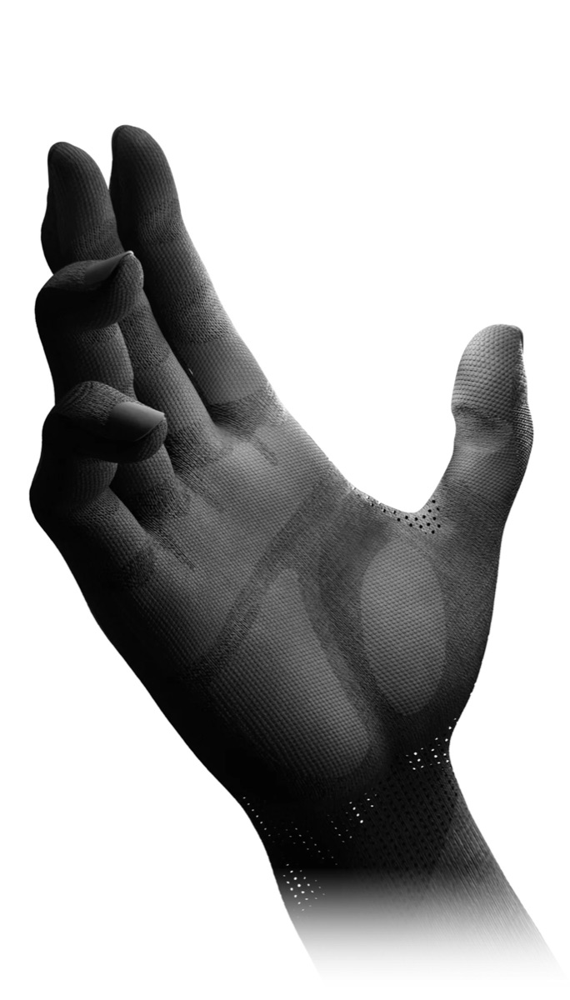
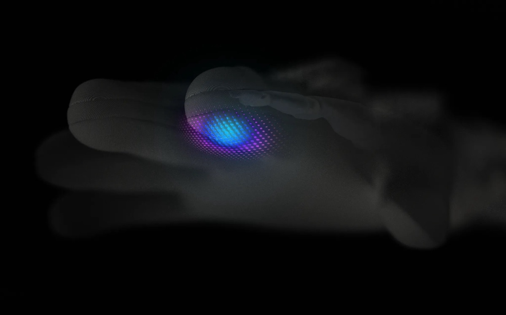
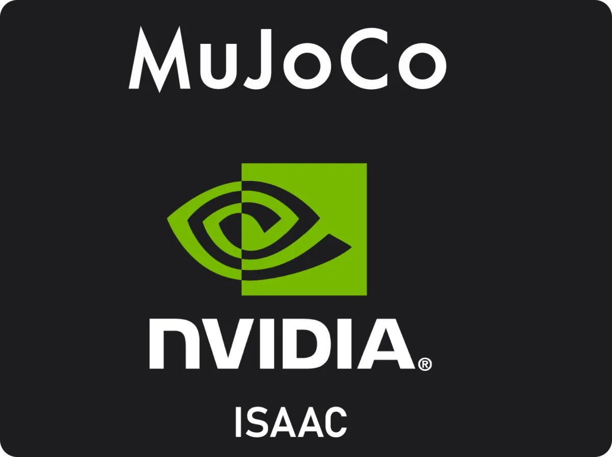

# WUJI × T01 — Products and Solutions

⬆ [WUJI profile](../WUJI.md) · [Brief](WUJI-T01-1-Brief.md) · [Playbook](WUJI-T01-3-Playbook.md)

**Bottom line:** WUJI makes hands and gloves, not mobile robots. For T01 it is the **end effector and teleop input** on someone else's platform. Nothing below moves, navigates or delivers by itself.

## Relevant products (ranked for this track)

### Wuji Hand 2

**Role in T01:** the "human hand" on a service robot — pressing lift and door buttons, turning handles, picking key cards, handing over small items. Back-drivable joints and force-position control make contact with fixed infrastructure (walls, panels, handles) more forgiving than a stiff position-controlled hand.

| Track-relevant spec | Value (official docs, 2.2 Beta) |
|---|---|
| Degrees of freedom | **20 active**, direct-drive, back-drivable, thumb opposition |
| Mass | **650 g** bare · 800 g with soft pads and cables · base 70 g extra |
| Size | 180 × 80 × 40 mm |
| Control | **MIT force-position hybrid** (default) · position mode (Beta) · **1000 Hz × 20 axes** |
| Comms / power | RJ45 Ethernet (100BASE-TX) · XT30, **11–13 V DC**, 12 V 20 A adapter (≥ 200 W) |
| Mounting | Standard palm-bottom interface (1 × M3 + 2 × M4 threaded holes), adapter mount + adapter flange in the box, STEP file in `wuji-description`. ISO flange size: not public |
| Payload, fingertip force, wrist load limits | **not public** (docs: wrist load / shock limits pending — avoid high loads) |
| IP rating / temperature | **not public** for Hand 2 — treat as indoor, dry |
| Tactile sensing | **None** in this beta ("non-tactile prototype") |

- **Status:** 🧪 beta hardware; docs warn parameters, skin and external interface will change.
- **Price:** official price not public. Third-party listings US$14,600–19,500 — ⚠️ unverified.
- **Availability on site:** not confirmed; expect shared, supervised units.
- **What you control:** per-joint position, velocity, feed-forward effort and kp / kd (MIT mode) or position targets; enable / disable; IMU and joint state streams. Python and C SDK, ROS 2 driver (`wuji_hand2_driver`). **No grasp planner, no skill library.**

### Wuji Hand

**Role in T01:** the lower-risk hand if Hand 2 units are scarce or unstable. Published force numbers, simple USB hookup, self-locking joints (holds an object without continuous effort commands).

| Track-relevant spec | Value (official docs) |
|---|---|
| Degrees of freedom | **20 active** (4 per finger), self-locking direct-drive joints |
| Mass / size | **580 ± 10 g** · 201 × 75 × 50 mm |
| Fingertip force | **15 N** |
| Whole-hand static grasp load | **10 kg** |
| Open / close time | ≈ 0.3 s |
| Control | Position control, **1000 Hz × 20 axes** |
| Comms / power | **USB 2.0** · 12–20 V DC |
| Protection | **IP40** — indoor, no water, no dust |
| Idle grip life | ≥ 300,000 cycles |

- **Status:** ✅ shipping.
- **Price:** official price not public. Reseller listing "from US$5,500" — ⚠️ unverified.
- **What you control:** joint position targets and joint state via the unified Wuji SDK; older ROS 2 package `wujihandros2` (archived; docs still online).

### Wuji Glove

**Role in T01:** remote-operator input ("human takes over when the robot is stuck") and demonstration capture for imitation learning. Not a robot component by itself.

| Track-relevant spec | Value (official docs) |
|---|---|
| Finger tracking | **5 EMF 6-DoF fingertip trackers**, 120 Hz, ≤ 2 mm RMS, ≤ 10 ms latency |
| Tactile | **526 points**, 120 FPS, 0–20 N, 0.1 N resolution |
| IMU | 6-axis, 800 Hz |
| Mass | **67.5 g** |
| Comms / power | USB-C power, RJ45 data via adapter |
| Operating temperature | −5 to 40 °C |
| Limit | EMF tracking degrades near metal — keep ≥ 3 cm clearance |

- **Status:** ✅ shipping. **Price:** not public.
- **What you get:** hand skeleton (feeds SDK retargeting directly), tactile frames, IMU; MCAP recording; ROS 2 driver (`wuji_glove_driver`, 10 topics).
- The glove tracks **fingers, not the arm** — arm teleop needs another tracker (the archived teleop repo used HTC Vive Trackers or PICO 4).

### Wuji SDK + Wuji CLI

**Role in T01:** the fastest route from laptop to moving fingers.

| Item | Detail |
|---|---|
| Install | `pip install wuji-sdk` (Python) · C packages |
| Platforms | Linux x86_64 / arm64, macOS Apple silicon, Windows (SDK + CLI); the **retargeting** page lists Linux and macOS arm64 only |
| Retargeting | 21 MediaPipe-format keypoints (metres) in → 20 joint angles out, for Hand and Hand 2, left / right |
| Recording | Multi-stream **MCAP** |
| Status / price | ✅ available, free (MIT repo) |

## What WUJI already does in this domain

**Nothing public.** No delivery, cleaning, facility-maintenance, hospitality, retail or municipal deployment, pilot or customer was found. The official docs position the hands for research, robot integration and human-machine interaction.

Closest adjacent evidence:

| Date | What | Relevance to T01 |
|---|---|---|
| 2026-06 | `wuji-openpi`: pi0 / pi0.5 fine-tuning + ROS 2 deployment for a dual 7-DoF-arm + two-Wuji-Hand rig (54-D action, head + two wrist cameras). No tasks named, no checkpoints or datasets published | Shows the hands running in a bimanual learned-policy setup — the kind of stack a service manipulator would use |
| undated | `wuji-hand-teleop`: glove-driven dual-hand teleop, optional Tianji arm control via Vive Tracker or PICO 4. Archived, "not actively maintained" | Reference for remote-operator service robots |
| undated | Official video list: release films, glove → hand retargeting / teleop, in-hand reorientation in sim and on hardware | Manipulation research demos only; no service scenario |

Note: the web-search quota for this research run was exhausted, so trade-press coverage of exhibitions or integrator partnerships could not be checked. Treat "nothing public" as "nothing in official docs, GitHub or the company profile".

## What they are building next in this domain

- 🧪 **Hand 2 final version** — the "non-tactile prototype" wording implies a tactile version later; no date (🔭). Tactile fingertips would matter for buttons and handles.
- ✅ **Software consolidation** — one SDK + CLI + ROS 2 driver for all devices (2026-10 / 2026-11 releases).
- **Inference:** WUJI's direction is a data loop (glove → retargeting → hand → MCAP → RL / VLA) for general humanoid dexterity, not urban-service products. Any T01 relevance arrives through robot makers that integrate the hand. No service-robot roadmap is published.

## Software, models and data that help for this track

| Asset | Use in a 48-hour T01 build | Caveat |
|---|---|---|
| [wuji-sdk](https://github.com/wuji-technology/wuji-sdk) `examples/python/retargeting/1.teleop_real.py` | Glove or webcam keypoints drive the hand — remote-assist in hours | Example switches Hand 2 to position mode (Beta) |
| SDK replay example (thumb opposition) | Pattern for **recording and replaying canned hand poses** (button-press finger, key-card pinch, handle wrap) | No interpolation; do not jump to `pos=0`, use the homing routine |
| [wuji-ros2](https://github.com/wuji-technology/wuji-ros2) | Hand 2 + Glove in the ROS graph next to a partner arm / Nav2 stack | **ROS 2 Lyrical only**, source build; most partner robots run Humble — bridge via the Python SDK or a container. No command watchdog in the Hand 2 driver |
| [wuji-description](https://github.com/wuji-technology/wuji-description) | URDF / MJCF / USD + STEP of the mount: design an adapter plate and test poses in sim | Rigid-body only |
| [wuji-openpi](https://github.com/wuji-technology/wuji-openpi) | Fine-tune pi0.5 on your own teleop episodes | Needs NVIDIA GPU (CUDA 12), ROS 2 Humble, your own data and base checkpoint — **too heavy for 48 h** unless a team member already knows openpi |
| [wuji-mjlab](https://github.com/wuji-technology/wuji-mjlab) / wuji-isaaclab | RL in-hand reorientation | Not relevant to T01 |

Pretrained models or datasets from WUJI: **none published**.

## Gaps and limits for this track

- **No mobility, no arm, no navigation, no perception.** Everything T01 is about ("move, deliver, maintain") comes from a partner vendor.
- **Indoor only.** Gen 1 is IP40; Hand 2 has no published rating. Leukerbad streets in November (snow, slush, sub-zero) are out.
- **Hand 2 load limits unpublished** — do not lean on door handles or carry heavy parcels with it. Gen 1 has numbers (15 N fingertip, 10 kg static).
- **No tactile sensing on the hand** — contact must be inferred from joint effort / tracking error or the arm's force sensing.
- **Integration cost:** you must machine or 3D-print an adapter plate, route Ethernet + 12 V along the arm, and fuse arm and hand control yourself.
- **ROS distro mismatch** (Lyrical vs. the Humble most robots use).
- **Overkill risk:** for most delivery or cleaning tasks a parallel gripper or a tray is simpler and more robust. Use the hand only where five fingers change the outcome.

## Sources

- [WUJI company profile (this repo)](../WUJI.md)
- [Wuji Docs — English index](https://docs.wuji.tech/_llms/en.txt)
- [Wuji Hand 2 (2.2 Beta) product introduction](https://docs.wuji.tech/docs/en/wuji-hand/latest/overview.md)
- [Wuji Hand 2 mechanical integration](https://docs.wuji.tech/docs/en/wuji-hand/latest/hardware-integration.md)
- [Wuji Hand 2 SDK practice — replaying a thumb opposition](https://docs.wuji.tech/docs/en/wuji-hand/latest/sdk-practice/opposition-replay.md)
- [Wuji Hand (gen 1) product introduction](https://docs.wuji.tech/docs/en/wuji-hand/v1/overview.md)
- [Wuji Glove product introduction](https://docs.wuji.tech/docs/en/wuji-glove/latest/introduction.md)
- [Wuji SDK — hand retargeting](https://docs.wuji.tech/docs/en/wuji-sdk/latest/retargeting.md)
- [Wuji Docs — videos](https://docs.wuji.tech/docs/en/videos.md)
- [Wuji Docs — release notes](https://docs.wuji.tech/docs/en/release-notes.md)
- [GitHub: wuji-ros2](https://github.com/wuji-technology/wuji-ros2)
- [GitHub: wuji-openpi](https://github.com/wuji-technology/wuji-openpi)
- [GitHub: wuji-hand-teleop](https://github.com/wuji-technology/wuji-hand-teleop)
- [GitHub: wuji-sdk](https://github.com/wuji-technology/wuji-sdk) · [wuji-description](https://github.com/wuji-technology/wuji-description)
- Product pages: [Hand](https://www.wuji.tech/en/hand) · [Hand 2](https://www.wuji.tech/en/hand2) · [Glove](https://www.wuji.tech/en/glove)
