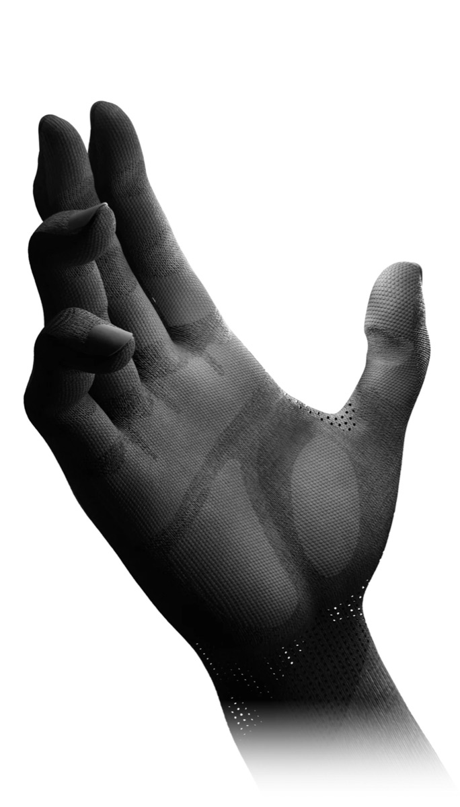
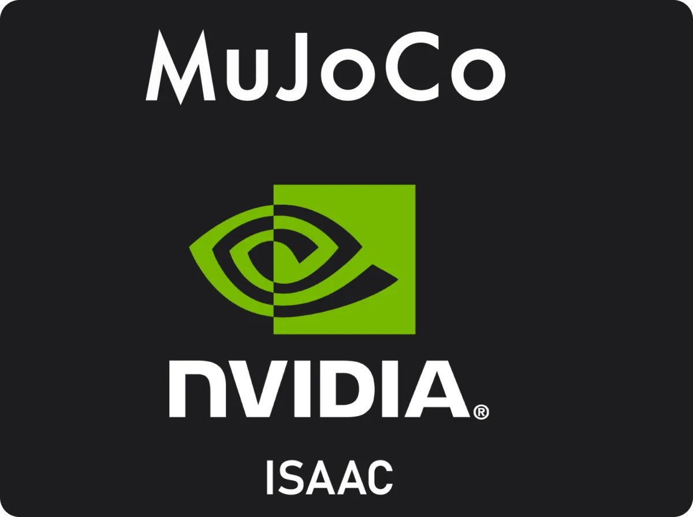

# WUJI × T02 — Products and Solutions

⬆ [WUJI profile](../WUJI.md) · [Brief](WUJI-T02-1-Brief.md) · [Playbook](WUJI-T02-3-Playbook.md)

**Bottom line for T02:** WUJI supplies the *hand* and the *operator glove* of a teleoperated hazard-response robot. Arm, mobility, cameras, mapping and autonomy must come from other vendors on site. WUJI has **no public safety, rescue or inspection deployment**.

## Relevant products (ranked for this track)

### Wuji Glove

**Role in T02:** the operator interface. It turns a human hand into a 20-joint command for the robot hand, and its tactile map shows how the operator is gripping. It also works alone as a gesture / grip sensor when no hand or arm is free.

| Spec | Value (official docs) | Why it matters for T02 |
|---|---|---|
| Finger tracking | 5 EMF 6-DoF fingertip modules, **120 Hz**, ≤ 2 mm RMS, < 5° RMS, latency **≤ 10 ms** | Low-lag teleoperation, no camera line of sight needed |
| Tactile | **526 points** (24 × 31 matrix), 120 FPS, 0–20 N, 0.1 N resolution, palm side | Measures the operator's grip, not the robot's contact |
| IMU | 6-axis, **800 Hz**, on the back of the hand | Orientation only; no wrist position |
| Connection | Wired: USB-C power (5 V / 1 A), RJ45 100BASE-TX via data-acquisition board on the forearm | Operator is tethered to a PC |
| Environment | −5 to 40 °C, **< 55 % RH** | Control-room device, not for wet field use |
| Metal sensitivity | Keep **≥ 3 cm** from metallic / ferromagnetic objects | Do not rest the glove on a steel bench |
| Weight | 67.5 g glove, 192.6 g with cable | Wearable for long sessions |

- **Status / price:** ✅ shipping · price not public · on-site quantity unknown.
- **Developer access:** `tactile`, `emf_poses`, `imu_data/palm` streams and joint angles from built-in inverse kinematics; per-user hand-model calibration (`wuji calib hand-model`); live viewer (`wuji viz`). One client can hold the glove at a time.
- **Setup time per docs:** about **30 min** to first data, about **45 min** to glove-to-Hand-2 teleoperation.

### Wuji Hand 2 (2.2 Beta)

**Role in T02:** the remote hand that operates human controls (valves, breakers, plugs, handles) in a place a person should not enter. Back-drivable joints make contact with unknown objects more forgiving.

| Spec | Value (official docs) | Why it matters for T02 |
|---|---|---|
| DoF | **20 active** (4 per finger), full thumb opposition, no coupled joints | Uses tools and controls built for human hands |
| Drive | Back-drivable direct drive, FOC, **1000 Hz × 20 axes** | Compliant contact, fast response |
| Control | **MIT mode** (position, velocity, current feed-forward, per-joint kp / kd) · position mode (Beta; docs require firmware v3.0.0+ and SDK v2026.11.9+) | Tune stiffness per task; cap effort per joint |
| Feedback | Position (rad), velocity (rad/s), effort (current in A in MIT mode; torque estimate in N·m in position mode), diagnostics, IMU | Docs warn: **do not use joint current as a contact-force measurement** on 2.2 |
| Weight | 650 g bare, **800 g** with pads and cables (base 70 g extra) | Fits small cobots and humanoid wrists |
| Interface | RJ45 Ethernet 100BASE-TX + XT30 power, 11–13 V DC, 12 V 20 A adapter (≥ 200 W) | Needs a 12 V rail and an Ethernet run on the carrier robot |
| Environment | **15–30 °C**, dry and clean, no liquids, oil mist or dust; no IP rating published | Indoor mock-ups only |
| Robustness | No guarantee for drop, vibration, shock or durability; "do not grasp fragile or high-value objects"; avoid long high-load runs (thermal design unfinished) | Treat as a prototype; plan gentle tasks |
| Force / payload | **not public** for Hand 2 (docs say prototype values are not a design basis) | Test your task on day 1 |

- **Status / price:** 🧪 beta prototype ("non-tactile") · official price not public (third-party listings US$14.6k–19.5k ⚠️ unverified).
- **Mounting:** palm interface with M3 / M4 threaded holes, identical on left / right; an adapter mount and adapter flange ship in the box; integrators are expected to machine an arm-side plate. STEP files and drawings are in `wuji-description`. Wrist load limits are not yet published.
- **Developer access:** joint level only (Python / C). No grasp planner, no skills, no camera.

### Wuji Hand (gen 1)

**Role in T02:** the lower-risk hand if Hand 2 units are scarce or unstable. Published force numbers, simpler USB wiring, self-locking joints that hold a grip.

| Spec | Value (official docs) | Why it matters for T02 |
|---|---|---|
| DoF | **20 active**, serial direct drive, **self-locking** joints | Holds a grasp without continuous effort |
| Fingertip force | **15 N** | Enough for switches, small valves, connectors; not for forcing |
| Load | Whole-hand static grasp **10 kg**, vertical grasp **5 kg**, single-finger hook **3 kg**, max grasp diameter **100 mm** | Can hold and carry a hand tool; test your object before relying on it |
| Control | Position control, **1000 Hz × 20 axes**; effort limit per joint 0–3.5 A (default 1.5 A) | Simple and stable; less compliant than Hand 2 |
| Feedback | Joint position, effort (A), per-joint temperature, bus voltage, error codes | Health monitoring during long teleop sessions |
| Interface | **USB 2.0** (USB-C) + XT30 power, 12–20 V DC, static power 12 W | One USB cable to the host PC |
| Protection | **IP40** | Dry indoor use only |
| Weight | 580 ± 10 g | Light payload cost on the arm |

- **Status / price:** ✅ shipping · official price not public (reseller "from US$5,500" ⚠️ unverified).
- **Mounting:** direct-mount adapter with a grooved flange for M5 and M6 screws; M4 screws to the hand's latch.

### Wuji SDK + Wuji CLI

**Role in T02:** the glue. One package discovers gloves and hands, retargets human pose to joint commands, and records sessions.

| Capability | Detail | T02 use |
|---|---|---|
| Install | `pip install wuji-sdk`; CLI via the official install script | Running in minutes on Linux, macOS (Apple silicon), Windows |
| Teleop example | `wuji-sdk/examples/python/retargeting/1.teleop_real.py` (glove → Hand 2, right hand by default) | The core of every remote-hands demo |
| Retargeting | 21 MediaPipe-format hand keypoints in → 20 joint angles out | Webcam hand tracking as a glove substitute |
| Recording | `TopicRecorder` → **MCAP** (LZ4 / Zstd), episodes, pause / resume, drop-rate / jitter / sync metrics and alerts | Incident log and demonstration data. Camera streams are not covered by the SDK recorder |
| Diagnostics | `wuji devices`, `wuji ping`, `wuji doctor`, fault logs, status LEDs (warning / fault / fatal) | Fast triage when a hand stops mid-demo |

- **Status / price:** ✅ available, free.

## What WUJI already does in this domain

**Nothing public.** No deployment, pilot, customer case or demo in emergency response, hazardous-environment teleoperation, infrastructure inspection or security was found in WUJI's official site, docs, GitHub organisation or in the company-profile research. The docs position the products for "research, robot integration and human-machine interaction".

Closest adjacent, dated evidence:

| Date | What | Relevance to T02 |
|---|---|---|
| 2026-11-10 | Unified SDK / CLI release (Windows, Apple silicon, Hand 2 position mode Beta) — [release notes](https://docs.wuji.tech/docs/en/release-notes.md) | Teleop stack is current and maintained |
| 2026-08-31 | `wuji-hand-teleop` archived (dual Tianji arms + dual Wuji Hands, Vive Tracker / PICO 4, stereo head camera streamed to the headset) — [repo](https://github.com/wuji-technology/wuji-hand-teleop) | A full arm + hand remote-operation reference exists, but is unsupported; README says a product version is "coming soon" |
| 2026-06 | `wuji-openpi`: pi0 / pi0.5 fine-tuning for two 7-DoF arms + two hands — [repo](https://github.com/wuji-technology/wuji-openpi) | Path from teleop demonstrations to autonomous skills; no checkpoints published |

Note: a dedicated news search could not be run in this research pass (search quota exhausted), so trade-press coverage of safety-domain demos was not re-checked beyond the profile research. Ask the WUJI staff on site.

## What they are building next in this domain

- 🧪 **Hand 2 final version with tactile sensing** — inference from the docs calling 2.2 a "non-tactile prototype"; no date or spec. Tactile fingertips would matter for blind manipulation in smoke or clutter.
- 🔭 **Productised teleoperation system** — the archived teleop README mentions a product version "coming soon"; no details.
- 🔭 **Connector change on Hand 2** — docs warn the external interface form will change in later 2.2 releases; adapters built this weekend may not fit future units.
- **No safety- or rescue-specific roadmap is public.** Ruggedised or sealed hands: not announced.

## Software, models and data that help for this track

| Asset | What you get | 48-hour use |
|---|---|---|
| [wuji-sdk](https://github.com/wuji-technology/wuji-sdk) (MIT) | Device API, retargeting, MCAP recording, Python examples | Glove → hand teleop on day 1 |
| [wuji-ros2](https://github.com/wuji-technology/wuji-ros2) | ROS 2 drivers for Hand 2 and Glove (official target: Ubuntu 26.04 + ROS 2 Lyrical) | Bridge to a partner arm's ROS 2 stack; use Docker if your laptop differs |
| [wuji-description](https://github.com/wuji-technology/wuji-description) | URDF / MJCF / MJX / USD, STEP and flange drawings | Simulate the task; design or print the arm adapter |
| [wuji-hand-teleop](https://github.com/wuji-technology/wuji-hand-teleop) (MIT, archived) | ROS 2 Humble Docker stack for arm + hand teleop, camera streaming to PICO | Read for architecture; do not expect it to run on other arms unmodified |
| [wuji-openpi](https://github.com/wuji-technology/wuji-openpi) (Apache-2.0) | Fine-tuning and deployment of pi0 / pi0.5; needs NVIDIA GPU (CUDA 12), LeRobot v2.1 data | Stretch goal only |
| Pretrained models / datasets | **none published** | — |

## Gaps and limits for this track

- **Not a robot.** No arm, base, camera, mapping, navigation or autonomy. Glove gives finger pose but **no wrist position**; arm teleoperation needs an external tracker or another input.
- **Not field-rated.** IP40 (gen 1); Hand 2 limited to 15–30 °C, dry and clean, no shock guarantee. Any "avalanche / flood / fire" story must be staged indoors and described honestly as a lab prototype.
- **No touch on the robot side.** Current Hand 2 beta has no tactile sensors and its joint current must not be used as a force measurement. Operator feedback is visual only; the glove has no haptic actuators in the published specs.
- **Light forces.** 15 N fingertip class (gen 1); Hand 2 force data not public. Stiff industrial valves or emergency door releases may be out of reach.
- **Tethered and local.** Glove and Hand 2 are wired Ethernet on one subnet. Remote operation over a wide-area link is not documented; watchdog behaviour on communication loss is not documented.
- **Beta hardware.** Thermal behaviour under long load is unverified; interface and parameters may change.
- **Access.** Units are expensive and fragile; expect shared, supervised use.

## Sources

- [WUJI company profile (this repo)](../WUJI.md)
- [Wuji Docs — English index](https://docs.wuji.tech/_llms/en.txt)
- [Wuji Hand 2 (2.2 Beta) overview](https://docs.wuji.tech/docs/en/wuji-hand/latest/overview.md)
- [Wuji Hand 2 user notice / usage constraints](https://docs.wuji.tech/docs/en/wuji-hand/latest/user-notice.md)
- [Wuji Hand 2 mechanical integration](https://docs.wuji.tech/docs/en/wuji-hand/latest/hardware-integration.md)
- [Wuji Hand 2 joint states and control](https://docs.wuji.tech/docs/en/wuji-hand/latest/sdk-reference/joint-control.md)
- [Wuji Hand 2 effort and MIT parameters](https://docs.wuji.tech/docs/en/wuji-hand/latest/sdk-reference/effort-and-mit.md)
- [Wuji Hand (gen 1) overview](https://docs.wuji.tech/docs/en/wuji-hand/v1/overview.md)
- [Wuji Glove introduction](https://docs.wuji.tech/docs/en/wuji-glove/latest/introduction.md)
- [Wuji Glove quick start (incl. glove-to-hand teleoperation)](https://docs.wuji.tech/docs/en/wuji-glove/latest/getting-started.md)
- [Wuji SDK data recording](https://docs.wuji.tech/docs/en/wuji-sdk/latest/data-recording.md)
- [Wuji Docs release notes](https://docs.wuji.tech/docs/en/release-notes.md)
- [GitHub: wuji-technology](https://github.com/wuji-technology) · [wuji-hand-teleop](https://github.com/wuji-technology/wuji-hand-teleop) · [wuji-openpi](https://github.com/wuji-technology/wuji-openpi)
- Canonical product pages (JavaScript-rendered; specs above come from the docs, not these pages): [Wuji Hand](https://www.wuji.tech/en/hand) · [Wuji Hand 2](https://www.wuji.tech/en/hand2) · [Wuji Glove](https://www.wuji.tech/en/glove)
