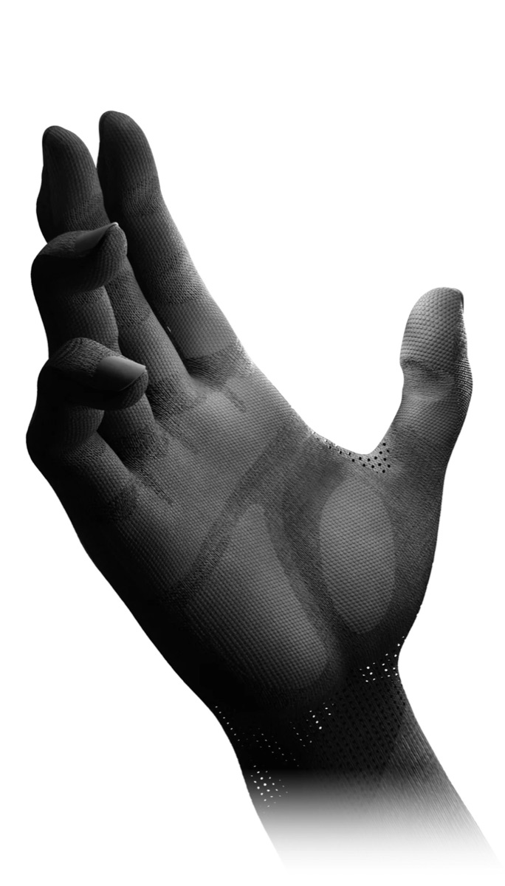
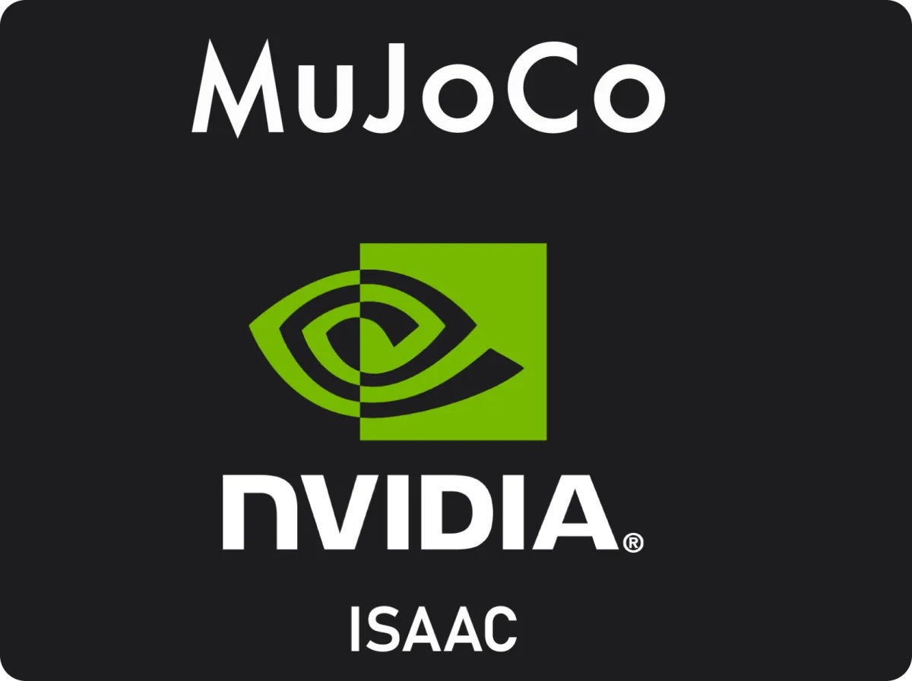

# WUJI × T03 — Products and Solutions

⬆ [WUJI profile](../WUJI.md) · [Brief](WUJI-T03-1-Brief.md) · [Playbook](WUJI-T03-3-Playbook.md)

**Bottom line:** WUJI sells an end effector and a data glove, not a sustainability solution. Its sensible T03 role is **dexterous handling in circular-economy tasks** (disassembly, repair, separating multi-material items) and **capturing human demonstrations** of those tasks. What WUJI actually brings on site is not confirmed; check at the booth first.

## Relevant products (ranked for this track)

### Wuji Glove

**Role in T03:** lowest-risk entry point. Worn by a human, it (a) teleoperates the Wuji Hand for disassembly / sorting steps, and (b) records how a skilled person grips and takes apart an item (pressure map + finger pose), which is the raw material for later automation. Works even if no arm is available.

| Spec (official docs) | Value |
|---|---|
| Tactile | **526 points** (24 × 31 matrix, full palm side), **120 FPS**, 0–20 N, 0.1 N resolution, 4 mm pitch, ±6 % repeatability |
| Finger tracking | 5 EMF 6-DoF fingertip modules, 120 Hz, ≤ 2 mm RMS, < 5° RMS, ≤ 10 ms latency |
| IMU | 6-axis on back of hand, 800 Hz |
| Weight | **67.5 g** glove (192.6 g with cable) |
| Interfaces | USB-C power (5 V / 1 A), RJ45 Ethernet data via adapter |
| Environment | −5 to 40 °C, **< 55 % RH** operating; water resistance not stated |
| Known limit | EMF tracking is disturbed by metal / ferromagnetic objects: keep **≥ 3 cm** clearance |

- **Status / price:** ✅ shipping · price not public.
- **Developer access:** SDK subscriptions for tactile frames, fingertip poses, solved hand skeleton and IMU; MCAP recording; ROS 2 driver in `wuji-ros2`.
- **T03 caveat:** e-waste and cans are metal. Expect degraded finger tracking when fingers are close to metal parts; the tactile matrix still works. Test on your actual objects in hour 1.

### Wuji Hand (gen 1)

**Role in T03:** the hand with **published load numbers**, simple USB hookup and per-joint current feedback. Best choice when the task is gripping, twisting or pulling recyclables and you need to argue payload and energy with real figures.

| Spec (official docs) | Value |
|---|---|
| DoF | **20 active** (4 per finger), self-locking direct-drive joints |
| Weight / size | **580 ± 10 g** · 201 × 75 × 50 mm |
| Forces | fingertip **15 N** · whole-hand static grasp **10 kg** · vertical grasp 5 kg · single-finger hook 3 kg |
| Object size | max grasp diameter **100 mm** |
| Speed | open / close ≈ **0.3 s**, ≥ 2 cycles per second |
| Precision | ±1 mm repeatability |
| Power | 12–20 V DC · **12 W static** · adapter 12 V 20 A |
| Control | position control, 1000 Hz × 20 axes, **USB 2.0** (USB-C) + XT30 power |
| Feedback | joint position, **joint effort in amps**, per-joint bus voltage, temperature, error code |
| Protection | **IP40**, aluminium shell, idle grip life ≥ 300,000 cycles |

- **Status / price:** ✅ shipping · official price not public (reseller listing "from US$5,500" — ⚠️ unverified).
- **Developer access:** joint-level position targets, per-joint effort limit (default 1.5 A, range 0–3.5 A, derated by firmware when hot), full state readback. No grasp planner.
- **Extras:** docs mention an optional tactile glove worn on the hand and an impact-release wrist adapter with safety chain; whether either is on site is unknown.

### Wuji Hand 2 (2.2 Beta)

**Role in T03:** compliant handling. Back-drivable joints with MIT (stiffness / damping) control let fingers give way on fragile or irregular items (glass jars, thin plastic, connectors) instead of crushing them. Probably the unit WUJI most wants developers on, but it is beta.

| Spec (official docs) | Value |
|---|---|
| DoF | **20 active**, back-drivable direct-drive, full thumb opposition |
| Weight / size | **650 g** bare · 800 g with pads and cables · 70 g base · 180 × 80 × 40 mm |
| Object size | min grasp diameter 0 mm (pinch) |
| Fingertip force / payload / joint torque | **not published** in the beta docs |
| Control | **MIT force-position mode** (default) + position mode (Beta), 1000 Hz × 20 axes |
| Power | 11–13 V DC, adapter 12 V 20 A (≥ 200 W rated); typical draw not stated |
| Interfaces | RJ45 Ethernet 100BASE-TX + XT30 (docs warn the connector form will change) |
| Sensing | no tactile skin ("non-tactile prototype"); joint states and diagnostics via SDK |
| Mounting | standard flange + adapter mount + adapter flange in the box; palm pattern 1 × M3 + 2 × M4; STEP files in `wuji-description`. **Wrist load and shock limits not yet published** |
| IP rating | not stated — treat as indoor, clean, dry |

- **Status / price:** 🧪 beta hardware · official price not public (third-party listings US$14,600–19,500 — ⚠️ unverified).
- **Developer access:** per-joint `kp` / `kd`, effort limit (amps in MIT mode, N·m in position mode), position targets, joint states and diagnostics. Official teleop examples switch the hand to position mode first.

### Wuji SDK + Wuji CLI

**Role in T03:** the glue. One Python / C SDK for hand, Hand 2 and glove, with the two features a 48-hour team needs most: retargeting and recording.

| Capability | Detail |
|---|---|
| Install | `pip install wuji-sdk` · Linux x86_64 / arm64, macOS Apple silicon, Windows |
| Retargeting | `RetargetSession`: **21 MediaPipe-format keypoints (metres) in → 20 joint angles out**, same call for both hand generations. Sources: Wuji Glove skeleton, webcam + MediaPipe, VR hand tracking. Retargeting wheels cover Linux and macOS arm64 only (**not Windows**) |
| Recording | `TopicRecorder` writes selected channels to one **MCAP** file per episode, with drop-rate / jitter / sync metrics and alerts |
| ROS 2 | `wuji-ros2` drivers; official install targets Ubuntu 26.04 + ROS 2 Lyrical |

- **Status / price:** ✅ available · free (MIT).

## What WUJI already does in this domain

**Nothing public.** No WUJI deployment, pilot, demo, partner or application page was found for waste sorting, recycling, disassembly, energy, water or environmental monitoring.

- Official docs position the products for **research, robot integration and human-machine interaction** only.
- Published demos are generic dexterity: in-hand cube reorientation (`wuji-mjlab`, `wuji-isaaclab`, 2026-10), pen-spin retargeting (`toporetarget`, 2026-06), dual-arm pi0 / pi0.5 fine-tuning (`wuji-openpi`, 2026-06).
- Research limits for this file: web search was unavailable during this run, so the check covered the official docs, the official GitHub organisation and the existing company profile. Chinese-language press and trade-show coverage was **not** searched for this track — ⚠️ treat "nothing found" as "nothing found in official channels".

## What they are building next in this domain

No sustainability-specific plans are announced. Relevant general direction:

- 🧪 **Hand 2 final version** — the "non-tactile prototype" wording implies a tactile version later (inference; no date). Tactile fingertips would matter for material identification by touch.
- ✅ **Data loop** (glove → retargeting → hand → MCAP → RL / VLA fine-tuning) is the company's stated path to autonomy. *Inference:* that loop fits disassembly and repair, where product variety defeats hard-coded automation, but WUJI has not said so.
- Interfaces on Hand 2 will change in later 2.2 releases (stated in docs), so anything you build this weekend is a prototype against a moving target.

## Software, models and data that help for this track

| Asset | What it gives you in 48 hours | Caveat |
|---|---|---|
| [wuji-sdk](https://github.com/wuji-technology/wuji-sdk) | Hand / glove control, retargeting, MCAP recording from plain Python | Joint-level only |
| [wuji-description](https://github.com/wuji-technology/wuji-description) | URDF / MJCF / MJX / USD + STEP files for adapter plates | Rigid bodies only |
| [wuji-ros2](https://github.com/wuji-technology/wuji-ros2) | ROS 2 drivers and messages for Hand 2 and Glove | Targets Ubuntu 26.04 + ROS 2 Lyrical; use Docker or skip ROS |
| [wuji-openpi](https://github.com/wuji-technology/wuji-openpi) | Fine-tuning + ROS 2 deployment of pi0 / pi0.5 for dual-arm + two Wuji Hands (54-D actions), LeRobot v2.1 data | **No checkpoints or datasets published**; needs NVIDIA GPU (CUDA 12), ROS 2 Humble client and the archived teleop repo. Not a 48-hour path for most teams |
| [wuji-mjlab](https://github.com/wuji-technology/wuji-mjlab) / [wuji-isaaclab](https://github.com/wuji-technology/wuji-isaaclab) | PPO in-hand cube reorientation with sim-to-real | Task is not sustainability-related; useful only as an RL template |
| [wuji-hand-teleop](https://github.com/wuji-technology/wuji-hand-teleop) | ROS 2 hand + arm teleoperation reference | Archived, not maintained |

No sorting, waste, disassembly or energy datasets or models exist from WUJI. You bring your own vision model (for example an open-vocabulary detector on a laptop GPU or a D-Robotics RDK board).

## Gaps and limits for this track

- **No proof in the domain** and no sustainability story from the vendor: the impact case is entirely yours to build.
- **Wrong tool for most waste tasks:** real waste is wet, dirty, sharp and abrasive. Gen 1 is IP40; Hand 2 has soft pads, a skin that must stay fitted and fragile flex cables. Use **clean, dry mock items** only.
- **No arm, no mobility, no perception, no compute.** Budget several hours for flange adaptation, cable routing and payload checks (hand ≈ 0.6–0.9 kg before the object).
- **Hand 2 unknowns:** payload, fingertip force and wrist-load limits are unpublished; beta firmware; position mode is Beta.
- **Glove near metal:** EMF finger tracking degrades within 3 cm of metal, which is most e-waste.
- **Energy optics:** a 20-motor hand with a 12 V 20 A supply is hard to sell as "energy-efficient" unless you measure it (gen 1 reports 12 W static and per-joint current).
- **Access:** unit count unknown; expect shared, supervised time on the hardware.

## Sources

- [WUJI profile (this repo)](../WUJI.md)
- [Wuji Docs — English index](https://docs.wuji.tech/_llms/en.txt)
- [Wuji Hand 2 (2.2 Beta) product introduction](https://docs.wuji.tech/docs/en/wuji-hand/latest/overview.md)
- [Wuji Hand 2 mechanical integration](https://docs.wuji.tech/docs/en/wuji-hand/latest/hardware-integration.md)
- [Wuji Hand 2 effort and MIT parameters](https://docs.wuji.tech/docs/en/wuji-hand/latest/sdk-reference/effort-and-mit.md)
- [Wuji Hand (gen 1) product introduction](https://docs.wuji.tech/docs/en/wuji-hand/v1/overview.md)
- [Wuji Glove product introduction](https://docs.wuji.tech/docs/en/wuji-glove/latest/introduction.md)
- [Wuji SDK hand retargeting](https://docs.wuji.tech/docs/en/wuji-sdk/latest/retargeting.md)
- [Wuji SDK data recording](https://docs.wuji.tech/docs/en/wuji-sdk/latest/data-recording.md)
- [GitHub: wuji-technology repositories](https://github.com/orgs/wuji-technology/repositories)
- [GitHub: wuji-openpi](https://github.com/wuji-technology/wuji-openpi)
- [T03 track overview (this repo)](../../../Challenges/T03-Sustainable-City/T03-0-Track-Overview.md)
