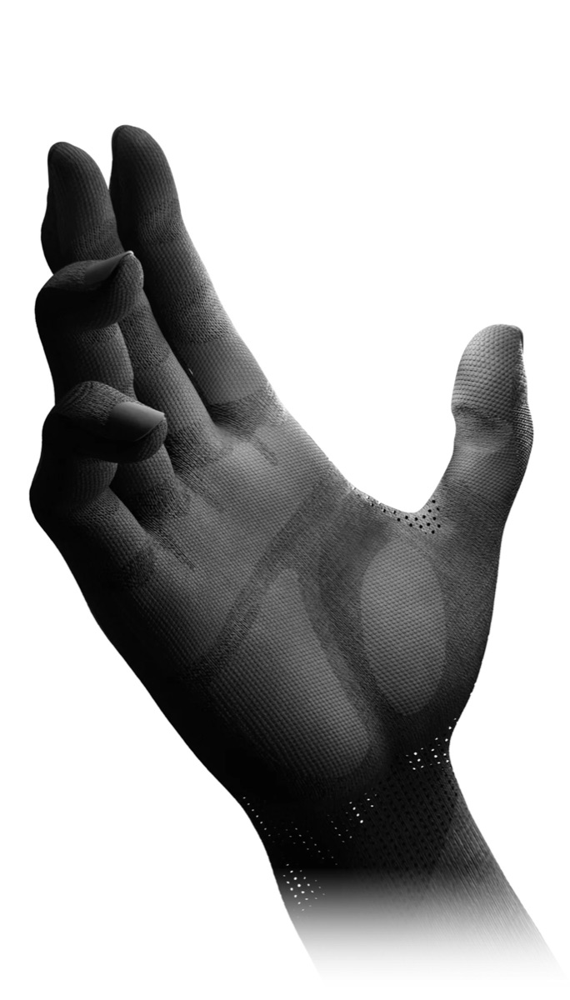
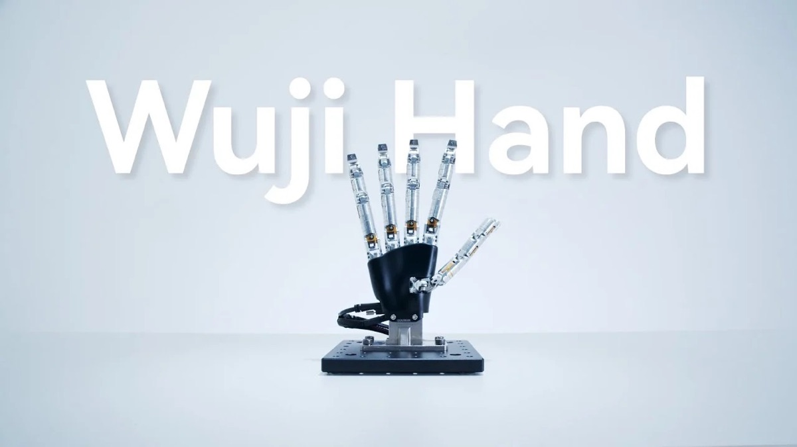
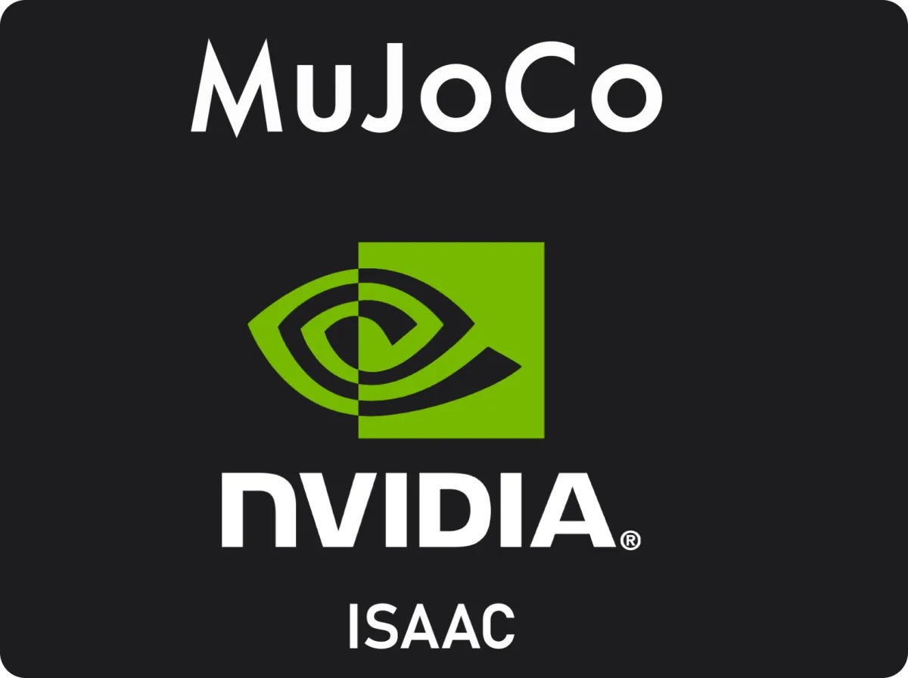

# WUJI × T04 — Products and Solutions

⬆ [WUJI profile](../WUJI.md) · [Brief](WUJI-T04-1-Brief.md) · [Playbook](WUJI-T04-3-Playbook.md)

**In one line:** WUJI sells a tactile data glove and 20-DoF robot hands. For care and rehab the glove is the stronger card (it works alone); the hands need a stand or a partner arm. WUJI has **no published healthcare activity**.

## Relevant products (ranked for this track)

### Wuji Glove

**Role in T04:** wearable sensor for hand-function assessment and exercise coaching (grip pressure pattern, finger range of motion, tremor), and the input device for teleoperating a robot hand (tele-care, mirror therapy). The only WUJI product usable without another vendor's robot.

| Track-relevant spec | Value (official docs) |
|---|---|
| Tactile sensing | **526 active points** (24 × 31 matrix, full palm side), **120 FPS**, 4 mm pitch, hardware range 0–20 N, 0.1 N resolution, repeatability ±6% |
| Tactile output in the SDK | **Normalized 0.0–1.0, not newtons**; also grouped by zone (palm 288 points, thumb 41, index 43, middle 58, ring 52, pinky 44), per-point contact yes/no, 3D pressure point cloud |
| Finger pose | 5 fingertip EMF trackers, 6-DoF, **120 Hz**, ≤ 2 mm RMS position, < 5° RMS orientation, ≤ 10 ms latency |
| Derived hand model | 21-keypoint skeleton (MediaPipe topology), 21 joint angles in radians, per-finger confidence |
| IMU | 6-axis on the back of the hand, **800 Hz** (usable for tremor / movement smoothness) |
| Weight | **67.5 g** glove, 192.6 g with cable |
| Connection | USB-C power (5 V / 1 A) + RJ45 Ethernet data via adapter — tethered, not wireless |
| Size | One size listed (215 × 195 mm); no hand-size range given |
| Environment | −5 to 40 °C, humidity < 55% RH; cleaning / washing guidance: not published |

- **Status / price / availability:** ✅ shipping. Price not public. Units on site: not confirmed.
- **Developer interface:** Python and C SDK (`pip install wuji-sdk`). Subscribe to `tactile()`, `tactile_zones()`, `tactile_binary()`, `emf_poses()`, `hand_joint_angles()`, `hand_skeleton()` and IMU; set stream rate; record to MCAP. Calibration through the Wuji CLI (`wuji calib hand-model`, `wuji calib tactile`, health check `wuji doctor`); hand-model calibration needs a named user profile.

### Wuji Hand 2 (2.2 Beta)

**Role in T04:** compliant robot hand for mirror-therapy / exercise demonstration on a desk stand, or as the end effector for daily-living tasks (caps, pill boxes, cups, handles) on a partner arm.

| Track-relevant spec | Value (official docs) |
|---|---|
| Degrees of freedom | **20 active**, 4 per finger, thumb opposition |
| Drive | Direct-drive, **back-drivable** joints (can be pushed by hand when gains are low) |
| Control | **MIT force-position mode** (per-joint kp / kd, per-joint `effort_limit` in amperes) · position mode (Beta) · 1000 Hz |
| Feedback | Joint states incl. effort, joint diagnostics, IMU. **No tactile sensors** in this beta. Docs say not to use joint current to judge contact force |
| Weight / size | 650 g bare, **800 g** with pads and cables · 180 × 80 × 40 mm |
| Power / data | 11–13 V DC (12 V 20 A adapter, ≥ 200 W) via XT30 · RJ45 Ethernet |
| Environment | 15–30 °C, dry and clean; over-temperature protection with thermal derating |
| Payload / fingertip force | Not committed for the beta ("may change") |

- **Status / price / availability:** 🧪 beta prototype; parameters not final. Official price not public (third-party listings US$14,600–19,500 — ⚠️ unverified). Units on site: not confirmed.
- **Developer interface:** joint-level only. You set targets, gains and effort limits per joint; there is no grasp planner. ROS 2 driver in `wuji-ros2` (official install targets Ubuntu 26.04 + ROS 2 Lyrical).
- **Safety wording in the user notice:** keep hands and body away while it moves; no long high-load runs; do not grasp fragile or high-value objects; housing can get hot.

### Wuji Hand (gen 1)

**Role in T04:** the more mature hand; pick it when you need published force numbers and simple USB hookup rather than compliance.

| Track-relevant spec | Value (official docs) |
|---|---|
| Degrees of freedom | **20 active**, serial direct-drive, self-locking joints |
| Fingertip force / grasp | **15 N** fingertip · **10 kg** whole-hand static grasp load |
| Speed | Open / close ≈ 0.3 s |
| Control | Position control, 1000 Hz |
| Weight / size | **580 g** · 201 × 75 × 50 mm |
| Power / data | 12–20 V DC · USB 2.0 |
| Protection | IP40 (indoor, dry) |

- **Status / price / availability:** ✅ shipping. Official price not public (reseller "from US$5,500" — ⚠️ unverified).
- **Developer interface:** joint position targets through the unified SDK; retargeting supports it (`HandModel.WujiHand`).

### Wuji SDK + Wuji CLI

**Role in T04:** the glue for every concept — streaming, retargeting, recording, calibration.

| Capability | Detail |
|---|---|
| Languages / install | Python + C · `pip install wuji-sdk` · free, MIT repo |
| Platforms | Linux x86_64 / arm64; Windows and Apple-silicon macOS added in the 2026-11-10 release (per profile research) |
| Retargeting | `RetargetSession.for_hand(model, side)` → `step(keypoints)`: 21 MediaPipe-format keypoints in, 20 joint angles out; works for Hand 2 and Hand gen 1; only needs `numpy` |
| Ready example | `examples/python/retargeting/1.teleop_real.py` in `wuji-sdk`: glove → retarget → real hand |
| Recording | `TopicRecorder` writes MCAP (LZ4 / Zstd), one file per episode, with live quality metrics. Documented channels: hand `joint_states`, `joint_diagnostics`, glove `emf_poses`, `imu_raw/palm`. Tactile recording to MCAP is not listed on that page — ⚠️ unverified |
| Visualisation | Wuji CLI live visualisation; tactile contact grid view |

## What WUJI already does in this domain

**Nothing public.** No deployment, pilot, clinical study, healthcare partner or care demo was found.

- The official glove page lists four application scenarios: robot-hand teleoperation, tactile data collection and research, human-computer interaction experiments, VR / AR gesture input. Rehabilitation, medical or elderly care are not mentioned.
- The official docs index (about 167 English pages) contains no healthcare, prosthetics or rehabilitation page.
- No product is described as a medical device, and no medical certification is published.
- Research note: the general web search quota was exhausted during this run, so this section rests on the official docs, the GitHub organisation and the profile research (which also found no named customers in any sector). Treat "nothing public" as "nothing found", and ask WUJI staff on site.

## What they are building next in this domain

- 🔭 **Tactile Hand 2** — inference: the docs call 2.2 a "non-tactile prototype", which implies a tactile version later. No date. A tactile robot hand would matter for safe handling of objects around people.
- ✅ **Unified SDK / CLI across platforms** (Windows and macOS in the 2026-11-10 release) — lowers the barrier for a clinic-style laptop app.
- ✅ **Glove → retarget → hand → record → train loop** (RL and pi0 / pi0.5 fine-tuning repos) — aimed at humanoid dexterity, not care. Inference: the same loop is what a future home-assist robot would need for daily-living tasks.
- Healthcare-specific roadmap: **not public**.

## Software, models and data that help for this track

| Asset | Use in a 48-hour T04 build | Status |
|---|---|---|
| [wuji-sdk](https://github.com/wuji-technology/wuji-sdk) | Glove streams, retargeting, MCAP recording; glove → hand teleop example | ✅ MIT, updated 2026-11-10 |
| [wuji-cli](https://github.com/wuji-technology/wuji-cli) | Device discovery, `wuji doctor`, calibration, live plots | ✅ MIT |
| [wuji-description](https://github.com/wuji-technology/wuji-description) | URDF / MJCF / MJX / USD hand models — build a simulated "ghost hand" or test before hardware time | ✅ MIT |
| [wuji-ros2](https://github.com/wuji-technology/wuji-ros2) | ROS 2 drivers for Hand 2 and Glove when combining with a ROS-based arm | ✅ MIT (ROS 2 Lyrical target) |
| [wuji-openpi](https://github.com/wuji-technology/wuji-openpi) | Fine-tune pi0 / pi0.5 on your own teleop demos (needs GPU and time) | ✅ code only, no checkpoints |
| [toporetarget](https://github.com/wuji-technology/toporetarget) | Human hand-object motion → Wuji Hand; research-grade | ✅ MIT |
| Pretrained care / rehab models, datasets | — | none published |

Webcam + MediaPipe produces the same 21-keypoint format as the glove skeleton, so the pose part of any concept can be developed without a glove.

## Gaps and limits for this track

- **No clinical validity.** Pressure comes out normalized (0–1); the ±6% repeatability and lack of a newton mapping in the SDK make it a relative, not a diagnostic, measure.
- **Fit and hygiene.** One glove size; no guidance for small, swollen or contracted hands; no cleaning instructions. Putting a glove on an arthritic or post-stroke hand may be hard.
- **Calibration burden.** Hand-model and tactile calibration use guided hand motions; whether a person with limited range of motion can complete them is unknown.
- **EMF tracking.** Needs ≥ 3 cm clearance from metal (rings, wheelchair or rollator frames, bed rails). Compatibility with pacemakers or other implants is not addressed in the docs — ask before putting it on anyone with an implant.
- **Tethered.** USB-C power plus Ethernet cable on the wrist.
- **Robot hands are not people-safe by certification.** No tactile sensing on Hand 2 beta, contact force cannot be inferred from current, housing can get hot, fingers and flex cables are fragile, IP40 / dry only.
- **No arm, no mobile base, no perception, no grasp planner, no on-board compute** — all must come from your team or another vendor.
- **Scarcity.** Expect shared, supervised access to hands and gloves.

## Sources

- [WUJI profile (this repo)](../WUJI.md)
- [Wuji Docs — English index](https://docs.wuji.tech/_llms/en.txt)
- [Wuji Glove product introduction](https://docs.wuji.tech/docs/en/wuji-glove/latest/introduction.md)
- [Wuji Glove — tactile data reference](https://docs.wuji.tech/docs/en/wuji-glove/latest/sdk-data-reference/tactile.md)
- [Wuji Glove — hand tracking data reference](https://docs.wuji.tech/docs/en/wuji-glove/latest/sdk-data-reference/hand-tracking.md)
- [Wuji Glove — calibration and configuration](https://docs.wuji.tech/docs/en/wuji-glove/latest/calibration.md)
- [Wuji Hand 2 — user notice](https://docs.wuji.tech/docs/en/wuji-hand/latest/user-notice.md)
- [Wuji Hand 2 — effort and MIT parameters](https://docs.wuji.tech/docs/en/wuji-hand/latest/sdk-reference/effort-and-mit.md)
- [Wuji Hand 2 (2.2 Beta) product introduction](https://docs.wuji.tech/docs/en/wuji-hand/latest/overview.md) (specs taken via the profile research)
- [Wuji Hand (gen 1) product introduction](https://docs.wuji.tech/docs/en/wuji-hand/v1/overview.md) (specs taken via the profile research)
- [Wuji SDK — hand retargeting](https://docs.wuji.tech/docs/en/wuji-sdk/latest/retargeting.md)
- [Wuji SDK — data recording](https://docs.wuji.tech/docs/en/wuji-sdk/latest/data-recording.md)
- [Wuji Docs release notes](https://docs.wuji.tech/docs/en/release-notes.md) (via the profile research)
- [GitHub: wuji-technology](https://github.com/wuji-technology)
