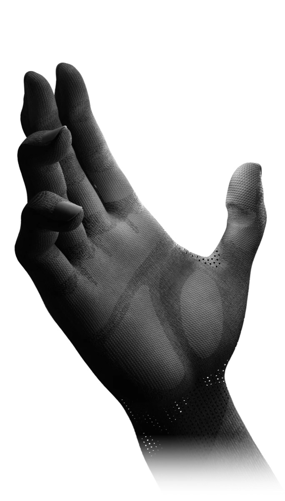
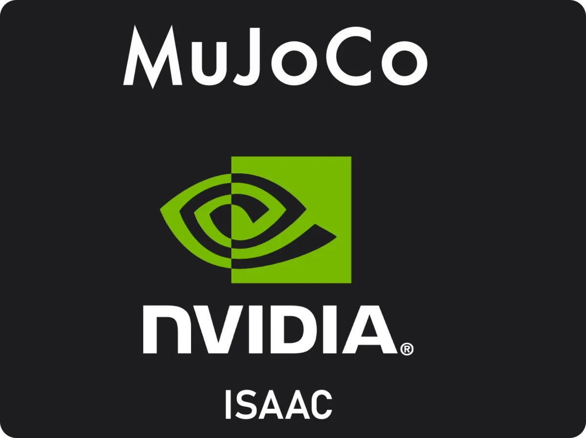

# WUJI — Product Portfolio

⬆ [WUJI profile](WUJI.md) · [Developer guide](WUJI-Developer-Guide.md) · [Roadmap and strategy](WUJI-Roadmap-and-Strategy.md)

> **In 20 seconds:** WUJI sells **two 20-DoF direct-drive dexterous hands**, **one tactile + pose data glove**, and a **free unified SDK / CLI**. No arm, no wrist, no mobile base, no on-board compute: you always pair it with another vendor's arm or humanoid (or use the glove alone as a sensor).
> **Pick quickly:** need force / compliant contact → **Wuji Hand 2** (back-drivable, MIT mode, Ethernet). Need the simplest plug-in (USB, position control, holds load unpowered-style via self-locking joints) → **Wuji Hand** gen 1. Need teleop, demonstrations or a grip-pressure sensor on a human → **Wuji Glove**.

## Lineup map

Track relevance: ● strong · ◐ partial · ○ none. Status: ✅ shipping/available · 🧪 announced/preview · 🔭 roadmap/concept.

| Product | Category | Status | Launched | Price (if public) | Positioning (one line) | T01 | T02 | T03 | T04 |
|---|---|---|---|---|---|---|---|---|---|
| **Wuji Hand** (gen 1) | 5-finger dexterous hand | ✅ | 2025 ⚠️ unverified (docs figures dated 2025-11) | not public (reseller "from US$5,500" ⚠️ unverified) | 20-DoF self-locking direct-drive hand, USB, position control, strongest published load figures | ◐ | ◐ | ◐ | ◐ |
| **Wuji Hand 2** (2.1 / 2.2 Beta) | 5-finger dexterous hand, gen 2 | 🧪 beta hardware | teased 2026-06; 2.2 Beta docs current in 2026-11 | not public (third-party US$14,600–19,500 ⚠️ unverified) | 20-DoF back-drivable hand with soft pads and MIT force-position control over Ethernet | ◐ | ● | ◐ | ● |
| **Wuji Glove** | Tactile + pose data glove | ✅ | not public | not public | 526-point palm pressure map + 5 fingertip 6-DoF trackers for teleop and data capture | ◐ | ● | ◐ | ● |
| **Wuji SDK + Wuji CLI** | Software (Python / C SDK, command-line tool) | ✅ free | unified SDK consolidated in 2026 | free | One API for both hands and the glove; discovery, streaming, MCAP recording, retargeting | ◐ | ◐ | ◐ | ◐ |
| Hand 2 tactile / final version | Dexterous hand | 🔭 | no date published | not public | Implied by the docs calling 2.2 a "non-tactile prototype" | ○ | ○ | ○ | ○ |

## Products

### Wuji Hand

First-generation 20-DoF five-finger hand. Every joint has its own motor (serial direct drive, no tendon or linkage coupling) and the joints are **self-locking**, so it holds a grasp without continuous torque. Position control only.

| Spec | Value (official docs) |
|---|---|
| Active DoF / joints | **20** (4 per finger), fully opposable thumb, lateral finger swing |
| Kinematics | Serial direct-drive rotary joints, no nonlinear coupling |
| Weight | **580 ± 10 g** (without cables) |
| Size | 201 × 75 × 50 mm; finger length about 157 mm, thumb about 130 mm |
| Max grasp diameter | 100 mm |
| Fingertip force | **15 N** |
| Static loads | single-finger hook **3 kg** · whole-hand grasp **10 kg** · whole-hand hook 10 kg · vertical grasp 5 kg · max hanging weight 5 kg |
| Speed | open/close ≈ **0.3 s** · ≥ 2 open-close cycles per second · four-finger bend ≈ 0.25 s |
| Precision / life | repeatability ± 1 mm · backlash ≤ ± 7 mm · idle grip life ≥ 300,000 cycles |
| Control | Position control, FOC drives, **1000 Hz × 20 axes** |
| Connectivity | **USB 2.0** (USB-C on the hand), proprietary protocol |
| Power | 12–20 V DC via XT30, static 12 W; supplied adapter 12 V 20 A (420 W transient peak) |
| Sensors | Joint state feedback; no tactile sensing documented |
| Compute | None on board for applications — driven from your PC / robot controller |
| Housing / protection | Aluminium alloy, **IP40** (indoor, dry) |

- **Variants:** left and right hands. No EDU / developer tiers published; SDK access is the same for every unit.
- **Typical applications:** research on dexterous manipulation, in-hand reorientation (RL), teleoperated grasping, end effector on a partner arm.
- **Hackathon notes:** simplest wiring (one USB + one power cable). No force control and no back-drivability: be careful around people and rigid fixtures. Best when you need to **hold** heavier objects.
- Official page: https://www.wuji.tech/en/hand · docs: [product introduction](https://docs.wuji.tech/docs/en/wuji-hand/v1/overview.md)

### Wuji Hand 2

Second-generation 20-DoF hand with **back-drivable** direct-drive joints, a skeleton / soft-pad / skin build, and **MIT force-position hybrid control**. Units in the field are **2.1 or 2.2 Beta**; the docs state that 2.2 is a non-tactile prototype whose parameters are not final.

| Spec | Value (official docs, 2.2 Beta) |
|---|---|
| Active DoF / joints | **20** (4 per finger), full thumb opposition, lateral abduction |
| Kinematics | Serial direct-drive rotary joints, no nonlinear coupling |
| Weight | **650 g** bare hand · 800 g with soft pads and cables · base 70 g extra |
| Size | 180 × 80 × 40 mm (pose-dependent reference); fingers about 137 mm, little finger 134 mm, thumb 140 mm |
| Min grasp diameter | 0 mm (fingertips close fully) |
| Joint ranges (four fingers) | MCP flex −60° to 90° · MCP abd −40° to 40° · PIP −60° to 120° · DIP −60° to 90° |
| Joint ranges (thumb) | CMC flex −68° to 74° · CMC abd −85° to 40° · MCP −60° to 90° · IP −60° to 90° |
| Control | **MIT mode** (default: position, velocity, feed-forward effort, kp / kd per joint) or position mode (Beta); FOC; **1000 Hz × 20 axes** |
| Connectivity | **RJ45 Ethernet, 100BASE-TX** |
| Power | 11–13 V DC (12 V nominal) via XT30; 12 V 20 A adapter included (≥ 200 W) |
| Sensors | Joint state and effort feedback, on-board IMU stream; **no tactile sensing** in 2.2; skin is passive |
| Compute | None on board for applications |
| Payload / fingertip force / IP rating | not public for Hand 2 |
| Firmware | 2.2: v2.0.0 and later (currently **v2.5.1**) · 2.1: frozen at v1.2.4 |

- **Variants:**
  - **2.2 Beta** (serial positions 5–7 = `A01`): 11–13 V input, current firmware line, fingertip soft-pad link in the models, level-based status light.
  - **2.1 Beta** (serial `A00`): **12 V only**, firmware frozen, some newer SDK capabilities unavailable. Check which revision you are handed before you plan features.
  - Left and right hands. No EDU / developer tiers published.
- **Serviceable parts:** a whole finger can be swapped with power off; soft pads and skin are replaceable. Do not run the hand without its skin.
- **Mounting:** factory wrist flange with mounting drawings in the docs. Docs warn that the XT30 + RJ45 two-cable connector layout will change in later 2.2 releases.
- **Typical applications:** compliant grasping and contact-rich manipulation, glove-driven teleoperation, RL sim-to-real, VLA fine-tuning on dual-arm rigs.
- **Hackathon notes:** the right choice when contact with people or delicate objects matters (T04) or when you teleoperate tools and switches (T02). Needs a wired Ethernet port on your host and a bench supply or the 12 V adapter. Beta hardware: budget time for quirks.
- Official page: https://www.wuji.tech/en/hand2 · docs: [product introduction](https://docs.wuji.tech/docs/en/wuji-hand/latest/overview.md) · [version differences](https://docs.wuji.tech/docs/en/wuji-hand/latest/version-compatibility.md)

### Wuji Glove

Wearable data glove that streams a palm-side pressure map, fingertip poses and wrist-back IMU data. Built for teleoperating a dexterous hand and for recording human demonstrations; also usable on its own as a hand-function sensor.

| Spec | Value (official docs) |
|---|---|
| Tactile sensing | 24 × 31 matrix, **526 active points**, full palmar side, **120 FPS** |
| Pressure range / resolution | 0–20 N, 0.1 N; spatial pitch 4 mm; repeatability ± 6 % |
| Pose tracking | **5 EMF modules** (one per fingertip), 6 DoF each, **120 Hz**, ≤ 2 mm RMS position, < 5° RMS orientation, ≤ 10 ms latency |
| Hand kinematics | Real-time full-hand inverse kinematics with joint angles; 6-step calibration |
| IMU | 1 × 6-axis on the back of the hand, **800 Hz**, ± 16 g, ± 2000 °/s |
| Weight | glove **67.5 g** · 192.6 g with cable |
| Size | 215 × 195 mm; total length with cable 340 mm |
| Power / data | USB Type-C 5 V / 1 A; data over **RJ45 (via adapter), 100BASE-TX** |
| Durability | press life and flex life 100,000+ cycles each |
| Environment | operating −5 to 40 °C, < 55 % RH |
| Wrist / arm tracking | Not built in; mechanical mounts for an external tracker or optical markers |
| Limits | EMF tracking is disturbed by metal / ferromagnetic objects: keep **≥ 3 cm** clearance |

- **Variants:** not public (sizes and left / right availability are not listed in the pages used).
- **Typical applications:** dexterous-hand teleoperation, tactile data collection, HCI experiments, VR / AR gesture input.
- **Hackathon notes:** fastest path to a working demo (glove → SDK retargeting → hand). Glove-only projects are viable for T04 (grip-pressure and finger-range assessment); it is **not a medical device**. For arm teleop you must add your own wrist tracking.
- Official page: https://www.wuji.tech/en/glove · docs: [product introduction](https://docs.wuji.tech/docs/en/wuji-glove/latest/introduction.md)

### Wuji SDK + Wuji CLI

One free development kit for Wuji Hand 2, Wuji Hand and Wuji Glove, plus a terminal tool for device care. Joint-level access only: there is no grasp planner or skill library.

| Item | Value (official docs) |
|---|---|
| Languages | Python and C |
| Install | `python -m pip install wuji-sdk` (wheels for CPython 3.8–3.14); C packages from GitHub Releases |
| Platforms | Linux x86_64 / arm64 · macOS 11+ on Apple silicon only · Windows 10 21H2+ / 11 x86_64 · C package also for Android aarch64 · Docker guide |
| Device management | Auto-discovery on the local network, several devices in parallel |
| Streams | Joint state / commands, effort and MIT parameters, IMU, tactile matrix, EMF poses, hand tracking; callback or async; merged cross-device subscriptions |
| Recording | Multi-channel **MCAP** with pause / resume, episode switching, quality monitoring |
| Retargeting | Built in (hand keypoints in, 20 joint angles out) |
| Wuji CLI | Device scan, parameter get / set, live visualisation, stream capture, glove hand-model and tactile calibration, `wuji doctor` health check, log export, firmware upgrade |
| Hand gen 1 | Supported by the unified SDK over USB; older `wujihandpy` package still available |

- **Typical use:** every WUJI project starts here; pair with `wuji-ros2` if your arm stack is ROS 2.
- Official page: https://docs.wuji.tech · [SDK overview](https://docs.wuji.tech/docs/en/wuji-sdk/latest/introduction.md) · [install](https://docs.wuji.tech/docs/en/wuji-sdk/latest/quick-start.md)

## Accessories and ecosystem

| Item | Type | Status | What it gives you |
|---|---|---|---|
| Wrist flange + mounting drawings (Hand 2) | Mechanical | ✅ | Bolt the hand to a partner arm; adapter plates for specific arms are not listed publicly — ask WUJI staff |
| Hand 2 base (70 g) | Mechanical | ✅ | Desk / stand mounting |
| 12 V 20 A power adapter, original cables | Power | ✅ included | Use the supplied cables; Hand 2.1 accepts 12 V only |
| Replaceable fingers, soft pads, skin (Hand 2) | Spares | ✅ | Field service of worn or damaged parts |
| Glove RJ45 adapter + data acquisition board | Electronics | ✅ | Ethernet data link for the glove |
| `wuji-ros2` | ROS 2 drivers | ✅ | Hand 2 and Glove drivers, messages, bringup (official target: Ubuntu 26.04 + ROS 2 Lyrical) |
| `wuji-description` | Sim models | ✅ | URDF, MJCF, MJX, USD for both hand generations (rigid-body only) |
| `wuji-mjlab` / `wuji-isaaclab` | RL | ✅ | In-hand cube reorientation training with sim-to-real path |
| `toporetarget` | Retargeting research code | ✅ | Human hand-object motion to Wuji Hand |
| `wuji-openpi` | VLA tooling | ✅ | pi0 / pi0.5 fine-tuning and ROS 2 deployment on dual-arm + Wuji Hand rigs |
| `wuji-hand-teleop` | Teleop | ✅ (not actively maintained) | ROS 2 hand + arm teleop via HTC Vive Tracker or PICO 4 |

Not offered by WUJI: arms, wrists, grippers, cameras, compute modules, batteries, WUJI-trained foundation models (none found).

## Legacy and discontinued

| Item | State | Replacement |
|---|---|---|
| Wuji Studio (desktop tool) | Archived | Wuji CLI (migration guide in the docs) |
| `wujihandpy` (Hand gen 1 Python package) | Still available, superseded | Wuji SDK |
| `wujihandros2` (Hand gen 1 ROS 2 driver) | Archived, usable | `wuji-ros2` covers Hand 2 and Glove |
| Wuji Hand 2.1 Beta firmware | Frozen at v1.2.4 | Hand 2.2 Beta |

## Image credits

| File | Shows | Source URL |
|---|---|---|
| assets/wuji-hand.jpg | Wuji Hand (gen 1) product video cover | https://www.wuji.tech/assets/posters/hand_video_cover.webp |
| assets/wuji-hand-2.jpg | Wuji Hand 2 hero image | https://www.wuji.tech/assets/images/hand2/p1-hero.webp |
| assets/wuji-glove.jpg | Wuji Glove hero image | https://www.wuji.tech/assets/images/glove/glove-hero.webp |
| assets/wuji-sdk.jpg | Software ecosystem illustration (Hand 2 simulation model in MuJoCo) from the Hand 2 page; stands in for the SDK, which has no product photo | https://www.wuji.tech/assets/images/hand2/p5-mujoco.webp |

All images © Wuji Technology, taken from the official site wuji.tech and converted to JPEG.

## Sources

- [Wuji Hand product page](https://www.wuji.tech/en/hand)
- [Wuji Hand 2 product page](https://www.wuji.tech/en/hand2)
- [Wuji Glove product page](https://www.wuji.tech/en/glove)
- [Wuji Docs](https://docs.wuji.tech) · [English index](https://docs.wuji.tech/_llms/en.txt)
- [Wuji Hand (gen 1) product introduction](https://docs.wuji.tech/docs/en/wuji-hand/v1/overview.md)
- [Wuji Hand 2 (2.2 Beta) product introduction](https://docs.wuji.tech/docs/en/wuji-hand/latest/overview.md)
- [Wuji Hand 2 version identification and compatibility](https://docs.wuji.tech/docs/en/wuji-hand/latest/version-compatibility.md)
- [Wuji Glove product introduction](https://docs.wuji.tech/docs/en/wuji-glove/latest/introduction.md)
- [Wuji SDK overview](https://docs.wuji.tech/docs/en/wuji-sdk/latest/introduction.md)
- [Wuji SDK installation and environment](https://docs.wuji.tech/docs/en/wuji-sdk/latest/quick-start.md)
- [WUJI profile in this pack](WUJI.md) (GitHub repo list, launch timing and unverified third-party price listings are carried over from its sources)
