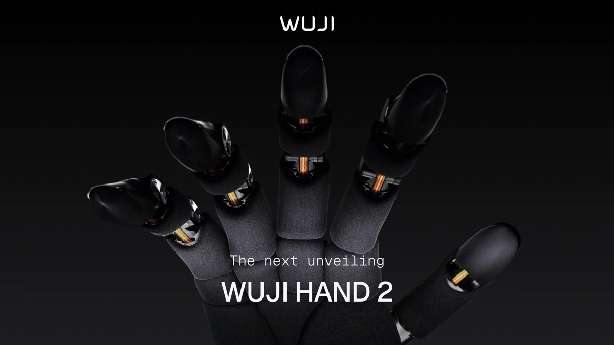
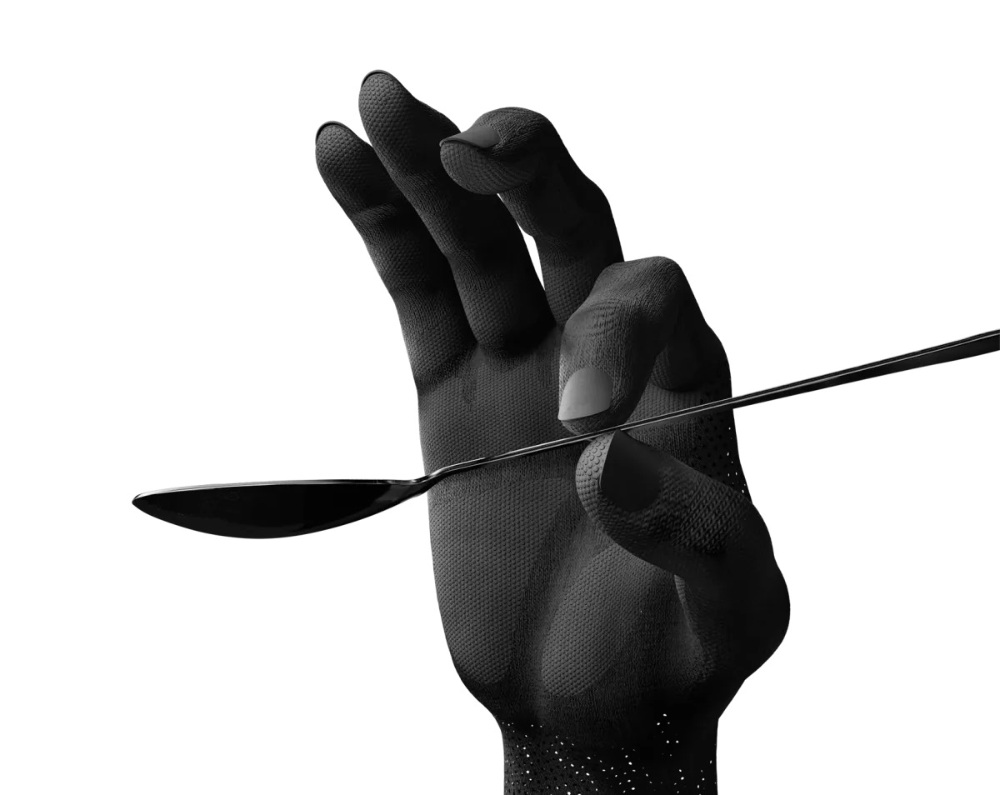
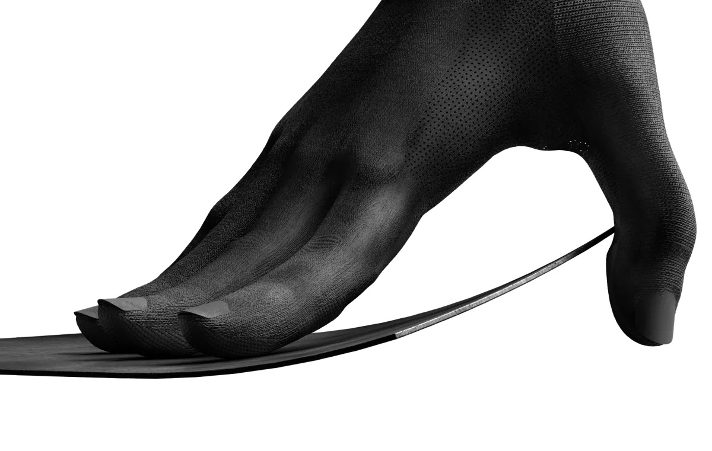
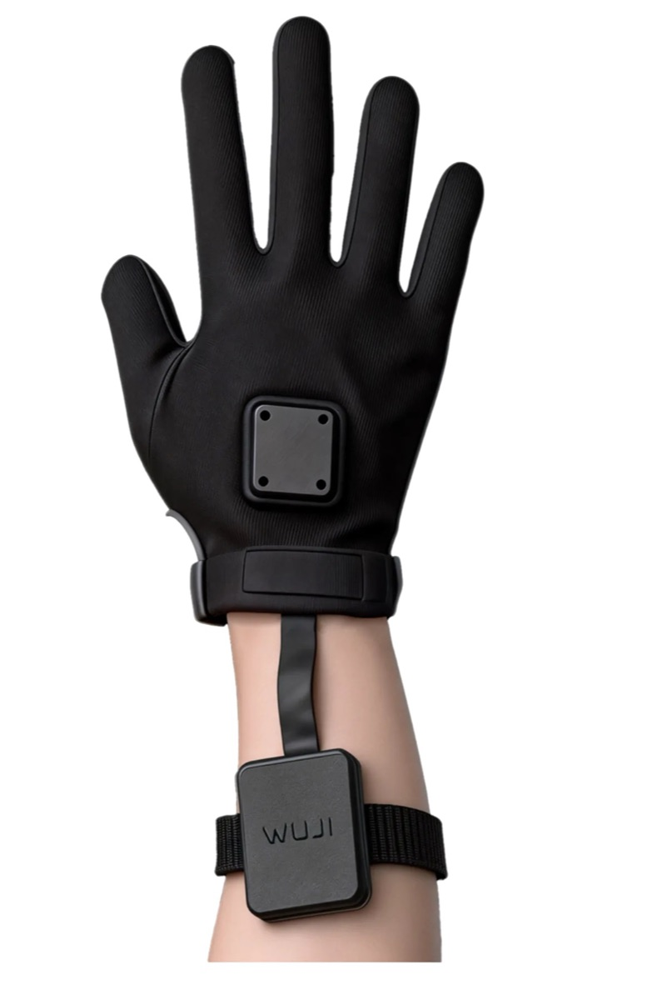
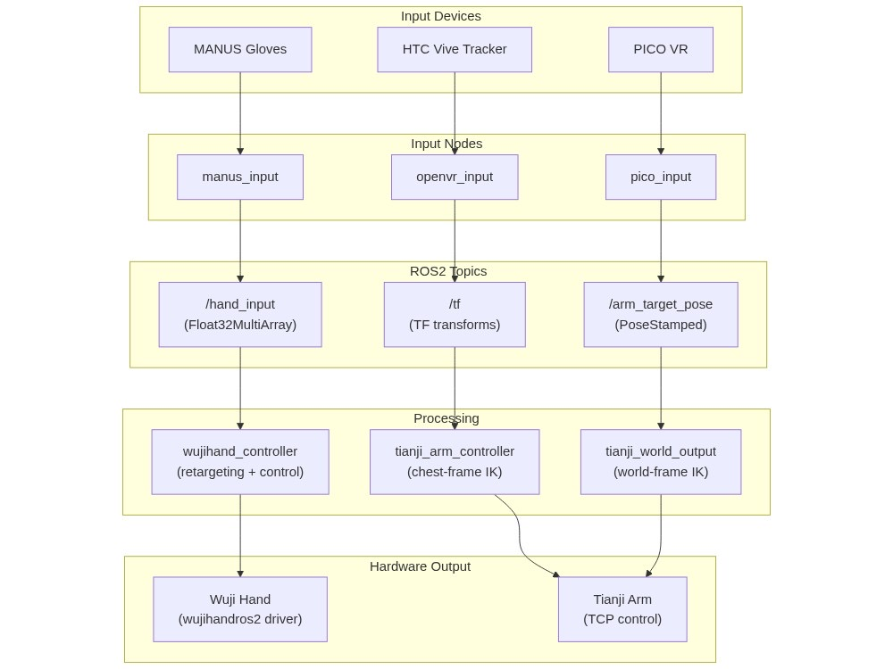
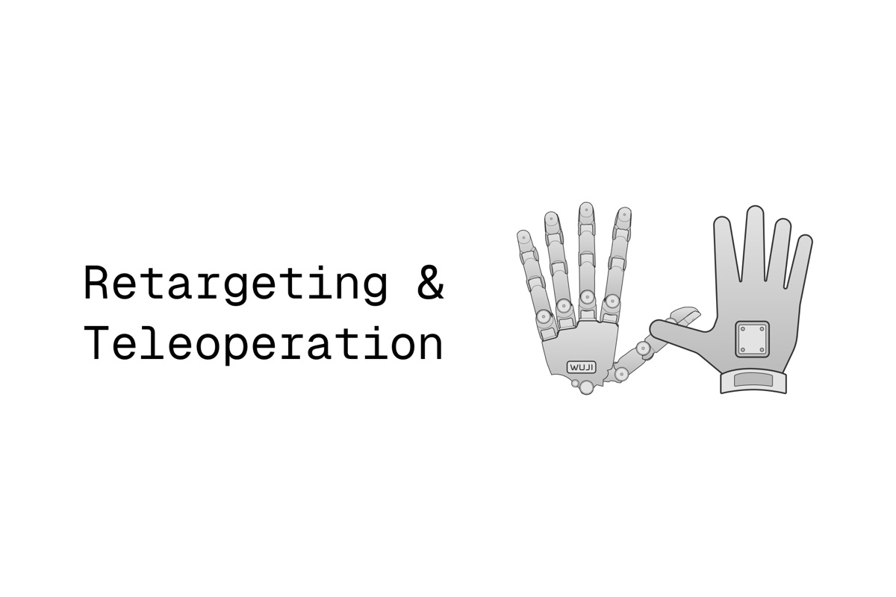
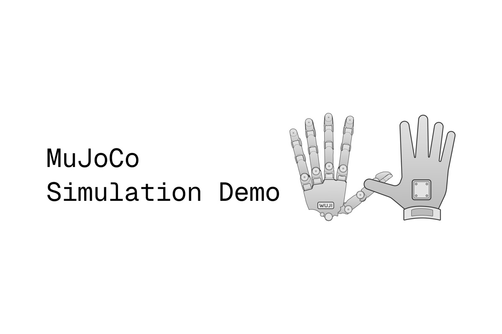
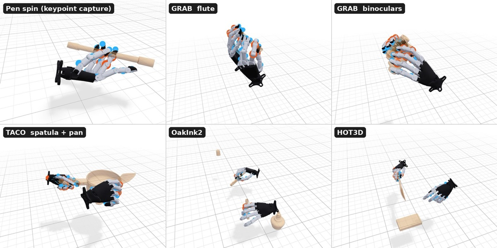

# WUJI — Solutions and Projects Register

⬆ [WUJI profile](WUJI.md) · [Product portfolio](WUJI-Products.md) · [Papers and research](WUJI-Papers-and-Research.md) · [Roadmap and strategy](WUJI-Roadmap-and-Strategy.md)

> **Coverage note:** Walked on 2026-11-14: the full `wuji.tech` sitemap (25 URLs: home, Hand, Hand 2, Glove, Purchase and Partnership, Careers, Contact, Terms, in English and Chinese, plus the one blog report `/blog/post-training-0`); the docs portal `docs.wuji.tech` (167-page English index, all release notes from 2026-02-09 to 2026-11-10, gen-1 changelog from 2025-11-07, videos page, archive page); all 24 public repos of the GitHub org `wuji-technology`; all 19 videos on the official YouTube channel `@WUJI_TECH` (2025-09-17 to 2026-10-29) with their descriptions; the arXiv records and partner pages those videos cite.
> **Not accessible / not done:** the web-search tool was unavailable for this pass (session search budget exhausted), so **no news-engine sweep was run** in English or Chinese — funding rounds, Chinese trade-press coverage, China-side exhibitions, tenders and any deployment not mentioned on WUJI's own channels may be missing. LinkedIn, X (`@wuji_global`), Bilibili and Xiaohongshu were not read. The Chinese site has the same pages as the English one (no extra solution or case-study section).
> **Key finding:** WUJI has **no Solutions / Industries / Case-studies section**. It sells three hardware products plus an open software stack, and describes them as a "universal manipulation solution" for research, robot integration and human-machine interaction. Nothing is marketed for delivery, inspection, rescue, waste, energy, elderly care or rehabilitation. Track tags below mark **where a building block can be applied**, not a WUJI vertical offering.

## Solutions catalogue — everything they offer

| # | Solution / application | What it does | Products used | Maturity | Tracks | Source link |
|---|---|---|---|---|---|---|
| 1 | **Wuji Hand 2** — dexterous end effector | 20-DoF back-drivable direct-drive five-finger hand with force-position (MIT) control, for mounting on a partner arm or humanoid | Hand 2 (2.1 / 2.2 Beta) | 🧪 beta hardware, sold on inquiry | T01 T02 T03 T04 | [Hand 2 page](https://www.wuji.tech/en/hand2) |
| 2 | **Wuji Hand** (gen 1) — dexterous end effector | 20-DoF self-locking direct-drive hand, position control, USB | Hand gen 1 | ✅ shipping (docs now flagged "kept for existing devices") | T01 T02 T03 T04 | [Hand page](https://www.wuji.tech/en/hand) |
| 3 | Tactile glove accessory for Wuji Hand gen 1 | Pressure skin worn by the gen-1 robot hand; SDK exposes attach status and tactile pressure stream | Hand gen 1 + SDK | ✅ SDK support · ⚠️ unverified as a catalogue item (no product page, no specs) | — | [Gen-1 changelog](https://docs.wuji.tech/docs/en/wuji-hand/v1/release-notes.md) |
| 4 | **Wuji Glove** — human hand capture | Wearable glove streaming palm-side pressure map, fingertip 6-DoF poses and IMU; official uses: hand teleoperation, tactile data collection, HCI experiments, VR/AR gesture input | Glove | ✅ shipping (1.0 released 2026-02-14) | T02 T04 | [Glove page](https://www.wuji.tech/en/glove) |
| 5 | Precision pinch and nail action (Hand 2 capability showcase) | Thumb-to-finger pinch down to **0 mm** grasp diameter, fingernail-style prying of thin objects | Hand 2 | 🧪 | T01 T03 T04 | [Hand 2 page](https://www.wuji.tech/en/hand2) |
| 6 | Compliant motion (Hand 2 capability showcase) | Back-drivable joints + per-joint kp / kd give soft, yielding contact instead of rigid position tracking | Hand 2 | 🧪 | T01 T04 | [Hand 2 page](https://www.wuji.tech/en/hand2) |
| 7 | **Glove-to-hand teleoperation closed loop** (Capture → Mapping → Execution → Training) | Operator wears the glove, the hand mirrors it live; the same stream is recorded as training data | Glove + Hand / Hand 2 + SDK | ✅ official quick start (about 45 min) | T02 T04 | [Hand 2 quick start](https://docs.wuji.tech/docs/en/wuji-hand/latest/quick-start.md) |
| 8 | **Hand + arm teleoperation stack** (`wuji-hand-teleop`) | ROS 2 package: glove drives the hands, HTC Vive Tracker or PICO 4 drives the arms, stereo video back to the headset; one-click Monitor GUI | Glove + Hand + Tianji arms (reference) | ✅ open source, **not maintained**; 🔭 "product version coming soon" | T01 T02 T04 | [Repo](https://github.com/wuji-technology/wuji-hand-teleop) |
| 9 | **Hand retargeting** (built into SDK) | Converts 21 MediaPipe-format hand keypoints to 20 joint commands, so any hand tracker can drive the hand | SDK + Hand / Hand 2 | ✅ (Python and C) | T02 T04 | [Retargeting docs](https://docs.wuji.tech/docs/en/wuji-sdk/latest/retargeting.md) |
| 10 | Data recording and offline processing | Multi-stream MCAP recording with separate source / receive timestamps, pause / resume, offline re-solving of glove poses | SDK + Glove / Hand 2 | ✅ | T04 | [Data recording docs](https://docs.wuji.tech/docs/en/wuji-sdk/latest/data-recording.md) |
| 11 | Tactile contact detection and calibration | Guided per-glove calibration trains a contact model; outputs binary contact, per-zone pressure and a 3D tactile point cloud | Glove + SDK / CLI | ✅ | T04 | [Tactile calibration](https://docs.wuji.tech/docs/en/wuji-cli/latest/tactile-calibration.md) |
| 12 | **Wuji SDK** (Python + C) | One SDK for Hand, Hand 2 and Glove: discovery, streaming, control, recording, retargeting; multi-app device sharing via SDK Bridge; usage telemetry can be switched off with `WUJI_TELEMETRY_DISABLE=1` | all | ✅ free, MIT | — (plumbing for every track) | [SDK overview](https://docs.wuji.tech/docs/en/wuji-sdk/latest/introduction.md) |
| 13 | **Wuji CLI + agent skills** | Terminal tool: scan, ping, get / set, subscribe, live Rerun viewer (`wuji viz`), health check, logs, calibration, firmware upgrade; ships installable "skills" so an AI coding agent can drive it | all | ✅ free | — | [CLI overview](https://docs.wuji.tech/docs/en/wuji-cli/latest/introduction.md) |
| 14 | ROS 2 integration (`wuji-ros2`) | Drivers, messages, launch files for Hand 2 and Glove (joint, pose, IMU, tactile, point cloud) via the ROS build farm | Hand 2, Glove | ✅ (since 2026-10-26) | — | [ROS 2 docs](https://docs.wuji.tech/docs/en/wuji-hand/latest/ros2-integration.md) |
| 15 | **Simulation model assets** (`wuji-description`) + sim demos | URDF, MJCF, MJX, USD and STEP for both hand generations; minimal MuJoCo and Isaac Sim loaders | none needed | ✅ | T01 T02 T03 T04 (prototype without hardware) | [Model docs](https://docs.wuji.tech/docs/en/wuji-hand/latest/model-integration.md) |
| 16 | Mechanical integration kit | Factory wrist flange, adapter mount (69 g), palm mounting-interface CAD and A3 drawings for fitting the hand to a partner arm | Hand 2 | ✅ | — | [Mechanical integration](https://docs.wuji.tech/docs/en/wuji-hand/latest/hardware-integration.md) |
| 17 | RL training and sim-to-real (`wuji-mjlab`, `wuji-isaaclab`) | PPO for in-hand cube reorientation (both generations) and reference-tracking pen spinning (Hand 2); release bundle includes jigs, 40 motion clips and **trained checkpoints** (ONNX) | Hand, Hand 2 | ✅ open source | — | [wuji-mjlab](https://github.com/wuji-technology/wuji-mjlab) |
| 18 | TopoRetarget | Turns human hand-object demonstrations into robot-hand reference motions that keep the contact pattern; CPU-only, no training | Hand, Hand 2 | ✅ open source (CoRL 2026 paper) | — | [toporetarget](https://github.com/wuji-technology/toporetarget) |
| 19 | **VLA fine-tuning and deployment** (`wuji-openpi`) | Fork of Physical Intelligence openpi: fine-tune pi0 / pi0.5 on any single- or dual-arm + Wuji Hand layout (reference: 54-D), with a ROS 2 deployment stack | Hand + partner arms | ✅ open source | T01 T03 T04 | [wuji-openpi](https://github.com/wuji-technology/wuji-openpi) |
| 20 | VLA post-training recipe (research report) | Four stages on one hand-action codec: fine-tune, human-correction (DAgger) with smooth takeover, residual RL on the real robot | 2 Tianji arms + 2 Wuji hands | 🧪 paper + report public; code "not public yet" | — | [Report](https://www.wuji.tech/blog/post-training-0) |
| 21 | MINT + EgoPipeline | Model that reconstructs camera and two-hand motion from first-person RGB video; output can be retargeted to the Wuji Hand; released with weights and annotations for **1,021 h** of video | none (data side) | ✅ open source (repo now under the first author's account) | — | [MINT video](https://www.youtube.com/watch?v=JIHCCwSayGo) |
| 22 | Purchase, partnership and distribution | Direct sales and integration partnerships (sales@wuji.tech); site footer links to US reseller Robotics Center, which lists itself as authorized distributor | all | ✅ | — | [Purchase and Partnership](https://www.wuji.tech/en/cooperation) |
| 23 | Education and community | Open LaTeX lecture notes on rigid-body mechanics; "Wuji's Talk" podcast / salon series | — | ✅ | — | [Lecture notes repo](https://github.com/wuji-technology/robotics-rigid-body-mechanics) |
| 24 | Archived legacy tools | Wuji Studio (desktop app), Wuji Hand HMI, Upgrader, `wujihandpy`, `wujihandros2`, standalone `wuji-retargeting` and `mujoco-sim` / `isaaclab-sim` — all superseded by SDK + CLI | Hand gen 1, Glove | ✅ usable, no updates | — | [Archived docs](https://docs.wuji.tech/docs/en/archived.md) |
| 25 | High-torque-density motors (origin business, 2019) | The company started with motors before hands | — | not marketed on the current site | — | [Podcast description](https://www.youtube.com/watch?v=r86fXB8kEgw) |

### Wuji Hand 2

- **20 active DoF** (4 per finger), thumb opposition, **back-drivable** direct-drive joints, **1000 Hz × 20 axes**, Ethernet (RJ45) + XT30 power, 12 V. Site lists fingertip peak force **≥ 12 N**, open / close **≥ 4 cycles/s**, joint backlash **< 1°** (Beta 1 figures, "will continue to iterate").
- Default control is MIT mode (position, velocity, feed-forward effort, kp / kd per joint); whole-hand **position mode (Beta)** arrived 2026-11-10 and needs firmware v3.0.0 or later.
- Both field revisions (2.1 and 2.2) are **non-tactile prototypes**; 2.1 is frozen on firmware v1.2.4. Built-in feed-forward compensation applies only to units shipped from October 2026 — ask WUJI staff which batch is on site.
- Used for: any track task that needs fingers rather than a gripper (handles, switches, tools, cutlery, small parts). Indoor and dry only.
- Official: [product page](https://www.wuji.tech/en/hand2) · [docs](https://docs.wuji.tech/docs/en/wuji-hand/latest/overview.md) · [version differences](https://docs.wuji.tech/docs/en/wuji-hand/latest/version-compatibility.md)

### Wuji Hand (gen 1)

- **20 DoF**, self-locking direct-drive joints, **580 g**, fingertip force **15 N**, static grasp load **10 kg**, single-finger hook **3 kg**, max grasp diameter **100 mm**, USB 2.0, position control, **IP40**.
- Reliability claims on the site: survives an internal **80 cm** drop test, twist-lock finger structure releases under overload, **≥ 300,000** no-load cycles.
- Now driven by the unified Wuji SDK (Linux only; on Windows the gen-1 functions return "unsupported"). Released 2025-09-17; this is the hand in most partner demos up to mid-2026.
- Official: [product page](https://www.wuji.tech/en/hand) · [docs](https://docs.wuji.tech/docs/en/wuji-hand/v1/overview.md)

### Wuji Glove

- **526 pressure points** over the palm side at **120 FPS** (0–20 N, 0.1 N steps, 4 mm pitch), **5 fingertip EMF trackers** (≤ 2 mm RMS, ≤ 10 ms latency), wrist IMU at **800 Hz**; glove weighs **67.5 g**, tethered (USB-C power, RJ45 data).
- Works **without any robot**: grip-pressure maps, finger joint angles, 21-keypoint skeleton and contact events are available live or recorded. This is the fastest WUJI route into T04 hand-function assessment or exercise feedback (it is not a medical device).
- Limits: EMF tracking degrades within 3 cm of metal; operating humidity < 55 % RH; one glove size listed (215 × 195 mm).
- Used outside WUJI by the EgoExplorer dataset team (Shanghai AI Laboratory and others) for finger motion and regional touch.
- Official: [product page](https://www.wuji.tech/en/glove) · [docs](https://docs.wuji.tech/docs/en/wuji-glove/latest/introduction.md)

### Precision pinch and nail action (Hand 2 capability showcase)

- Marketed capability: thumb pad against any fingertip with a minimum grasp diameter of **0 mm**, plus rigid "nails" for getting under thin edges.
- Relevance: holding cutlery, pills, cards, zips, small waste fractions. SDK retargeting was tuned in 2026-08 for better thumb-to-fingertip contact, and a firmware fix removed false over-current stops during pinching.
- Official: [Hand 2 page, Capabilities Showcase](https://www.wuji.tech/en/hand2)

### Compliant motion (Hand 2 capability showcase)

- Back-drivable joints with soft finger pads; stiffness and damping set per joint (defaults kp = 5.0, kd = 0.1 on new units).
- Relevance: contact with people or fragile objects is yielding rather than rigid. There is **no certified safety function** — thermal derating, over-current stop and software limits are device protection only.
- Official: [control guide](https://docs.wuji.tech/docs/en/wuji-hand/latest/control-guide.md)

### Glove-to-hand teleoperation closed loop

- Four steps as WUJI presents them: **Capture** (glove) → **Mapping** (retargeting) → **Execution** (hand) → **Training** (recorded data feeds RL / VLA).
- The SDK ships a live example (`examples/python/retargeting/1.teleop_real.py`); official estimate is about **45 minutes** from unboxing to a mirrored hand.
- Who uses it: every dexterous-data pipeline WUJI publishes starts here (wuji-openpi, the VLA post-training report). For the hackathon it is the base of any "human stays outside the hazard" or remote-caregiver demo.
- Official: [cross-product teleoperation](https://docs.wuji.tech/docs/en/wuji-hand/latest/quick-start.md)

### Hand + arm teleoperation stack (wuji-hand-teleop)

- Docker-based ROS 2 workspace: Wuji Glove → retarget + IK → left / right hand (about 120 Hz joint targets); arm pose from **HTC Vive Trackers** or a **PICO 4** headset; stereo camera stream to the headset; MANUS gloves supported by the community only.
- Reference arms are **Tianji 7-DoF**; other arms plug in through the documented wrist-pose topics, which is the integration path for the arms at Leukerbad.
- Status: README says **not actively maintained, no support**, "product version coming soon". Records ROS 2 MCAP that `wuji-openpi` converts to LeRobot format.
- Official: [repo](https://github.com/wuji-technology/wuji-hand-teleop)

### Hand retargeting

- Input: 21 hand keypoints in MediaPipe order. Output: 20 joint angles in firmware order, ready to send. One line builds a session for Hand or Hand 2, left or right.
- Input sources documented across SDK and the archived repo: Wuji Glove (recommended), webcam + MediaPipe, Apple Vision Pro, video files, Intel RealSense, ZED, MANUS-style pipelines.
- No glove on your team? A laptop camera is enough to drive the hand.
- Official: [retargeting docs](https://docs.wuji.tech/docs/en/wuji-sdk/latest/retargeting.md) · [session example](https://docs.wuji.tech/docs/en/wuji-sdk/latest/sdk-practice/retarget-session.md)

### Data recording and offline processing

- MCAP recording from Python and C, episode pause / resume that waits for the state change, separate source-event and host-receive timestamps for cross-device alignment.
- Offline pipeline recomputes joint angles, fingertip poses, skeleton and fused IMU from recorded raw glove data without a device attached.
- Relevance: session logs for rehab or assessment prototypes, and demonstration datasets for any learned skill.
- Official: [SDK data recording](https://docs.wuji.tech/docs/en/wuji-sdk/latest/data-recording.md) · [glove offline solving](https://docs.wuji.tech/docs/en/wuji-glove/latest/offline-pipeline.md)

### Tactile contact detection and calibration

- `wuji calib tactile` (or `glove.calibrate_tactile()`): prompted hand motions train a per-glove contact model, then the `tactile_binary` stream reports contact in real time; sensitivity adjustable 0.5–3.0.
- Also available: per-zone pressure (palm and each finger) and a 3D tactile point cloud for visualisation.
- Relevance: "is the person actually gripping / touching" events without writing signal processing.
- Official: [tactile calibration](https://docs.wuji.tech/docs/en/wuji-cli/latest/tactile-calibration.md) · [tactile data reference](https://docs.wuji.tech/docs/en/wuji-glove/latest/sdk-data-reference/tactile.md)

### Simulation model assets

- `wuji-description` carries URDF, MJCF, MJX, USD and STEP for Hand gen 1, Hand 2.1 and Hand 2.2 (2.2 adds a soft-pad link per fingertip; rigid-body only, no deformable simulation yet). Models are rooted at the arm-flange mount.
- A model loads in MuJoCo with one command and no hardware, so a team can develop while the real hand is shared.
- Official: [model assets and loading](https://docs.wuji.tech/docs/en/wuji-hand/latest/model-integration.md) · [wuji-description](https://github.com/wuji-technology/wuji-description)

### VLA fine-tuning and deployment (wuji-openpi)

- Pipeline: teleoperation capture (ROS 2 MCAP) → LeRobot v2.1 conversion → supervised fine-tuning of pi0 / pi0.5 → policy server → closed-loop ROS 2 deployment. Arm count and DoF are config values, not hard-coded.
- Needs an NVIDIA GPU (CUDA 12) and a few hundred demonstrations; WUJI's own report used **200 demonstrations** per skill. Not a 48-hour path unless you start from an existing dataset.
- Official: [repo](https://github.com/wuji-technology/wuji-openpi)

### TopoRetarget (no track tag, picture for reference)

- Retargets recorded human hand-object motion (own pen-spin capture, GRAB, TACO, OakInk2, HOT3D clips) to the Wuji Hand while preserving which keypoints touch the object; reported **+40.6 percentage points** pen-spin training success and zero-shot transfer to hardware.
- Official: [repo](https://github.com/wuji-technology/toporetarget) · [project page](https://toporetarget2026.github.io/TopoRetarget/)

## Projects register — past and current

| Date | Project / deployment / pilot / partnership | Partner or customer | Location | What happened (one line) | Tracks | Source link |
|---|---|---|---|---|---|---|
| 2026-11-10 | Docs / SDK release | — | — | CLI and SDK on Windows and Apple silicon; Hand 2 position mode (Beta); glove calibration solver 15× faster | — | [Release notes](https://docs.wuji.tech/docs/en/release-notes.md) |
| 2026-10-29 | Pen spinning under disturbances (demo) | — | — | Video of an RL policy spinning a pen on Hand 2 while being pushed | — | [Video](https://www.youtube.com/watch?v=W8yfvxsaZRs) |
| 2026-10-26 | ROS 2 drivers + fault logs release | — | — | `wuji-ros2` drivers for Hand 2 and Glove; SDK on macOS; C-side MCAP recording | — | [Release notes](https://docs.wuji.tech/docs/en/release-notes.md) |
| 2026-10-22 | `wuji-mjlab` v2026.10.22 | — | — | Asset bundle with jigs, 40 pen-spin clips, five recipes and matched checkpoints | — | [Repo](https://github.com/wuji-technology/wuji-mjlab) |
| 2026-10-19 | **IROS 2026 booth + salon "Toward an Embodied Future"** | — | Pittsburgh, USA | Hand 2 and Glove manipulation demos, hands-on teleoperation for visitors, a talk session for researchers | T02 | [Video](https://www.youtube.com/watch?v=3uO7-6idn8o) |
| 2026-10-15 | **EgoExplorer dataset** uses Wuji Glove | Shanghai AI Laboratory and collaborating institutions | China | 100-hour wearable vision-motion-touch dataset; glove records finger motion and regional touch | — | [Video](https://www.youtube.com/watch?v=fc9syM7nwq8) · [arXiv 2610.18872](https://arxiv.org/abs/2610.18872) |
| 2026-10-14 | **Natura-1** foundation model on Wuji hands | Nature Will | not stated | WUJI supplied hands for training and task deployment; Nature Will's dual-arm rig is **ROKAE AR5 arms + Wuji hands** | T01 T04 | [Video](https://www.youtube.com/watch?v=xadNfiDMOs4) · [Natura-1 post](https://www.naturewill.com/blog/natura-1) |
| 2026-10-12 | Description packages reorganised | — | — | Separate Hand 2.1 and Hand 2.2 ROS 2 model packages; SDK supports Ubuntu 20.04+ and Python 3.8+ | — | [Release notes](https://docs.wuji.tech/docs/en/release-notes.md) |
| 2026-09-26 | **WUJI × Gento** | Gento (robot maker; details not verified) | not stated | "Gento Luna" robot uses WUJI hands to handle bottles, stack blocks and put toys away | T01 T04 | [Video](https://www.youtube.com/watch?v=K6txrShpl_A) |
| 2026-09-22 | SDK / firmware release | — | — | Feed-forward compensation (units shipped from Oct 2026), multi-app device sharing, glove live view in CLI | — | [Release notes](https://docs.wuji.tech/docs/en/release-notes.md) |
| 2026-09-17 | **VLA post-training paper and report** | ShanghaiTech University (co-authors) | China | Five marker skills (pick up, hand-to-hand transfer, in-hand rotation, uncap, write "WUJI") each reach **20 / 20** trials on 2 Tianji arms + 2 Wuji hands | — | [arXiv 2609.19666](https://arxiv.org/abs/2609.19666) · [Report](https://www.wuji.tech/blog/post-training-0) |
| 2026-09-08 | Documentary "From Motor to Dexterous Hand — WUJI's Seven-Year Journey" | Alphaist Partners (production) | — | Company history film: single motor in 2019 to direct-drive hands on the ICRA floor | — | [Video](https://www.youtube.com/watch?v=PFOwvftdg4A) |
| 2026-09-07 | **MINT open-sourced** | ShanghaiTech, Tsinghua, HKU, Zhejiang University (co-authors) | — | Model, code, EgoPipeline reference and annotations for **560,649 episodes / 1,021 h** of egocentric video; hand motion retargets to Wuji Hand | — | [Video](https://www.youtube.com/watch?v=JIHCCwSayGo) · [arXiv 2609.04958](https://arxiv.org/abs/2609.04958) |
| 2026-08-12 | **Dyna-2** real-robot tasks on Wuji hands | Dyna Robotics | USA | Two of Dyna-2's evaluation tasks run on 6-DoF YAM arms fitted with a pair of "WUJI-2" 20-DoF hands | T01 | [Video](https://www.youtube.com/watch?v=4Cu95eXorU0) · [Dyna-2 page](https://www.dyna.co/dyna-2) |
| 2026-08-03 to 08-31 | SDK / CLI releases | — | — | Guided tactile calibration, `wuji logs`, `wuji viz` for Hand 2, Beta 2 sim models with soft pads, palm-mount CAD | — | [Release notes](https://docs.wuji.tech/docs/en/release-notes.md) |
| 2026-08-02 | **RynnBrain 1.1** real-robot evaluation | Alibaba DAMO Academy | China | "Tianji-Wuji" dexterous system used for long tasks: steak cooking, plating, meal delivery, pouring | T01 T04 | [Video](https://www.youtube.com/watch?v=WoyZ662JQSc) · [RynnBrain page](https://alibaba-damo-academy.github.io/RynnBrain/) |
| 2026-07-01 to 07-23 | Hand 2 software generation change | — | — | Resource-style API, Hand 2 in the C SDK, retargeting moved into the SDK, firmware v2.0.0 for Beta 2 hardware, Hand 2 (Beta 1) sim models | — | [Release notes](https://docs.wuji.tech/docs/en/release-notes.md) |
| 2026-06-30 | Glove calibration tutorial | — | — | Official video for hand-model calibration with the CLI | — | [Video](https://www.youtube.com/watch?v=LdbhNvbI9Ig) |
| 2026-06-15 | **TopoRetarget** paper + code (CoRL 2026) | IIIS, Tsinghua University (co-authors) | China | Interaction-preserving retargeting; policies transfer zero-shot to Wuji Hand for cube reorientation and pen spinning | — | [arXiv 2606.16272](https://arxiv.org/abs/2606.16272) |
| 2026-06-10 | `wuji-openpi` released | builds on Physical Intelligence openpi | — | pi0 / pi0.5 fine-tuning and ROS 2 deployment for dual-arm + Wuji Hand rigs | T01 T03 T04 | [Repo](https://github.com/wuji-technology/wuji-openpi) |
| 2026-06-05 | **Wuji Hand 2 global debut at ICRA 2026** | — | Vienna, Austria (ICRA 2026 venue; city not named in WUJI's video) | First public showing: 20 DoF, back-drivable actuation, improved thermal design | — | [Video](https://www.youtube.com/watch?v=OiG3kM18tls) |
| 2026-06-01 | Wuji Hand 2 release film | — | — | "Yield over Strength, Stand over Time"; teaser had run on 2026-05-10 ("after 8 months, fully upgraded") | — | [Video](https://www.youtube.com/watch?v=7QYedp3ozjw) |
| 2026-05-06 | **GENE-26.5** manipulation model on Wuji Hand | Genesis AI (WUJI calls it a partner) | not stated | Partner's manipulation model announced as running on the Wuji Hand | — | [Video](https://www.youtube.com/watch?v=44yS6YRrA4I) |
| 2026-04-16 | **Breakfast-preparation demo** on Wuji Hand | LiberAI (WUJI calls it a partner) | not stated | Partner's first dexterous manipulation model shown preparing breakfast | T01 T04 | [Video](https://www.youtube.com/watch?v=RoApCJ25BGY) |
| 2026-02-15 | Podcast "The Dexterous Hand Solution" | Alphaist Partners (hard-tech venture fund; investor status not stated) | — | **Founder and CEO Yunzhe Pan** on the direct-drive choice and sim-to-real; confirms 2019 start with motors | — | [Video](https://www.youtube.com/watch?v=r86fXB8kEgw) |
| 2026-02-14 | **Wuji Glove 1.0 release** | — | — | First data-capture glove; Wuji Studio and the Python SDK had shipped on 2026-02-09 | T02 T04 | [Video](https://www.youtube.com/watch?v=NE5FytzRz_E) |
| 2025-11-07 to 2026-02-02 | Gen-1 hand firmware / SDK line | — | — | Full closed-loop control (2025-11-07), firmware v1.0.0 with 1 kHz real-time control (2025-12-05), six further updates | — | [Gen-1 changelog](https://docs.wuji.tech/docs/en/wuji-hand/v1/release-notes.md) |
| 2025-09-17 | **Wuji Hand official release** | — | — | First-generation 20-DoF hand launched (most-viewed video on the channel) | — | [Video](https://www.youtube.com/watch?v=LXVV-oErD8s) |
| undated | US distribution | Robotics Center (San Francisco; East Coast site in Allston, MA) | USA | Linked from the WUJI site footer; reseller states it is an authorized distributor. Its spec text partly conflicts with WUJI's docs — use WUJI's numbers | — | [Reseller page](https://www.roboticscenter.ai/store/product/wuji-hand) |
| 2019 | Company founded | — | Shenzhen, China | Started with high-torque-density motors, then hands and data-capture devices | — | [Podcast description](https://www.youtube.com/watch?v=r86fXB8kEgw) |

Not found on any WUJI channel: named paying customers, shipment numbers, government programmes, joint labs, competitions, or any deployment in Europe or Switzerland. All partner entries above are **research or demo use of WUJI hardware by AI-model companies and labs**, not field deployments.

## Future projects and announced plans

| Announced | Planned for | What | Confidence | Tracks | Source link |
|---|---|---|---|---|---|
| 2026-06 (README) | "coming soon", no date | **Product version of the hand + arm teleoperation stack**, replacing the unmaintained `wuji-hand-teleop` | official | T02 T04 | [wuji-hand-teleop](https://github.com/wuji-technology/wuji-hand-teleop) |
| 2026-10 (docs) | no date | **Final Wuji Hand 2 with tactile sensing** — both current revisions are labelled "non-tactile prototype", parameters "don't represent the final product" | inferred | T01 T02 T03 T04 | [Hand 2 overview](https://docs.wuji.tech/docs/en/wuji-hand/latest/overview.md) |
| 2026-09 (report) | "when it is released" | **Code for the VLA post-training pipeline** (codec, DAgger takeover, residual RL); link placeholder says not public yet | official | — | [Report](https://www.wuji.tech/blog/post-training-0) |
| 2026-11 (docs) | "in production" | Wuji Hand 2 unboxing and setup video guide | official | — | [Videos page](https://docs.wuji.tech/docs/en/videos.md) |
| 2026-11-10 | no date | Hand 2 **position control mode** leaves Beta | inferred | — | [Release notes](https://docs.wuji.tech/docs/en/release-notes.md) |
| 2026-10 (docs) | no date | **Deformable soft-pad simulation** for Hand 2 ("isn't supported yet") | inferred | — | [Hand 2 overview](https://docs.wuji.tech/docs/en/wuji-hand/latest/overview.md) |
| 2026-09 (report) | open research | Long-horizon skill composition, new objects and scenes for dexterous VLA policies (current results are about 30-second atomic skills) | official (stated as open work) | T01 T04 | [Report](https://www.wuji.tech/blog/post-training-0) |
| 2026 (docs index) | ongoing | Gen-1 Wuji Hand phased into maintenance: docs marked "kept for existing devices"; Hand 2 is the lead product | inferred | — | [Docs home](https://docs.wuji.tech/docs/en/index.md) |
| 2026 (GitHub) | no date | More device types: the SDK is described as covering "Wuji Glove, Wuji Hand, Wuji Hand 2, and others" | inferred | — | [GitHub org](https://github.com/wuji-technology) |
| 2026 (GitHub profile, videos) | ongoing | International hiring and an open call for robotics teams to co-develop real-world dexterous applications | official | — | [WUJI × Gento video](https://www.youtube.com/watch?v=K6txrShpl_A) |

No dated roadmap, price list, funding plan or new-product announcement (arm, wrist, humanoid, wireless glove) was found. ⚠️ unverified beyond WUJI's own channels because the news search could not be run.

## Solutions by track — quick index

### T01 Autonomous Urban Services
- **Wuji Hand 2 / Wuji Hand as the end effector** of another vendor's mobile manipulator: door handles, lift buttons, bottles, cutlery, table service (solutions 1, 2, 5, 6).
- **Partner precedents for service tasks:** RynnBrain 1.1 meal delivery and steak cooking (Tianji arms + Wuji hands), LiberAI breakfast preparation, Gento Luna tidying bottles and toys, Dyna-2 tasks, Natura-1 on **ROKAE AR5 + Wuji hands**.
- **wuji-openpi** for a learned skill if you can collect demonstrations (solution 19); **hand + arm teleop stack** as the demonstration source or as a remote-operated concierge fallback (solution 8).
- **Simulation assets** to build before hardware access (solution 15).

### T02 Resilient & Safe City
- **Glove-to-hand teleoperation closed loop** — operator outside the hazard, dexterous hand inside (solution 7). This is the strongest WUJI fit for the track.
- **Hand + arm teleoperation stack** with headset video (solution 8); **retargeting** from a webcam or VR headset when no glove is free (solution 9).
- **Wuji Glove** as the operator input device (solution 4); **Hand 2 / Hand** for valves, switches, connectors and tools (solutions 1, 2).
- Precedent: hands-on teleoperation was WUJI's own IROS 2026 booth demo. Nothing found for search and rescue, inspection, patrol or mapping.

### T03 Sustainable City
- Nothing specific found. WUJI markets no sorting, recycling, energy, charging, environmental or agriculture application.
- Closest reusable pieces: **Hand 2 precision pinch** for small or awkward items and disassembly steps (solutions 1, 5), **wuji-openpi** for a learned sort-by-demonstration skill (solution 19), **simulation assets** (solution 15).

### T04 Elderly Care & Rehabilitation
- **Wuji Glove alone** for hand-function measurement: 526-point grip-pressure map, finger angles, contact events, recorded sessions (solutions 4, 10, 11). No robot needed; not a medical device.
- **Compliant, back-drivable Hand 2** for assistive manipulation near a person: fetching, holding a spoon or cup, opening containers (solutions 1, 5, 6).
- **Glove-to-hand teleoperation and retargeting** for remote caregiver help or mirror-style therapy concepts (solutions 7, 9); **hand + arm teleop stack** for telepresence (solution 8).
- Partner precedents in household tasks: breakfast preparation (LiberAI), meal delivery and pouring (RynnBrain 1.1), putting toys and bottles away (Gento Luna).
- Nothing found for fall detection, massage, exoskeleton, prosthetic or EMG products.

## What they do NOT offer

- **No complete robot:** no arm, wrist actuator, mobile base or humanoid. Every manipulation demo needs another vendor's arm plus your own mounting and integration time.
- **No vertical solutions or case studies** for any of the four tracks; no field deployments, only research and demo use.
- **No high-level skills:** no grasp planner, no perception, no task library. Control is joint-level; you write the grasps or teleoperate.
- **No general foundation model.** Published weights are narrow: RL checkpoints for cube reorientation and pen spinning (`wuji-mjlab` bundle) and the MINT video-to-hand-motion model.
- **No tactile sensing on Hand 2** today (beta prototypes are non-tactile); touch data comes only from the human-worn glove, or the gen-1 tactile accessory (availability unverified).
- **No outdoor or wet use:** gen-1 hand is IP40; glove needs < 55 % RH and no metal within 3 cm; glove and hands are tethered.
- **No certified safety or medical function:** no safety-rated stop, no medical-device status for the glove.
- **No EMG, exoskeleton, prosthetic, haptic-feedback or wireless product.** The glove senses only; it does not push back on the wearer.
- **No Europe-based office or distributor found;** sales are direct from Shenzhen / Beijing or through a US reseller.

## Image credits

| File | Shows | Source URL |
|---|---|---|
| `assets/wuji-sol-hand2.jpg` | Wuji Hand 2 release-film poster | https://www.wuji.tech/assets/images/hand2/hand2-trailer-poster-en.webp |
| `assets/wuji-sol-hand1.jpg` | Wuji Hand (gen 1) on its stand, video cover | https://www.wuji.tech/assets/posters/hand_video_cover.webp |
| `assets/wuji-sol-glove.jpg` | Wuji Glove hero image | https://www.wuji.tech/assets/images/glove/glove-hero.webp |
| `assets/wuji-sol-pinch.jpg` | Hand 2 pinching a spoon handle ("Precision Pinch") | https://www.wuji.tech/assets/images/hand2/p3-pinch.webp |
| `assets/wuji-sol-compliant.jpg` | Hand 2 with soft cover lifting a thin sheet ("Compliant Motion") | https://www.wuji.tech/assets/images/hand2/p3-compliant.webp |
| `assets/wuji-sol-teleop-loop.jpg` | Wuji Glove with forearm acquisition board, from the "Glove closed-loop flow" section | https://www.wuji.tech/assets/images/hand2/p5-glove.webp |
| `assets/wuji-sol-teleop-arm.jpg` | Dataflow diagram of the hand + arm teleoperation stack | https://raw.githubusercontent.com/wuji-technology/wuji-hand-teleop/main/docs/images/dataflow.png |
| `assets/wuji-sol-retarget.jpg` | "Retargeting & Teleoperation" demo cover (hand and glove drawing) | https://docs.wuji.tech/shared/assets/videos/cover-vid-retarget-live.png |
| `assets/wuji-sol-sim.jpg` | MuJoCo simulation demo cover | https://docs.wuji.tech/shared/assets/videos/cover-vid-mujoco-live.png |
| `assets/wuji-sol-toporetarget.jpg` | TopoRetarget results on six clips (pen spin, GRAB, TACO, OakInk2, HOT3D) | https://raw.githubusercontent.com/wuji-technology/toporetarget/main/docs/images/demos.jpg |

All images © Wuji Technology (official site, docs CDN or the company's GitHub repos). The TopoRetarget panel renders third-party dataset clips that stay under their own licences.

## Sources

- [Wuji Technology site map](https://www.wuji.tech/sitemap.xml) · [home](https://www.wuji.tech/en) · [Hand](https://www.wuji.tech/en/hand) · [Hand 2](https://www.wuji.tech/en/hand2) · [Glove](https://www.wuji.tech/en/glove) · [Purchase and Partnership](https://www.wuji.tech/en/cooperation) · [Careers](https://www.wuji.tech/en/careers) · [Chinese home](https://www.wuji.tech/zh)
- [WUJI research report: Towards High-DoF Dexterous Manipulation through VLA Post-Training](https://www.wuji.tech/blog/post-training-0)
- [Wuji Docs English index](https://docs.wuji.tech/_llms/en.txt) · [docs home](https://docs.wuji.tech/docs/en/index.md) · [release notes](https://docs.wuji.tech/docs/en/release-notes.md) · [videos](https://docs.wuji.tech/docs/en/videos.md) · [archived](https://docs.wuji.tech/docs/en/archived.md)
- [Hand 2 overview](https://docs.wuji.tech/docs/en/wuji-hand/latest/overview.md) · [Hand 2 version compatibility](https://docs.wuji.tech/docs/en/wuji-hand/latest/version-compatibility.md) · [Hand 2 quick start](https://docs.wuji.tech/docs/en/wuji-hand/latest/quick-start.md) · [Hand 2.1 overview](https://docs.wuji.tech/docs/en/wuji-hand/beta1/overview.md)
- [Wuji Hand gen-1 overview](https://docs.wuji.tech/docs/en/wuji-hand/v1/overview.md) · [gen-1 changelog](https://docs.wuji.tech/docs/en/wuji-hand/v1/release-notes.md)
- [Wuji Glove introduction](https://docs.wuji.tech/docs/en/wuji-glove/latest/introduction.md)
- [GitHub org wuji-technology](https://github.com/wuji-technology) · [wuji-sdk](https://github.com/wuji-technology/wuji-sdk) · [wuji-cli](https://github.com/wuji-technology/wuji-cli) · [wuji-ros2](https://github.com/wuji-technology/wuji-ros2) · [wuji-description](https://github.com/wuji-technology/wuji-description) · [wuji-hand-teleop](https://github.com/wuji-technology/wuji-hand-teleop) · [wuji-openpi](https://github.com/wuji-technology/wuji-openpi) · [wuji-mjlab](https://github.com/wuji-technology/wuji-mjlab) · [wuji-isaaclab](https://github.com/wuji-technology/wuji-isaaclab) · [wuji-mujoco](https://github.com/wuji-technology/wuji-mujoco) · [toporetarget](https://github.com/wuji-technology/toporetarget) · [wuji-retargeting](https://github.com/wuji-technology/wuji-retargeting) · [robotics-rigid-body-mechanics](https://github.com/wuji-technology/robotics-rigid-body-mechanics)
- [MINT repository (redirects from the WUJI org to the first author's account)](https://github.com/ZZJ-Asher/wuji-ego-mint)
- [YouTube channel @WUJI_TECH](https://www.youtube.com/@WUJI_TECH/videos) — individual videos linked in the tables above
- [arXiv 2609.19666 — VLA post-training](https://arxiv.org/abs/2609.19666) · [arXiv 2606.16272 — TopoRetarget](https://arxiv.org/abs/2606.16272) · [arXiv 2609.04958 — MINT](https://arxiv.org/abs/2609.04958) · [arXiv 2610.18872 — EgoExplorer](https://arxiv.org/abs/2610.18872)
- [TopoRetarget project page](https://toporetarget2026.github.io/TopoRetarget/)
- Partner pages: [Dyna-2 (Dyna Robotics)](https://www.dyna.co/dyna-2) · [RynnBrain 1.1 (Alibaba DAMO Academy)](https://alibaba-damo-academy.github.io/RynnBrain/) · [Natura-1 (Nature Will)](https://www.naturewill.com/blog/natura-1)
- Third party, not official: [Robotics Center — Wuji Hand listing](https://www.roboticscenter.ai/store/product/wuji-hand) · [humanoid.guide — Wuji Hand 2](https://humanoid.guide/welcome-wuji-hand-2/) · [RuntimeWire — Hand 2 teaser (2026-06-05)](https://runtimewire.com/article/wuji-tech-hand-2-robotic-hand-teaser)
