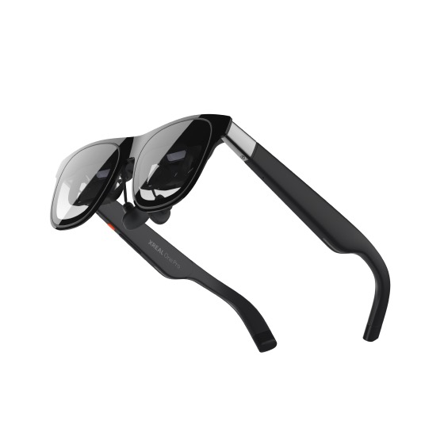
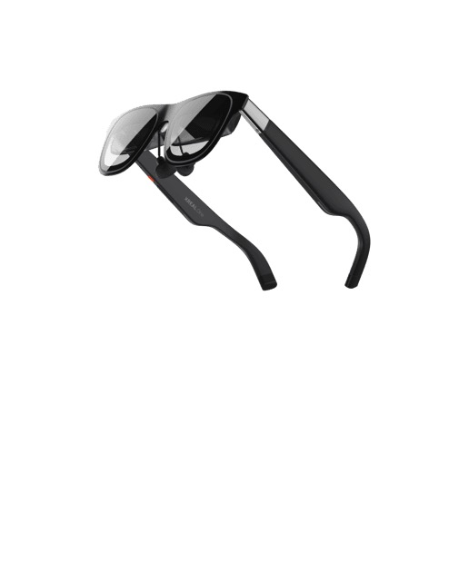
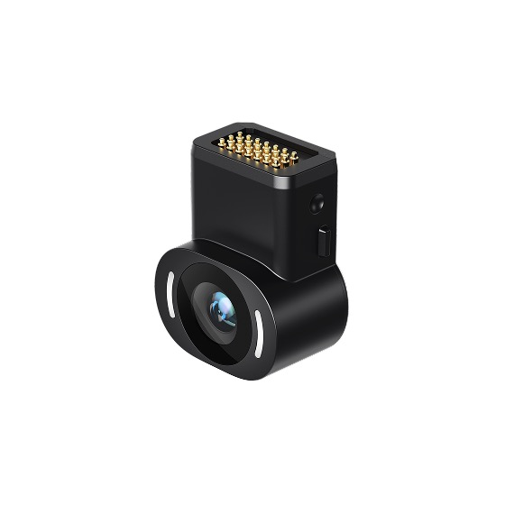
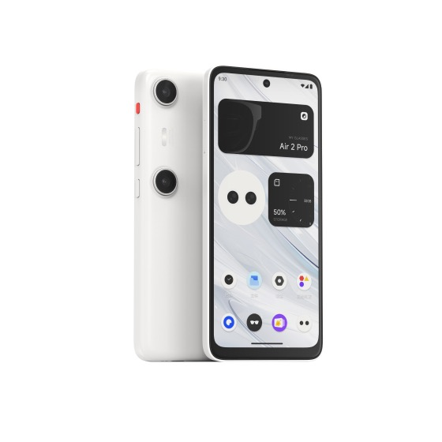
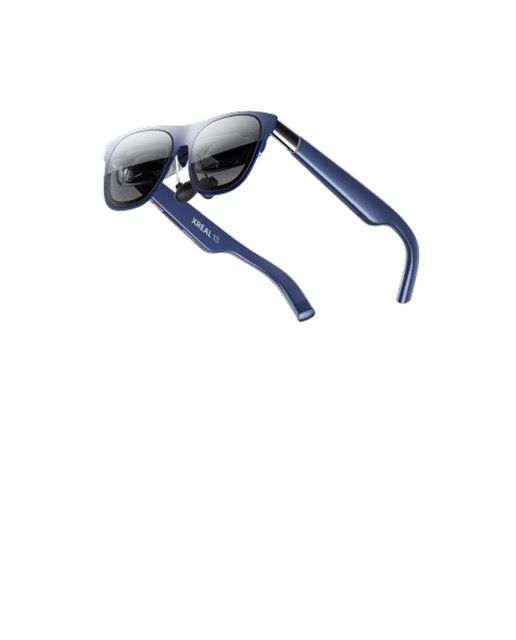
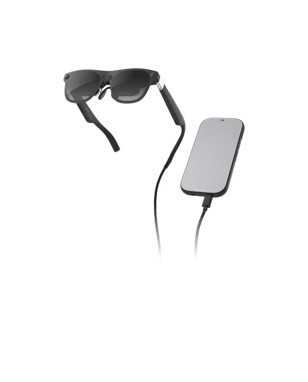

# XREAL × T01 — Products and Solutions

⬆ [XREAL profile](../XREAL.md) · [Brief](XREAL-T01-1-Brief.md) · [Playbook](XREAL-T01-3-Playbook.md)

**Bottom line:** XREAL sells AR glasses, not robots. For T01 it supplies the **operator side** of an urban-service robot: a hands-free HUD, a head-pose input, and (with XREAL Eye) a first-person camera feed. Robot, navigation and autonomy must come from another vendor.

Research note: live web search was unavailable while this track file was written (budget exhausted), so track-specific findings rest on the official XREAL developer docs, the Android XR docs and the company profile research. Nothing in those sources shows an XREAL urban-services deployment.

## Relevant products (ranked for this track)

Feature matrix from the official SDK compatibility page (this decides which glasses you ask for):

| Capability (XREAL SDK) | One series + XREAL Eye | Air 2 Ultra | Plain One series (no Eye) |
|---|---|---|---|
| Head tracking | **6DoF** | **6DoF** | 3DoF (on-glasses X1 chip) |
| App access to RGB camera frames | **Yes** (YUV_420_888) | No RGB camera (dual grayscale SLAM cameras) | No |
| First-person view capture / cast | App **and reality** | App only | App only |
| Plane / image tracking, depth mesh, spatial anchors | **No** | Yes | No |
| Hand tracking | **No** | Yes | No |
| Controller | Phone as 3DoF controller | Phone as 3DoF controller | Phone as 3DoF controller |

### XREAL One Pro

**Role in T01:** default supervisor / remote-takeover HUD for a delivery or maintenance robot.

| Spec | Value |
|---|---|
| FOV | **57°** |
| Brightness | 700 nits |
| Weight | **87 g** |
| Tracking | Native 3DoF (X1 chip); **6DoF with XREAL Eye** |
| Connection | USB-C DisplayPort (tethered; no on-board app compute, no battery) |
| IP / weather rating | not public — treat as indoor / dry-weather gear |

- **Status:** ✅ shipping · USD 599 (superseded by 1 Pro+ but still listed).
- **Developer control:** as a plain display — anything your host renders. Through XREAL SDK (Unity, Android host): head pose; with Eye, 6DoF pose and camera frames.

### XREAL 1 Pro+

**Role in T01:** same as One Pro, better choice **outdoors** (snow glare, daylight streets).

| Spec | Value |
|---|---|
| FOV | **57°** |
| Brightness | **1,200 nits** peak |
| Tracking | Native 3DoF (X1 chip) |
| Weight | not published |
| XREAL Eye / SDK 6DoF support | ⚠️ unverified for this model (launched after SDK 3.1.0) — ask on site |

- **Status:** ✅ since 15 Oct 2026 · USD 599.
- **Developer control:** USB-C display; SDK behaviour expected to match One series ⚠️ unverified.

### XREAL Eye

**Role in T01:** turns One-series glasses into a 6DoF tracked headset with an operator-POV camera — the piece that enables "look at a problem, send a robot".

| Spec | Value |
|---|---|
| Adds | **6DoF head tracking** + RGB camera to One series |
| Frame access in SDK | `GetYUVFormatTextures()` → Y / U / V textures, format **YUV_420_888** |
| Capture | Photo, video (Low / Middle / High), blend of virtual + real, first-person cast |
| Sensor resolution | ⚠️ unverified |
| Does **not** add | planes, image tracking, anchors, depth mesh, hand tracking |

- **Status:** ✅ shipping · USD 99.
- **Developer control:** camera textures and 6DoF pose inside a Unity app on the Android host; ready sample scenes `RGBCamera`, `RGBCameraAndCapture`, `FirstPersonViewStreamingCast`.

### XREAL Beam Pro

**Role in T01:** the pocket Android computer that runs your Unity app and talks to the robot over Wi-Fi.

| Spec | Value |
|---|---|
| Function | Android host for MyGlasses + XREAL SDK apps |
| SDK support | Officially supported host (alongside Samsung Galaxy S24 / S25) |
| Caveat | Docs: **do not use Android 16** on dev devices |

- **Status:** ✅ shipping · from USD 199.
- **Developer control:** normal Android device — install APKs, open sockets / WebSockets to the robot network.

### XREAL 1S

**Role in T01:** budget HUD; same workflow as One Pro with a narrower view.

| Spec | Value |
|---|---|
| FOV | **52°** (official docs device table) |
| Resolution | 1920×1200 |
| Weight | about 82 g |
| Tracking | Native 3DoF; accepts the detachable RGB accessory (Eye) per docs |

- **Status:** ✅ since Jan 2026 · USD 449.

### XREAL Air 2 Ultra

**Role in T01:** the only XREAL-SDK device with **world-anchored AR** (image tracking to localise against a robot marker, anchors, planes, hands) — needed for drawing a robot's path or drop-off point in the real street / corridor.

| Spec | Value |
|---|---|
| Tracking | Native **6DoF**, dual grayscale cameras |
| AR features | Planes, image tracking, hand tracking (26 joints), depth mesh, spatial anchors |
| RGB camera | None |
| FOV | Docs are inconsistent (52° in text, 46° in table) |
| Anchor guidance | Keep content within **3 m** of an anchor; needs textured, evenly lit surroundings |

- **Status:** ✅ legacy (shipped Mar 2024, USD 699 at launch); availability on site unconfirmed.

### XREAL AURA

**Role in T01:** stretch option — standalone Android XR glasses with compute puck; could run the whole operator app (and Gemini) without a phone.

| Spec | Value |
|---|---|
| FOV | **70°** |
| Tracking | 6DoF inside-out + hand tracking |
| Compute | Puck with Snapdragon Reality Elite + X1S, 4,455 mAh |
| Weight (glasses) | <95 g |
| Dev stack | Android XR: Unity 6 + Unity OpenXR Android XR package + Android XR Extensions (planes, persistent / shareable anchors, hands; Geospatial VPS listed for the platform — per-device support on AURA ⚠️ unverified) |

- **Status:** ✅ launched 28 Oct 2026, first batch mid-Nov, **US / CA / JP / KR only** — on-site units unlikely. USD 1,279 / 1,499.

Not relevant for T01: ROG XREAL R1 (gaming display), XREAL Neo (battery / hub — useful only as a power accessory), xbx a01+ (details unverified).

## What XREAL already does in this domain

- **Nothing public.** No deployment, pilot, demo, partnership or application page for delivery, cleaning, maintenance, concierge or wayfinding robots was found. The business is consumer entertainment / productivity glasses.
- **Nearest robotics evidence (academic, not XREAL):** *ActiveGlasses* (arXiv 2604.08534, submitted 9 Apr 2026) — smart glasses worn by a demonstrator, then the same camera mounted on a 6-DoF perception arm for policy replay. The company profile research identifies the glasses as XREAL Air 2 Ultra used for head pose, with a separate stereo camera because raw frames were not exposed on that model.
- **No official ROS 2 package, robotics SDK, teleoperation product, sim assets or datasets.**

## What they are building next in this domain

- **Announced:** AURA / Android XR roll-out (Europe "later"), Gemini built in. No robotics or urban-services roadmap is public.
- **Inference (not announced):** an Android XR device with Gemini, cameras and (platform-level) geospatial anchoring is a natural base for pedestrian wayfinding and field-worker assistance; that is adjacent to T01 but is not a robot product and nothing ties XREAL to city-service robotics.

## Software, models and data that help for this track

| Asset | What it gives you in 48 h | Notes |
|---|---|---|
| USB-C DisplayPort mode | Any existing UI (RViz, Foxglove, web dashboard, video) in the glasses with zero code | Host port must support DP Alt Mode ⚠️ check robot computers / dev boards |
| XREAL SDK 3.1.0 (Unity 2021.3+, AR Foundation / XRI) | 6DoF head pose, camera frames (Eye), phone-as-controller | C# only; Android host |
| SDK samples | `HelloMR`, `RGBCamera`, `RGBCameraAndCapture`, `FirstPersonViewStreamingCast`, `BasicImageTracking`, `Anchors`, `MarkerTracking` (experimental) | Image tracking / anchors only on Air 2 Ultra |
| Unity ROS-TCP-Connector (Unity Technologies, Apache-2.0) | Publish head pose / subscribe to robot topics from the Unity app | Third-party to XREAL; README badges list ROS 2 Foxy / Galactic — newer distros ⚠️ unverified. Plain WebSocket / UDP JSON is the lower-risk alternative |
| Android XR Unity packages (AURA only) | Planes, anchors, hands via AR Foundation / XR Hands | Only if AURA hardware is on site |
| Models / datasets | none from XREAL | Bring your own VLM / detector |

## Gaps and limits for this track

- **Not a robot:** zero payload, mobility, manipulation or autonomy. Fit depends entirely on the partner robot.
- **No ROS 2 bridge out of the box** — budget half a day for Unity ↔ robot plumbing.
- **One + Eye is thinner than expected:** 6DoF pose and camera only; no hands, planes, anchors or image tracking. World-locked overlays need Air 2 Ultra or AURA.
- **Tethered:** glasses need a host and cable; a walking operator carries a Beam Pro / phone or laptop.
- **Outdoor use:** optical see-through washes out in bright snow; prefer 1 Pro+ (1,200 nits). No public IP rating; cold-weather behaviour not public.
- **Tracking outdoors / over distance:** visual-inertial tracking and anchors are documented for near-field, textured, evenly lit scenes (0.5–3 m guidance) — do not promise street-scale AR registration.
- **Host constraints:** Beam Pro or Samsung S24 / S25; avoid Android 16.
- **On-site hardware is unconfirmed** — check the booth before committing to a design.

## Sources
- [XREAL developer docs — overview (SDK 3.1.0)](https://docs.xreal.com/)
- [XREAL docs — Compatibility (feature matrix, supported phones)](https://docs.xreal.com/XREALDevices/Compatibility)
- [XREAL docs — XREAL Glasses (device table)](https://docs.xreal.com/XREALDevices/XREAL%20Glasses)
- [XREAL docs — Access RGB Camera](https://docs.xreal.com/Camera/Access%20RGB%20Camera)
- [XREAL docs — Sample Code](https://docs.xreal.com/Sample%20Code)
- [XREAL docs — Spatial Anchor intro](https://docs.xreal.com/Spatial%20Anchor/intro)
- [Android Developers — Develop with Unity for Android XR](https://developer.android.com/develop/xr/unity)
- [Unity-Technologies / ROS-TCP-Connector (GitHub)](https://github.com/Unity-Technologies/ROS-TCP-Connector)
- [arXiv 2604.08534 — ActiveGlasses](https://arxiv.org/abs/2604.08534)
- [XREAL company profile (internal, prices and launch dates with their own sources)](../XREAL.md)
