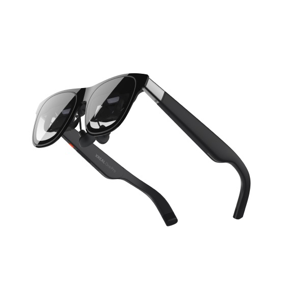
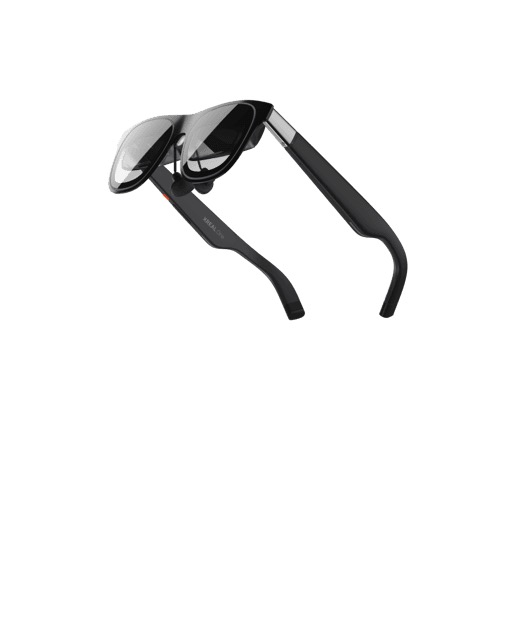
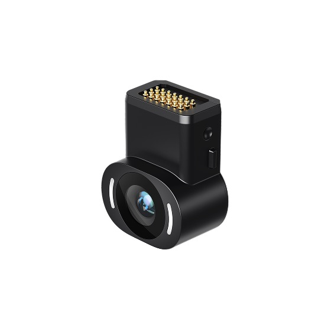
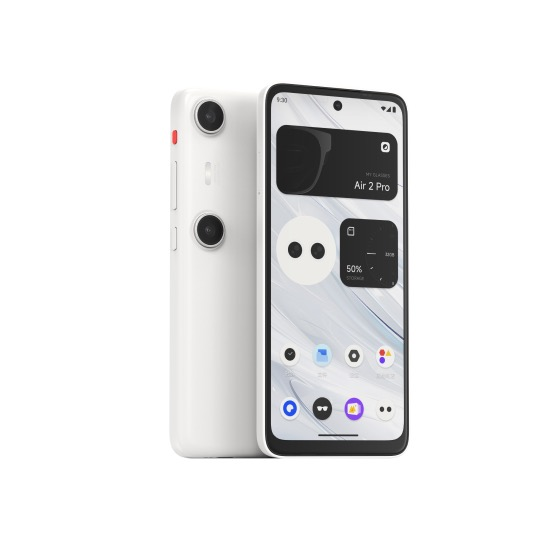
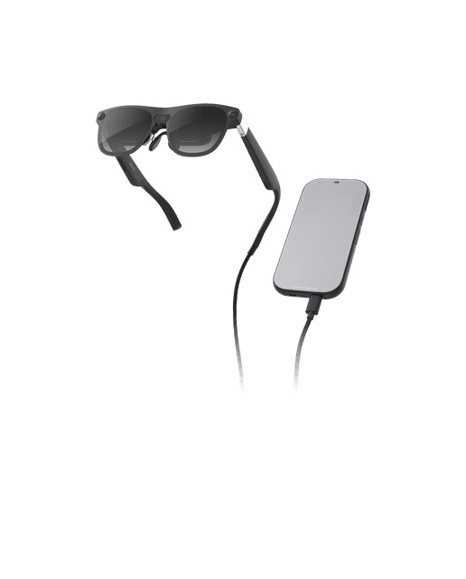
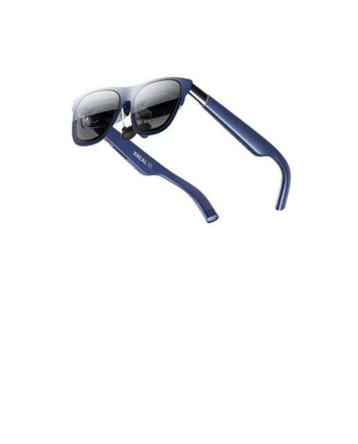
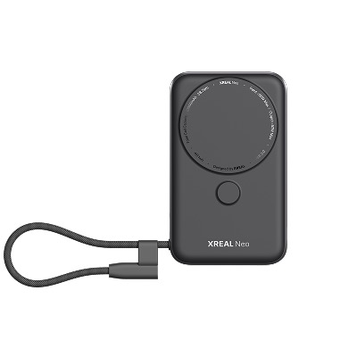

# XREAL × T02 — Products and Solutions

⬆ [XREAL profile](../XREAL.md) · [Brief](XREAL-T02-1-Brief.md) · [Playbook](XREAL-T02-3-Playbook.md)

**Read this first:** XREAL sells AR glasses, not robots. In T02 its role is the **operator / responder interface** on top of another vendor's robot. Which glasses you get decides what you can build:

| You need | Device that does it (per official SDK compatibility table) |
|---|---|
| Head-up screen only, no code | Any model on a USB-C DisplayPort host |
| 6DoF head pose + **RGB camera frames** + first-person view with real-world video | **One series + XREAL Eye** |
| 6DoF + hand tracking + planes + image tracking + depth mesh + spatial anchors | **Air 2 Ultra** (no RGB camera) |
| All spatial features + standalone compute + Gemini | **AURA** (Android XR stack) |

The One series + Eye column in XREAL's own table reads **"No"** for plane tracking, image tracking, hand tracking, depth mesh and spatial anchors. Do not plan on those with One + Eye.

## Relevant products (ranked for this track)

### XREAL One Pro

**Role in T02:** default operator HUD. Shows a robot's video, map and alerts while the operator's hands stay on a controller; with XREAL Eye it also becomes a 6DoF head-pose input device.

| Spec | Value |
|---|---|
| Field of view | **57°** |
| Brightness | 700 nits |
| Tracking | Native 3DoF on the X1 chip (about 3 ms motion-to-photon); **6DoF only with XREAL Eye** |
| Weight | **87 g** |
| Connection | USB-C DisplayPort, cable-tethered |
| Ruggedness / IP rating | not public |

- **Status / price:** ✅ shipping · USD 599 (superseded by 1 Pro+, still listed).
- **Developer control:** as a display — nothing to program. Via XREAL SDK 3.1.0 (Unity, Android host): head pose, 3DoF phone controller, rendering.

### XREAL 1 Pro+

**Role in T02:** same as One Pro, but the pick for **outdoor / snow-glare** use thanks to peak brightness.

| Spec | Value |
|---|---|
| Field of view | **57°** |
| Brightness | **1,200 nits** peak |
| Tracking | Native 3DoF (X1 chip) |
| Weight | not published |
| XREAL Eye / SDK 6DoF support | ⚠️ unverified (SDK 3.1.0 predates this model — ask on site) |

- **Status / price:** ✅ shipping since 15 Oct 2026 · **USD 599**.
- **Developer control:** display path certain; SDK path to be confirmed.

### XREAL Eye

**Role in T02:** the part that turns One-series display glasses into a sensor. It provides the 6DoF upgrade and is the **only XREAL camera whose RGB frames the SDK documents as readable**.

| Capability | Detail (official docs) |
|---|---|
| Head tracking with One series | **6DoF** |
| RGB frame access | Yes — YUV_420_888 textures in Unity (RGBCamera sample) |
| Photo / video capture | Yes — blend modes: virtual + real, RGB only, virtual only |
| First-person view streaming | Yes, with real-world video — to a Windows receiver app on the same LAN |
| Resolution / frame rate | not stated in docs ⚠️ unverified |
| Hand tracking, planes, image tracking, mesh, anchors | **No** on One + Eye |

- **Status / price:** ✅ shipping · **USD 99**.
- **Developer control:** camera textures, recording and streaming prefabs in Unity. Frames arrive on the Android host — forwarding them to a robot stack is your own code.

### XREAL Beam Pro

**Role in T02:** the pocket Android host that runs your Unity app, so the responder is untethered from a laptop.

| Spec | Value |
|---|---|
| Function | Android handheld; one of the officially supported SDK hosts (the other: Samsung Galaxy S24 / S25) |
| Networking for robot link | Wi-Fi (your app talks to the robot over LAN) |
| Android version | Keep below **Android 16** (docs warn of unresolved compatibility issues) |

- **Status / price:** ✅ shipping · from **USD 199**.
- **Developer control:** standard Android + Unity app deployment (adb).

### XREAL Air 2 Ultra

**Role in T02:** the only non-AURA device with the full spatial feature set — needed for **world-anchored hazard markers**, marker-based alignment to a robot map, or hand-gesture commands.

| Capability | Detail (official docs) |
|---|---|
| Head tracking | **6DoF** (dual grayscale cameras) |
| Plane / image tracking, hand tracking (26 joints), depth mesh, spatial anchors | **Yes** |
| RGB camera | **No** |
| Grayscale camera frames to apps | Not exposed, according to the ActiveGlasses authors (Apr 2026) |
| First-person view | Virtual content only |

- **Status / price:** ✅ shipped Mar 2024, legacy (USD 699 at launch); on-site availability not confirmed.
- **Developer control:** XREAL SDK 3.1.0 through AR Foundation / XR Hands on Beam Pro or Samsung S24 / S25.

### XREAL AURA

**Role in T02:** highest-capability option — standalone compute puck, widest view, hands as input — if units are actually at the venue.

| Spec | Value |
|---|---|
| Field of view | **70°** |
| Tracking / input | 6DoF inside-out + hand tracking; puck trackpad |
| Compute | Puck with Snapdragon Reality Elite + X1S, 4,455 mAh battery |
| Weight (glasses) | **<95 g** |
| AI | Gemini built in |
| Android XR Unity features (platform level) | Planes, persistent anchors, occlusion / depth, object tracking, hand tracking; per-device support on AURA ⚠️ unverified |
| App access to camera frames | ⚠️ unverified |

- **Status / price:** ✅ launched 28 Oct 2026, first batch ships mid-Nov; **USD 1,279 / 1,499**; US, Canada, Japan, South Korea only — **not yet sold in Europe**.
- **Developer control:** Android XR — Unity 6 with the Unity OpenXR: Android XR package and Android XR Extensions; a different code base from XREAL SDK 3.x.

### XREAL 1S

**Role in T02:** cheapest HUD; hand several to a "command post" team.

| Spec | Value |
|---|---|
| Display | 1920×1200 per eye; FOV ⚠️ unverified |
| Tracking | Native 3DoF; docs say One-series glasses take the Eye accessory, 1S not named individually ⚠️ unverified |
| Weight | about **82 g** |

- **Status / price:** ✅ shipping · **USD 449**.

### XREAL Neo

**Role in T02:** minor — battery + video hub that can keep glasses powered away from a desk. Capacity and suitability as a field power source: ⚠️ unverified. ✅ shipping · USD 119.

**Skip for this track:** ROG XREAL R1 (gaming, 240 Hz) and xbx a01+ (budget display) add nothing here beyond being a screen.

## What XREAL already does in this domain

- **Nothing public.** The company profile research found no deployments, pilots, demos, partner programmes or application pages for emergency response, inspection, security or teleoperation. XREAL's business is consumer entertainment and productivity.
- **Caveat on this statement:** the track-specific web search could not be run for this document (search quota exhausted); the finding rests on the profile research plus official docs read today. Absence of evidence, not proof of absence.
- **Closest third-party evidence (academic, not an XREAL project):**
  - **2026-04** — *ActiveGlasses* (arXiv 2604.08534): Air 2 Ultra's 6DoF tracking records the wearer's head motion; a ZED Mini stereo camera is mounted on the glasses because XREAL does not let apps call the cameras directly; a perception arm then reproduces the head motion while a **Flexiv Rizon4** manipulates. Relevant as proof that XREAL head pose is stable enough to drive a robot's viewpoint ([arXiv](https://arxiv.org/abs/2604.08534)).

## What they are building next in this domain

- **Announced, general:** AURA rollout to Europe "soon after" the first wave 🧪; Android XR + Gemini as the premium line; cheaper display glasses with in-house chips (see [profile](../XREAL.md)).
- **Safety / robotics specific:** not public. No announced enterprise, first-responder, teleoperation or robotics SDK programme.
- **Inference (ours, not XREAL's):** Android XR brings platform features such as geospatial anchors (VPS), object tracking and on-device Gemini that suit field guidance and "what am I looking at" assistance. Whether XREAL pursues safety / industrial customers is unknown.

## Software, models and data that help for this track

| Asset | What it gives you | Notes |
|---|---|---|
| **XREAL SDK 3.1.0** (Unity package) | Head pose, AR Foundation features, XR Interaction Toolkit rigs | Unity 2021.3+; Android host only |
| Sample: **RGBCamera / RGBCameraAndCapture** | Read Eye RGB frames; record video / photos | Starting point for POV capture or running detection on the wearer's view |
| Sample: **FirstPersonViewStreamingCast** + StreamingReceiver (Windows) | One-tap POV stream to a PC on the same LAN | Docs advise a dedicated Wi-Fi / hotspot and firewall off; protocol not documented |
| Samples: **Spatial Anchor**, **Image Tracking**, **XREAL Marker**, **Plane Detection**, **Basic Meshing** | World-locked content, marker-based alignment | Air 2 Ultra only (per compatibility table); marker sample device support ⚠️ unverified |
| **Simulator** (Unity Editor) | Develop without glasses on your head | Useful when the team shares one device |
| **CloudXR / XR Streaming** tool | Streams SteamVR content from a PC to the glasses over Wi-Fi | Possible route to PC-rendered 3D scenes; latency untested |
| **MRTK3 integration** | Ready-made UI controls | Saves UI time |
| **Android XR Unity packages** (AURA) | Planes, persistent anchors, occlusion, hand tracking via XR Hands, geospatial | Unity 6, URP + Vulkan recommended |
| GitHub org `nreal-ai` | MRTK fork, older NRSDK samples, a UVC test project | Mostly legacy; **no ROS 2 code** |

- **Robotics bridge:** none official. Use Unity's ROS-TCP-Connector or a plain UDP / WebSocket pose stream to a small ROS 2 node.
- **Models / datasets / simulation assets for safety or inspection:** none from XREAL.

## Gaps and limits for this track

- **Not a robot:** no mobility, no hazard sensing, no actuation. Every T02 concept needs another vendor's platform.
- **Feature split across devices:** RGB camera only on One + Eye; anchors / hand tracking only on Air 2 Ultra or AURA. No single 3.x device has both.
- **Camera access is narrow:** Eye RGB only. No thermal, no depth stream, SLAM cameras not exposed.
- **Field hardness:** consumer glasses; no IP rating, operating-temperature range or helmet / glove compatibility found. Cable to host. Optical see-through washes out in bright snow (1 Pro+ mitigates).
- **Stack lock-in:** Unity + Android only; no Python, C++, ROS 2 or web SDK. Android 16 hosts are discouraged.
- **Head pose on a laptop host:** the display path gives a screen only; reading head pose from a PC is not documented ⚠️ unverified.
- **AURA availability:** launched two weeks ago, not sold in Europe; do not rely on it until you see units.
- **No domain track record:** nothing to cite to judges as an XREAL safety deployment.

## Sources

- [XREAL company profile (this repo)](../XREAL.md) — product specs, prices and dates are carried over from here
- [XREAL docs — SDK overview (3.1.0)](https://docs.xreal.com/)
- [XREAL docs — Compatibility (feature support per glasses, host devices)](https://docs.xreal.com/XREALDevices/Compatibility)
- [XREAL docs — XREAL Glasses](https://docs.xreal.com/XREALDevices/XREAL%20Glasses)
- [XREAL docs — Access RGB Camera](https://docs.xreal.com/Camera/Access%20RGB%20Camera)
- [XREAL docs — First Person View](https://docs.xreal.com/Tools/First%20Person%20View)
- [XREAL docs — Sample Code](https://docs.xreal.com/Sample%20Code)
- [XREAL docs — Tools](https://docs.xreal.com/category/tools)
- [Android Developers — Develop with Unity for Android XR](https://developer.android.com/develop/xr/unity)
- [GitHub — nreal-ai](https://github.com/nreal-ai)
- [arXiv 2604.08534 — ActiveGlasses](https://arxiv.org/abs/2604.08534)
