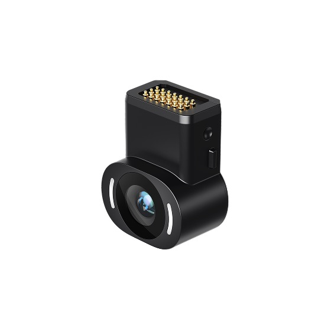
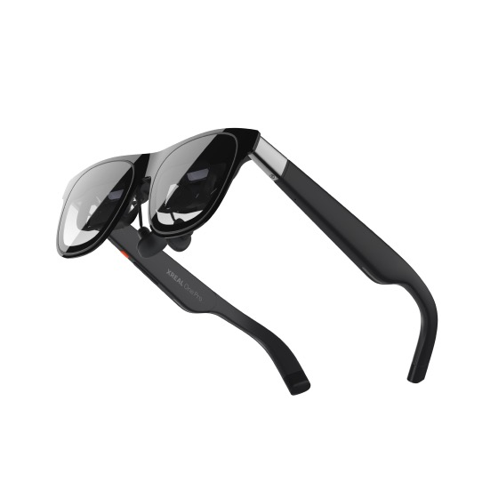
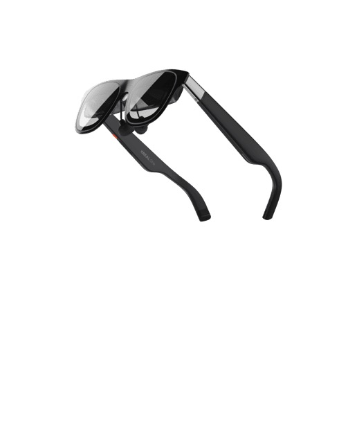
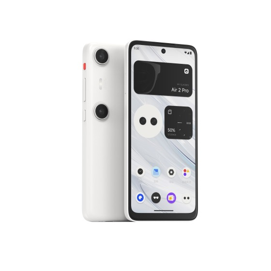
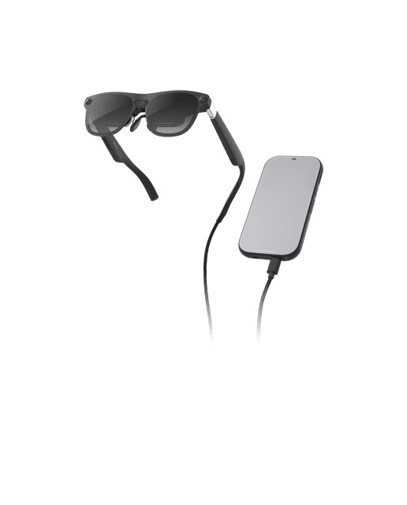
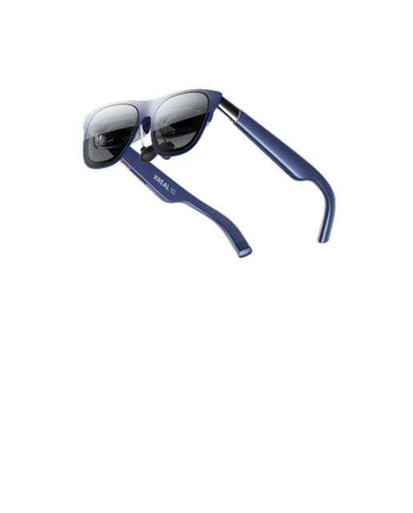

# XREAL × T03 — Products and Solutions

⬆ [XREAL profile](../XREAL.md) · [Brief](XREAL-T03-1-Brief.md) · [Playbook](XREAL-T03-3-Playbook.md)

> **Bottom line:** XREAL sells AR glasses, not robots, and has **no sustainability-specific product, deployment or software**. For T03 it is an add-on: operator HUD, wearable RGB camera, and an anchor-based overlay for sensor data. Everything below is ranked by how useful it is in that supporting role.
>
> **Research note:** the web-search quota for this pipeline run was exhausted, so track-specific news searches could not be executed. Findings rest on the company profile plus XREAL's and Google's official developer docs fetched today. "Nothing found" means "nothing in those sources", not a proven absence.

## Relevant products (ranked for this track)

### XREAL Eye

**Role in T03:** the piece that turns display glasses into a sensing device — a head-worn RGB camera for "look at the item" recognition (waste type, part to repair, meter reading) and the enabler for 6DoF anchoring of data overlays.

| Spec | Value |
|---|---|
| Function | Clip-in camera for One-series glasses; adds **6DoF** tracking (SDK 3.1.0+, glasses firmware update required) |
| App access to frames | ✅ documented: RGB camera textures in **YUV_420_888**; photo / video capture; first-person-view streaming sample |
| Resolution / frame rate | not published in the docs (capture has Low / Middle / High levels) ⚠️ unverified |
| UVC webcam mode | Docs FAQ mentions a UVC mode in which the device enumerates as a camera-class USB device; which models and how to enable ⚠️ unverified |
| Compatibility with 1 Pro+ / 1S | ⚠️ unverified (documented for "One series") |

- **Status / price:** ✅ shipping · **USD 99**.
- **Developer control:** Unity C# via XREAL SDK (`RGBCamera`, `RGBCameraAndCapture`, `FirstPersonViewStreamingCast` samples). Needs an Android host (Beam Pro or Samsung S24 / S25 class).

### XREAL One Pro

**Role in T03:** the operator's see-through HUD at a sorting cell, repair bench or building walk-through.

| Spec | Value |
|---|---|
| FOV | **57°** |
| Brightness | 700 nits |
| Tracking | Native 3DoF (X1 chip, about 3 ms motion-to-photon); **6DoF only with XREAL Eye** |
| Weight | **87 g** |
| Connection | USB-C DisplayPort, powered by the host (tethered) |
| IP rating / operating temperature | not public |

- **Status / price:** ✅ shipping (superseded by 1 Pro+) · **USD 599**.
- **Developer control:** (a) plain external display — no code; (b) XREAL SDK 3.1.0 in Unity for head pose, anchors, planes, image tracking.

### XREAL 1 Pro+

**Role in T03:** same as One Pro, better choice where ambient light is strong (snow glare, glass façades, greenhouse).

| Spec | Value |
|---|---|
| FOV | **57°** |
| Brightness | **1,200 nits** peak |
| Tracking | Native 3DoF (X1 chip) |
| Weight | not published |
| SDK 6DoF with Eye | ⚠️ unverified for this model |

- **Status / price:** ✅ since 15 Oct 2026 · **USD 599**.
- **Developer control:** USB-C display path certain; SDK feature parity with One Pro to be confirmed on site.

### XREAL Beam Pro

**Role in T03:** the pocket Android host that runs your Unity app and talks to the robot over Wi-Fi; one of the two officially tested SDK hosts.

| Spec | Value |
|---|---|
| Type | Android handheld with dual cameras |
| SDK status | Officially tested host for SDK 3.1.0 (with MyGlasses 1.11.0+) |
| On-device AI compute | not characterised publicly — plan to run models on a laptop / edge board |

- **Status / price:** ✅ shipping · from **USD 199**.
- **Developer control:** standard Android (ADB, APK sideload); developer mode enabled inside MyGlasses.

### XREAL AURA

**Role in T03:** the only standalone option — hand tracking, anchors and an on-device assistant without a phone. Attractive for an untethered technician or guest-facing guide, **if units are on site**.

| Spec | Value |
|---|---|
| FOV / display | **70°**, 1920×1200 per eye, up to 120 Hz |
| Tracking | **6DoF inside-out + hand tracking**; no eye tracking |
| Compute | Tethered puck: Snapdragon Reality Elite + X1S, 4,455 mAh |
| Weight | glasses **<95 g** |
| Android XR Unity features (platform level) | planes, persistent anchors, depth occlusion, object tracking, bounding-box detection, geospatial (VPS); per-device support on AURA ⚠️ unverified |
| Raw camera frames for apps | ⚠️ unverified (Unity "AR Camera" feature is documented for light estimation / passthrough only) |

- **Status / price:** ✅ launched 28 Oct 2026, first batch ships mid-Nov 2026 in US / CA / JP / KR; **Europe later** · **USD 1,279 / 1,499**.
- **Developer control:** Android XR stack (Unity 6 + Unity OpenXR: Android XR package + Android XR Extensions, XR Hands, AR Foundation) — **a different toolchain** from XREAL SDK. Also runs ordinary Android apps.

### XREAL Air 2 Ultra

**Role in T03:** legacy developer glasses with native 6DoF + hand tracking — the only XREAL device with published robotics research use (head-pose capture for robot learning).

| Spec | Value |
|---|---|
| Tracking | Native **6DoF** (two SLAM cameras), hand tracking (26 joints via SDK) |
| Image tracking | Documented: max **5** reference images, **1** tracked at a time |
| Raw camera frames | A 2026 paper reports they were not exposed to apps |

- **Status / price:** ✅ shipped Mar 2024 (USD 699 at launch); no longer in main site navigation.
- **Developer control:** XREAL SDK 3.x "6DoF glasses" reference device.

### XREAL 1S

**Role in T03:** cheapest way to hand several teammates or jurors a private HUD.

| Spec | Value |
|---|---|
| Display | 1920×1200 (16:10); FOV ⚠️ unverified |
| Tracking | Native 3DoF (X1 chip) |
| Weight | about **82 g** |

- **Status / price:** ✅ since Jan 2026 · **USD 449**.
- **Developer control:** USB-C display; SDK 6DoF with Eye ⚠️ unverified.

Not ranked: **ROG XREAL R1** (gaming display), **XREAL Neo** (battery / video hub — useful only to extend runtime), **xbx a01+** (details not confirmed).

## What XREAL already does in this domain

**Nothing public.** No deployments, pilots, customer cases, application pages or partnerships were found for waste, recycling, energy, building automation, environmental monitoring or circular economy. XREAL's business is consumer entertainment / productivity glasses.

Adjacent evidence that is real:

| Date | What | Relevance |
|---|---|---|
| 2026-04 | "ActiveGlasses" (arXiv 2604.08534): Air 2 Ultra 6DoF head pose + separate stereo camera to record egocentric manipulation demos and replay active vision on a 6-DoF arm. Academic, not an XREAL product | Template for teaching a robot sorting / disassembly from human demonstrations |
| 2025-11-25 | XREAL SDK 3.1.0: 6DoF on One series + Eye; RGB camera access and first-person streaming samples | Makes wearable-camera recognition pipelines feasible on current hardware |
| 2026-06-16 | Unity support for AURA on Android XR | Standard AR Foundation features on the standalone device |

## What they are building next in this domain

- **Announced, domain-specific:** nothing. No robotics SDK, enterprise / industrial programme or sustainability initiative is public.
- **Announced, general:** 🧪 AURA rollout to Europe "soon after" the first wave; retail expansion in 2027. Strategy is two lines — affordable display glasses on in-house chips and a premium Android XR + Gemini line.
- **Inference (not announced):** an always-available multimodal assistant on AURA is the capability that would matter for sustainability use cases (e.g. "which bin does this go in?", guided repair). Whether third-party apps can feed AURA camera frames to their own models is not confirmed.

## Software, models and data that help for this track

| Asset | What it gives you | Notes |
|---|---|---|
| XREAL SDK 3.1.0 (Unity) | 6DoF, planes, image tracking, depth mesh + mesh classification, spatial anchors (persistent / shareable), hand tracking, RGB camera, capture, FPV streaming | Unity 2021.3 / 2022.3 / 6000.0 LTS; XRI 2.5.x or 3.0.x; Android build (IL2CPP, ARM64). **Do not use Android 16 hosts** |
| SDK samples (via Unity Package Manager) | `HelloMR`, `BasicImageTracking`, `PlaneDetection`, `MeshClassification`, `Anchors`, `RGBCamera`, `RGBCameraAndCapture`, `FirstPersonViewStreamingCast`, `MarkerTracking` (experimental) | Start from `RGBCamera` + `Anchors` for T03 concepts |
| Image tracking | Pose of a printed marker → cheap way to register glasses to a robot base or a bin | Limits: 5 images in library, 1 tracked at a time, print < 1 m², quality score ≥ 65 |
| Android XR + Unity (AURA) | Planes, persistent anchors, depth occlusion, object tracking, bounding boxes, geospatial anchors, XR Hands | Hand tracking needs the `HAND_TRACKING` permission |
| GitHub org `nreal-ai` | 7 repos, mostly legacy NRSDK / MRTK / WebXR forks; `uvc_android` (UVC camera test, updated Jun 2026) | No robotics or ROS code |
| Unity ROS-TCP-Connector (third party, Apache-2.0) | Send / receive ROS messages from a Unity app | README badges list ROS Melodic and ROS 2 Foxy; Android-build support and maintenance status ⚠️ unverified — a plain WebSocket / UDP bridge is the safer fallback |
| Models / datasets / sim assets from XREAL | **None** for robotics or sustainability | Bring your own classifier / VLM and run it off-device |

## Gaps and limits for this track

- **No actuation, no autonomy, no ROS 2** — every T03 concept needs another vendor's robot and your own bridge.
- **Two incompatible toolchains** (XREAL SDK vs Android XR); pick one in the first hour based on what is physically on the table.
- **Unity-only and Android-host-only** for spatial features; no Python / C++ / Linux SDK. Laptop use = plain display.
- **Compute:** One-series glasses run no app code; inference must live on the laptop, robot computer or an edge board.
- **Environment:** no IP rating or operating-temperature range published; tethered cable; optical see-through contrast drops in bright snow light (prefer 1 Pro+ at 1,200 nits). Treat as an indoor device.
- **Unknowns to settle on site:** hand tracking on One + Eye, Eye frame resolution / latency, UVC mode, Eye support on 1 Pro+ / 1S, AURA camera access, AURA availability.
- **Sustainability credentials:** no published product-level energy, repairability or recycled-content data found — do not claim any.

## Sources
- [XREAL company profile (this repo)](../XREAL.md) — product specs, prices and dates are taken from here; its own source list applies
- [XREAL developer docs — SDK overview (3.1.0)](https://docs.xreal.com/)
- [XREAL SDK 3.1.0 release note](https://docs.xreal.com/Release%20Note/XREAL%20SDK%203.1.0)
- [XREAL docs — Getting Started with XREAL SDK](https://docs.xreal.com/Getting%20Started%20with%20XREAL%20SDK)
- [XREAL docs — Sample Code](https://docs.xreal.com/Sample%20Code)
- [XREAL docs — Access RGB Camera](https://docs.xreal.com/Camera/Access%20RGB%20Camera)
- [XREAL docs — Camera](https://docs.xreal.com/Camera/Camera)
- [XREAL docs — Image Tracking](https://docs.xreal.com/Image%20Tracking/intro)
- [XREAL docs — Frequently Asked Questions](https://docs.xreal.com/Frequently%20Asked%20Questions)
- [XREAL developer downloads](https://developer.xreal.com/download)
- [GitHub — nreal-ai organisation](https://github.com/nreal-ai)
- [Android Developers — Develop with Unity for Android XR](https://developer.android.com/develop/xr/unity)
- [GitHub — Unity-Technologies/ROS-TCP-Connector](https://github.com/Unity-Technologies/ROS-TCP-Connector)
- [arXiv 2604.08534 — ActiveGlasses](https://arxiv.org/pdf/2604.08534) (via profile)
- [Road to VR — XREAL AURA launch and pricing](https://www.roadtovr.com/google-ar-glasses-xreal-aura-release-date-price/) (via profile)
- [Unity blog — Unity support for XREAL AURA](https://unity.com/blog/unity-android-xr-wired-glasses-support) (via profile)
