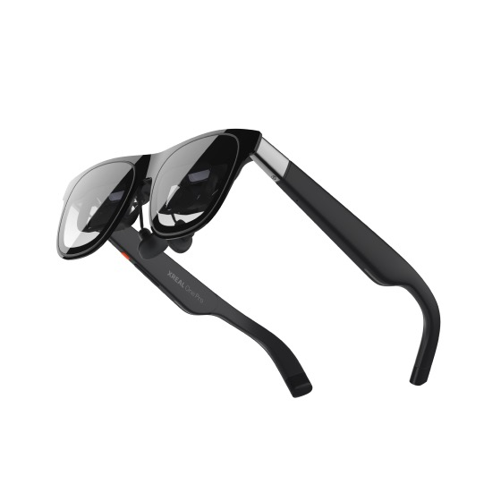
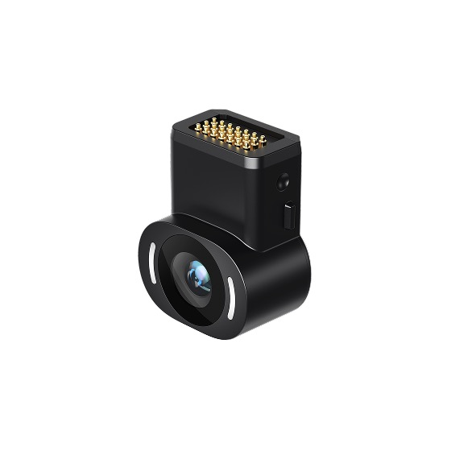
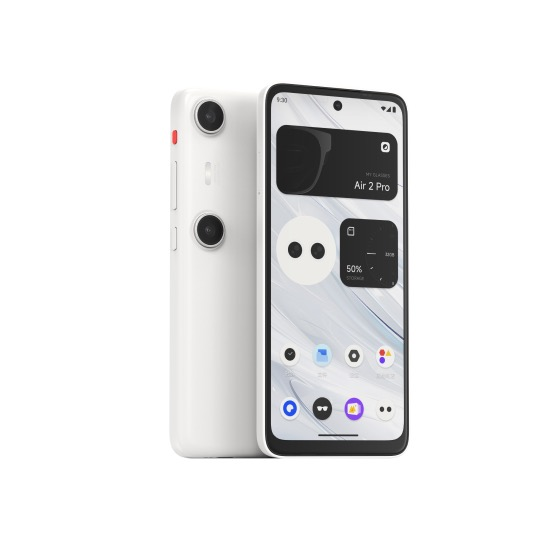
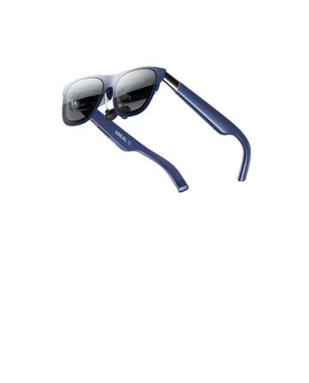
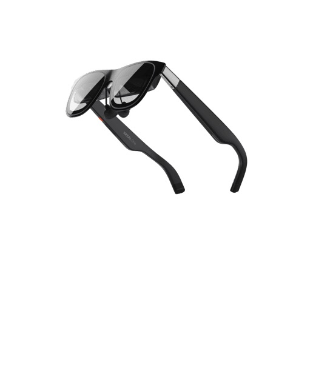
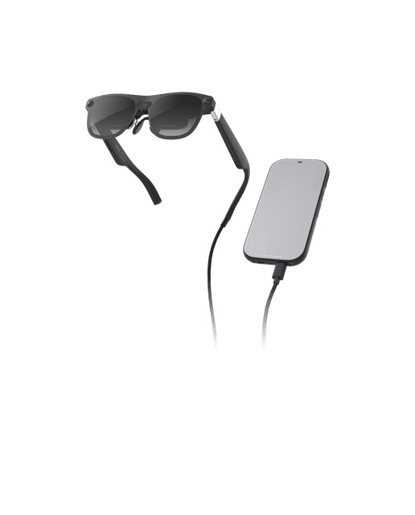
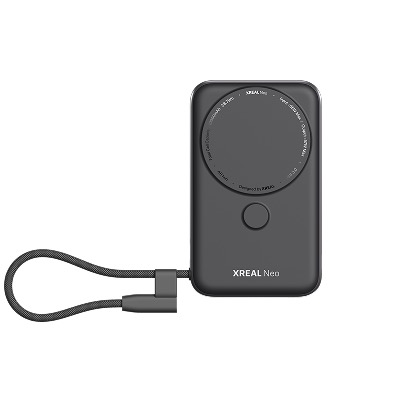

# XREAL × T04 — Products and Solutions

⬆ [XREAL profile](../XREAL.md) · [Brief](XREAL-T04-1-Brief.md) · [Playbook](XREAL-T04-3-Playbook.md)

**Read this first:** XREAL sells AR glasses, not care robots. In T04 the glasses are the **interface for a human** — therapist, caregiver, remote relative or patient — around a robot from another vendor. Typical robot specs (payload, reach, force control, IP rating, autonomy stack) **do not apply**. What decides your build is which tracking features your exact glasses + host combination exposes:

| Capability (official SDK compatibility table) | One series + XREAL Eye | Air 2 Ultra | AURA (Android XR stack) |
|---|---|---|---|
| Head tracking | **6DoF** | **6DoF** | **6DoF** |
| Hand tracking | **No** | Yes | Yes (XR Hands) |
| Plane detection | No | Yes | Yes |
| Image / marker tracking | No | Yes | Marker / object tracking via Android XR extensions |
| Depth mesh | No | Yes | Environment-depth occlusion |
| Spatial anchors | No | Yes | Yes (persistent) |
| App access to RGB camera frames | **Yes** (YUV_420_888) | not public | ⚠️ unverified |
| First-person-view capture | App content **and** real scene | App content only | ⚠️ unverified |
| Without Eye (plain One series) | 3DoF, handled on the glasses | — | — |

The official table names "XREAL One Series (RGB camera)"; whether 1S and 1 Pro+ behave identically with Eye is ⚠️ unverified — check on site.

## Relevant products (ranked for this track)

### XREAL One Pro

- **Role in T04:** default wearable for a therapist / caregiver HUD or a patient cue display; most likely model on site (best guess, not confirmed).

| Spec | Value |
|---|---|
| Weight | **87 g** |
| Field of view | **57°** |
| Brightness | 700 nits |
| Tracking | Native **3DoF** (X1 chip); **6DoF** only with XREAL Eye |
| Motion-to-photon | about 3 ms |
| Connection | Tethered USB-C (DisplayPort); no battery in the glasses |

- **Status / price:** ✅ shipping · **USD 599**.
- **Developer control:** as a plain display — nothing to program. Through XREAL SDK 3.1.0 (Unity, Android host): head pose; with Eye also 6DoF pose, RGB frames, video recording, first-person streaming. No hand tracking.

### XREAL Eye

- **Role in T04:** turns One-series glasses into a 6DoF tracker with a forward camera — the key piece for head-movement exercise measurement and for "see what the wearer sees" tele-care.

| Spec | Value |
|---|---|
| Adds | **6DoF** head tracking (SDK 3.1.0+), POV photo / video |
| Frame format for apps | **YUV_420_888** (Y / U / V textures) |
| Recording modes | Blend (virtual + real), RGB only, virtual only; Low / Middle / High quality presets |
| Resolution / frame rate | ⚠️ unverified (not stated in docs) |

- **Status / price:** ✅ shipping · **USD 99**.
- **Developer control:** RGB camera textures, capture to file, first-person-view streaming sample. Whether camera and 6DoF run concurrently without limits: ⚠️ unverified.

### XREAL Beam Pro

- **Role in T04:** pocket Android host so the wearer is not tied to a laptop; one of only three officially tested SDK hosts (with Samsung S24 and S25).

| Spec | Value |
|---|---|
| Type | Android handheld, phone-like, dual cameras for spatial capture |
| Runs | MyGlasses launcher + XREAL SDK apps |
| Developer mode | Tap the glasses icon 10× in MyGlasses with glasses disconnected |

- **Status / price:** ✅ shipping · from **USD 199**.
- **Developer control:** normal Android app deployment (adb). Avoid Android 16 on any host — the docs flag open compatibility issues.

### XREAL 1S

- **Role in T04:** lightest and cheapest current model — the one to put on an elderly wearer if comfort matters most.

| Spec | Value |
|---|---|
| Weight | about **82 g** |
| Display | 1920×1200 (16:10) |
| Tracking | Native 3DoF (X1 chip) |
| Field of view | ⚠️ unverified |

- **Status / price:** ✅ shipping since Jan 2026 · **USD 449**.
- **Developer control:** same as One Pro; Eye compatibility for 6DoF ⚠️ unverified for this model.

### XREAL 1 Pro+

- **Role in T04:** brightest model — pick it for sunlit therapy rooms, spa terraces or outdoor walking exercises on snow.

| Spec | Value |
|---|---|
| Brightness | **1,200 nits** peak |
| Field of view | **57°** |
| Tracking | Native 3DoF (X1 chip) |
| Weight | not public |

- **Status / price:** ✅ shipping since 15 Oct 2026 · **USD 599**.
- **Developer control:** same as One Pro.

### XREAL AURA

- **Role in T04:** the only current XREAL device that runs apps by itself and tracks hands — the right tool for gesture-driven patient exercises or hand-teleoperated assistance, **if units are on site**.

| Spec | Value |
|---|---|
| Field of view | **70°** |
| Tracking | 6DoF inside-out + **hand tracking**; no eye tracking |
| Weight | glasses **<95 g**, plus tethered compute puck |
| Compute | Snapdragon Reality Elite + X1S; 4,455 mAh puck battery |
| Assistant | Gemini built in |

- **Status / price:** ✅ launched 28 Oct 2026, first batch mid-Nov 2026 in US / CA / JP / KR; **Europe later** · **USD 1,279 / 1,499**.
- **Developer control:** Android XR — Unity 6 with OpenXR Android XR package: XR Hands joint data (needs the hand-tracking permission), planes, persistent anchors, ray casts, depth occlusion, object / bounding-box tracking. Standard Android apps also run.

### XREAL Air 2 Ultra

- **Role in T04:** legacy developer glasses, but the only XREAL SDK 3 device with the **full feature set** (hands, planes, images, mesh, anchors). Best choice for hand-tracked rehab exercises if AURA is absent.

| Spec | Value |
|---|---|
| Tracking | Native **6DoF** (two SLAM cameras) + hand tracking |
| SDK features | Planes, image tracking, depth mesh, spatial anchors |
| App camera access | Reported as not exposed (ActiveGlasses paper, 2026) |

- **Status / price:** ✅ shipped Mar 2024, no longer in main site navigation · USD 699 at launch.
- **Developer control:** XREAL SDK 3.1.0 via Unity (AR Foundation, XR Interaction Toolkit, XR Hands) on Beam Pro or Samsung S24 / S25.

### XREAL Neo

- **Role in T04:** minor — battery + video hub that can keep glasses and host powered during a long demo. USD 119. No developer interface.

**Not relevant for T04:** ROG XREAL R1 (gaming, 240 Hz) and xbx a01+ (budget display glasses, specs ⚠️ unverified) add nothing over the One series here.

## What XREAL already does in this domain

**Nothing of its own was found.** No XREAL deployment, pilot, clinical study, healthcare partnership or application page for elderly care or rehabilitation appears in the company profile research or in the official developer docs. Note: this session's web-search quota was exhausted, so the check relied on direct page fetches — treat "nothing found" as "nothing found in a limited check".

Adjacent evidence (third-party, not XREAL products):

| Date | What | Relevance |
|---|---|---|
| Listed Nov 2026 | **XRAI Glass** (third-party live captioning / translation app) names XREAL One, Air 2, Air 2 Pro and Air 2 Ultra as supported glasses, with head-tracked captions on XREAL One ([XRAI Glass](https://xrai.glass/ar-glasses/)) | Shows the glasses already serve as an assistive display for hearing loss — a common need among elderly guests |
| Apr 2026 | **ActiveGlasses** research (arXiv 2604.08534): smart glasses with a mounted stereo camera record bare-hand demonstrations; a robot arm replays manipulation with active vision ([arXiv](https://arxiv.org/abs/2604.08534)) | Path for teaching an assistive robot household tasks from a caregiver's egocentric demos; academic, not an XREAL offering |

## What they are building next in this domain

- **Announced, general:** AURA rollout to Europe "soon after" the first wave; 2027 retail expansion; AI (Gemini) as the main driver for the glasses line. See the [profile](../XREAL.md).
- **Care / rehab specific:** not public. No announced health, accessibility or robotics programme.
- **Inference (not a company statement):** an always-on camera + Gemini assistant on AURA is a natural base for reminder, object-finding and visual-description assistance for older users; third parties are more likely than XREAL to build it.

## Software, models and data that help for this track

| Asset | What you get | 48-hour use |
|---|---|---|
| **USB-C display mode** (no software) | Any laptop / phone screen in the glasses; 3DoF anchoring handled on the glasses | Therapist HUD, captions, robot dashboard — works in minutes |
| **XREAL SDK 3.1.0** (Unity package) | AR Foundation / XR Interaction Toolkit / XR Hands based; C# only | Head-pose capture, world-anchored exercise targets (6DoF) |
| SDK sample **RGBCameraAndCapture** | RGB frame access + photo / video recording | Record sessions; feed frames to your own vision model |
| SDK sample **FirstPersonViewStreamingCast** | Streams the wearer's view | Remote therapist / family "see what I see" |
| SDK samples for Air 2 Ultra | Plane detection, image tracking, meshing, anchors, XREAL Marker | Anchor instructions to a walker, bed or pill box |
| **MRTK3 integration** (documented) | Ready UI components (buttons, panels) | Faster large-target UI for older users |
| **Android XR + Unity** (AURA) | Hand joints, planes, persistent anchors, object tracking | Gesture-based exercises, hand teleoperation |
| GitHub org `nreal-ai` | 7 repos, mostly old forks (MRTK, WebXR polyfills); `uvc_android` updated Jun 2026 | Little direct value; do not plan around it |

- **Robotics bridge:** no official ROS 2 package. Send head / hand pose from Unity to the robot yourself (ROS-TCP-Connector or a small UDP / WebSocket publisher).
- **Models / datasets / sim assets:** none published by XREAL for care, rehab or robotics.

## Gaps and limits for this track

- **No robot, no force control, no autonomy** — every physical-assistance function must come from another vendor.
- **One + Eye is head-pose only**: no hands, planes, images, mesh or anchors per the official table. Body or limb tracking needs an external camera or another sensor.
- **Tethered**: a cable runs to a phone, puck or laptop — a snag / trip hazard for frail users; plan cable routing and keep the patient seated or supervised.
- **Host lock-in**: SDK apps are only tested on Samsung S24 / S25 and Beam Pro; Android 16 is flagged as problematic. No official Windows / Linux / Python SDK.
- **Prescription wearers**: many elderly users wear glasses; corrective-insert availability on site ⚠️ unverified.
- **Not a medical device**: regulatory status for clinical use is not public; present demos as prototypes, not therapy.
- **AURA availability**: not yet sold in Europe; on-site units unconfirmed.
- **Evidence gap**: no XREAL care / rehab reference customers to cite to judges.

## Sources
- [XREAL profile (general research)](../XREAL.md)
- [XREAL docs — device and feature compatibility](https://docs.xreal.com/XREALDevices/Compatibility)
- [XREAL docs — Sample Code (SDK 3.1.0)](https://docs.xreal.com/Sample%20Code)
- [XREAL docs — Access RGB Camera](https://docs.xreal.com/Camera/Access%20RGB%20Camera)
- [XREAL docs — Hand Tracking](https://docs.xreal.com/Input%20and%20Interactions/Hand%20Tracking)
- [XREAL docs — Frequently Asked Questions](https://docs.xreal.com/Frequently%20Asked%20Questions)
- [XREAL docs — home (SDK 3.1.0)](https://docs.xreal.com/)
- [GitHub — nreal-ai organization](https://github.com/nreal-ai)
- [Android Developers — Develop with Unity for Android XR](https://developer.android.com/develop/xr/unity)
- [XRAI Glass — compatible AR glasses](https://xrai.glass/ar-glasses/)
- [arXiv 2604.08534 — ActiveGlasses](https://arxiv.org/abs/2604.08534)
