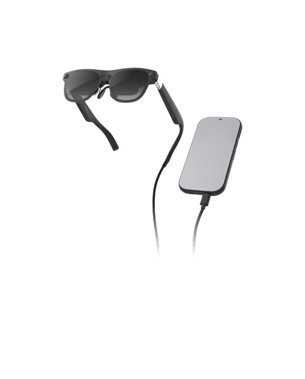
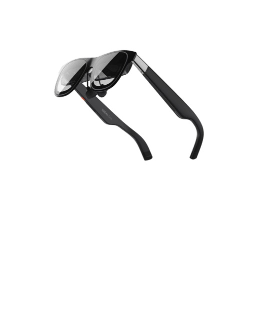
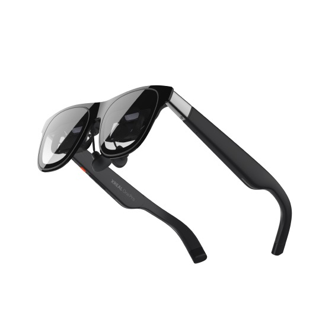
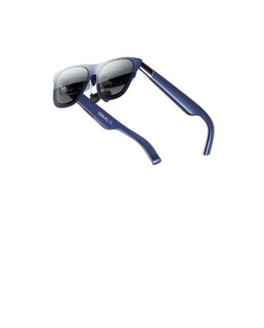
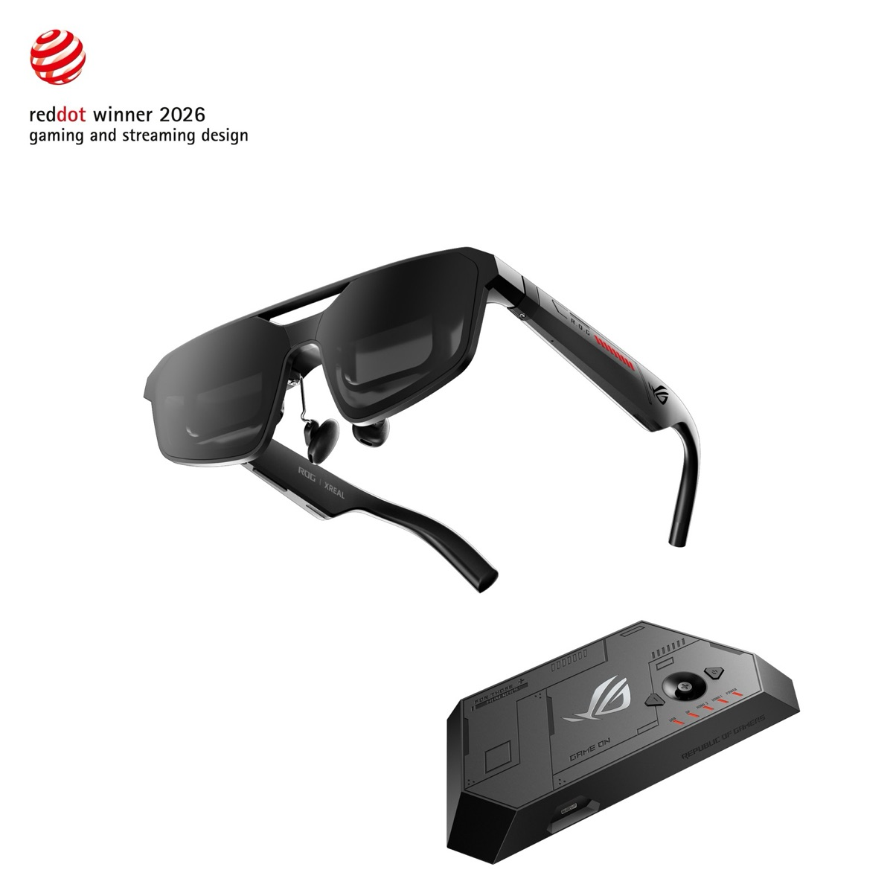
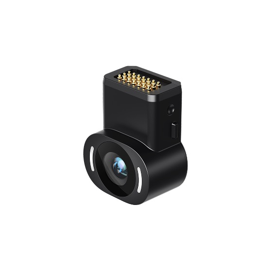
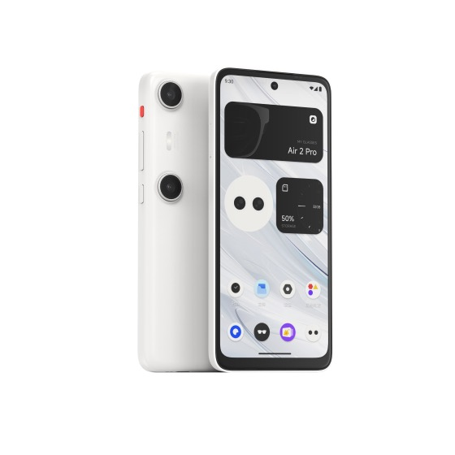
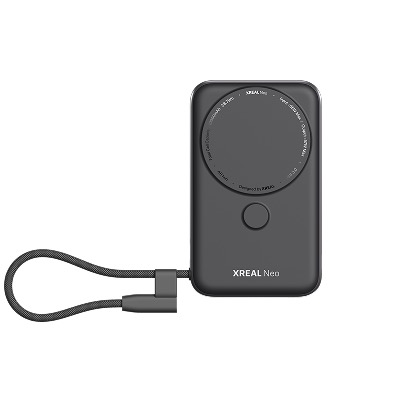
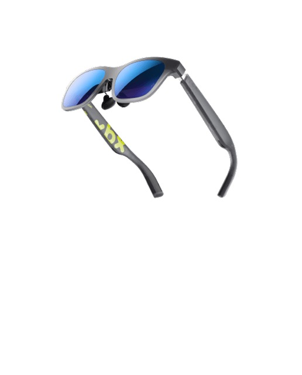

# XREAL — Product Portfolio

⬆ [XREAL profile](XREAL.md) · [Developer guide](XREAL-Developer-Guide.md) · [Roadmap and strategy](XREAL-Roadmap-and-Strategy.md)

> **Read this first:** XREAL sells **wearable displays, not robots**. Every product below is a human-interface add-on for someone else's robot: operator HUD, hands-free instruction overlay, or head / hand pose input. Pick by one question — **do you need only a screen (any model), 6DoF + hands (One series + Eye, or Air 2 Ultra), or a standalone Android XR computer (AURA)?**
>
> Verification note: specs were read from the official XREAL and ASUS ROG product pages on 2026-11-14. Web search was unavailable during this pass, so prices and dates not shown on those pages are carried over from the [profile](XREAL.md) and anything else is marked ⚠️ unverified.

## Lineup map

Track relevance: ● strong · ◐ partial · ○ none

| Product | Category | Status | Launched | Price (if public) | Positioning (one line) | T01 | T02 | T03 | T04 |
|---|---|---|---|---|---|---|---|---|---|
| XREAL AURA | Android XR see-through glasses + compute puck | ✅ (US / CA / JP / KR; **not yet sold in Europe**) | 28 Oct 2026 | **USD 1,279** (12/256) · 1,499 (16/512); launch offer 1,099 / 1,299 to end of 2026 | Only standalone device: 6DoF, hand tracking, camera, Gemini, apps on the puck | ◐ | ● | ◐ | ● |
| XREAL 1 Pro+ | Tethered display glasses (flagship) | ✅ | 15 Oct 2026 | **USD 599** | Brightest One-series display (1,200 nits); 6DoF + gestures with Eye | ◐ | ● | ◐ | ● |
| XREAL One Pro | Tethered display glasses | ✅ (superseded by 1 Pro+) | 2025 | USD 599 | Same 57° optics, 700 nits; the model most SDK material refers to | ◐ | ● | ◐ | ● |
| XREAL 1S | Tethered display glasses (entry) | ✅ | Jan 2026 | **USD 449** | Lightest spatial model (82 g), 1200p, native 3DoF | ◐ | ◐ | ◐ | ● |
| ROG XREAL R1 | Gaming display glasses (with ASUS) | ✅ | 2026 | about **USD 849** | 240 Hz gaming display with HDMI / DP dock | ◐ | ◐ | ○ | ○ |
| XREAL Eye | Clip-in camera module | ✅ | 2025 | **USD 99** | Turns One-series glasses into 6DoF devices; 12 MP POV camera | ◐ | ● | ◐ | ● |
| XREAL Beam Pro | Android handheld host / spatial camera | ✅ | 2024 | from **USD 199** | Pocket Android computer that runs XREAL SDK apps for the glasses | ◐ | ● | ◐ | ● |
| XREAL Neo | Battery + video hub | ✅ | Feb 2026 | USD 119 | Powers host and glasses for long sessions | ○ | ◐ | ○ | ◐ |
| xbx a01+ | Budget display glasses (sub-brand) | ✅ | 2026 | USD 299 ⚠️ unverified | 62 g, very bright, **0DoF only** — a plain head-fixed screen | ○ | ◐ | ○ | ◐ |
| XREAL Air 2 Ultra | Developer 6DoF glasses (legacy) | ✅ shipped 2024; no longer on the official site menu | Mar 2024 | USD 699 at launch | Native 6DoF + hand tracking without add-ons | ◐ | ● | ◐ | ● |

**Fast pick**

| You want | Take | Effort |
|---|---|---|
| Operator screen for a robot UI you already have | Any glasses, plugged into a USB-C DisplayPort host | Minutes |
| Screen that stays fixed in space while the head turns | 1 Pro+, One Pro, 1S, R1 (3DoF on the glasses) | Minutes |
| Head pose / hand pose as robot input, world-anchored overlays | One series + Eye + Beam Pro, or Air 2 Ultra + Beam Pro (Unity, XREAL SDK) | Half a day or more |
| Standalone app with Gemini, camera and hand tracking | AURA (Android XR) | Half a day or more; availability on site uncertain |

## Products

### XREAL AURA

Optical see-through glasses wired to a pocket compute puck running **Android XR**. The only XREAL product that runs apps itself and the only one with built-in 6DoF, hand tracking and an RGB camera. Formerly "Project Aura".

| Spec | Value |
|---|---|
| Optics | X Prism, **70° FOV**, optical see-through (no camera passthrough) |
| Display | Sony Micro-OLED, **1920 × 1200 per eye**, up to **120 Hz**, peak **1,050 nits**, 32 PPD, 100% sRGB |
| Dimming | Electrochromic, 5 levels, auto / manual |
| Tracking and sensing | 2 world-facing tracking cameras, **6DoF** spatial anchoring, **hand tracking**, high-resolution RGB camera with privacy LED |
| Glasses chip | XREAL X1S spatial coprocessor, 3 ms motion-to-photon |
| Audio | Open-ear speakers (Bose tuning), 4-microphone array |
| Glasses weight | **95 g** |
| IPD sizes | M 60–66 mm · L 66–72 mm |
| Puck compute | Snapdragon Reality Elite, **48 TOPS** AI processing |
| OS | Android XR (Google Play apps, Gemini assistant) |
| Memory / storage | 12 GB / 256 GB or 16 GB / 512 GB (UFS 4.0) |
| Puck battery | **4,455 mAh / 34.84 Wh**; runtime not stated on the product page |
| Puck ports | USB-C 1: glasses (USB 3.1, **full ADB support**) · USB-C 2: charging (up to 57 W, PD 3.0 / QC 3.0) and **DisplayPort in** |
| Input | Hands, voice, touchpad on puck; Bluetooth keyboard, mouse, game controller; fingerprint button |
| Wireless | Wi-Fi 6 / 6E, Bluetooth 5.3; GPS, GLONASS, Galileo, QZSS, BeiDou |
| Cooling / puck weight | Active fan · **265 g** |
| IP rating | not public |

- **Variants:** 12 GB / 256 GB and 16 GB / 512 GB; two IPD sizes. No separate developer edition found; development uses the public Android XR SDK (Unity, OpenXR — see the [developer guide](XREAL-Developer-Guide.md)).
- **Why it matters here:** the puck is a real robot-side companion computer — ADB, Wi-Fi 6E, GNSS, 48 TOPS — and the DP-in port means it can also act as a plain display for a laptop.
- **Typical applications:** standalone operator app with hand gestures; "look and ask" assistant using Gemini; remote-expert view; patient or caregiver guidance overlay.
- **Caveats:** not yet sold in Europe, so on-site units are uncertain; app access to raw camera frames ⚠️ unverified.
- Official page: [xreal.com/aura](https://www.xreal.com/aura)

### XREAL 1 Pro+

Current flagship tethered display glasses. No app compute on board — it shows whatever a USB-C DisplayPort host sends, with head-stabilised screens handled by the X1 chip in the glasses.

| Spec | Value |
|---|---|
| Optics | X Prism, **57° FOV** |
| Display | Sony Micro-OLED, **1,200 nits** peak, **120 Hz**, AI HDR; Standard / Movie / Reading colour modes |
| Tracking | **Native 3DoF** (Follow and Anchor modes), 3 ms motion-to-photon; **6DoF anchoring + gesture interaction with XREAL Eye** (sold separately; XREAL notes feature availability may vary) |
| On-glasses processing | X1 spatial computing chip; 2D-to-3D conversion at 60 fps on the glasses |
| Dimming | Electrochromic, automatic |
| Audio | Sound by Bose |
| Fit | Two IPD sizes, adjustable temples, redesigned nose pad |
| Weight | not published on the product page |
| Resolution | not stated on the product page |
| Connectivity | USB-C (DisplayPort); works with phones, handhelds, consoles, PCs |
| Battery | None — powered by the host |

- **Variants:** two IPD sizes.
- **Typical applications:** bright operator HUD usable near windows or outdoors; world-anchored robot dashboard with Eye; teleoperation video view.
- Official page: [xreal.com/1-pro-plus](https://www.xreal.com/1-pro-plus)

### XREAL One Pro

Previous flagship, still listed. Optically the same class as the 1 Pro+ but dimmer. Most public SDK and community material refers to this model.

| Spec | Value |
|---|---|
| Optics | X Prism, **57° FOV**, virtual screen up to 171 in (at 4 m) |
| Display | 0.55 in Sony Micro-OLED, **120 Hz**, **700 nits** peak, per-unit colour calibration |
| Tracking | **Native 3DoF** via X1 chip, 3 ms motion-to-photon; 6DoF anchoring with XREAL Eye |
| Dimming | Electrochromic, 3 levels (Clear / Shade / Theater) |
| Audio | Sound by Bose |
| IPD sizes | 57–66 mm and 66–75 mm |
| Weight | **87 g** |
| Connectivity | USB-C; host needs **USB-C with DisplayPort output** (Nintendo Switch needs an extra hub) |
| Battery | None — powered by the host |

- **Variants:** two IPD sizes.
- **Typical applications:** same as 1 Pro+ for indoor use.
- Official page: [xreal.com/one-pro](https://www.xreal.com/one-pro) · [US store](https://us.shop.xreal.com/products/xreal-one-pro)

### XREAL 1S

Entry model of the spatial (X1-chip) line and the lightest of them — the comfortable choice for long wear, for example by a patient or therapist.

| Spec | Value |
|---|---|
| Display | Sony Micro-OLED, **1200p** (1920 × 1200), **120 Hz**, **700 nits** peak, 108% sRGB |
| FOV | not stated on the product page ⚠️ unverified |
| Tracking | **Native 3DoF** via X1 chip (Anchor, Follow, Ultra-wide modes), 3 ms motion-to-photon |
| On-glasses processing | 2D-to-3D conversion on the glasses |
| Dimming | Electrochromic, manual or automatic |
| Audio | Sound by Bose, multi-microphone array with noise cancellation |
| Weight | **82 g** |
| Connectivity | USB-C (DisplayPort) |
| Add-ons named on the page | XREAL Eye, XREAL Neo, XREAL Beam Pro |

- **Typical applications:** low-cost HUD handed out to several team members; patient-side exercise cues; status overlay for a caregiver.
- Official page: [xreal.com/1s](https://www.xreal.com/1s)

### ROG XREAL R1

Gaming glasses co-developed with ASUS ROG. Relevant mainly because the included dock accepts **HDMI and DisplayPort**, so hosts without USB-C DP Alt Mode can drive it.

| Spec | Value |
|---|---|
| Display | 0.55 in Sony Micro-OLED, **1920 × 1080 per eye**, 120 Hz native, **240 Hz** with Frame Rate Boost (achieved by image scaling) |
| FOV | **57°**, virtual screen up to 171 in at 4 m, 40 PPD |
| Brightness | 700 nits max, 106% sRGB |
| Tracking | Native 3DoF, 3 ms motion-to-photon |
| Dimming | Electrochromic, 3 levels |
| Audio | Bose-tuned speakers, noise-cancelling microphone array |
| Weight | **91 g** (ASUS lists 0.09 kg net) |
| IPD sizes | 57–66 mm and 66–75 mm |
| Glasses port | 1 × USB-C (DP Alt Mode) |
| ROG Control Dock (included) | **2 × HDMI 2.0, 1 × DisplayPort 1.4**, USB-C front (DP Alt Mode), USB-C data and power; 0.23 kg |

- **Typical applications:** low-latency first-person video view for teleoperation from a PC with HDMI / DP only.
- Official pages: [ASUS ROG spec](https://rog.asus.com/glasses/rog-xreal-r1/spec/) · [xreal.com/rog-xreal-r1](https://www.xreal.com/rog-xreal-r1)

### XREAL Eye

Tiny camera module that plugs into the bridge of One-series glasses. This is the part that makes the cheap glasses interesting for robotics: it upgrades them from 3DoF to **6DoF**.

| Spec | Value |
|---|---|
| Function | **6DoF spatial anchoring** for One-series glasses, processed by the X1 chip — works with any DisplayPort host, no app needed |
| Camera | **12 MP**, first-person photo and video |
| Weight | **1.35 g** |
| Latency | 3 ms motion-to-photon (X1 chip) |
| Compatibility | XREAL One series only |
| Recording | First-person capture needs Beam Pro (per XREAL) |

- **Developer notes:** 6DoF pose is exposed through XREAL SDK 3.1.0+ on an Android host (see [developer guide](XREAL-Developer-Guide.md)). XREAL advertises gesture interaction for 1 Pro+ with Eye; SDK hand-tracking support on One + Eye and raw camera-frame access ⚠️ unverified — ask at the booth.
- **Typical applications:** head-pose driven camera / gimbal control on a robot; world-locked dashboards; POV recording for demonstrations.
- Official page: [xreal.com/eye](https://www.xreal.com/eye)

### XREAL Beam Pro

Phone-shaped Android device built as the host for XREAL glasses. For a hackathon it is the **default deployment target for XREAL SDK (Unity) apps** and a self-contained, pocketable operator computer.

| Spec | Value |
|---|---|
| OS | Android with nebulaOS spatial UI; full Google Play Store |
| Compute | Qualcomm Snapdragon "spatial companion" processor (exact model not stated on the page) |
| Screen | 6.5 in Full HD LCD touch screen |
| Cameras | **Dual 50 MP**, 50 mm lens spacing, for 3D spatial photo / video |
| Output to glasses | 1080p, up to 90 Hz |
| Ports | **Dual USB-C** (glasses and charging at the same time), microSD up to 1 TB |
| Wireless | Wi-Fi 6, Bluetooth 5.2; optional **5G** variant (SIM required) |
| Charging | 27 W |
| Tracking modes | 3DoF with Air / Air 2 / Air 2 Pro / One / One Pro; **full 6DoF with Air 2 Ultra** |
| Battery capacity | not stated on the product page |

- **Variants and prices:** 128 GB Wi-Fi **USD 199** · 256 GB Wi-Fi USD 249 · 256 GB 5G USD 299; bundles with One or One Pro.
- **Typical applications:** runs your Unity app and streams poses to a robot over Wi-Fi; 5G variant for outdoor demos away from the venue network; stereo capture of a scene.
- Official page: [xreal.com/beampro](https://www.xreal.com/beampro)

### XREAL Neo

Battery pack and video hub that sits between a host device and the glasses, so both stay powered. Useful if a demo must run for hours from a phone or handheld.

| Spec | Value |
|---|---|
| Function | Power bank + display hub for XREAL glasses (XREAL calls it an "AR charging expansion dock") |
| Capacity, ports, weight | not confirmed from official pages ⚠️ unverified |
| Price | USD 119 (USD 99 at launch), per the [profile](XREAL.md) |

- Official page: [xreal.com/neo](https://www.xreal.com/neo) (thin on technical detail)

### xbx a01+

Budget sub-brand glasses. Very light and very bright, but **0DoF**: the image is fixed in front of the eyes with no anchoring and no SDK-relevant tracking. XREAL itself points to 1S / One Pro for spatial features.

| Spec | Value |
|---|---|
| Weight | **62 g** (56 g without the detachable front frame) |
| Display | Up to **1,600 nits** peak, native HDR10, real-time HDR upscaling |
| Virtual screen | 147 in (as advertised) |
| Tracking | **0DoF** (screen stays in front of the eyes) |
| Frame | Ultralight nylon, flexible temples, hinges flex up to 20° |
| Connectivity | Plug-in to phone, tablet, handheld or laptop |
| FOV, resolution, refresh rate | not confirmed ⚠️ unverified |
| Price | USD 299 ⚠️ unverified (matches the reported sub-brand entry price) |

- **Typical applications:** cheapest, lightest heads-up status display, including outdoors in bright snow light (washes out in direct sun, per XREAL).
- Official page: [xreal.com/xbxa01](https://www.xreal.com/xbxa01)

### XREAL Air 2 Ultra

Older developer-oriented glasses with **native 6DoF and hand tracking** from two built-in tracking cameras — no Eye module needed. Still the reference "6DoF glasses" in the XREAL SDK and used in published robotics research (see [profile](XREAL.md)). No longer in the official site menu; no official image could be retrieved.

| Spec | Value |
|---|---|
| Tracking | Native **6DoF**, hand tracking, plane detection (via XREAL SDK on an Android host) |
| Host | Beam Pro gives "full-featured 6DoF" per the Beam Pro page |
| Display, FOV, weight | not re-checked against an official page today ⚠️ unverified |
| Price | USD 699 at launch (Mar 2024) |

- **Caveat:** a 2026 research paper reported that raw camera frames were not exposed to apps on this model.
- Official page: none currently live on [xreal.com](https://www.xreal.com)

## Accessories and ecosystem

| Item | What it adds | Status |
|---|---|---|
| XREAL Eye | 6DoF + 12 MP POV camera for One series | ✅ USD 99 |
| XREAL Beam Pro | Android host for SDK apps, dual 50 MP spatial camera, optional 5G | ✅ from USD 199 |
| XREAL Neo | Battery + video hub | ✅ |
| ROG Control Dock | HDMI 2.0 × 2 and DisplayPort 1.4 input for the R1 (included with R1) | ✅ |
| XREAL Hub | Adapter needed for hosts such as Nintendo Switch (named in One Pro footnotes) | ✅ details not checked |
| Prescription lens inserts | Via partner opticians (US / EU / UK) | ✅ |
| X1 / X1S chips | On-glasses spatial coprocessors (3DoF / 6DoF, 3 ms latency) — not sold separately | ✅ inside products |
| XREAL SDK 3.x (Unity) | 6DoF, planes, images, hands, anchors for Eye / Air 2 Ultra on Android hosts | ✅ free download |
| Android XR SDK | Development path for AURA (Unity, OpenXR) | ✅ |

Host checklist for the plain-display route: the host port must output **DisplayPort over USB-C**. Many robot computers and dev boards expose only HDMI — then you need an HDMI-to-USB-C DP adapter with power, the R1 dock, or a laptop in between.

## Legacy and discontinued

- **XREAL One** (2024–25, first X1-chip model) — still referenced as a compatible device on Beam Pro and Eye pages; no longer in the main menu.
- **XREAL Air / Air 2 / Air 2 Pro** — earlier display glasses without the X1 chip; 3DoF only through a host such as Beam Pro.
- **XREAL Air 2 Ultra** — see above; legacy but still the most direct 6DoF + hands developer device.
- **XREAL Beam** (original screen-anchoring box) and **Nreal Light** — predecessors; not relevant here.

## Image credits

| File | Shows | Source URL |
|---|---|---|
| assets/xreal-aura.jpg | AURA glasses with compute puck | https://cms-media.xreal.com/catalog_aura_3457d806be.png |
| assets/xreal-1-pro-plus.jpg | XREAL 1 Pro+ | https://cms-media.xreal.com/catalog_xreal_1_pro_plus_da49cc29ea.png |
| assets/xreal-one-pro.jpg | XREAL One Pro | https://resource.xreal.com/www-xreal-com/images/home/menu_OnePro.png |
| assets/xreal-1s.jpg | XREAL 1S | https://cms-media.xreal.com/catalog_xreal_1s_2436ad7c05.png |
| assets/xreal-rog-r1.jpg | ROG XREAL R1 | https://dlcdnwebimgs.asus.com/gain/D55C57D4-9E20-4023-92A3-C00C874C10B2 |
| assets/xreal-eye.jpg | XREAL Eye camera module | https://resource.xreal.com/www-xreal-com/images/home/menu_Eye.png |
| assets/xreal-beam-pro.jpg | XREAL Beam Pro | https://resource.xreal.com/www-xreal-com/images/home/menu_BeamPro.png |
| assets/xreal-neo.jpg | XREAL Neo | https://resource.xreal.com/www-xreal-com/images/home/menu_XREAL_Neo.png |
| assets/xreal-xbx-a01-plus.jpg | xbx a01+ | https://cms-media.xreal.com/catalog_xbx_a01_plus_a7fa719864.png |

All images © XREAL (R1 image © ASUS), taken from the official sites / CDNs and converted to JPEG. No official image was found for XREAL Air 2 Ultra.

## Sources

- [XREAL — home page and product menu](https://www.xreal.com)
- [XREAL AURA — product page and spec sheet](https://www.xreal.com/aura)
- [XREAL 1 Pro+ — product page](https://www.xreal.com/1-pro-plus)
- [XREAL One Pro — product page](https://www.xreal.com/one-pro)
- [XREAL 1S — product page](https://www.xreal.com/1s)
- [ROG XREAL R1 — XREAL product page](https://www.xreal.com/rog-xreal-r1)
- [ASUS ROG — ROG XREAL R1 specifications](https://rog.asus.com/glasses/rog-xreal-r1/spec/)
- [XREAL Eye — product page](https://www.xreal.com/eye)
- [XREAL Beam Pro — product page](https://www.xreal.com/beampro)
- [XREAL Neo — product page](https://www.xreal.com/neo)
- [xbx a01+ — product page](https://www.xreal.com/xbxa01)
- [XREAL profile in this repository (prices, launch dates, SDK notes and their sources)](XREAL.md)
