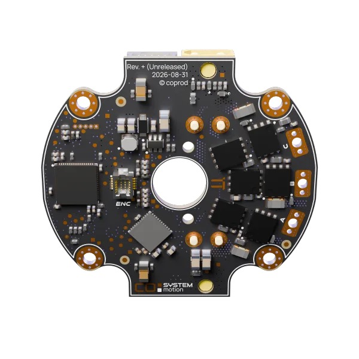
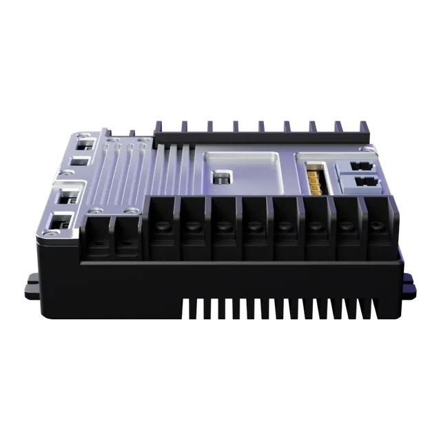
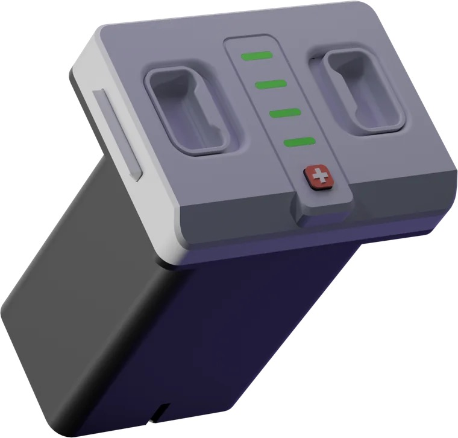
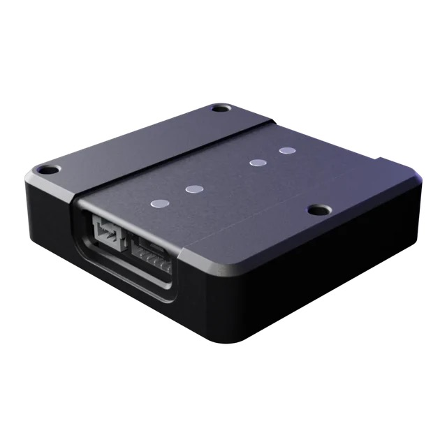
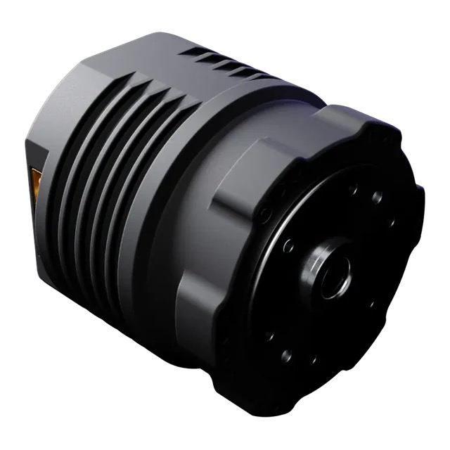

# coprod Inc. × T01 — Products and Solutions

⬆ [coprod Inc. profile](../coprod.md) · [Brief](coprod-T01-1-Brief.md) · [Playbook](coprod-T01-3-Playbook.md)

**Bottom line:** coprod supplies the *joint, power and sensing layer* of a robot. For T01 that means a **custom mechanism or wheel drive** under your own autonomy stack. There is no delivery robot, no navigation software and no urban-service reference from coprod. Public information is thin; everything below marked "not public" must be asked at the booth.

Shared platform numbers (all modules): **EtherCAT 100 Mb/s** · **1 kHz** typical control loop · **< 20 µs** jitter · distributed-clock sync · real-time Linux master.

## Relevant products (ranked for this track)

### co:motion

**Role in T01:** drives any motor you need — wheel motors of a small cart, or the axis of a delivery hatch, lift, dispenser, brush or camera pan mount.

| Spec | Value |
|---|---|
| Bus / loop | EtherCAT, **1 kHz+**, DC sync |
| Control modes | Torque, velocity and position (simultaneous) |
| Feedback inputs | BiSS, SSI, SPI, Hall, incremental; on- or off-axis |
| Form factor | Several sizes, incl. hollow-shaft |
| Stopping | Controlled braking; Safe Torque Off module is a future item |
| Current / power rating, supported motor sizes | not public |
| IP rating | not public |

- **Status:** 🧪 pre-order · **Price:** not public · **On-site stock:** not public — ask.
- **Developer control:** per-axis mode selection, velocity / position / torque setpoints and gain tuning from Python; axes can be grouped (the home-page sample commands four wheels as one velocity group).
- [Product page](https://coprod.co/products.html#comotion)

### co:power

**Role in T01:** power backbone of a mobile payload or cart — e-stop handling, soft start, regulated rails for your compute, and energy telemetry for a "fleet health" dashboard.

| Spec | Value |
|---|---|
| Input voltage | **10–54.6 V** |
| Architecture | Motherboard with up to **6 submodules** |
| Submodule types | Power logic (supervisor, e-stop, bus-off), precharge (inrush / soft start), isolated DC/DC regulator, brake (regen clamp / chopper) |
| Telemetry | Every submodule reports over EtherCAT |
| Current / power ratings, output voltages | not public |

- **Status:** 🧪 pre-order · **Price:** not public.
- **Developer control:** read telemetry (the home-page sample reads a regulator voltage); how much switching is exposed to the API is not public.
- [Product page](https://coprod.co/products.html#copower)

### co:battery

**Role in T01:** untethered runtime for a payload module or cart.

| Spec | Value |
|---|---|
| Protection | Over-current, over- / under-voltage, short-circuit, temperature |
| Indicators | 4 state-of-charge LEDs |
| Mechanical | Latching interface |
| Capacity, voltage, weight, runtime | not public (sizes and voltages "on request") |

- **Status:** 🧪 pre-order · **Price:** not public. Runtime cannot be planned from public data — measure on site.
- [Product page](https://coprod.co/products.html#cobattery)

### co:sense

**Role in T01:** heading and tilt for a wheel base, or the reference for a **self-levelling cargo tray** on Leukerbad's steep streets. It is an IMU only — no position, no obstacle sensing.

| Spec | Value |
|---|---|
| Sensing | **9-axis, dual-redundant** |
| Fusion | On-board at **1 kHz** |
| Outputs | Quaternion, linear acceleration, angular velocity, magnetic field |
| Size | **30 × 50 mm** |

- **Status:** 🧪 pre-order · **Price:** not public.
- **Developer control:** read fused orientation from Python (sample prints IMU orientation).
- [Product page](https://coprod.co/products.html#cosense)

### cosystem API

**Role in T01:** the single software entry point — scan the bus, get device handles, command axes, read IMU and power data. Your navigation / task layer sits on top.

| Item | Value |
|---|---|
| Languages | Python package on a C++ core |
| Verified capabilities | Network scan (`cs.scan_network()`), devices by slave ID, motor groups, gain setting, velocity / position commands, IMU and regulator read-out |
| ROS 2 | ⚠️ unverified — claimed in a third-party listing, not shown on the official site |
| Navigation, mapping, perception, fleet tools | none |
| Host requirements | Real-time Linux; exact OS / NIC / CPU requirements not public |

- **Status:** 🧪 preview — not publicly downloadable; no public docs portal. Access is via the team / Discord.
- [Official site](https://coprod.co/)

### co:act

**Role in T01:** a compact torque-controlled joint for a tray-levelling axis, hatch or small manipulator joint — *if* units exist on site.

| Spec | Value |
|---|---|
| Torque | **10 Nm** continuous / **25 Nm** peak |
| Reduction | **16:1**, quasi-direct drive |
| Size / mass | **60 mm** diameter / **420 g** |
| Other | Hollow shaft, dual encoder (motor and output side), built-in controller |

- **Status:** 🧪 coming soon — the least available item in the range · **Price:** not public.
- [Product page](https://coprod.co/products.html#coact)

### Low relevance for T01

| Item | Why it matters little here |
|---|---|
| co:dodo (in-house biped, not sold) and its browser simulator ✅ | Proof that the stack runs a real robot; a point-foot biped is not a service platform. [Systems](https://coprod.co/systems.html) · [Simulator](https://coprod.co/simulator/) |
| co:found (discount programme) ✅ | Only relevant after the hackathon if your team turns the project into a start-up: **75%** off up to the first CHF 25,000, **33%** off up to CHF 100,000. [co:found](https://coprod.co/cofound.html) |

## What coprod Inc. already does in this domain

**Nothing public.** No deployment, pilot, customer, partner or application page for delivery, navigation, cleaning, maintenance or any other urban service was found.

| Date | What | Relevance to T01 |
|---|---|---|
| Dec 2025 | First motion of the in-house biped co:dodo on coprod modules | Shows 1 kHz whole-body control works; not a service robot |
| 2 Apr 2026 | CHF 40,000 from Venture Kick; unnamed "global component supplier" partnership reported | No urban-service content |
| 2026 (site) | Home-page API sample scripts a **four-wheel velocity group**, a camera motor and an IMU | The only public hint of a wheeled-base use case — a code illustration, not a product or demo |
| 2026 (site) | Systems page invites outside teams ("your robot") to collaborate | A hackathon build fits this invitation |

Source for the dated items: [company profile](../coprod.md) (Venture Kick release) and the official [home](https://coprod.co/) and [systems](https://coprod.co/systems.html) pages.

## What they are building next in this domain

- **Announced modules, no dates** 🔭: EtherCAT junction (star / branch wiring), IO board (time-stamped digital / analog I/O), tactile sensor array, Safe Torque Off module, more co:act sizes.
- **Announced systems, no dates** 🔭: dual-arm teleoperation platform with tactile end effectors; full-body humanoid.
- **Nothing announced for mobile bases, delivery or municipal services.**
- *Inference:* the roadmap points to manipulation and humanoids, not urban logistics. The IO board and EtherCAT junction would make custom service carts (lights, bumpers, door sensors on the same bus) easier, but that is our reading, not a coprod statement.

## Software, models and data that help for this track

| Asset | Status | Use in a 48-hour T01 build |
|---|---|---|
| cosystem Python API | 🧪 preview, access via team | Scripting axes, IMU and power in a few lines |
| co:dodo browser simulator | ✅ web | Biped only — no help for a cart or payload module |
| Open-source examples | Product page mentions examples for battery integration; the GitHub link on the site returned **404** on 2026-11-14 | Do not plan on public code; ask for a USB stick / private repo |
| Pretrained models, datasets, VLA | none | Bring perception and navigation from elsewhere (e.g. open-source ROS 2 navigation on another vendor's compute) |
| URDF / MJCF of modules | not found publicly | Ask if needed for simulation |

## Gaps and limits for this track

- **No autonomy**: no SLAM, navigation, obstacle avoidance, perception or fleet software.
- **No complete platform**: no chassis, wheels, arm or enclosure — you build or borrow the mechanics.
- **Availability**: everything is pre-order or coming soon; kit count on site is unknown.
- **Key numbers missing**: motor current / power limits, battery capacity, runtime, payload — none published.
- **No outdoor rating**: no IP or temperature rating published; snow and wet streets are out of scope for bare boards.
- **Safety**: Safe Torque Off is still a roadmap item; no safety certification is claimed.
- **Access**: no public SDK download, no docs portal, dead GitHub link; ROS 2 support ⚠️ unverified.
- **Research note**: track-specific web search was unavailable for this doc; findings rest on the official site pages and the company profile.

## Sources
- [coprod — official site (home, API sample, system specs)](https://coprod.co/)
- [coprod — products](https://coprod.co/products.html)
- [coprod — systems](https://coprod.co/systems.html)
- [coprod — community](https://coprod.co/community.html)
- [coprod — co:found](https://coprod.co/cofound.html)
- [coprod Inc. profile (general research, incl. Venture Kick release of 2 Apr 2026)](../coprod.md)
- [Venture Kick — coprod receives CHF 40,000](https://www.venturekick.ch/coprod-receives-CHF-40000-from-Venture-Kick-to-build-scalable-interoperable-robotics-ecosystem) (used via the profile; page returned HTTP 503 on re-check, 2026-11-14)
