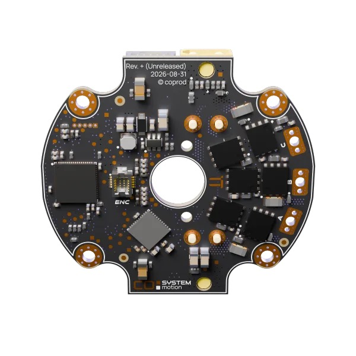
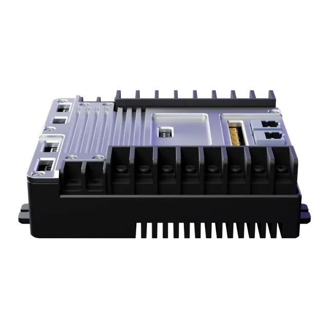
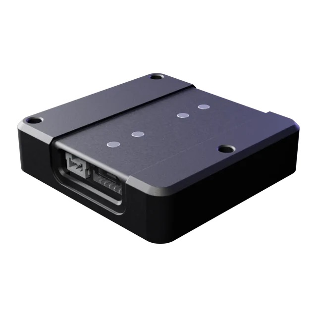
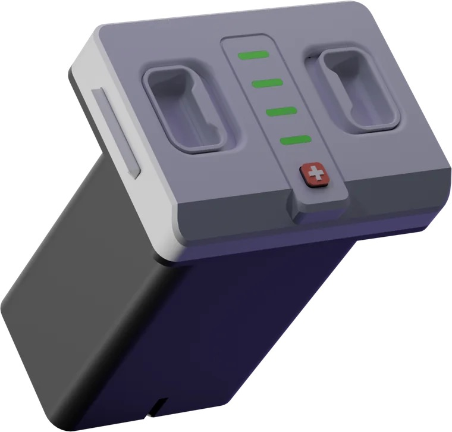
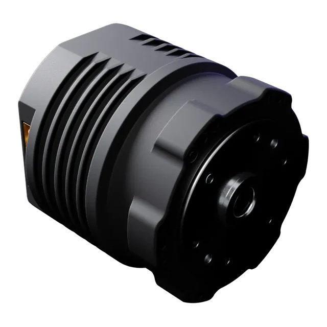
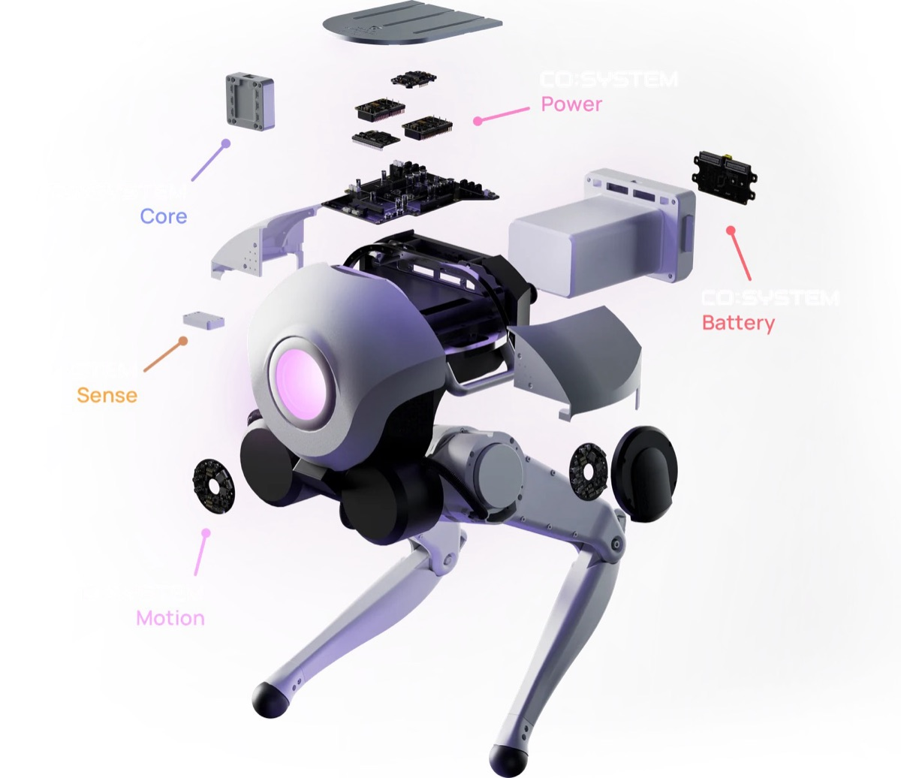

# coprod Inc. × T02 — Products and Solutions

⬆ [coprod Inc. profile](../coprod.md) · [Brief](coprod-T02-1-Brief.md) · [Playbook](coprod-T02-3-Playbook.md)

**Bottom line:** coprod supplies joint-level parts and a control bus. For T02 it can power **one custom mechanism or payload** on someone else's robot (or a fixed installation), not a full response system. Nothing below is rated for outdoor use, and no price is public.

Shared platform numbers (co:system): EtherCAT **100 Mb/s** · **1 kHz** typical loop · **< 20 µs** jitter · distributed-clock sync with hardware time-stamps · master runs on real-time Linux.

## Relevant products (ranked for this track)

### co:motion

**Role in T02:** drives any custom actuated axis — barrier, valve turner, sensor gimbal, winch, teleop joint — with a defined stop behaviour.

| Spec | Value |
|---|---|
| Bus / rate | EtherCAT with distributed clocks, **1 kHz+** |
| Control modes | Torque, velocity and position, simultaneously |
| Encoder inputs | BiSS, SSI, SPI, Hall, incremental (on- or off-axis) |
| Stop behaviour | Controlled braking for emergency stop; **Safe Torque Off module not yet available** |
| Form factor | Several sizes, hollow-shaft options (dimensions not public) |
| Current / voltage rating | not public |
| IP rating | not public |

- **Status:** 🧪 pre-order · **Price:** not public · **On-site availability:** unknown — ask.
- **Developer control:** per-axis commands and gains from the `cosystem` Python API (C++ core). You supply the motor, encoder and mechanics.

### co:power

**Role in T02:** the "resilience" part — e-stop, fault supervision and live power data for a robot or a fixed actuator that must survive brown-outs.

| Spec | Value |
|---|---|
| Input voltage | **10–54.6 V** |
| Architecture | Motherboard with up to **6 submodules** |
| Submodules | Power Logic (monitoring, fault detection, e-stop, bus-off handling) · Precharge (soft start) · Regulator (galvanically isolated DC/DC) · Brake (chopper / regen clamp) |
| Telemetry | Every submodule reports over EtherCAT at 1 kHz+ |
| Power / current limits | not public |
| Safety certification | none published |

- **Status:** 🧪 pre-order · **Price:** not public.
- **Developer control:** read bus and regulator telemetry from the API (the home-page sample reads a regulator voltage); e-stop and fault handling are built in. Exact writable parameters: not public.

### co:sense

**Role in T02:** orientation and vibration source for a stabilised sensor head, a tilt / shake alarm on a structure mock-up, or fall and tip-over detection on a carrier robot.

| Spec | Value |
|---|---|
| Sensor | 9-axis AHRS, **dual-redundant** |
| Fusion | On-board at **1 kHz** |
| Outputs | Quaternion, linear acceleration, angular velocity, magnetic field |
| Time-stamping | Hardware time-stamps on EtherCAT |
| Size | **30 × 50 mm** |
| Noise / drift figures | not public |

- **Status:** 🧪 pre-order · **Price:** not public.
- **Developer control:** read orientation (the API sample prints Euler angles) and raw channels. It is a wired EtherCAT device — not a wireless or low-power remote sensor node.

### co:battery

**Role in T02:** untethered power for the mechanism, and the prop for an "infrastructure keeps working during a power cut" demo.

| Spec | Value |
|---|---|
| Protection | Over-current, over / under-voltage, short-circuit, temperature |
| Indicators | 4 state-of-charge LEDs |
| Mechanical | Latching interface; site mentions open integration examples for it (not found publicly) |
| Capacity / voltage / runtime | not public (sizes on request) |
| Cold-weather rating | not public |

- **Status:** 🧪 pre-order · **Price:** not public.

### co:act

**Role in T02:** a backdrivable joint for a force-reflecting teleop tool or a compliant gimbal — only if units exist on site.

| Spec | Value |
|---|---|
| Torque | **10 Nm** continuous / **25 Nm** peak |
| Reduction | **16:1** quasi-direct drive, hollow shaft |
| Size / mass | **60 mm** diameter / **420 g** |
| Sensing | Dual encoder (motor side + output side) |
| Control | Torque, velocity, position; safe stopping |

- **Status:** 🧪 coming soon — do not plan around it until you have seen hardware. **Price:** not public.

### cosystem API

**Role in T02:** the only software layer. It gives joint-level access; everything above (perception, autonomy, alerts, UI) is yours.

| Item | Detail |
|---|---|
| Languages | Python package on a C++ core |
| Shown functions | Scan network, get a device by ID, command wheel velocities, read IMU orientation, read regulator voltage |
| Real-time | Control loop + EtherCAT master on real-time Linux |
| ROS 2 | Claimed in a third-party listing only — ⚠️ unverified |
| Access | 🧪 not publicly downloadable; get it from the team |

### co:dodo and co:dodo simulator

**Role in T02:** minimal. co:dodo is a 6-DoF point-foot biped used in-house to prove the stack (🧪 not sold). The browser simulator (✅ free, MuJoCo WebAssembly + ONNX policy at **50 Hz**) is a nice showpiece but does not model terrain hazards, payloads or sensors relevant to this track.

## What coprod Inc. already does in this domain

**Nothing public.** The official site names no application domain at all — no inspection, rescue, security, hazard monitoring or outdoor use case, and no customer or pilot.

| Date | Fact | Relevance to T02 |
|---|---|---|
| Dec 2025 | First motion of in-house biped co:dodo built on coprod modules ([Venture Kick, via profile](../coprod.md)) | Shows the bus and controllers work on a real legged robot; nothing safety- or field-related |
| 2 Apr 2026 | CHF 40,000 from Venture Kick; partnership with an unnamed component supplier reported | None directly |
| 2026 | Team states prior experience building rovers, arms and robot dogs (per profile) | Background only; no named project |

Research note: official site pages were re-checked on 2026-11-14. An independent web search for track-specific news could not be completed in this pass, so "nothing public" means "nothing on the official site or in the earlier profile research".

## What they are building next in this domain

| Item | Status | T02 relevance |
|---|---|---|
| Safe Torque Off module | 🔭 announced, no date | Needed for any credible safety claim on an actuated device |
| IO board (time-stamped digital / analog) | 🔭 roadmap, no date | Would let you wire limit switches, gas or water-level sensors straight to the bus |
| EtherCAT junction (star / branch) | 🔭 roadmap, no date | Easier wiring of distributed payloads |
| Tactile sensor array | 🔭 roadmap, no date | Contact-rich manipulation |
| Dual-arm teleoperation platform with tactile end effectors | 🔭 planned system, no date | *Inference:* the closest link to "teleoperation in hazardous environments", but coprod states no such use case |
| Full-body humanoid | 🔭 planned system, no date | None near-term |

No stated plan targets public safety, inspection or emergency response. Any such positioning is inference.

## Software, models and data that help for this track

- **cosystem API** — joint commands and telemetry; the only shortcut coprod offers.
- **co:dodo browser simulator** — works today, but biped-only.
- **Models / datasets:** none. No perception, SLAM, navigation, VLA or anomaly-detection software.
- **Open-source code:** none confirmed. The GitHub link on the site returned 404 on 2026-11-14.
- **What you must bring:** host PC with real-time Linux, your own perception and alerting stack, and a bridge (for example a small Python process) to any other vendor's robot.

## Gaps and limits for this track

- **No complete robot** — no mobility, no arm, no sensors beyond an IMU.
- **No environmental rating** — no IP, temperature or shock figures; treat as indoor lab hardware. Snow and wet conditions in Leukerbad are out of scope.
- **No functional-safety certification**; Safe Torque Off is still a roadmap item. Do not present it as a certified safety system.
- **Pre-order hardware, unknown quantities, no public docs or prices.**
- **Wired EtherCAT only** — no wireless or long-range link; unsuitable as a distributed remote sensor network on its own.
- **Key electrical limits not public** (motor current, bus power, battery capacity) — you cannot size a mechanism without asking.

## Sources
- [coprod — official site (home, API sample, system specs)](https://coprod.co/)
- [coprod — products and roadmap](https://coprod.co/products.html)
- [coprod — systems (co:dodo, planned systems)](https://coprod.co/systems.html)
- [coprod — co:dodo simulator](https://coprod.co/simulator/)
- [Venture Kick — coprod receives CHF 40,000 (2 Apr 2026)](https://www.venturekick.ch/coprod-receives-CHF-40000-from-Venture-Kick-to-build-scalable-interoperable-robotics-ecosystem) — used via the company profile; page returned 503 when re-checked on 2026-11-14
- [coprod Inc. profile (general research)](../coprod.md)
