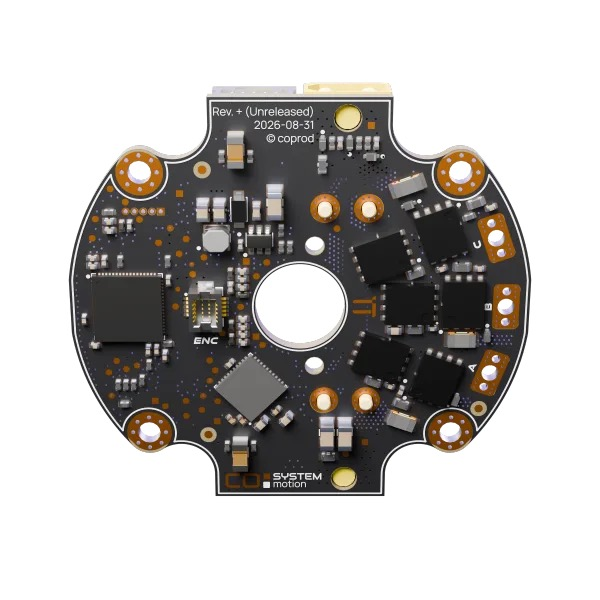
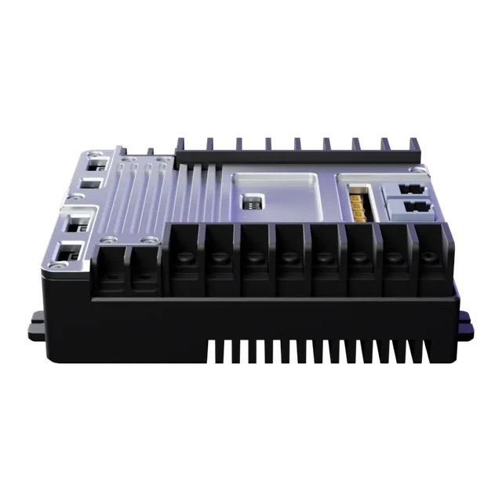
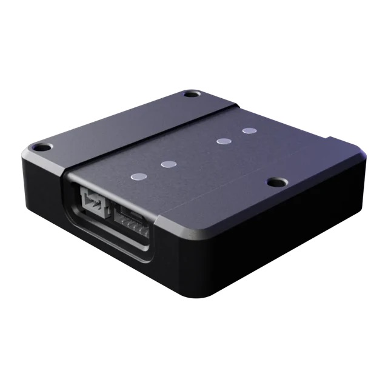
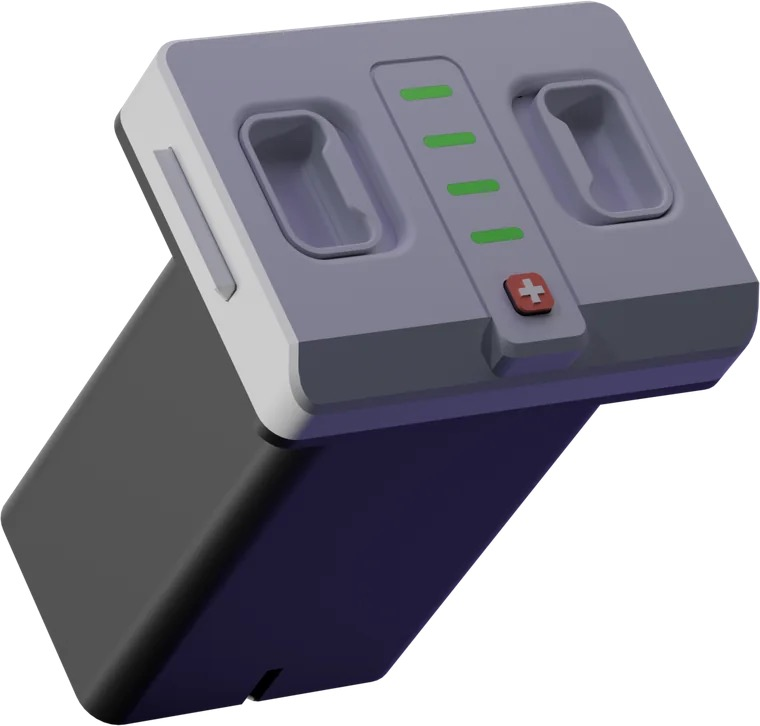
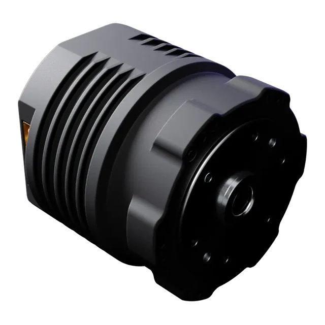

# coprod Inc. × T03 — Products and Solutions

⬆ [coprod Inc. profile](../coprod.md) · [Brief](coprod-T03-1-Brief.md) · [Playbook](coprod-T03-3-Playbook.md)

**Bottom line:** coprod has **no sustainability-specific product, deployment or demo**. For T03 it can only be the low-level motion and power layer of a mechanism you design yourself. Everything below is 🧪 pre-order or earlier; prices are not public; what is physically on site is ⚠️ unverified.

Shared platform numbers (co:system): **EtherCAT 100 Mb/s** · **1 kHz** typical loop · **< 20 µs** jitter · distributed-clock sync · real-time Linux master.

## Relevant products (ranked for this track)

### co:motion

**Role in T03:** the axis driver for any custom mechanism — sorting flap, diverter paddle, conveyor roller, valve or damper, solar-panel tilt, tool spindle.

| Spec | Value |
|---|---|
| Bus | EtherCAT, **1 kHz+**, distributed clocks |
| Control modes | Torque, velocity and position, simultaneously |
| Encoder / feedback inputs | BiSS, SSI, SPI, Hall, incremental |
| Form factors | Several sizes, incl. hollow-shaft (dimensions not public) |
| Voltage / current rating | not public |
| Safety | Controlled braking on e-stop; Safe Torque Off module 🔭 planned |
| IP rating / temperature range | not public |

- **Status:** 🧪 pre-order · **Price:** not public · **Availability on site:** ⚠️ unverified
- **Developer control:** per-axis mode (velocity / position / torque), set-points, and gains (e.g. `kp`) from Python. Grouped axes can be commanded with one call. Whether measured current / torque can be read back is ⚠️ unverified — it matters for energy logging.
- Product page: [coprod.co/products.html#comotion](https://coprod.co/products.html#comotion)

### co:power

**Role in T03:** power distribution for the mechanism, plus the only coprod feature with a resource angle — **per-submodule telemetry on the bus**, usable as a live energy readout for the demo.

| Spec | Value |
|---|---|
| Input voltage | **10–54.6 V** |
| Submodules per motherboard | up to **6** |
| Submodule types | Power logic / e-stop · precharge · galvanically isolated DC/DC regulator · brake chopper |
| Telemetry | Every submodule reports over EtherCAT; the API sample reads regulator **voltage** |
| Current / power measurement | not stated ⚠️ unverified |
| Regenerative energy | Brake chopper "handles" it during deceleration. A chopper normally **dissipates** the energy rather than recovering it — do not claim energy recovery without confirming |

- **Status:** 🧪 pre-order · **Price:** not public
- **Developer control:** read regulator telemetry from Python (`cs.power.get_regulator(id=0).voltage` is the one call shown publicly).
- Product page: [coprod.co/products.html#copower](https://coprod.co/products.html#copower)

### cosystem API

**Role in T03:** the glue between your perception code (camera classifier, sensor logic) and the axis. Python makes it easy to sit next to an OpenCV / ONNX pipeline in one process.

| Item | Value |
|---|---|
| Languages | Python package on a C++ core |
| Publicly shown calls | Scan network · get device by ID · get controller group · set mode · set gain · position and velocity commands · IMU Euler angles · regulator voltage |
| ROS 2 | Claimed in the startup.ch listing only ⚠️ unverified |
| Host requirement | Real-time Linux PC running the EtherCAT master (exact OS / NIC requirements not public) |
| Download / docs | **Not public** — get access from the team on site or via their Discord |

- **Status:** 🧪 preview · **Price:** not public
- **Level of control:** joint-level only. No perception, planning, navigation or manipulation layer.
- Page: [coprod.co](https://coprod.co/)

### co:sense

**Role in T03:** tilt / orientation feedback (e.g. panel angle in a solar tracker, tip-over or vibration detection on a bin or machine). It is an IMU only — **not** an air, water, gas or temperature sensor.

| Spec | Value |
|---|---|
| Sensor | **9-axis, dual-redundant** IMU |
| Fusion | On-board at **1 kHz** |
| Outputs | Quaternion, linear acceleration, angular velocity, magnetic field |
| Size | **30 × 50 mm** |

- **Status:** 🧪 pre-order · **Price:** not public
- Product page: [coprod.co/products.html#cosense](https://coprod.co/products.html#cosense)

### co:battery

**Role in T03:** makes the mechanism untethered for the demo table. Low track relevance beyond that.

| Spec | Value |
|---|---|
| Protection | Over-current, over / under-voltage, short-circuit, temperature |
| Indicators | 4 state-of-charge LEDs |
| Capacity / voltage / runtime | not public (several sizes and voltages on request) |

- **Status:** 🧪 pre-order · **Price:** not public
- Product page: [coprod.co/products.html#cobattery](https://coprod.co/products.html#cobattery)

### co:act

**Role in T03:** a compact backdrivable joint for a torque-sensitive tool (e.g. a torque-limited unscrewing spindle for repair / disassembly). Ranked last because it is not yet released.

| Spec | Value |
|---|---|
| Torque | **10 Nm** continuous / **25 Nm** peak |
| Reduction | **16:1**, quasi-direct drive |
| Size / mass | **60 mm** diameter · **420 g** |
| Feedback | Dual encoder (motor side + output side), hollow shaft |

- **Status:** 🧪 coming soon · **Price:** not public · **On site:** ⚠️ unverified, expect few or none
- Product page: [coprod.co/products.html#coact](https://coprod.co/products.html#coact)

**Not relevant for T03:** co:dodo (biped demo robot, not sold), the co:dodo browser simulator (biped only), co:found (discount programme: **75% off** the first CHF 25,000, then **33% off** up to CHF 100,000 — only matters if you continue after the hackathon).

## What coprod Inc. already does in this domain

**Nothing public.** No waste, recycling, energy, environmental-monitoring, agriculture or building-automation deployment, pilot, demo, partner or application page was found. The official site names no application domains at all.

The only dated public milestones are general:

| Date | Event | Source |
|---|---|---|
| Dec 2025 | First coprod modules run the in-house biped co:dodo (built in about three months of evenings and weekends) | [Venture Kick](https://www.venturekick.ch/coprod-receives-CHF-40000-from-Venture-Kick-to-build-scalable-interoperable-robotics-ecosystem) |
| 2 Apr 2026 | CHF 40,000 from Venture Kick; partnership with an unnamed global component supplier | [Venture Kick](https://www.venturekick.ch/coprod-receives-CHF-40000-from-Venture-Kick-to-build-scalable-interoperable-robotics-ecosystem) |

## What they are building next in this domain

No sustainability-specific plans are announced. General roadmap items that would help a T03 build (all 🔭, no dates):

- **IO board** — time-stamped digital / analog IO on the bus. *Inference:* this is the module that would let environmental sensors (flow, temperature, gas, weight cells) join the same bus; today you must read such sensors separately.
- **EtherCAT junction** — star / branch wiring, useful for spread-out installations.
- **Safe Torque Off module** — needed before any unattended mechanism near people.
- **Tactile sensor**, dual-arm teleop platform, humanoid — not T03-relevant.
- *Inference:* the "reusable, interoperable modules" positioning fits a repair-and-reuse story, but coprod has not made that claim itself.

## Software, models and data that help for this track

| Asset | Useful for T03? |
|---|---|
| cosystem Python API | Yes — the only way to drive the hardware; get it from the team |
| Public GitHub code | None (site link returned 404 on 2026-11-14) |
| Example projects (conveyor, sorter, valve) | None public — ask for the wheel-base style example shown in the home-page code sample |
| Pretrained models / datasets | None |
| co:dodo browser simulator | No (biped locomotion only) |

Bring your own perception: any open waste-classification model or a small custom classifier trained on site, running on a laptop or a D-Robotics board.

## Gaps and limits for this track

- **No perception, no autonomy, no end effector, no mobile base** — coprod covers one layer only.
- **No environmental sensing**; the IO board that would make it easy is still planned.
- **No IP rating, temperature range or outdoor data** — treat everything as indoor bench hardware. Not for snow or wet demos.
- **Energy telemetry depth unknown** — only regulator voltage is shown publicly; current / power per axis is ⚠️ unverified.
- **No public SDK, docs or code** — you depend fully on on-site support.
- **Motors and mechanics are on you** — co:motion is a controller; co:act (the integrated actuator) is not released.
- **Stock** — pre-order stage; number of kits per team unknown.

## Sources
- [coprod — official site (API sample, system specs)](https://coprod.co/)
- [coprod — products and roadmap](https://coprod.co/products.html)
- [coprod — systems](https://coprod.co/systems.html)
- [coprod — co:found programme](https://coprod.co/cofound.html)
- [Venture Kick — coprod receives CHF 40,000 (2 Apr 2026)](https://www.venturekick.ch/coprod-receives-CHF-40000-from-Venture-Kick-to-build-scalable-interoperable-robotics-ecosystem)
- [coprod company profile (internal, general research)](../coprod.md)
