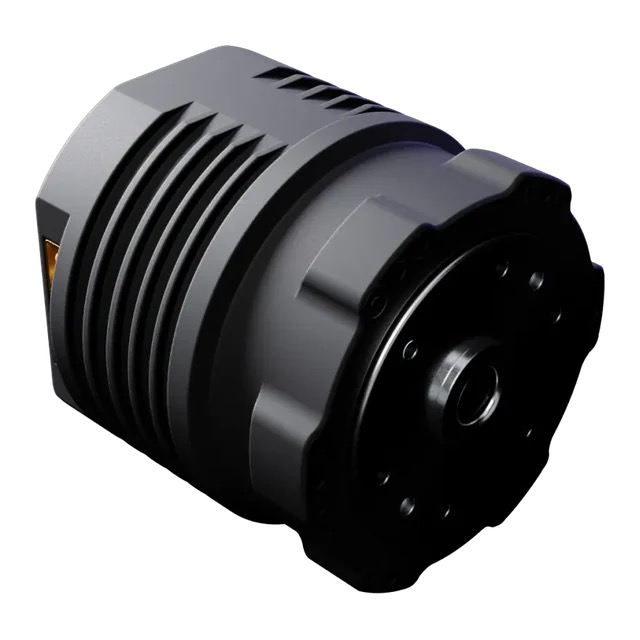
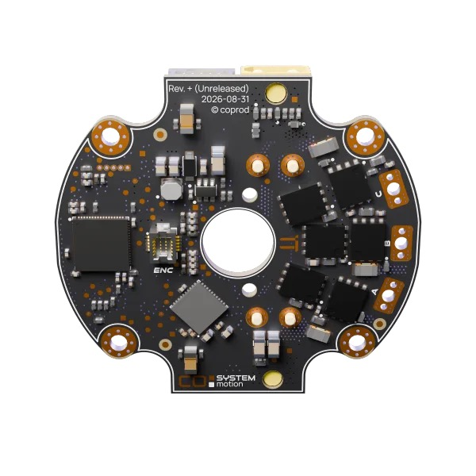
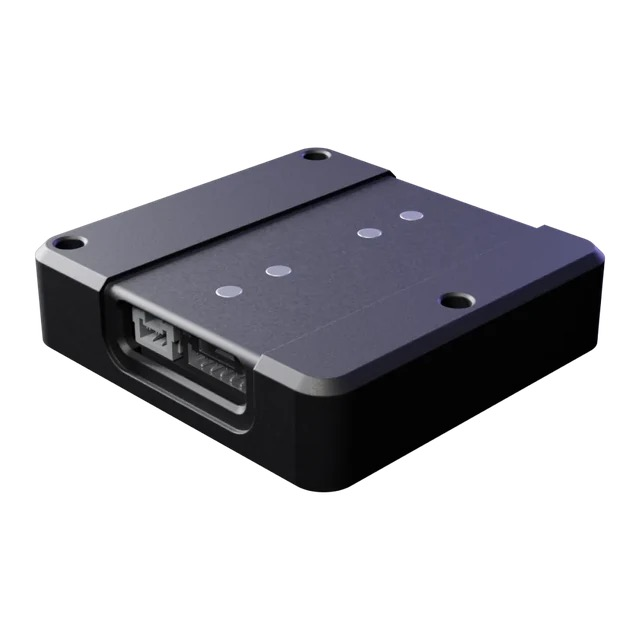
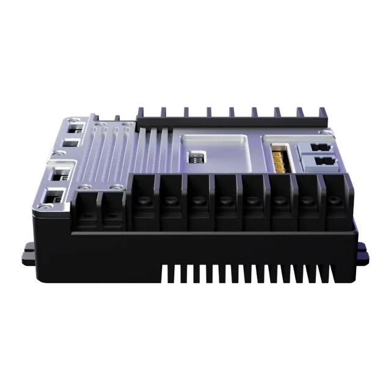
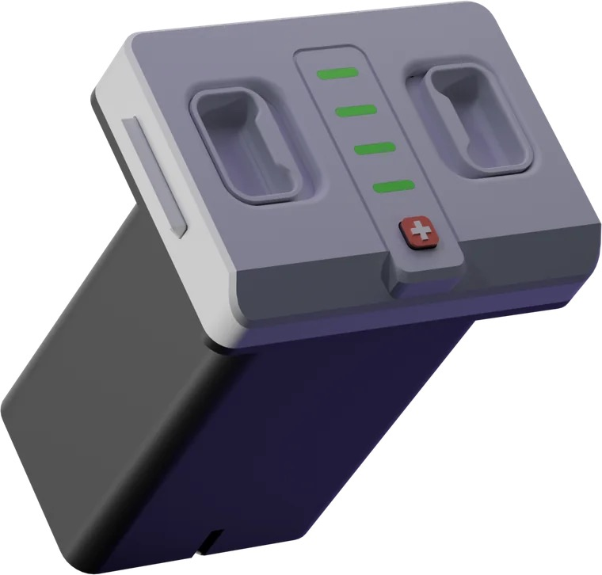

# coprod Inc. × T04 — Products and Solutions

⬆ [coprod Inc. profile](../coprod.md) · [Brief](coprod-T04-1-Brief.md) · [Playbook](coprod-T04-3-Playbook.md)

**Bottom line:** coprod offers **joint-level parts and a control API**, nothing care-specific. For T04 it is useful only if you build a **custom single- or dual-axis device** (exercise trainer, assist joint, powered rollator). Everything below is 🧪 pre-order or coming soon; **what is physically on site is not confirmed** — check at the booth first.

Research note: the official site, the Venture Kick article and the company profile were used. A wider web search was not possible in this run (search budget exhausted), so "nothing found" means "nothing on those sources".

## Relevant products (ranked for this track)

### co:act

**Role in T04:** the actuated joint of a rehab or assist device — resist, assist or guide a limb movement.

| Spec | Value |
|---|---|
| Torque | **10 Nm** continuous / **25 Nm** peak |
| Drive | Quasi-direct drive, **16:1**, hollow shaft |
| Sensing | Dual encoder (motor side + output side) |
| Control modes | Torque, velocity and position simultaneously |
| Size / mass | **60 mm** diameter / **420 g** |
| Bus | EtherCAT, **1 kHz** loop |
| Backdrivability, torque sensor, supply voltage, IP rating | not public (a 16:1 quasi-direct drive is normally easy to backdrive — inference) |

- **Status:** 🧪 coming soon · **Price:** not public · **On site:** ⚠️ unverified, likely few or none.
- **Developer control:** per-axis mode, gains and torque / velocity / position setpoints via `cosystem`. Whether measured torque / current can be read back is not public.
- **Sizing (inference):** suits wrist, forearm, light elbow or a hand crank. Not sized for hips, knees or lifting a person.

### co:motion

**Role in T04:** the realistic route if co:act is not available — a controller board that turns a third-party motor into a torque-controlled axis (rehab handle, rollator wheel).

| Spec | Value |
|---|---|
| Bus | EtherCAT, **1 kHz+**, distributed-clock sync |
| Control modes | Torque, velocity and position simultaneously |
| Feedback inputs | BiSS, SSI, SPI, Hall, incremental (on- or off-axis) |
| Safety | Controlled braking for emergency stop; **Safe Torque Off module not yet available** |
| Form factor | Several sizes, hollow-shaft options |
| Current / voltage rating | not public |

- **Status:** 🧪 pre-order · **Price:** not public.
- **Developer control:** `cs.motion.get_controllers(...)`, set `.mode` (e.g. `MotionMode.VELOCITY`), set gains (`.kp`), send commands (`control_vel([...])`) — as shown in the home-page sample.

### co:sense

**Role in T04:** tilt, sway and impact sensing — slope detection on a rollator, tip-over / fall event detection, limb-segment angle on a rehab rig.

| Spec | Value |
|---|---|
| Sensor | **9-axis**, dual-redundant |
| Fusion | On board at **1 kHz** |
| Outputs | Quaternion, linear acceleration, angular velocity, magnetic field |
| Size | **30 × 50 mm** |
| Link | EtherCAT (wired) — not a wireless wearable |

- **Status:** 🧪 pre-order · **Price:** not public.
- **Developer control:** read orientation (`.euler` in the sample) and raw channels from Python.

### co:power

**Role in T04:** the safety and power backbone of anything a person touches — e-stop handling, soft start, brake chopper for energy when the user backdrives the motor.

| Spec | Value |
|---|---|
| Input | **10–54.6 V** |
| Submodules | Up to **6**: power logic (supervisor, e-stop, bus-off handling), precharge, isolated DC/DC regulator, brake chopper |
| Telemetry | Voltage etc. over EtherCAT |

- **Status:** 🧪 pre-order · **Price:** not public.
- **Developer control:** telemetry readout, e.g. `cs.power.get_regulator(id=0).voltage`.

### co:battery

**Role in T04:** needed only for an untethered device (powered rollator, mobile aid).

| Spec | Value |
|---|---|
| Protection | Over-current, over / under-voltage, short-circuit, temperature |
| UI | 4 state-of-charge LEDs, latching interface |
| Capacity / voltage / runtime | not public (sizes on request) |

- **Status:** 🧪 pre-order · **Price:** not public.

### cosystem API

**Role in T04:** the only software layer — you write the therapy logic yourself on top of it.

| Item | Value |
|---|---|
| Language | Python package with C++ core |
| Functions shown | Bus scan, device handles, motion modes and gains, velocity commands, IMU and power readout |
| Timing | **1 kHz** typical, **< 20 µs** jitter, real-time Linux host |
| ROS 2 | ⚠️ unverified (claimed in a third-party listing only) |

- **Status:** 🧪 preview, not publicly downloadable — access must come from the team on site.

**Not relevant for T04:** [co:dodo](https://coprod.co/systems.html) (in-house 6-DoF point-foot biped, not sold) and its [browser simulator](https://coprod.co/simulator/) — a walking demo, no care use. [co:found](https://coprod.co/cofound.html) is a start-up discount programme, useful only after the hackathon.

## What coprod Inc. already does in this domain

**Nothing public.** No deployment, pilot, demo, partner or application page for elderly care, rehabilitation, exoskeletons or medical devices.

| Date | What | Relevance to T04 |
|---|---|---|
| Dec 2025 | First modules integrated into the in-house biped co:dodo; first motion ([Venture Kick](https://www.venturekick.ch/coprod-receives-CHF-40000-from-Venture-Kick-to-build-scalable-interoperable-robotics-ecosystem)) | Shows the 1 kHz torque-control stack runs on real hardware — nothing more |
| 2 Apr 2026 | CHF 40,000 Venture Kick; partnership with an unnamed global component supplier | None specific |

The official product, systems and home pages do not mention healthcare, rehab, assistive or wearable use at all.

## What they are building next in this domain

No care or rehab plans are announced. Roadmap items with indirect relevance (no dates):

| Item | Status | Why it could matter for T04 |
|---|---|---|
| Safe Torque Off module | 🔭 planned | Prerequisite for any device that moves a human limb outside a demo |
| Tactile sensor array | 🔭 planned | Contact sensing for gentle handling |
| IO board (digital / analog, time-stamped) | 🔭 planned | Grip switches, load cells, buttons on an aid |
| Dual-arm teleoperation platform with tactile end effectors | 🔭 planned | Closest link to tele-care / tele-rehab — **inference**, coprod does not state this use |
| More co:act sizes | 🔭 planned | Larger joints would open elbow / knee class devices (inference) |

## Software, models and data that help for this track

- **From coprod:** only the `cosystem` API (preview). No rehab library, no impedance-control examples published, no models, no datasets, no public repo (the GitHub link on the site was dead on 2026-11-14 per the company profile). The battery page mentions "open-source examples" for the latching interface, but no public location was found.
- **You must bring yourself:** therapy state machine, virtual spring / damper control, UI, logging, any perception.
- **Generic open tools that fit (not coprod-specific):** MuJoCo for a quick one-joint simulation, a Python dashboard framework for the therapist view, MediaPipe-style pose estimation if you add a camera.

## Gaps and limits for this track

- **No finished robot** — no arm, base, gripper, camera, speech or AI stack.
- **Availability** — all hardware pre-order / coming soon; kit count on site unknown.
- **Safety** — no STO yet, no medical or collaborative-robot certification, no public IP rating. Demo on healthy volunteers or a dummy limb only, with software torque caps and mechanical end stops.
- **Torque class** — 10 Nm continuous: small-joint exercise and light assist only.
- **Wired bus** — co:sense is an EtherCAT node, not a body-worn wireless sensor.
- **Docs** — no public documentation; you depend on the founders being at your table.
- **Host requirements** — real-time Linux EtherCAT master; supported PCs / boards not public.

## Sources
- [coprod — official site (API sample, system specs)](https://coprod.co/)
- [coprod — products and roadmap](https://coprod.co/products.html)
- [coprod — systems (co:dodo, planned systems)](https://coprod.co/systems.html)
- [coprod — co:dodo simulator](https://coprod.co/simulator/)
- [coprod — co:found (details via company profile, not re-fetched)](https://coprod.co/cofound.html)
- [Venture Kick — coprod receives CHF 40,000 (2 Apr 2026)](https://www.venturekick.ch/coprod-receives-CHF-40000-from-Venture-Kick-to-build-scalable-interoperable-robotics-ecosystem)
- [coprod Inc. company profile (internal)](../coprod.md)
