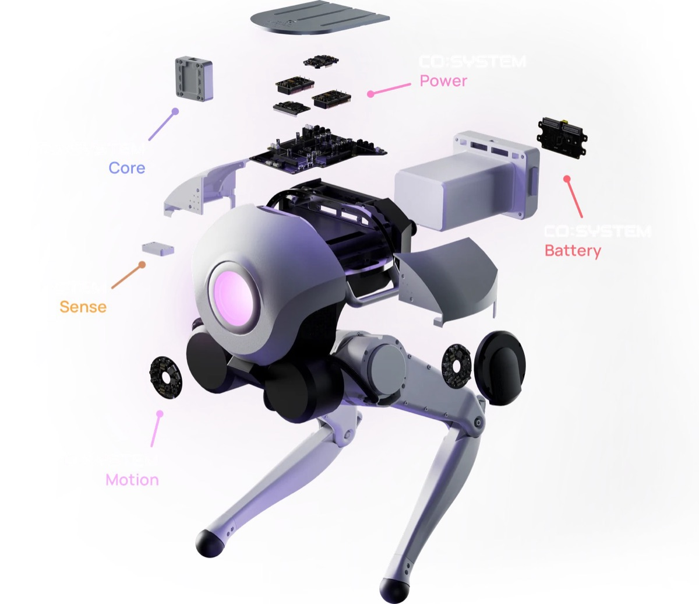
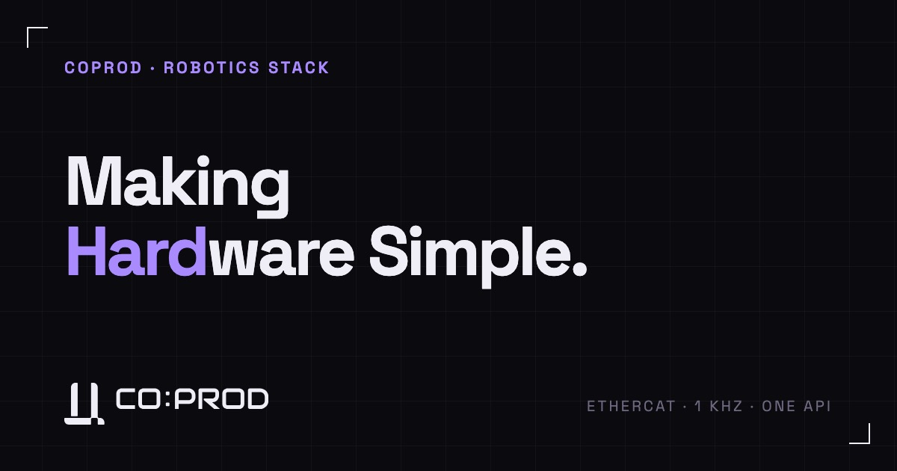

# coprod Inc. — Papers and Research

⬆ [coprod Inc. profile](coprod.md) · [Solutions and projects](coprod-Solutions-and-Projects.md) · [Developer guide](coprod-Developer-Guide.md)

> **Bottom line:** coprod has published **no paper, preprint, dataset, benchmark or white paper**. It is an engineering-first start-up (founded July 2024, three founders). What exists publicly is a browser simulator, a handful of GitHub forks with small in-house changes, and one original KiCad tool. This page lists exactly that, plus the **verified background papers behind the open tools coprod visibly builds on** — clearly separated, because none of them is coprod's own work.

## Research footprint

- **Not a research-publishing company.** Zero company-authored papers found. The blog is titled "engineering & research" but shows "nothing published yet" (checked 2026-11-14). No "research" or "technology" page exists on the site (sitemap has 9 pages, none of them research).
- **Roots are a student robotics team, not a university lab.** Public GitHub profiles of the founders tie them to **EPFL Xplore** (EPFL's student rover / robotics association): the CEO's account holds a wooden prototype of the **Argos rover (EPFL Xplore 2021)** and EPFL course repos; the CTO's account holds **ΛMULET**, a brushless motor controller "designed to be integrated in EPFL Xplore's Legged Robot actuators". This matches the company's own line about 4+ years building "rovers, arms, dogs". There is **no evidence of a spin-off from an EPFL or ETH research lab**, and no professor or lab is named anywhere.
- **Key people:** Loïc Delineau (CEO), Vincent Nguyen (CTO), Matthias Schuller (Chief Scientist). An arXiv author lookup for "Delineau" and for "Matthias Schuller" returned **0 papers**; "Vincent Nguyen" is too common a name to attribute anything safely ⚠️ unverified.
- **Open-source posture:** "built in the open" is the stated intent, but the core stack (`cosystem` API, firmware, robot model, training code) is **not released**. Public output = forks of mainstream tools (`rsl_rl`, `lerobot`, `SOES`, `modm`, `FreeRTOS-Cpp`, `tinycrypt`) with a few in-house commits, one original MIT tool, and a browser simulator.
- **How this page was researched:** one web search was available and returned nothing relevant to coprod. Everything else comes from direct reads of coprod.co, the `coprod-Inc` GitHub organisation (repos, branches, commit lists), the simulator bundle, Venture Kick, startup.ch and arXiv / Crossref records. LinkedIn, X, YouTube and Discord content was **not** checked.

## Company-authored and company-affiliated papers

**None found.** No arXiv preprint, conference paper, journal article, thesis or technical report by coprod, its founders (under their coprod affiliation) or an affiliated lab could be located.

| Paper (title as a link) | Authors / organisation | Venue, year | What it contributes (one line) | Artifacts (code / weights / data links) | Tracks |
|---|---|---|---|---|---|
| — none — | — | — | — | — | — |

What was checked, so you can judge the strength of "none":

| Where | Result |
|---|---|
| coprod.co — all 9 pages in the sitemap, scanned for paper / arXiv / thesis / citation / dataset / patent | No paper, no citation block, no project page. Only hits: "Interns & master thesis welcome" on the jobs page |
| [coprod.co/blog](https://coprod.co/blog/) | Empty ("nothing published yet") |
| GitHub org `coprod-Inc` — 9 repos, READMEs and branches | No paper links of their own; only upstream citation blocks inherited from forks |
| co:dodo simulator JavaScript bundle | No paper, method or library credit for the policy; only standard web-3D library metadata |
| arXiv catalogue — author "Delineau", author "Matthias Schuller", terms "co:dodo", "cosystem" + EtherCAT | 0 relevant records |
| Venture Kick interview (2 Apr 2026), startup.ch listing | No research references |
| One general web search (names + coprod + biped + EtherCAT) | Only unrelated biped papers |

Not checked (could hold something): Google Scholar, EPFL Infoscience (student theses), LinkedIn posts, the co:dodo YouTube film description. Ask the founders directly — a master-thesis or semester-project report behind co:dodo or ΛMULET is plausible ⚠️ unverified.

## Datasets, models and benchmarks released

No dataset, no benchmark, no formally released model. The table lists every public technical artifact that does exist.

| Name | Type | Licence | Link | Useful for |
|---|---|---|---|---|
| **co:dodo browser simulator** ✅ | Interactive demo: MuJoCo physics compiled to WebAssembly, ONNX policy at **50 Hz**, 6 joints (`LHAA`, `LHFE`, `LKFE`, `RHAA`, `RHFE`, `RKFE`) | No licence stated | [coprod.co/simulator](https://coprod.co/simulator/) | Zero-install biped demo for a pitch; shows the claimed "same policies as the real robot" |
| **co:dodo walking policy** (`encoder.onnx` + `policy.onnx`) 🧪 | Locomotion policy files loaded by the simulator from its `policies/` folder; **not** announced as a release | No licence stated — ask before reuse | served by the [simulator](https://coprod.co/simulator/) | Evidence of an encoder-plus-actor architecture; not usable outside the demo without permission and the robot model |
| **`rsl_rl` fork, branch `history-encoder`** 🧪 | RL training library fork; `main` is unmodified upstream, the branch carries **1 in-house commit** ("added encoder", 6 Sep 2025, by the Chief Scientist's account) | Upstream licence file (no change) | [github.com/coprod-Inc/rsl_rl](https://github.com/coprod-Inc/rsl_rl) | Shows how the co:dodo policy was most likely trained (PPO in `rsl_rl` with an observation-history encoder — inference) |
| **`lerobot` fork** 🧪 | Imitation-learning stack fork, **6 in-house commits** (Apr 2025): udev-rule scripts, serial numbers, a Python file to deploy a model on an **SO-100** arm | Apache-2.0 (upstream) | [github.com/coprod-Inc/lerobot](https://github.com/coprod-Inc/lerobot) | Proof the team has run LeRobot on low-cost arms; no co:system driver in it |
| **`SOES` fork** ✅ | EtherCAT slave stack fork, **9 commits ahead** of upstream (May–Nov 2026): File-over-EtherCAT read / write hardening, abort hooks for failed CoE downloads, weak default PDO buffers | Upstream SOES licence file | [github.com/coprod-Inc/SOES](https://github.com/coprod-Inc/SOES) | Only public view into coprod's firmware work; relevant if you build your own EtherCAT device |
| **`kicad_project_manager`** ✅ | Original tool: KiCad 9 / 10 plugin for project templates, design rules and stack-ups, **v1.1.0** (23 Oct 2026) | MIT | [github.com/coprod-Inc/kicad_project_manager](https://github.com/coprod-Inc/kicad_project_manager) | PCB designers only; irrelevant for a 48-hour robot build |
| `modm`, `FreeRTOS-Cpp`, `tinycrypt` forks | Firmware dependencies (embedded C++ HAL, RTOS wrapper, small crypto library); in-house changes not inspected | MPL-2.0 / MIT / upstream | [github.com/coprod-Inc](https://github.com/coprod-Inc) | Hints at the firmware toolchain; nothing to build on |
| `robolitude` | Placeholder repo, description "Social Robotics", one initial commit (25 Nov 2025) | MIT | [github.com/coprod-Inc/robolitude](https://github.com/coprod-Inc/robolitude) | Nothing yet |

Not released: `cosystem` SDK, firmware, co:dodo MJCF / URDF, training environment, actuator models, any test data (the blog promises "numbers with units" but has none).

## Third-party papers using their hardware or software

**None found — and none should be expected.** co:motion, co:power, co:sense and co:battery are still pre-order, co:act is "coming soon", the SDK is not downloadable and no customer is named. No external lab can have published on this hardware yet.

| Paper (link) | Authors / organisation | Venue, year | Hardware / software used | What it shows | Tracks |
|---|---|---|---|---|---|
| — none — | — | — | — | — | — |

### Background papers behind the tools and design choices coprod builds on (NOT coprod work, NOT using coprod hardware)

Every paper below was opened and checked (arXiv record, Crossref DOI record or the official repository's citation block). The "Link to coprod" column states the evidence; anything beyond that evidence is marked as inference.

| Paper (link) | Authors / organisation | Venue, year | Link to coprod (evidence) | What it gives you | Tracks |
|---|---|---|---|---|---|
| [LeRobot: An Open-Source Library for End-to-End Robot Learning](https://arxiv.org/abs/2602.22818) | R. Cadene, S. Alibert, F. Capuano, M. Aractingi, A. Zouitine et al. (Hugging Face) | ICLR 2026 (arXiv Feb 2026) | coprod keeps a `lerobot` fork with SO-100 deployment commits | The library paper: data format, teleop recording, policy training and deployment on low-cost arms | T01 T04 |
| [Robot Learning: A Tutorial](https://arxiv.org/abs/2510.12403) | F. Capuano, C. Pascal, A. Zouitine, T. Wolf, M. Aractingi (Hugging Face) | arXiv, Oct 2025 | Same LeRobot fork | Step-by-step teaching text for imitation and reinforcement learning with LeRobot | T01 T04 |
| [RSL-RL: A Learning Library for Robotics Research](https://arxiv.org/abs/2509.10771) | C. Schwarke, M. Mittal, N. Rudin, D. Hoeller, M. Hutter (ETH Zurich RSL) | arXiv, Sep 2025 | coprod keeps an `rsl_rl` fork with a `history-encoder` branch | Reference for the GPU PPO / distillation library most likely used to train co:dodo (inference) | T02 |
| [Learning Fine-Grained Bimanual Manipulation with Low-Cost Hardware](https://arxiv.org/abs/2304.13705) | T. Z. Zhao, V. Kumar, S. Levine, C. Finn | arXiv Apr 2023 (RSS 2023) | Roadmap: planned dual-arm teleoperation platform; LeRobot fork ships this policy class (ACT) | Leader-follower teleop + action-chunking transformer; the template for a dual-arm data-collection rig | T01 T04 |
| [Learning to Walk in Minutes Using Massively Parallel Deep Reinforcement Learning](https://arxiv.org/abs/2109.11978) | N. Rudin, D. Hoeller, P. Reist, M. Hutter (ETH Zurich RSL, NVIDIA) | CoRL 2021 | Origin paper of the `rsl_rl` training pipeline; co:dodo joint names follow the same HAA / HFE / KFE convention | Rough-terrain locomotion policy trained in minutes with terrain curriculum | T02 |
| [RMA: Rapid Motor Adaptation for Legged Robots](https://arxiv.org/abs/2107.04034) | A. Kumar, Z. Fu, D. Pathak, J. Malik | RSS 2021 | Representative of the "history encoder + policy" family; the simulator loads exactly such a pair. Which method coprod follows is **not stated** — inference | How an encoder over recent observations lets a walking policy adapt to unknown terrain and payload | T02 |
| [An Open Torque-Controlled Modular Robot Architecture for Legged Locomotion Research](https://arxiv.org/abs/1910.00093) | F. Grimminger, A. Meduri, M. Khadiv, … L. Righetti (MPI-IS, NYU) | IEEE RA-L 5(2), 2020 | Closest academic analogue to coprod's idea: low-cost modular torque-controlled actuator modules assembled into legged robots. No stated link | Design and validation of a modular brushless actuator and a robot built from it; good benchmark questions for co:act | T02 |
| [Quasi-Direct Drive Actuation for a Lightweight Hip Exoskeleton with High Backdrivability and High Bandwidth](https://arxiv.org/abs/2004.00467) | S. Yu, T.-H. Huang, X. Yang, C. Jiao, J. Yang, Y. Chen, J. Yi, H. Su | IEEE/ASME Trans. Mechatronics 25(4), 2020 | Same actuator class as **co:act** (quasi-direct drive, low ratio). No stated link | Shows why a low-ratio backdrivable actuator suits wearable assistance, with torque-control results on a hip exoskeleton | T04 |
| [Proprioceptive Actuator Design in the MIT Cheetah: Impact Mitigation and High-Bandwidth Physical Interaction for Dynamic Legged Robots](https://doi.org/10.1109/TRO.2016.2640183) | P. M. Wensing, A. Wang, S. Seok, D. Otten, J. Lang, S. Kim (MIT) | IEEE Trans. Robotics 33(3), 2017 | Foundational paper for the quasi-direct-drive class that co:act belongs to. No stated link | Theory for sizing motor and gear ratio for torque transparency and safe contact | T02 T04 |
| [Design Principles for Energy-Efficient Legged Locomotion and Implementation on the MIT Cheetah Robot](https://doi.org/10.1109/TMECH.2014.2339013) | S. Seok, A. Wang, M. Y. Chuah, D. J. Hyun, J. Lee, D. M. Otten, J. H. Lang, S. Kim (MIT) | IEEE/ASME Trans. Mechatronics 20(3), 2015 | Same actuator class; relates to co:power's brake-chopper / energy telemetry. No stated link | Where actuator energy goes and how low-ratio drives recover it through regeneration | T03 |
| [MuJoCo: A physics engine for model-based control](https://github.com/google-deepmind/mujoco#citation) | E. Todorov, T. Erez, Y. Tassa | IEEE/RSJ IROS 2012, pp. 5026–5033 (DOI 10.1109/IROS.2012.6386109, taken from the official repository's citation block) | The co:dodo simulator runs MuJoCo in WebAssembly | The physics engine under the simulator | — |

## Reading list by track

No coprod paper exists for any track. The lists below are **background reading only**, picked for a 48-hour build that uses a co:system axis as one part of a larger system.

### T01 Autonomous Urban Services

No directly relevant paper found from coprod. Closest useful background:

- [LeRobot library paper](https://arxiv.org/abs/2602.22818) — fastest route to a learned manipulation skill for a service robot (T01.3, T01.7); coprod's own team has used it on SO-100 arms.
- [Robot Learning: A Tutorial](https://arxiv.org/abs/2510.12403) — read the imitation-learning chapters before recording your first demonstrations.
- [ACT / low-cost bimanual manipulation](https://arxiv.org/abs/2304.13705) — how many demonstrations and which action representation you need for a hand-over or dispensing task (T01.1, T01.3).

For T01.6 navigation and path planning coprod offers nothing; use another vendor's stack and papers.

### T02 Resilient & Safe City

No directly relevant paper found from coprod. Closest useful background:

- [Learning to Walk in Minutes](https://arxiv.org/abs/2109.11978) — terrain curriculum for rough-ground locomotion (T02.6); the pipeline behind the library coprod forked.
- [RMA](https://arxiv.org/abs/2107.04034) — history-encoder adaptation to slopes, payload and slippery ground (T02.6); explains the encoder + policy pair you see in the co:dodo simulator.
- [RSL-RL](https://arxiv.org/abs/2509.10771) — practical reference if you retrain any legged policy on site.
- [Open torque-controlled modular architecture](https://arxiv.org/abs/1910.00093) — test protocol ideas (impact, torque tracking) for a rugged custom mechanism built from actuator modules.
- [Proprioceptive actuator design](https://doi.org/10.1109/TRO.2016.2640183) — impact mitigation, useful when an actuated tool or mast must survive knocks (T02.2, T02.3).

### T03 Sustainable City

- [Design Principles for Energy-Efficient Legged Locomotion](https://doi.org/10.1109/TMECH.2014.2339013) — the one relevant item: an energy-loss breakdown and regeneration argument for low-ratio drives (T03.3). Pair it with co:power's on-bus voltage / power telemetry to measure and plot energy per motion cycle.

Otherwise: no directly relevant paper found (nothing on waste sorting, recycling, water or environmental monitoring).

### T04 Elderly Care & Rehabilitation

No directly relevant paper found from coprod. Closest useful background:

- [Quasi-direct-drive hip exoskeleton](https://arxiv.org/abs/2004.00467) — the best single reference for a backdrivable torque-controlled assist joint (T04.3, T04.4); same actuator class as co:act.
- [Proprioceptive actuator design](https://doi.org/10.1109/TRO.2016.2640183) — why low gear ratio gives safe, transparent contact with a person; use it to justify torque caps in your demo.
- [ACT / low-cost bimanual manipulation](https://arxiv.org/abs/2304.13705) and the [LeRobot paper](https://arxiv.org/abs/2602.22818) — if your concept is a tele-operated or learned daily-living assistance task (T04.1, T04.6).

Reminder from the [developer guide](coprod-Developer-Guide.md): coprod has **no Safe Torque Off module and no safety certification**; demonstrate on a dummy limb.

## White papers, patents and technical reports

- **White papers / technical reports:** none published.
- **Patents:** none found in the sources read; patent databases were not searched ⚠️ unverified.
- **Trademark hint:** Venture Kick's interview writes "coproducts®" with a registered-mark sign; registration itself not checked ⚠️ unverified.
- **Founders' earlier open designs (personal accounts, pre-company, not coprod products):**
  - [ΛMULET motion controller](https://github.com/nguyen-v/amulet_controller_kibot) — CTO's open brushless motor controller for EPFL Xplore legged-robot actuators: **12–44 V**, **100 A** peak phase current, CAN-FD, STM32G474, moteus-firmware compatible. A plausible ancestor of co:motion (inference).
  - [Microver](https://github.com/loicdelineau/microver) — CEO's 2023 "modular robotics platform for learning", CERN-OHL-S hardware licence. Early statement of the modular idea (inference).
  - [omni_wheel_controller](https://github.com/nguyen-v/omni_wheel_controller) — a `ros2_control` omni-wheel controller package on the CTO's account (appears to be a copy of a community package; provenance not checked ⚠️ unverified). Shows ROS 2 familiarity, relevant to the unconfirmed ROS 2 support.

## Sources

- [coprod — home page](https://coprod.co/)
- [coprod — products](https://coprod.co/products)
- [coprod — systems](https://coprod.co/systems)
- [coprod — jobs](https://coprod.co/jobs)
- [coprod — community](https://coprod.co/community)
- [coprod — blog (empty)](https://coprod.co/blog/)
- [coprod — co:dodo simulator](https://coprod.co/simulator/)
- [coprod — sitemap](https://coprod.co/sitemap.xml)
- [GitHub — coprod-Inc organisation](https://github.com/coprod-Inc)
- [GitHub — coprod-Inc/rsl_rl (branches, commit list)](https://github.com/coprod-Inc/rsl_rl)
- [GitHub — coprod-Inc/lerobot (commit list)](https://github.com/coprod-Inc/lerobot)
- [GitHub — coprod-Inc/SOES (commit list)](https://github.com/coprod-Inc/SOES)
- [GitHub — coprod-Inc/kicad_project_manager](https://github.com/coprod-Inc/kicad_project_manager)
- [GitHub — coprod-Inc/robolitude](https://github.com/coprod-Inc/robolitude)
- [GitHub — Loïc Delineau (public profile and repos)](https://github.com/loicdelineau)
- [GitHub — Vincent Nguyen (public profile)](https://github.com/nguyen-v)
- [GitHub — nguyen-v/amulet_controller_kibot](https://github.com/nguyen-v/amulet_controller_kibot)
- [GitHub — nguyen-v/omni_wheel_controller](https://github.com/nguyen-v/omni_wheel_controller)
- [GitHub — loicdelineau/microver](https://github.com/loicdelineau/microver)
- [GitHub — Matthias Schuller (public profile)](https://github.com/maschull106)
- [Venture Kick — coprod receives CHF 40,000 (2 Apr 2026)](https://www.venturekick.ch/coprod-receives-CHF-40000-from-Venture-Kick-to-build-scalable-interoperable-robotics-ecosystem)
- [startup.ch — coprod listing](https://www.startup.ch/coprod)
- [GitHub — leggedrobotics/rsl_rl README (citation block)](https://github.com/leggedrobotics/rsl_rl)
- [GitHub — huggingface/lerobot README (citation block)](https://github.com/huggingface/lerobot)
- [GitHub — google-deepmind/mujoco README (citation block)](https://github.com/google-deepmind/mujoco#citation)
- [arXiv 2602.22818 — LeRobot](https://arxiv.org/abs/2602.22818)
- [arXiv 2510.12403 — Robot Learning: A Tutorial](https://arxiv.org/abs/2510.12403)
- [arXiv 2509.10771 — RSL-RL](https://arxiv.org/abs/2509.10771)
- [arXiv 2304.13705 — Learning Fine-Grained Bimanual Manipulation with Low-Cost Hardware](https://arxiv.org/abs/2304.13705)
- [arXiv 2109.11978 — Learning to Walk in Minutes](https://arxiv.org/abs/2109.11978)
- [arXiv 2107.04034 — RMA](https://arxiv.org/abs/2107.04034)
- [arXiv 1910.00093 — Open Torque-Controlled Modular Robot Architecture](https://arxiv.org/abs/1910.00093)
- [arXiv 2004.00467 — Quasi-Direct Drive Actuation for a Lightweight Hip Exoskeleton](https://arxiv.org/abs/2004.00467)
- [DOI 10.1109/TRO.2016.2640183 — Proprioceptive Actuator Design in the MIT Cheetah](https://doi.org/10.1109/TRO.2016.2640183)
- [DOI 10.1109/TMECH.2014.2339013 — Design Principles for Energy-Efficient Legged Locomotion](https://doi.org/10.1109/TMECH.2014.2339013)
