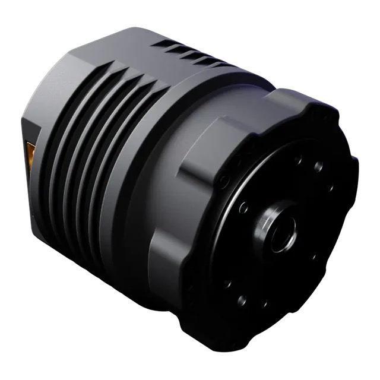
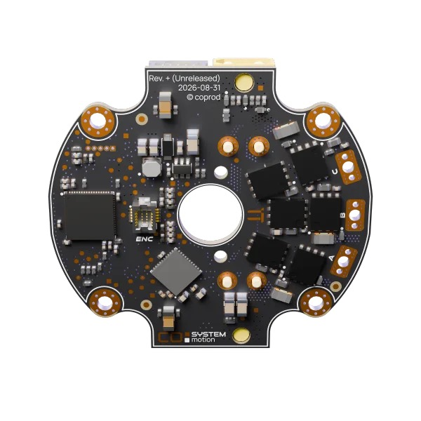
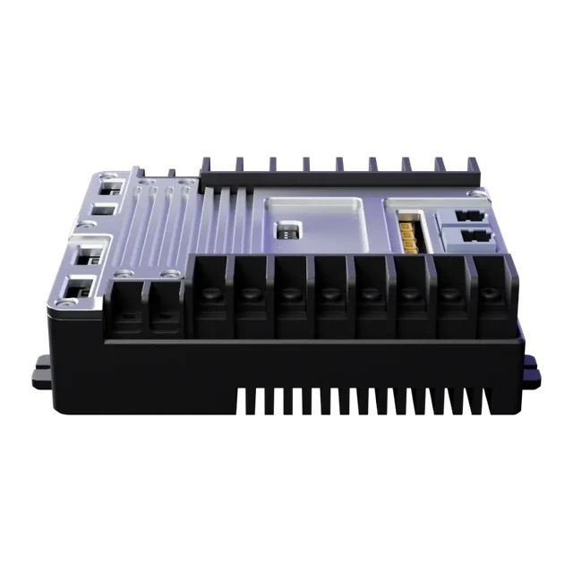
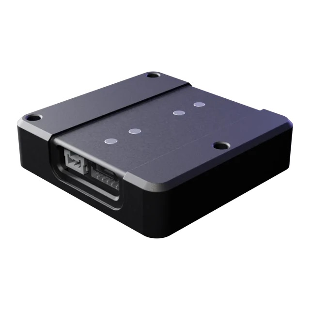
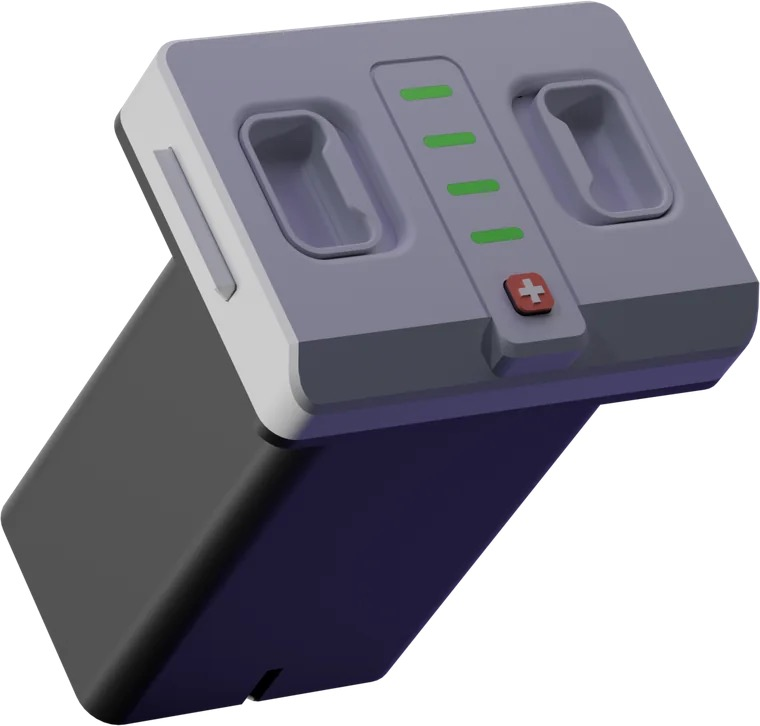
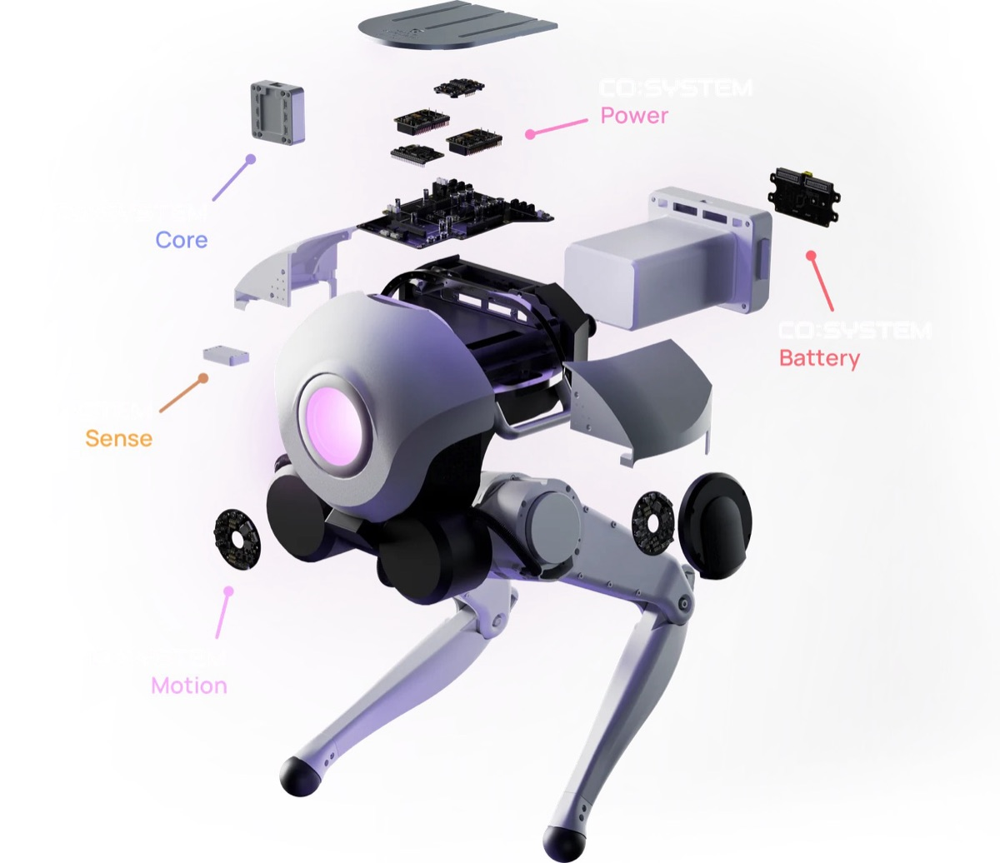
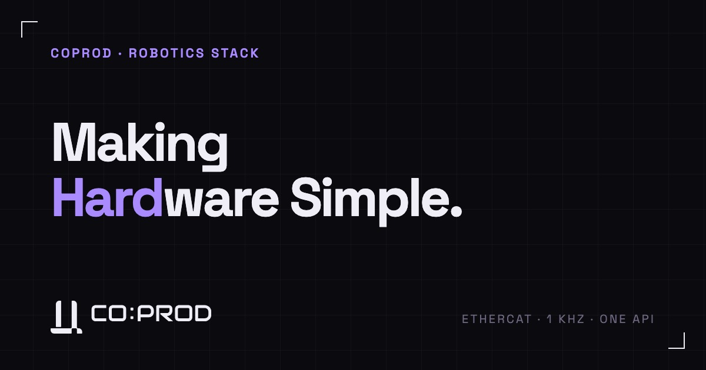

# coprod Inc. — Product Portfolio

⬆ [coprod Inc. profile](coprod.md) · [Developer guide](coprod-Developer-Guide.md) · [Roadmap and strategy](coprod-Roadmap-and-Strategy.md)

> **Decide in 30 seconds:** coprod sells **robot building blocks, not robots**. Everything is one platform, **co:system**: EtherCAT modules (actuator, motor controller, power, IMU, battery) under one Python / C++ API. Pick it only if your idea needs a **custom actuated mechanism** with deterministic **1 kHz** torque / velocity / position control, and only after confirming at the booth how many kits exist. All hardware is **pre-order or coming soon**; **no prices, no public SDK download, no public docs**.

**Platform numbers shared by every module** (official site): EtherCAT at **100 Mb/s** · **1 kHz** typical loop · jitter **< 20 µs** · distributed clocks with hardware time-stamping · real-time Linux master on a host PC you supply.

## Lineup map

Track relevance: ● strong · ◐ partial · ○ none. Status: ✅ shipping/available · 🧪 announced/preview · 🔭 roadmap/concept.

| Product | Category | Status | Launched | Price (if public) | Positioning (one line) | T01 | T02 | T03 | T04 |
|---|---|---|---|---|---|---|---|---|---|
| **co:act** | Integrated actuator | 🧪 coming soon | not public | not public | Quasi-direct-drive joint, controller inside, one EtherCAT node | ◐ | ◐ | ○ | ● |
| **co:motion** | Motion controller board | 🧪 pre-order | not public | not public | Drives your own motor with 1 kHz+ torque / velocity / position control | ● | ◐ | ◐ | ◐ |
| **co:power** | Power distribution module | 🧪 pre-order | not public | not public | Configurable power backplane with e-stop logic and bus telemetry | ◐ | ◐ | ◐ | ○ |
| **co:sense** | IMU / AHRS module | 🧪 pre-order | not public | not public | Dual-redundant 9-axis orientation sensor, time-synced with the motors | ◐ | ◐ | ○ | ◐ |
| **co:battery** | Battery pack | 🧪 pre-order | not public | not public | Protected pack with latch interface for mobile builds | ◐ | ◐ | ○ | ○ |
| **cosystem API** | Software (Python on C++ core) | 🧪 preview, not downloadable | not public | not public | One API for every device on the bus | ◐ | ◐ | ◐ | ◐ |
| **co:dodo** | Reference biped (not sold) | 🧪 in-house demo | first motion Dec 2025 | not for sale | Proof that the stack can walk; showpiece, not a dev platform | ○ | ○ | ○ | ○ |
| **co:dodo simulator** | Browser simulator | ✅ available (web) | not public | free to use | Try a trained biped policy in a browser tab, no install | ○ | ○ | ○ | ○ |
| **co:found** | Founder discount programme | ✅ open for applications | not public | 75% / 33% discounts | Cheap hardware for start-ups after the hackathon | ○ | ○ | ○ | ○ |

Launch dates are not published for any module. Track scores reflect a **supporting role**: coprod has no navigation, perception or manipulation layer.

## Products

### co:act

Quasi-direct-drive rotary actuator with the co:motion controller built into the housing: one part, one EtherCAT node, bolts into a joint. The most hackathon-relevant part for assistive or rehab devices because low gearing makes it backdrivable — **but it is listed "coming soon"**; ask whether any units are on site.

| Spec | Value |
|---|---|
| Continuous torque | **10 Nm** |
| Peak torque | **25 Nm** |
| Reduction | **16:1**, quasi-direct drive |
| Diameter | **60 mm** |
| Weight | **420 g** |
| Shaft | Hollow |
| Encoders | Dual: motor side + output side |
| Control modes | Torque, velocity and position, simultaneously |
| Bus | EtherCAT, 1 kHz+, distributed clocks |
| Safety | Controlled braking for emergency stop; Safe Torque Off module still to come |
| Speed, voltage, IP rating | not public |

- **Variants:** one size published; more sizes announced, no details.
- **Typical applications:** leg and arm joints, single-joint rehab or assist devices, compliant gripper or tool axes.
- **Watch out:** no safety certification is published — keep any human-contact demo low-torque and supervised.
- Official page: [coprod.co/products.html#coact](https://coprod.co/products.html#coact)

### co:motion

EtherCAT motor controller board for building your own joint or wheel drive. This is the module most likely to be available in dev-kit form (the home-page code sample drives four wheel motors and a camera motor with it).

| Spec | Value |
|---|---|
| Bus | EtherCAT, **1 kHz+**, distributed-clock sync |
| Control modes | Torque, velocity and position, simultaneously; gains settable from the API |
| Encoder / feedback inputs | BiSS, SSI, SPI, Hall, incremental; on- or off-axis |
| Mechanical | Several sizes, including hollow-shaft versions |
| Safety | Controlled braking for emergency stop; Safe Torque Off module announced |
| Current, voltage, power rating, supported motor types | not public |

- **Variants:** multiple board sizes; individual model names and ratings not public.
- **Typical applications:** wheel bases, pan / tilt units, lifts, hatches, dispensers, custom joints.
- **Ask at the booth:** which motors are supplied with the boards, and the current / voltage limits.
- Official page: [coprod.co/products.html#comotion](https://coprod.co/products.html#comotion)

### co:power

Modular power system: a motherboard (backplane) that carries only the submodules your robot needs, each reporting telemetry on the same EtherCAT clock as motors and sensors.

| Spec | Value |
|---|---|
| Input voltage | **10–54.6 V** |
| Capacity | Up to **6 submodules** per motherboard |
| Bus | EtherCAT, 1 kHz+; telemetry from every submodule |
| Current / power rating, output voltages, weight | not public |

| Submodule | Job |
|---|---|
| Power Logic | Supervisor: monitoring, fault detection, e-stop and bus-off handling |
| Precharge | Soft-start that limits inrush into downstream capacitors |
| Regulator | Wide-input, galvanically isolated DC/DC with protection and telemetry |
| Brake | Active brake chopper that absorbs regenerative energy on deceleration |
| Motherboard | Configurable backplane linking the submodules |
| Complete module | Assembled, sealed unit: motherboard + submodules + cooling |

- **Variants:** standard motherboard, or custom mechanical / electrical layouts on request.
- **Typical applications:** power and e-stop chain of a mobile base; energy logging (useful for a T03 "measure the savings" story — the API sample reads regulator voltage).
- Official page: [coprod.co/products.html#copower](https://coprod.co/products.html#copower)

### co:sense

Compact EtherCAT orientation sensor (AHRS) with fusion done on the module, time-stamped on the same clock as the motor controllers.

| Spec | Value |
|---|---|
| Sensor | **9-axis**, **dual-redundant** IMU |
| On-board fusion | **1 kHz** |
| Outputs | Quaternion, linear acceleration, angular velocity, magnetic field (the API sample also reads Euler angles) |
| Bus | EtherCAT, 1 kHz+, distributed clocks |
| Size | **30 × 50 mm** |
| Accuracy, drift, sensor ranges, weight | not public |

- **Variants:** IMU only today; "more sensor modalities" announced without detail.
- **Typical applications:** balance and tilt sensing, slope / fall detection, stabilised sensor mast.
- Official page: [coprod.co/products.html#cosense](https://coprod.co/products.html#cosense)

### co:battery

Integrated battery pack designed to latch into co:system builds.

| Spec | Value |
|---|---|
| Protection | Over-current, over- / under-voltage, short-circuit, temperature |
| Indicator | 4 state-of-charge LEDs |
| Mechanical | Latching interface; integration examples described as open source (none found publicly) |
| Capacity, voltage, weight, runtime, chemistry | not public |

- **Variants:** several sizes and voltages, custom on request; no model list published.
- Official page: [coprod.co/products.html#cobattery](https://coprod.co/products.html#cobattery)

### cosystem API

No product image exists; it is shown only as a code sample on the home page.

Python package `cosystem` on a C++ core. It is the only software layer coprod publishes, and it is **joint-level only**.

| Item | Detail |
|---|---|
| Languages | Python bindings on a C++ core |
| What the sample shows | Scan the bus · get devices by ID · set gains and motion mode · command angle or velocity · read IMU orientation and regulator voltage · logging |
| Stack | Developer API → real-time control loop → EtherCAT master → devices |
| Host requirement | Real-time Linux PC acting as EtherCAT master; exact OS / hardware requirements not public |
| ROS 2 | Mentioned on the startup.ch listing, not on the official site — ⚠️ unverified |
| Availability | Not publicly downloadable; no public docs; the GitHub link on the site returned 404 on 2026-11-14 |
| Not included | Navigation, perception, manipulation skills, pretrained models, teleoperation |

- **How to get it:** from the coprod team on site or via their Discord.
- Official page: [coprod.co](https://coprod.co/)

### co:dodo

coprod's own point-foot biped, built from co:system modules to prove the stack. **Not a product** — expect a demo, not a robot to reprogram.

| Spec | Value |
|---|---|
| Degrees of freedom | **6**, point-foot locomotion |
| Control rate | **1 kHz**, whole-body control over EtherCAT (DC sync, 100 Mb/s) |
| Build time claim | Under **6 months** to first step using co:system |
| Milestone | First motion **Dec 2025** (Venture Kick) |
| Size, weight, payload, speed, runtime | not public |

- Official page: [coprod.co/systems.html](https://coprod.co/systems.html)

### co:dodo simulator

*(Picture is coprod's generic brand card — the page has no screenshot of its own.)*

Browser-only simulator of co:dodo. Useful as a quick look at policy behaviour; not a general robot simulator.

| Spec | Value |
|---|---|
| Physics | MuJoCo compiled to WebAssembly, runs entirely in the tab |
| Policy | ONNX inference at **50 Hz**; coprod says these are the same policies as on the real robot |
| Install / backend | None |
| Downloadable URDF / MJCF, custom-policy upload | not public |

- Official page: [coprod.co/simulator](https://coprod.co/simulator/)

### co:found

*(Picture is coprod's generic brand card.)*

Discount programme for hardware start-ups — only relevant if your team continues the project after the hackathon.

| Stage | Discount | Cap |
|---|---|---|
| Bootstrap (first proof of concept) | **75% off** all products | first **CHF 25,000** spent |
| Funded (reliable MVP) | **33% off** all products | until **CHF 100,000** spent |

- No equity taken; the two stages follow one another. Apply via contact@coprod.ch.
- Official page: [coprod.co/cofound.html](https://coprod.co/cofound.html)

## Accessories and ecosystem

| Item | Status | Note |
|---|---|---|
| EtherCAT Junction (passive and active) | 🔭 planned | Star / branch wiring instead of a pure daisy chain |
| IO Board | 🔭 planned | Time-stamped digital / analog IO |
| Tactile Sensor | 🔭 planned | High-bandwidth tactile array for contact-rich manipulation |
| Safe Torque Off module | 🔭 planned | Complements the controlled-braking stop in co:motion / co:act |
| More co:act sizes | 🔭 planned | No specs yet |
| Dual-arm teleop platform, humanoid | 🔭 planned systems | No dates |
| Grippers, hands, cameras, compute boards | none offered | Bring your own; pair with another vendor on site |
| Community | ✅ | Discord (linked from the site), contact@coprod.ch |

**Missing pieces you must supply:** host PC with real-time Linux, motors (unless bundled), mechanics, cameras and any perception or autonomy software.

## Legacy and discontinued

None — the company was founded in 2024 and has no retired products.

## Image credits

All images © coprod, downloaded from the official site on 2026-11-14 and converted to JPEG.

| File | Shows | Source URL |
|---|---|---|
| assets/coprod-coact.jpg | co:act actuator render | https://coprod.co/assets/img/comotion-actuator.webp |
| assets/coprod-comotion.jpg | co:motion controller board | https://coprod.co/assets/img/comotion-board.webp |
| assets/coprod-copower.jpg | co:power complete module | https://coprod.co/assets/img/copower-module.webp |
| assets/coprod-cosense.jpg | co:sense IMU module | https://coprod.co/assets/img/cosense-imu.webp |
| assets/coprod-cobattery.jpg | co:battery pack | https://coprod.co/assets/img/7e388e4667.webp |
| assets/coprod-cododo.jpg | Exploded view of the co:dodo biped with its co:system modules | https://coprod.co/assets/img/297793954d.webp |
| assets/coprod-cododo-sim.jpg | coprod brand card (og:image of the simulator page; not a screenshot) | https://coprod.co/assets/img/og-card.png |
| assets/coprod-cofound.jpg | coprod brand card (og:image of the co:found page) | https://coprod.co/assets/img/og-card.png |

## Sources

- [coprod — home (platform numbers, API sample, simulator blurb)](https://coprod.co/)
- [coprod — products (module specs, submodules, roadmap)](https://coprod.co/products.html)
- [coprod — systems (co:dodo, planned systems)](https://coprod.co/systems.html)
- [coprod — co:found programme](https://coprod.co/cofound.html)
- [coprod — co:dodo simulator](https://coprod.co/simulator/)
- [Venture Kick — coprod receives CHF 40,000 (2 Apr 2026)](https://www.venturekick.ch/coprod-receives-CHF-40000-from-Venture-Kick-to-build-scalable-interoperable-robotics-ecosystem)
- [startup.ch — coprod listing (ROS 2 mention)](https://www.startup.ch/coprod)
- [coprod Inc. profile (this repo)](coprod.md)
