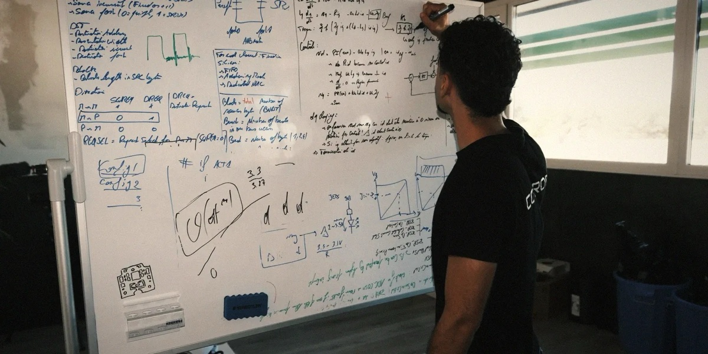
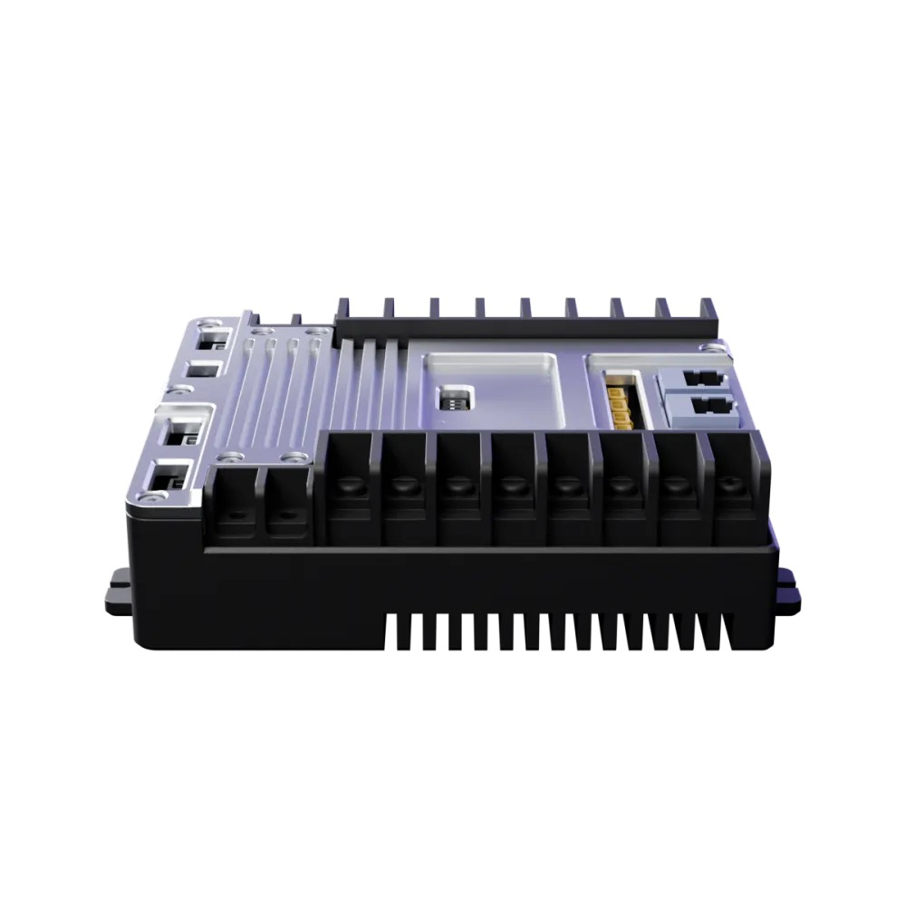
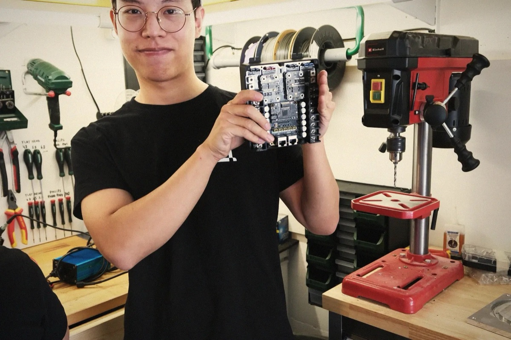
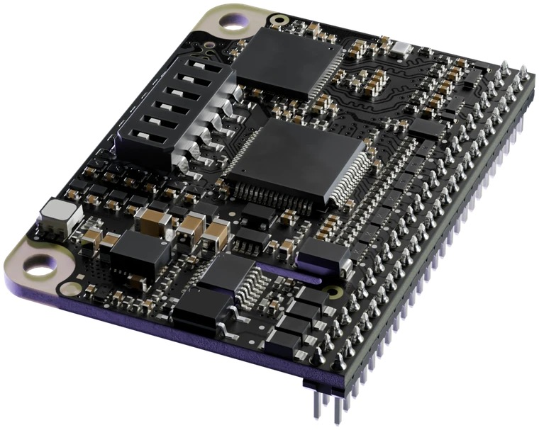
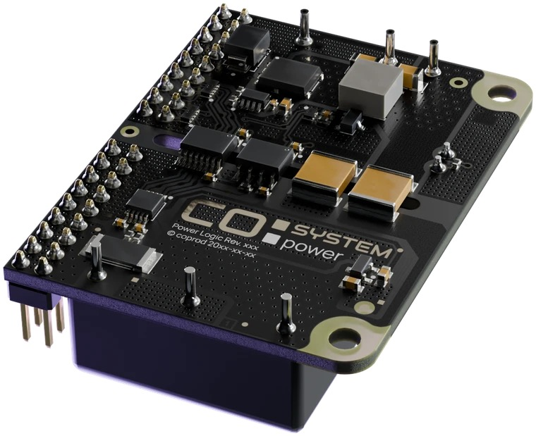
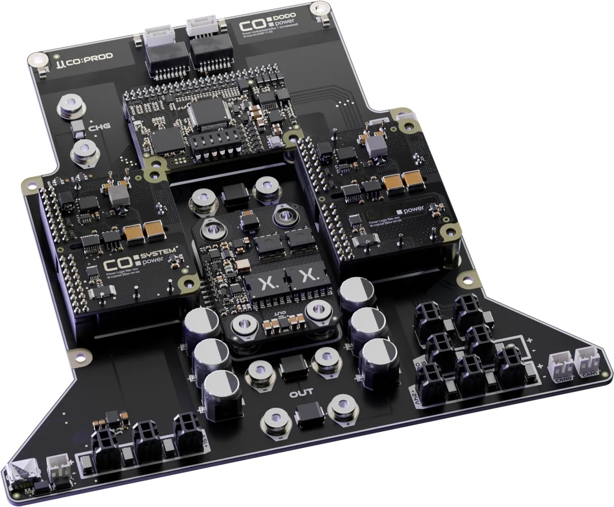
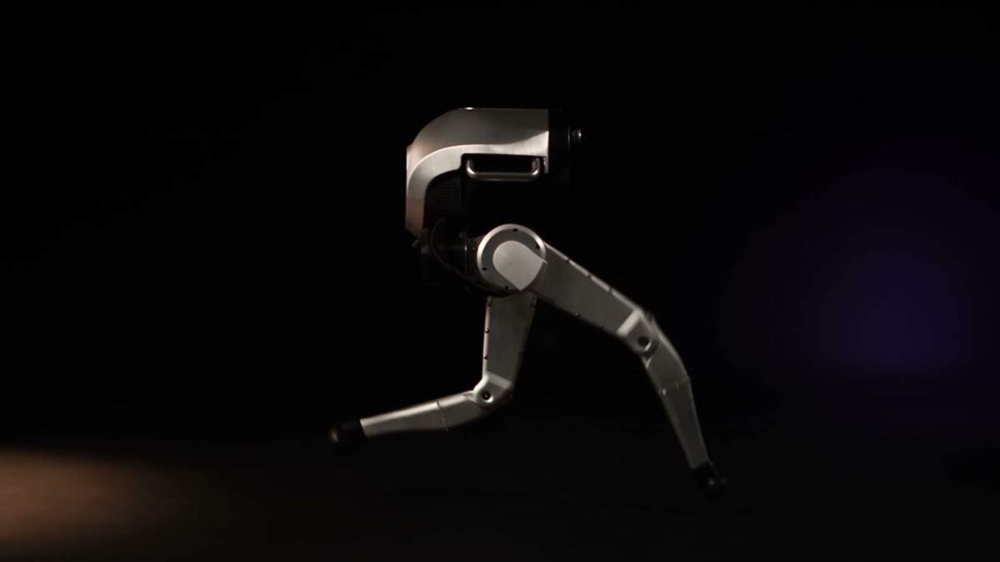
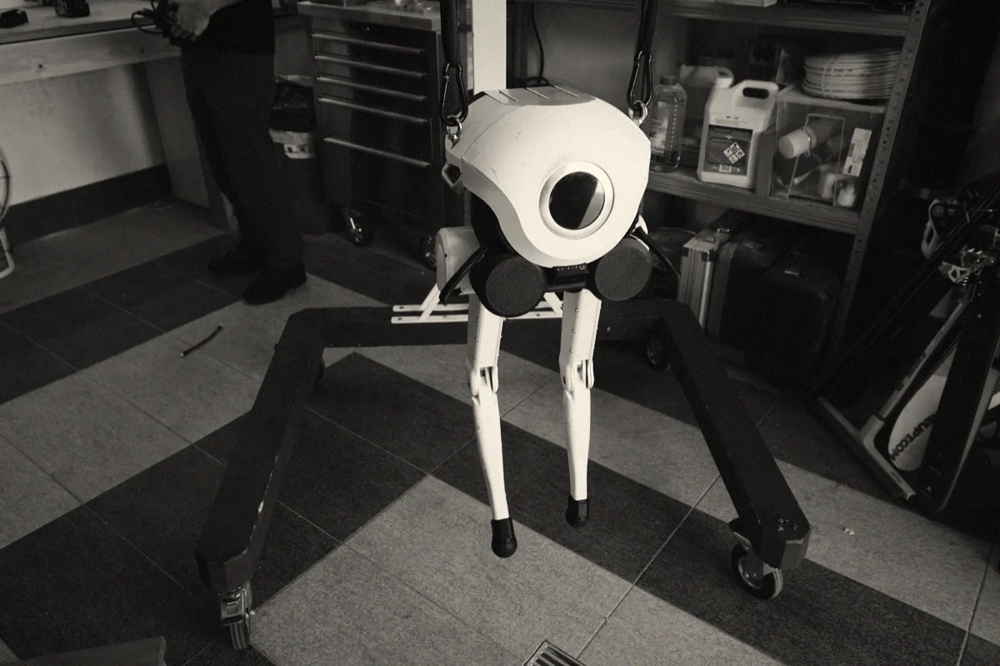
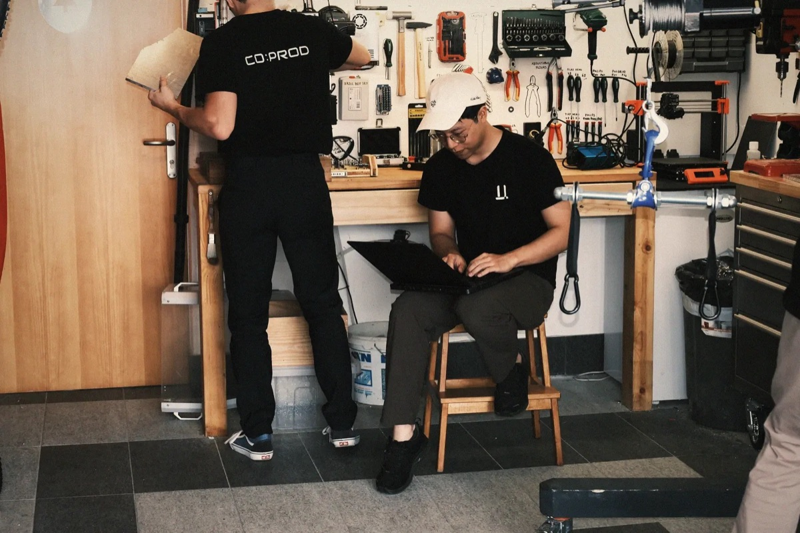
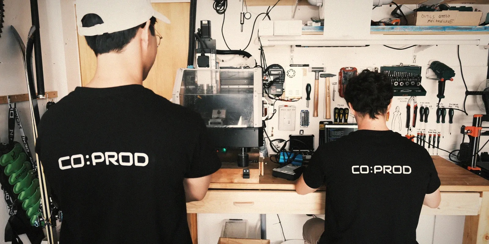

# coprod Inc. — Solutions and Projects Register

⬆ [coprod Inc. profile](coprod.md) · [Product portfolio](coprod-Products.md) · [Papers and research](coprod-Papers-and-Research.md) · [Roadmap and strategy](coprod-Roadmap-and-Strategy.md)

> **Coverage note:** Walked on 2026-11-14: the full official site (all 9 URLs in `sitemap.xml` — home, products, systems, values, jobs, community, co:found, simulator, blog — plus the unlisted `/cododo/` film page, `/privacy` and the `shop.coprod.co` storefront), the GitHub organisation `coprod-Inc` (all 9 public repos), Venture Kick (news article + portfolio page), Venturelab (profile + Seed Night article), startup.ch and the Swiss commercial-register record (via Moneyhouse / SOGC). **One** extended web search was available and used; it surfaced only the company's own pages and registry entries — **no trade-press coverage, no customer story, no deployment**. Not accessible: LinkedIn (bot wall), YouTube channel listing (no parsable video list), X / Instagram (not fetched), Discord content (invite only), `coprod.dev` (TLS error), the shop (password-locked "Opening soon"). There is **no Chinese-language site** (Swiss company, English-only site). News range covered: July 2024 (incorporation) to November 2026.
>
> **Read this first:** coprod markets **no industry solutions, no applications pages, no case studies and no named customers**. Everything it offers is one component platform (co:system) plus programmes for the people who build on it. Track tags below are **our inference** about where a building block could help, not coprod's claims.

## Solutions catalogue — everything they offer

Status: ✅ shipping/available/done · 🧪 announced/pilot/preview · 🔭 roadmap/planned. Planned-only items are in [Future projects](#future-projects-and-announced-plans).

| # | Solution / application | What it does | Products used | Maturity | Tracks | Source link |
|---|---|---|---|---|---|---|
| 1 | **co:system — one stack for the whole robot** | Unified EtherCAT architecture + central real-time control API + snap-together modules; "one bus, one clock, one API". **100 Mb/s**, **1 kHz** typical loop, jitter **< 20 µs** | all modules + cosystem API | 🧪 hardware in pre-order | T01 T02 T03 T04 | [home](https://coprod.co/) |
| 2 | **co:act — integrated actuators** | Quasi-direct-drive joint with the motion controller inside: **10 Nm** cont. / **25 Nm** peak, **16:1**, **60 mm**, **420 g**, hollow shaft, dual encoder | co:act | 🧪 coming soon (no order link) | T01 T02 T04 | [products#coact](https://coprod.co/products.html#coact) |
| 3 | **co:motion — motion controllers** | EtherCAT drive board for your own motor: simultaneous torque / velocity / position control at **1 kHz+**, BiSS / SSI / SPI / Hall / incremental feedback, controlled braking | co:motion | 🧪 pre-order | T01 T02 T03 T04 | [products#comotion](https://coprod.co/products.html#comotion) |
| 4 | **co:power — modular power system** | Configurable power backplane, **10–54.6 V**, up to **6 submodules**: Power Logic (supervisor, e-stop), Precharge, isolated DC/DC Regulator, Brake chopper; all telemetry on the bus | co:power motherboard + submodules | 🧪 pre-order | T01 T02 T03 | [products#copower](https://coprod.co/products.html#copower) |
| 5 | **co:sense — synchronized sensing** | **9-axis dual-redundant** IMU / AHRS, on-board fusion at **1 kHz**, hardware time-stamped; **30 × 50 mm** | co:sense | 🧪 pre-order | T01 T02 T04 | [products#cosense](https://coprod.co/products.html#cosense) |
| 6 | **co:battery — robot-ready battery packs** | Protected pack (over-current, over/under-voltage, short-circuit, temperature), 4 charge LEDs, latching interface; several sizes / voltages | co:battery | 🧪 pre-order | T01 T02 | [products#cobattery](https://coprod.co/products.html#cobattery) |
| 7 | **cosystem developer API and real-time stack** | Python bindings on a C++ core: scan bus, get devices, set gains / modes, command motors, read IMU and power telemetry, logging. Runs on real-time Linux | cosystem API | 🧪 preview — **not publicly downloadable** | T01 T02 T03 T04 | [home](https://coprod.co/) |
| 8 | **Custom hardware on request** | Custom mechanical / electrical co:power motherboards; custom battery designs; "need something else? contact us" | co:power, co:battery | 🧪 by enquiry | — | [products](https://coprod.co/products.html) |
| 9 | **"Your robot" — co-building systems with coprod** | Listed as system 03 ("collab"): coprod works with early-adopter teams to put their robot on co:system | whole stack | ✅ open by e-mail (no public example) | T01 T02 T03 T04 | [systems](https://coprod.co/systems.html) |
| 10 | **co:dodo — reference biped ("proof of stack")** | In-house **6-DoF** point-foot biped, **1 kHz** whole-body control over EtherCAT; shows a small team can reach first steps in **< 6 months** | co:motion / co:act, co:power, co:sense, co:battery | 🧪 demo robot, **not sold** | T02 (weak) | [systems](https://coprod.co/systems.html) |
| 11 | **co:dodo browser simulator** | MuJoCo compiled to WebAssembly + ONNX policy at **50 Hz**, runs in a tab, no install | — | ✅ available | — | [simulator](https://coprod.co/simulator/) |
| 12 | **co:found — founder's programme** | **75% off** all products for the first **CHF 25,000** spent, then **33% off** until **CHF 100,000**; no equity; founder community | whole catalogue | ✅ open for applications | — | [co:found](https://coprod.co/cofound.html) |
| 13 | **co:builder — Discord community** | Build logs, help, early looks at hardware | — | 🧪 opening with a hand-picked first cohort | — | [community](https://coprod.co/community.html) |
| 14 | **co:ambassador programme** | Campus / lab representatives run events and content; get early hardware access | — | 🧪 cohort 01 forming | — | [community](https://coprod.co/community.html) |
| 15 | **co:campus — clubs and teams** | Robotics clubs, Formula Student teams, university chapters build on the stack with a direct line to the designers | whole stack | ✅ open by e-mail | — | [community](https://coprod.co/community.html) |
| 16 | **Online shop (pre-orders)** | Shopify storefront behind the "Pre-order" buttons for co:motion, co:power, co:sense, co:battery | — | 🧪 password-locked, "Opening soon" | — | [shop](https://shop.coprod.co/) |
| 17 | **KiCad Project Manager** (open-source tool) | KiCad 9 / 10 plugin for project setup, template updates, design rules and PCB stackups; MIT; **v1.1.0** | — | ✅ released | — | [GitHub](https://github.com/coprod-Inc/kicad_project_manager) |

**17 offerings.** None is a vertical solution (delivery, cleaning, inspection, care …). Prices are not public for any of them.

### co:system — one stack for the whole robot

*(Official team photo: control-loop and bus-timing notes on the workshop whiteboard — the site has no architecture diagram as an image.)*

- **How it works:** every module is an EtherCAT node on one daisy-chained bus with distributed clocks; a real-time Linux master runs one deterministic loop for motors, power and sensors; the developer sees a single Python / C++ API.
- **Who uses it:** aimed at start-ups, research labs, student teams and hobbyists building their own robot. **No external user is named publicly.**
- **Numbers:** **100 Mb/s** bus · **1 kHz** typical loop · jitter **< 20 µs** · hardware time-stamping.
- **Track angle (inference):** a custom actuated mechanism in any track — wheel base, lift, hatch, sorting flap, rehab joint. It adds no navigation, perception or AI.
- Official link: [coprod.co](https://coprod.co/)

### co:act — integrated actuators

Picture: see [Product portfolio](coprod-Products.md) (no separate solution picture exists).

- **How it works:** quasi-direct drive (**16:1**) keeps the joint backdrivable; dual encoders give motor-side and output-side position; the co:motion controller sits inside the **60 mm / 420 g** housing.
- **Numbers:** **10 Nm** continuous, **25 Nm** peak. More sizes announced, no details.
- **Track angle (inference):** T04 single-joint rehab or assist device (torque control is the right primitive); T01 / T02 compliant tool or door / hatch axis.
- **Caveat:** "coming soon" — the only module without a pre-order link. No safety certification; Safe Torque Off is still to come.
- Official link: [coprod.co/products.html#coact](https://coprod.co/products.html#coact)

### co:motion — motion controllers

Picture: see [Product portfolio](coprod-Products.md).

- **How it works:** closes torque, velocity and position loops on the board; gains and mode are set from the API. The home-page code sample drives **four wheel motors in velocity mode plus one camera motor in position mode** — the closest thing to an "application example" coprod publishes.
- **Numbers:** EtherCAT **1 kHz+** with distributed clocks; several board sizes incl. hollow-shaft; current / voltage ratings **not public**.
- **Track angle (inference):** T01 wheel-base or dispenser axis; T02 actuated sensor mast; T03 sorting actuator; T04 exerciser joint with your own motor.
- Official link: [coprod.co/products.html#comotion](https://coprod.co/products.html#comotion)

### co:power — modular power system

- **How it works:** a motherboard carries only the submodules the robot needs; each reports voltage / fault telemetry on the same clock as motion and sensing. Sold as loose submodules or as a sealed complete module with cooling.
- **Numbers:** input **10–54.6 V** · up to **6 submodules** · EtherCAT **1 kHz+**. Current / power ratings **not public**.
- **Track angle (inference):** T01 / T02 power and e-stop chain for a mobile base; T03 energy measurement and regenerative-braking handling for an "energy-efficient robot" story.

| Submodule | Job | Picture |
|---|---|---|
| Power Logic | Supervisor: monitoring, fault detection, e-stop and bus-off handling |  |
| Regulator | Wide-input, galvanically isolated DC/DC with protection and telemetry |  |
| Motherboard | Configurable backplane; custom variants on request |  |
| Precharge | Soft-start that limits inrush current | no picture on site |
| Brake | Active brake chopper for regenerative energy | no picture on site |

- Official link: [coprod.co/products.html#copower](https://coprod.co/products.html#copower)

### co:sense — synchronized sensing

Picture: see [Product portfolio](coprod-Products.md).

- **How it works:** two redundant 9-axis IMUs fused on the module at **1 kHz**; outputs quaternion, linear acceleration, angular velocity, magnetic field, time-stamped on the bus.
- **Track angle (inference):** T02 tilt / vibration sensing on a mast or structure; T01 base attitude; T04 limb-motion or fall-related tracking on a device.
- **Caveat:** accuracy and drift figures are not published. "More sensor modalities" are announced without detail.
- Official link: [coprod.co/products.html#cosense](https://coprod.co/products.html#cosense)

### co:battery — robot-ready battery packs

Picture: see [Product portfolio](coprod-Products.md).

- **How it works:** integrated protection electronics and a latching mechanical interface; the site mentions open-source integration examples (**none found publicly** ⚠️ unverified).
- **Numbers:** capacity, voltage and weight are **not published**; several sizes, custom on request.
- **Track angle (inference):** T01 / T02 — untethered power for a custom mobile mechanism.
- Official link: [coprod.co/products.html#cobattery](https://coprod.co/products.html#cobattery)

### cosystem developer API and real-time stack

- **How it works:** stack is developer API → real-time control loop → EtherCAT master → devices. Joint-level only; no skills, navigation, perception or pretrained models.
- **Availability:** no public package, docs or examples. The repo link on the GitHub profile (`coprod-llc/cosystem`) and the site's GitHub link both return **404**; the live organisation is `coprod-Inc`, which holds no SDK. Get access from the team on site or via Discord.
- **ROS 2:** earlier notes in this knowledge base cite a ROS 2 claim; **no ROS mention was found on any page fetched in this pass** (site, startup.ch, Venture Kick, Venturelab) — ⚠️ unverified.
- Official link: [coprod.co](https://coprod.co/)

### "Your robot" — co-building systems with coprod

- **What it is:** the systems page lists three next systems; the third is "Your robot", labelled *collab*. The home page says coprod works with teams building real robots and asks them to get in touch.
- **Who uses it:** nobody is named. No collaboration, pilot or customer robot has been published.
- **Why it matters here:** for a hackathon team this is the practical offer — founders helping you wire and tune a custom axis. The jobs page describes a "Forward Deployed Engineer" role covering customer deployments, live demos **and hackathons**.
- Official link: [coprod.co/systems.html](https://coprod.co/systems.html)

### co:dodo — reference biped ("proof of stack")

- **How it works:** point-foot biped, **6 DoF**, whole-body control at **1 kHz** over EtherCAT; walking policy trained with reinforcement learning (the org keeps a fork of `rsl_rl`; training code not released) and exported to ONNX — the same policy runs in the browser simulator.
- **Numbers:** first motion **Dec 2025** after about **three months** of evenings and weekends; "time to first step **< 6 months**".
- **Media:** a product film is hosted at [coprod.co/cododo](https://coprod.co/cododo/) (1080p and 4K; captioned "product visualization").
- **Track angle:** weak. Legged locomotion relates to T02.6 in principle, but co:dodo has no perception, no payload data and is not for sale. Treat it as a showpiece.
- Official link: [coprod.co/systems.html](https://coprod.co/systems.html)

### Programmes and community (no direct track link)

- **co:found:** 75% / 33% discount tiers (caps CHF 25,000 / CHF 100,000), no equity. The second tier is sized for "3 to 5 robots" for first clients. Stated motive: help young European robot companies compete with technology from China and overseas. Relevant only if your team continues after the hackathon.
- **co:builder / co:ambassador / co:campus:** Discord community, campus ambassadors (early hardware access, reference letter, swag) and club / Formula Student support.
- Official links: [co:found](https://coprod.co/cofound.html) · [community](https://coprod.co/community.html)

## Projects register — past and current

**No customer deployment, pilot, joint lab, government programme or competition entry is public.** The register is therefore company milestones, support programmes and in-house builds.

| Date | Project / deployment / pilot / partnership | Partner or customer | Location | What happened (one line) | Tracks | Source link |
|---|---|---|---|---|---|---|
| 14–16 Nov 2026 | Leukerbad Robotics Hackathon 2026 | Hackathon organisers | Leukerbad, CH | Listed among the 20 companies on site (per the event brief; no announcement found on coprod's own channels ⚠️ unverified from coprod side) | T01–T04 | [profile](coprod.md) |
| 9–11 Nov 2026 | Firmware-stack work visible on GitHub | — | — | Forks of `SOES` (EtherCAT slave stack) and `modm` (embedded C++ HAL) pushed; indicates active module firmware development | — | [GitHub org](https://github.com/coprod-Inc) |
| 23 Oct 2026 | KiCad Project Manager plugin | open source | — | Repo last updated; **v1.1.0** is the stable release for KiCad 9 / 10 (MIT) | — | [GitHub](https://github.com/coprod-Inc/kicad_project_manager) |
| 19 Sep 2026 | Pre-order shop set up | Shopify (platform) | — | Privacy notice v1.2 describes `shop.coprod.co` as the storefront for module orders; shop still locked on 14 Nov 2026 | — | [privacy](https://coprod.co/privacy) |
| 1–10 Sep 2026 | Website relaunch | — | — | Sitemap dates: products with pre-order links, systems, co:found, community programmes, simulator, blog (empty) | — | [sitemap](https://coprod.co/sitemap.xml) |
| 2026 (date not stated) | co:dodo film and browser simulator published | — | — | Product film (1080p / 4K) and in-tab MuJoCo simulator of the biped go online | T02 (weak) | [co:dodo film](https://coprod.co/cododo/) |
| 8 Jun 2026 | Conversion to a stock corporation | Vaud commercial register | Prilly, CH | coprod Sàrl becomes **coprod SA** (statutes of 15 May 2026); share capital **CHF 100,000**, **CHF 50,000** paid in | — | [Moneyhouse / SOGC](https://www.moneyhouse.ch/en/company/coprod-sa-11261028671) |
| 8 May 2026 (article date) | Startup Champions Seed Night, 15th edition | Venturelab, EPFL | EPFL Rolex Forum, Lausanne | One of **20** start-ups pitching to about **500** attendees; the winner was another start-up (OptiZone); whether coprod reached the final four is not stated | — | [Venturelab](https://www.venturelab.swiss/Startup-Champions-Seed-Night-celebrates-15th-edition-at-EPFL) |
| 2 Apr 2026 | Venture Kick Stage 2 | Venture Kick | Switzerland | **CHF 40,000** for market outreach (travel, trade fairs, marketing) and a move out of the garage | — | [Venture Kick](https://www.venturekick.ch/coprod-receives-CHF-40000-from-Venture-Kick-to-build-scalable-interoperable-robotics-ecosystem) |
| By Apr 2026 | Supplier partnership | Unnamed "global component supplier" | — | Described by the founders as a key partnership; name, scope and product not disclosed ⚠️ unverified | — | [Venture Kick](https://www.venturekick.ch/coprod-receives-CHF-40000-from-Venture-Kick-to-build-scalable-interoperable-robotics-ecosystem) |
| By Apr 2026 | Advisors on board | Unnamed advisors | — | "Experienced advisors" brought in during the Venture Kick process | — | [Venture Kick](https://www.venturekick.ch/coprod-receives-CHF-40000-from-Venture-Kick-to-build-scalable-interoperable-robotics-ecosystem) |
| 2026 | Venture Kick support total | Venture Kick | — | startup.ch and Venturelab list "Venture Kick (**50'000**) 2026" — most likely Stage 1 + Stage 2 combined (inference) | — | [startup.ch](https://www.startup.ch/coprod) |
| Dec 2025 | co:dodo first motion | in-house | Prilly area (garage) | First co:system modules integrated into the biped; "first signs of life" just before Christmas | T02 (weak) | [Venture Kick](https://www.venturekick.ch/coprod-receives-CHF-40000-from-Venture-Kick-to-build-scalable-interoperable-robotics-ecosystem) |
| ~Sep–Dec 2025 | co:dodo build | in-house | garage | Biped built in about three months of evenings and weekends | — | [Venture Kick](https://www.venturekick.ch/coprod-receives-CHF-40000-from-Venture-Kick-to-build-scalable-interoperable-robotics-ecosystem) |
| 25 Nov 2025 | `robolitude` repository | in-house | — | Public repo described only as "Social Robotics" (MIT, README has two lines, no code) — purpose unknown | T04 (weak) | [GitHub](https://github.com/coprod-Inc/robolitude) |
| 2025 (date not public) | Entry into Venture Kick | Venture Kick | Switzerland | At entry the biped was not operational and the boards were early PCB prototypes that could not yet communicate reliably | — | [Venture Kick](https://www.venturekick.ch/coprod-receives-CHF-40000-from-Venture-Kick-to-build-scalable-interoperable-robotics-ecosystem) |
| 6 Sep 2025 | Reinforcement-learning tooling | open-source upstream (`leggedrobotics/rsl_rl`) | — | Fork of the legged-robot RL library — the likely training route for the co:dodo policy (inference) | — | [GitHub org](https://github.com/coprod-Inc) |
| 13 Apr 2025 | Robot-learning tooling | open-source upstream (`huggingface/lerobot`) | — | Fork of LeRobot (imitation learning / teleop data) — fits the planned dual-arm teleop platform (inference) | — | [GitHub org](https://github.com/coprod-Inc) |
| 24 Jul 2024 | Incorporation | Vaud commercial register | Prilly, CH | Founded as coprod Sàrl; purpose: design, production and distribution of robotics, software, mechanics and electronics solutions | — | [Moneyhouse / SOGC](https://www.moneyhouse.ch/en/company/coprod-sa-11261028671) |
| ~2020–2024 | Founders' earlier robots | — | — | "Over 4 years making robots (rovers, arms, dogs)" before the company; no project names given | — | [startup.ch](https://www.startup.ch/coprod) |

**20 entries.** Named external parties are support organisations only (Venture Kick, Venturelab / EPFL event). **Zero** named customers, integrators or research partners.

## Future projects and announced plans

Nothing below has a public date or price. "Announced" is the date of the source page.

| Announced | Planned for | What | Confidence (official / reported / inferred) | Tracks | Source link |
|---|---|---|---|---|---|
| Sep 2026 | "coming soon" | 🧪 **co:act** launch (60 mm, 420 g, 10 / 25 Nm) | official | T01 T02 T04 | [products](https://coprod.co/products.html#coact) |
| Sep 2026 | not dated | 🔭 More co:act sizes | official | T04 | [products](https://coprod.co/products.html#coact) |
| Sep 2026 | not dated | 🔭 **Safe Torque Off module** for co:motion (today: controlled braking only) | official | T02 T04 | [products](https://coprod.co/products.html#comotion) |
| Sep 2026 | not dated | 🔭 **EtherCAT Junction** — passive and active, for star / branch wiring | official | — | [products](https://coprod.co/products.html#future) |
| Sep 2026 | not dated | 🔭 **IO Board** — digital / analog IO, fast-sampled, time-stamped on the bus | official | T02 T03 | [products](https://coprod.co/products.html#future) |
| Sep 2026 | not dated | 🔭 **Tactile Sensor** — high-bandwidth array for contact-rich manipulation | official | T04 | [products](https://coprod.co/products.html#future) |
| Sep 2026 | not dated | 🔭 More co:sense sensor modalities | official | T02 | [products](https://coprod.co/products.html#cosense) |
| Sep 2026 | not dated | 🔭 **Dual-arm teleoperation platform** with tactile sensing on the end effectors (planned system 01) | official | T02 T04 | [systems](https://coprod.co/systems.html) |
| Sep 2026 | not dated | 🔭 **Humanoid robot** — full-body control, human-like locomotion (planned system 02) | official | T01 T04 (speculative) | [systems](https://coprod.co/systems.html) |
| Sep 2026 | "Opening soon" | 🧪 Online shop opening; pre-orders for co:motion, co:power, co:sense, co:battery become purchasable | official | — | [shop](https://shop.coprod.co/) |
| Sep 2026 | "now" | 🧪 Discord first cohort and **co:ambassador cohort 01** | official | — | [community](https://coprod.co/community.html) |
| Sep 2026 | not dated | 🔭 First engineering / research write-ups on the blog ("on the bench") | official | — | [blog](https://coprod.co/blog/) |
| 2025–2026 | not dated | 🔭 Public documentation, examples and "pre-built systems"; a `cosystem` repository (linked, currently 404) | official intent, timing inferred | T01–T04 | [GitHub org](https://github.com/coprod-Inc) |
| Sep 2026 | not dated | 🔭 Team build-out: **9 open roles** (electronics, mechanical, high- and low-level software, full-stack robotics, forward deployed, growth, founder's associate, sales) | official | — | [jobs](https://coprod.co/jobs.html) |
| Apr 2026 | 2026 | 🔭 Trade-fair and outreach campaign; move from the garage to a proper workspace (completion ⚠️ unverified) | official | — | [Venture Kick](https://www.venturekick.ch/coprod-receives-CHF-40000-from-Venture-Kick-to-build-scalable-interoperable-robotics-ecosystem) |
| — | not dated | 🔭 Further financing: Venture Kick's programme runs up to CHF 150,000 and coprod has CHF 50,000 so far; the SA conversion (Jun 2026) and 9 open roles point to a round — nothing announced | inferred | — | [startup.ch](https://www.startup.ch/coprod) |
| Nov 2025 | unknown | 🔭 "Social Robotics" (`robolitude` placeholder repo) — may signal a future direction; no description | inferred | T04 (speculative) | [GitHub](https://github.com/coprod-Inc/robolitude) |

**17 future items.** Stated rule for the roadmap: "we build what our own robots need".

## Solutions by track — quick index

All entries are **building blocks in a supporting role** (inference). coprod has nothing task-ready for any direction.

### T01 Autonomous Urban Services

- **co:motion** — wheel-base or mechanism drive; the official API sample commands four wheel motors and a camera motor — **T01.1**, **T01.6**, T01.2
- **co:power + co:battery** — power, e-stop and charge handling for a small mobile base or add-on module — **T01.1**, T01.2, T01.4
- **co:sense** — base attitude / tilt for a custom platform — **T01.6**
- **co:act** (if units exist) — compliant hatch, lift or handover axis next to people — **T01.3**, T01.7
- **co:system / cosystem API** — one synchronized loop for all of the above — T01.6
- **"Your robot" collaboration** — founder help to bring up a custom axis — any T01 direction
- 🔭 Humanoid robot (planned) — T01.3 (speculative)
- Not covered: T01.5 guidance / information services (no HRI, speech or display product)

### T02 Resilient & Safe City

- **co:sense** — dual-redundant, time-stamped IMU for tilt / vibration on a mast, structure or vehicle — **T02.3**, **T02.6**
- **co:power (Power Logic submodule)** — supervised power, fault detection, e-stop and bus-off handling — **T02.2**, T02.7
- **co:motion** — actuated sensor mast or tool with controlled braking on emergency stop — **T02.1**, T02.2
- **co:battery** — protected untethered power — T02.4
- **co:dodo** — legged-locomotion showpiece only, not available to build on — T02.6 (weak)
- 🔭 Dual-arm teleop platform with tactile end effectors — T02.7, T02.2 (planned)
- 🔭 Safe Torque Off module, IO Board, more sensor modalities — T02.3, T02.4 (planned)
- Not covered: T02.5 security monitoring (no cameras, no perception)

### T03 Sustainable City

- **co:power** — per-submodule energy telemetry on the control clock, isolated regulation, brake chopper for regenerative energy — **T03.3**, T03.5
- **co:motion** — actuator for a sorting flap, gate or valve with measured motion profiles — **T03.1**, T03.6
- **cosystem API** — logging of power and motion data for an efficiency comparison — T03.3, T03.7
- 🔭 IO Board (planned) — time-stamped analog / digital inputs for environmental sensors — T03.2, T03.7
- Nothing specific found for T03.4 (sustainable infrastructure)

### T04 Elderly Care & Rehabilitation

- **co:act** (coming soon) — backdrivable torque-controlled joint, **10 / 25 Nm**, for a single-joint exerciser or assist prototype — **T04.3**, **T04.4**
- **co:motion** — same torque / velocity / position control with your own motor — **T04.3**
- **co:sense** — motion and posture tracking on a device or limb fixture — **T04.7**, T04.4
- **co:power (Power Logic)** — e-stop chain for a supervised human-contact demo — T04.3
- 🔭 Tactile Sensor (planned) — contact-rich, gentle manipulation — T04.2
- 🔭 Safe Torque Off module (planned) — prerequisite for safer human contact — T04.3
- 🔭 Dual-arm teleop platform (planned) — remote assistance / data collection for care tasks — T04.6, T04.1
- 🔭 Humanoid robot (planned) — T04.1 (speculative)
- `robolitude` "Social Robotics" placeholder — T04.5 (name only, no content)

## What they do NOT offer

- **No finished robot you can use**: no mobile base, arm, gripper, hand or humanoid for sale; co:dodo is an in-house demo.
- **No vertical solutions**: nothing for delivery, cleaning, inspection, rescue, waste sorting, environmental monitoring, care or rehabilitation.
- **No autonomy software**: no navigation, SLAM, perception, manipulation skills, speech / HRI, fleet management or AI models.
- **No cameras, LiDAR, environmental sensors or compute boards** — bring your own host PC (real-time Linux) and sensors.
- **No public SDK, docs, examples, URDF / MJCF or confirmed ROS 2 bridge.**
- **No safety certification** and no Safe Torque Off yet — a limit for any T04 human-contact demo.
- **No shipping hardware at volume**: four modules are pre-order, the actuator is "coming soon", the shop is locked.
- **No public track record**: no customers, pilots, deployments, case studies or papers.
- **No prices** — except the co:found discount percentages.

## Image credits

All images © coprod, downloaded from the official site on 2026-11-14 and converted to JPEG.

| File | Shows | Source URL |
|---|---|---|
| assets/coprod-sol-cosystem-stack.jpg | Team member writing control-loop and bus notes on a whiteboard (home page, architecture section) | https://coprod.co/assets/img/team/whiteboard-control-loop-1600.webp |
| assets/coprod-sol-copower-complete.jpg | co:power complete sealed module (render) | https://coprod.co/assets/3d/power-6c028c90/f09.webp |
| assets/coprod-sol-copower-photo.jpg | Team member holding a populated co:power motherboard in the workshop | https://coprod.co/assets/img/team/workshop-holding-motherboard-1600.webp |
| assets/coprod-sol-copower-logic.jpg | co:power Power Logic submodule | https://coprod.co/assets/img/20f4fdc58e.webp |
| assets/coprod-sol-copower-regulator.jpg | co:power Regulator submodule | https://coprod.co/assets/img/37bedb8f9c.webp |
| assets/coprod-sol-copower-motherboard.jpg | co:power motherboard (backplane) | https://coprod.co/assets/img/9d9bba2084.webp |
| assets/coprod-sol-cododo-film.jpg | co:dodo biped, poster frame of the official film | https://coprod.co/cododo/video/film-poster.jpg |
| assets/coprod-sol-cododo-workshop.jpg | co:dodo hanging from its gantry in the workshop | https://coprod.co/assets/img/team/cododo-workshop-floor-1600.webp |
| assets/coprod-sol-cofound.jpg | Team working at the bench (co:found page) | https://coprod.co/assets/img/team/team-bench-laptop-1600.webp |
| assets/coprod-sol-community.jpg | Two team members at the CNC bench in coprod shirts (community page) | https://coprod.co/assets/img/team/workshop-coprod-shirts-cnc-1600.webp |

## Sources

- [coprod — home (co:system, API sample, stack numbers)](https://coprod.co/)
- [coprod — sitemap.xml](https://coprod.co/sitemap.xml)
- [coprod — products (modules, submodules, module roadmap)](https://coprod.co/products.html)
- [coprod — systems (co:dodo, planned systems, "Your robot")](https://coprod.co/systems.html)
- [coprod — co:dodo film page](https://coprod.co/cododo/)
- [coprod — co:dodo simulator](https://coprod.co/simulator/)
- [coprod — co:found founder's programme](https://coprod.co/cofound.html)
- [coprod — community (co:builder, co:ambassador, co:campus)](https://coprod.co/community.html)
- [coprod — jobs (9 open roles)](https://coprod.co/jobs.html)
- [coprod — values](https://coprod.co/values.html)
- [coprod — blog (empty)](https://coprod.co/blog/)
- [coprod — privacy notice v1.2 (shop, legal entity)](https://coprod.co/privacy)
- [coprod — shop (locked, "Opening soon")](https://shop.coprod.co/)
- [GitHub — coprod-Inc organisation](https://github.com/coprod-Inc)
- [GitHub — coprod-Inc/kicad_project_manager](https://github.com/coprod-Inc/kicad_project_manager)
- [GitHub — coprod-Inc/robolitude](https://github.com/coprod-Inc/robolitude)
- [Venture Kick — coprod receives CHF 40,000 (2 Apr 2026)](https://www.venturekick.ch/coprod-receives-CHF-40000-from-Venture-Kick-to-build-scalable-interoperable-robotics-ecosystem)
- [Venture Kick — coprod SA portfolio page](https://www.venturekick.ch/coprod)
- [Venturelab — Startup Champions Seed Night, 15th edition at EPFL (8 May 2026)](https://www.venturelab.swiss/Startup-Champions-Seed-Night-celebrates-15th-edition-at-EPFL)
- [Venturelab — coprod SA profile](https://www.venturelab.swiss/index.cfm?page=137304&profil_id=69043)
- [startup.ch — coprod SA listing](https://www.startup.ch/coprod)
- [Moneyhouse — coprod SA commercial-register record and SOGC notices](https://www.moneyhouse.ch/en/company/coprod-sa-11261028671)
- [coprod Inc. profile (this repo)](coprod.md)
