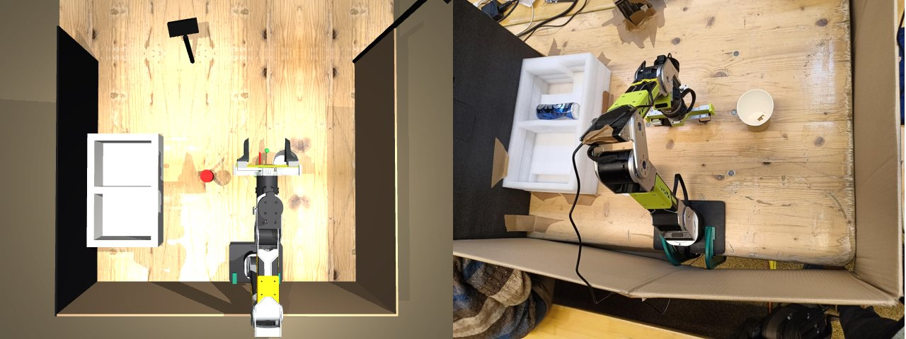
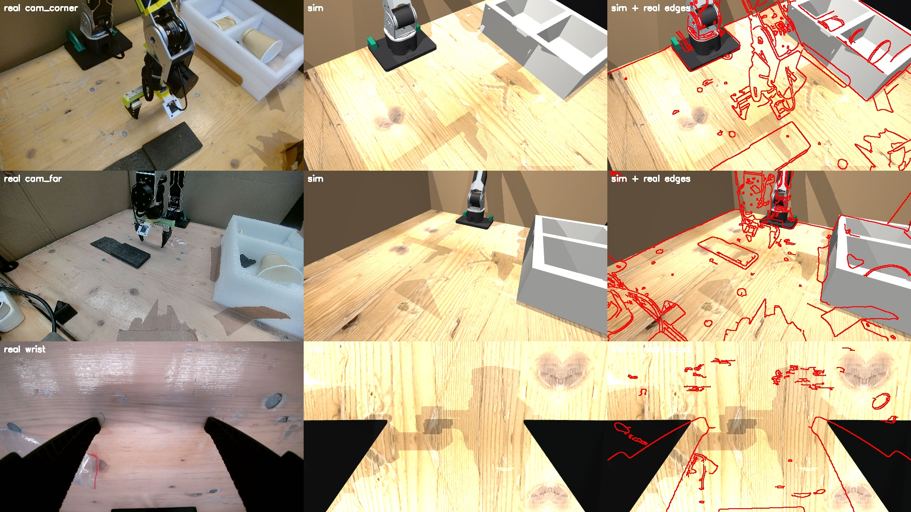
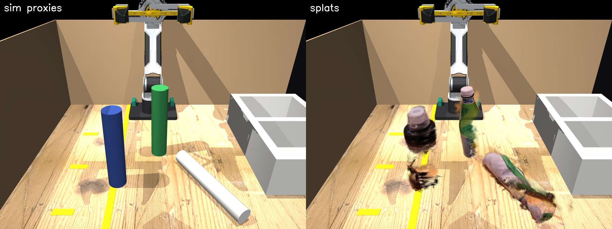

# rebot_sim: the real setup in MuJoCo

## Brief

`rebot_sim` is a MuJoCo replica of the team's real reBot B601-DM workspace, built from
measurements and photos of the setup (`reference_photos/`):

- **Robot:** Seeed's reBot B601-DM model with the teleop servos and IK, and the **soft
  (Fin-Ray) gripper** the real arm has. It's clamped on its base plate 38 cm from the right
  wall and flush with the near wall. At the ready pose the fingertips are 11.6 cm above the
  table; 11 cm was measured on the real arm.
- **Workspace:** a 98 × 84 cm wood table (texture taken from the photos) with 37 cm walls:
  cardboard behind and right of the robot, a black board on the left.
- **Bin:** the white foam bin, 25 × 40 × 12 cm, with two compartments. The drop targets
  are `bin_0` (nearer the robot) and `bin_1`.
- **Tape:** yellow tape on the table. A line runs along the robot's base plate from the near
  wall to the far edge, and three marks sit between it and the right wall.
- **Cameras:** the same three as on the real setup, calibrated against real frames.
  `cam_corner` is the Logitech C920 on a gooseneck, `cam_far` is the LeRobot camera at
  about 30 cm, and `wrist` is on the gripper.
- **Objects:** a can (13 × 4.5 cm, 15 g) and a hollow paper cup (11 × 9 cm, 8 g). Mesh
  assets can replace them.

**What it's for:** teleop practice and LeRobot data collection in sim (`--scene real`),
scripted policies and tests (`RealSetupEnv`), and handing the model to other tools
(`export`). The scripted pick-and-place puts the can and the cup into both compartments.
The far compartment is at the edge of the arm's reach with the gripper pointing straight down.

**One source of truth:** all measurements live in `rebot_sim/real_setup.json` and the
builder in `rebot_sim/scene.py`. The teleop apps, the env, the tests and the exports all
build from these two files. When the setup changes, edit the JSON, bump its `version`,
run the tests and push. Everyone gets the new model with `git pull`; the package is
installed editable, so no re-install is needed.




## Setup

```bash
cd teleoperation
./scripts/setup_assets.sh   # once: Seeed's reBot model
uv sync                     # installs rebot_sim (editable) into the teleop env
```

After `uv sync`, `import rebot_sim` works in that environment from any directory. Without
the sync, the teleop apps still find the package by its path in the repo.

## Use it

**Teleop and recording.** Add `--scene real`, or pass your own setup JSON instead:

```bash
cd teleoperation
uv run sim_teleop.py --input mouse --scene real
uv run quest_ee_teleop.py --vr --scene real        # sim in the headset; --demo without one
uv run sim_teleop.py --input quest --scene real --record \
    --cameras cam_far,cam_corner,wrist --task "put the can in the bin"
uv run sim_teleop.py --input mouse --scene ~/my_setup.json
```

**From Python (tests, scripted policies, data generation):**

```python
from rebot_sim import RealSetupEnv

env = RealSetupEnv()                        # RealSetupEnv(config="my_setup.json", objects=False)
env.reset(randomize=True, seed=0)           # objects at random spots in spawn_region
can = env.object_pos("can")                 # world position of the can's base
env.move_grasp_to(can + [0, 0, 0.20])       # IK move of the pinch point, gripper down (TOP_DOWN)
env.move_grasp_to(can + [0, 0, 0.06]); env.set_gripper(env.GRIPPER_CLOSED)
env.move_grasp_to(env.bin_pos("bin_0") + [0, 0, 0.25]); env.set_gripper(env.GRIPPER_OPEN)
env.in_bin("can", "bin_0")                  # -> True
rgb = env.render("wrist")                   # 1080x1920x3 uint8 (the camera's real size; others 480x640)
env.step(q_arm, gripper)                    # or drive the joints yourself (100 Hz ticks)
```

`RealSetupEnv` subclasses the teleop `RebotSim`, so `model`, `data`, `command()`,
`tcp_pose()` and `q_arm` work too. Lower level: `build_real_setup_spec()` returns the
`MjSpec`, and `apply_real_setup(spec)` adds the scene to your own reBot spec.

**CLI** (run from `simulation/`, or anywhere after `uv sync`):

```bash
uv run --project ../teleoperation python -m rebot_sim info      # version, commit, cameras, bins
uv run --project ../teleoperation python -m rebot_sim view
uv run --project ../teleoperation python -m rebot_sim render --out renders
uv run --project ../teleoperation python -m rebot_sim export out/rebot_real_setup.zip
```

`export` writes a standalone `scene.xml` with all its meshes and the texture, as a folder or
a zip, plus `rebot_sim_info.json` (scene version, commit, frame conventions). Use it for tools
outside this repo; it loads with `mujoco.MjModel.from_xml_path`. Re-export after pulling.
An export is a snapshot, so the JSON and the code stay the source of truth.

**Tests:** run after changing the setup:

```bash
cd simulation && uv run --project ../teleoperation tests/test_scene.py
```

They check the measurements (wall, bin and camera heights, robot offset, fields of view),
that the objects rest upright, randomization, a pick-and-place into both bins, camera
renders, the teleop `--scene` flag, and that the export loads standalone.
`examples/pick_place.py` is a template for scripted runs (add `--view` to watch,
`--random --seed N` for random starts).

## Layout

The robot base stays at the world origin, so the IK, teleop and recording code are unchanged.
**+x** points from the robot to the open far edge and **+y** points to the robot's left (the bin side).
The table top is at z = 0: the robot's base plate (part of the robot mesh) stands on it. This is the same frame as `base_link` in the ROS stack (`classic_real`).

```
                 far edge (open)  84 cm from the near wall
   cam_far ⊗ (30 cm from left, 33 cm high)     (gooseneck base ⊗ far-right corner)
 ┌──────────────────────────────────────────────────────┐
 │                                                      │
 │ ┌──────┐                                             │
 │ │bin_1 │ 40 cm                                       │  right wall
 │ │──────│                                             │  (cardboard)
 │ │bin_0 │                                             │
 │ └──────┘ 25 cm                                       │
 │   ↕ 15 cm                     [robot]                │
 └───────────────────────────────────────────────────────┘
  left wall (black)   near wall (cardboard)    ←— 38 cm —→
                    ←——————————— 98 cm ———————————————→
```

All measurements are in **`rebot_sim/real_setup.json`**, in workspace coordinates
(`from_left`, `from_near`, `height` above the table). Edit them there; no code changes are needed.

| Part | Value | Source |
|---|---|---|
| Workspace | 98 × 84 cm | measured |
| Robot (joint-1 axis) | 38 cm from the right wall; plate flush with the near wall (axis 7.5 cm out) | measured |
| Base plate | 20 × 14 × 1.4 cm, part of the robot mesh, centred on joint 1; 2 green clamps | robot model |
| Foam bin | 25 × 40 cm, 15 cm from the near wall; robot-side edge 30 cm from joint 1 (5 cm gap to the left wall) | size measured; position from the real arm's table homography |
| Bin height / divider | 12 cm, one divider in the middle → `bin_0`, `bin_1` | measured |
| Bin wall / floor thickness | 2.5 cm / 2 cm | **estimated** |
| `cam_far` | LeRobot camera, far edge: 35 cm from the left, 31 cm high; fovy 66° (16:9) | fitted to the real frame (matches the hand measurement) |
| `cam_corner` | Logitech C920 on the gooseneck: 83 cm from the left, 61 cm from the near wall, 54 cm high; fovy 43° | real arm's table homography + the real frame |
| `wrist` | on the gripper, centred between the fingers, 5.6 cm behind and 5.6 cm above the hard-finger tip line, tilted 33° towards the fingers; fovy 64°; recorded at 1920×1080 | fitted to the real frame's soft-finger silhouette (IoU 0.90) |
| Walls | 37 cm (cardboard near/right, black board left) | measured |
| Tape line | 19 mm yellow tape from the near wall to the far edge, flush against the base plate's right edge (10–11.9 cm right of joint 1) | photos (`real_setup_photos/new_reference_*`); the annotated photo says 27.5 cm from the right wall, about 1.4 cm more |
| Tape marks | 3 marks of 5.5 × 1.9 cm, wall-side ends 12 / 12.5 / 13 cm from the right wall, centres 25 / 43.5 / 60.5 cm from the near wall | rough measurements (`new_reference_3_with_measurements_in_cms.jpg`) |
| Can | 13 cm tall, 4.5 cm diameter, 15 g | measured |
| Paper cup | 11 cm tall, 9 cm top diameter (6 cm bottom, estimated), 8 g | measured |
| Table texture | cropped from the top-down photo | `rebot_sim/textures/table_wood.png` |

Named things for scripts and tasks: sites `bin_0` (near compartment), `bin_1` (far
compartment), `can_site` and `cup_site`; cameras `cam_far`, `cam_corner`, `wrist`,
`front` and `overhead_rgb`.

## Objects (placeholders until the real assets arrive)

`objects` in the config lists the pick objects. Three types are built in:

```jsonc
{"name": "can", "type": "can", "from_left": 0.42, "from_near": 0.40,
 "radius": 0.0225, "height": 0.13, "mass": 0.015, "rgba": [0.75, 0.05, 0.05, 1]}
{"name": "cup", "type": "cup", "from_left": 0.70, "from_near": 0.45,       // hollow, open top
 "top_radius": 0.045, "bottom_radius": 0.030, "height": 0.11, "wall": 0.002, "mass": 0.008}
{"name": "coke", "type": "mesh", "file": "assets/coke_can.obj", "scale": 1.0,  // rebot_sim/assets/
 "from_left": 0.42, "from_near": 0.40, "mass": 0.02}
```

Relative paths in a setup JSON resolve against the folder that JSON is in. Mesh objects
collide through their convex hull. A cup mesh would therefore be solid, so
keep the `cup` type for open cups, or split the mesh into convex parts. Every object gets
a free joint and the same contact settings as Seeed's demo objects, which the gripper is
tuned for.

With the tool held straight down, `bin_1` (the far compartment) is at the edge of the
arm's reach at a 30 cm carry height: the IK tilts the tool about 10 cm short of the
centre, and the object still falls in.

## Capture sessions on the real setup

[`capture/`](capture/README.md) has the tools for working on the real setup:

- a device page for assigning cameras and the arm port, and for lens calibration;
- a guided session where the arm holds poses while every camera is captured and
  compared with the sim;
- automatic camera calibration from a printed ChArUco board;
- a pause for the phone video, and packaging it as a Hugging Face dataset for
  Gaussian-splat training on HF Jobs.

### Scanned objects (Gaussian splats)

Phone videos of real objects become splats on HF Jobs (`capture/README.md`, standalone
mode), `tools/crop_object_splat.py` cuts and scales each object, and
`tools/splat_in_sim.py` drops them into the scene with physics proxies and renders the
cameras with the splats composited in (`rebot_sim/splat_render.py`, CPU):



## Camera calibration

Without the board, the camera poses come from real frames (`reference_photos/cameras/`, 1920×1080):

- `tools/calibrate_cameras.py` fits each external camera's pose and focal length. It uses
  hand-picked landmarks with known positions (base-plate corners, bin corners, the
  table/wall edges) and their pixels in the photo. `--overlay DIR` draws the fit on the
  photos and `--write` updates `real_setup.json`.
- For the C920 (`cam_corner`) it also uses the **table homography measured on the real
  arm**, from the `classic_real` branch
  (`ros2_ws/src/rebot_trash_sorting_agent/config/calibration.yaml`): 5 tape marks touched
  with the closed gripper and read from forward kinematics, 2.48 mm error. That ties the
  camera to the arm itself; the fit matches it to 3.4 px mean. Decomposed on its own, the
  homography gives a 42.8° vertical FOV, the C920's spec.
- The homography also corrected two scene errors. The separate base plate was a duplicate
  (the robot mesh already has it), so the table moved up 12 mm to z = 0. And the bin sits
  5 cm closer to the robot than the sketch had it. With both fixed, the center camera fits
  to 35 cm from the left and 31 cm high, which matches the hand measurement (36 cm, 30 cm).
- The gripper camera sees no fixed landmarks. `tools/fit_wrist_camera.py` fits its mount,
  field of view and the finger opening, by matching the sim's soft-finger silhouette to the
  dark fingers in the real frame (0.90 IoU).
- `tools/compare_cameras.py` renders the image above (real | sim | sim + real edges).
- The test `test_cameras_match_real_frames` checks that every landmark projects through
  the compiled sim cameras to within 30 px of the real frame.

If a camera moves: take a new 1920×1080 frame, update its landmark pixels in
`tools/calibrate_cameras.py`, run it with `--write`, check `compare_cameras.py`, and
run the tests.

Recording renders at 640×480. Because the config stores the vertical FOV, a 4:3 render
is the 16:9 view with its sides cropped, which is roughly what these webcams do in 4:3
modes.

## Not modelled yet

- Arm-link collisions: only the gripper palm and fingers collide (that's how Seeed's
  model is set up). The upper arm can pass through the bin walls and the near wall.
- Lens distortion: MuJoCo cameras are ideal pinholes. The 100° LeRobot cameras have
  visible barrel distortion, so straight edges near the frame borders sit up to about
  25 px off. To train on sim images, undistort the real frames or add distortion as an
  augmentation.
- The foam bin's inner steps and inserts, cables, and the clutter beyond the far edge.
