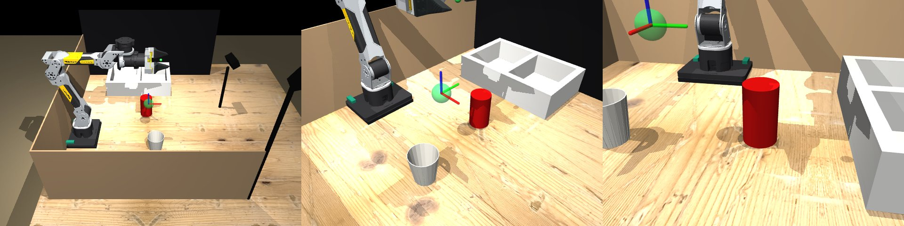

# Simulated real setup (reBot B601 in MuJoCo)

A MuJoCo replica of the team's real workspace: the reBot B601-DM on its clamped base
plate, the wood table, the cardboard and black walls, the white foam bin, and the two
external cameras. The dimensions come from the hand-drawn sketch and the photos in
`reference_photos/`.




## Run it

Uses the teleoperation environment (MuJoCo, numpy). Run `../teleoperation/scripts/setup_assets.sh` first if the robot model isn't fetched yet.

```bash
cd simulation
uv run --project ../teleoperation view_real_setup.py            # look around
uv run --project ../teleoperation view_real_setup.py --render   # renders/<camera>.png
uv run --project ../teleoperation tools/pick_place_check.py     # scripted can -> bin_0

# drive the arm in this scene: add --scene real to the teleop apps
cd ../teleoperation
uv run sim_teleop.py --input mouse --scene real
uv run quest_ee_teleop.py --scene real                # Quest; --demo without a headset
uv run sim_teleop.py --input quest --scene real --record \
    --cameras cam_far,cam_corner,wrist --task "put the can in the bin"
```

## Layout

The robot base stays at the world origin, so the IK, teleop and recording code are unchanged.
**+x** points from the robot to the open far edge and **+y** points to the robot's left (the bin side).
The table top is at z = −1.2 cm, the base plate's thickness.

```
                 far edge (open)  84 cm from the near wall
   cam_far ⊗ (36 cm from left, 30 cm high)            ⊗ cam_corner (60 cm high)
 ┌──────────────────────────────────────────────────────┐
 │                                                      │
 │ ┌──────┐                                             │
 │ │bin_1 │ 40 cm                                       │  right wall
 │ │──────│                                             │  (cardboard)
 │ │bin_0 │                                             │
 │ └──────┘ 25 cm                                       │
 │   ↕ 15 cm                     [robot]                │
 └───────────────────────────────────────────────────────┘
  left wall (black)   near wall (cardboard)    ←— 38 cm —→
                    ←——————————— 98 cm ———————————————→
```

All measurements are in **`config/real_setup.json`**, in workspace coordinates
(`from_left`, `from_near`, `height` above the table). Edit them there; no code changes are needed.

| Part | Value | Source |
|---|---|---|
| Workspace | 98 × 84 cm | measured |
| Robot (joint-1 axis) | 38 cm from the right wall, 7.5 cm from the near wall | 38 cm measured, 7.5 cm **estimated from photo** |
| Base plate | 19 × 15 × 1.2 cm, black, 2 green clamps | estimated from photo |
| Foam bin | 25 × 40 cm, 15 cm from the near wall, against the left wall | measured |
| Bin height / wall / divider | 10 cm / 2.5 cm / one divider at the middle → `bin_0`, `bin_1` | **estimated** |
| `cam_far` | far edge, 36 cm from the left, 30 cm high | measured; aim and FOV **estimated** |
| `cam_corner` | far-right corner, 60 cm high (gooseneck webcam) | measured; aim and FOV **estimated** |
| Walls | cardboard 30 cm (near, right), black board 45 cm (left) | **estimated** |
| Table texture | cropped from the top-down photo | `textures/table_wood.png` |

Named things for scripts and tasks: sites `bin_0` (near compartment), `bin_1` (far
compartment), `can_site` and `cup_site`; cameras `cam_far`, `cam_corner`, `wrist`,
`front` and `overhead_rgb`.

## Objects (placeholders until the real assets arrive)

`objects` in the config lists the pick objects. Three types are built in:

```jsonc
{"name": "can", "type": "can", "from_left": 0.42, "from_near": 0.40,
 "radius": 0.033, "height": 0.115, "mass": 0.03, "rgba": [0.75, 0.05, 0.05, 1]}
{"name": "cup", "type": "cup", "from_left": 0.70, "from_near": 0.45,       // hollow, open top
 "top_radius": 0.040, "bottom_radius": 0.028, "height": 0.09, "wall": 0.002, "mass": 0.01}
{"name": "coke", "type": "mesh", "file": "assets/coke_can.obj", "scale": 1.0,  // your own mesh
 "from_left": 0.42, "from_near": 0.40, "mass": 0.02}
```

Mesh objects collide through their convex hull. A cup mesh would therefore be solid, so
keep the `cup` type for open cups, or split the mesh into convex parts. Every object gets
a free joint and the same contact settings as Seeed's demo objects, which the gripper is
tuned for.

`tools/pick_place_check.py` grasps an object top-down, drops it into a compartment and
checks that it landed there. The can and the cup pass for both `bin_0` and `bin_1`.
With the tool held straight down, `bin_1` (the far compartment) is at the edge of the
arm's reach at a 30 cm carry height: the IK tilts the tool about 10 cm short of the
centre, and the object still falls in.

## Not modelled yet

- Arm-link collisions: only the gripper palm and fingers collide (that's how Seeed's
  model is set up). The upper arm can pass through the bin walls and the near wall.
- Camera intrinsics and extrinsics: positions are measured, but the aim point and FOV
  are guesses. Compare `renders/cam_*.png` with real frames and adjust `look_at` and `fovy`.
- The foam bin's inner steps and inserts, cables, and the clutter beyond the far edge.
